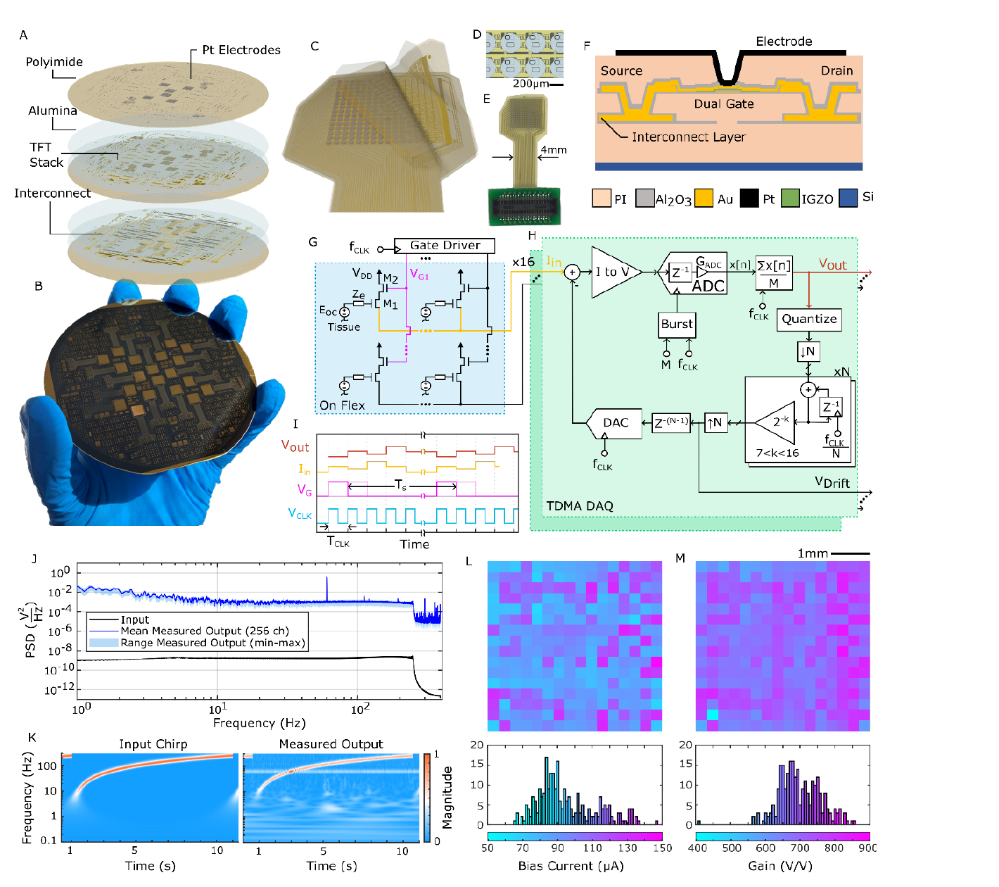
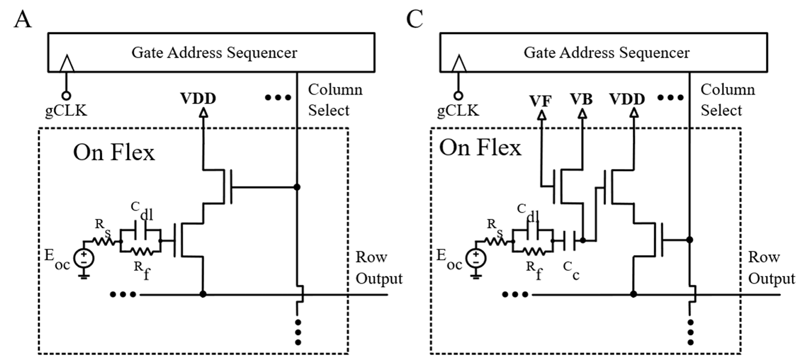
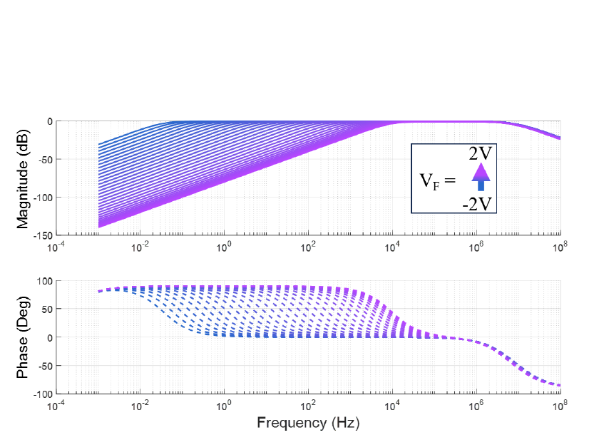
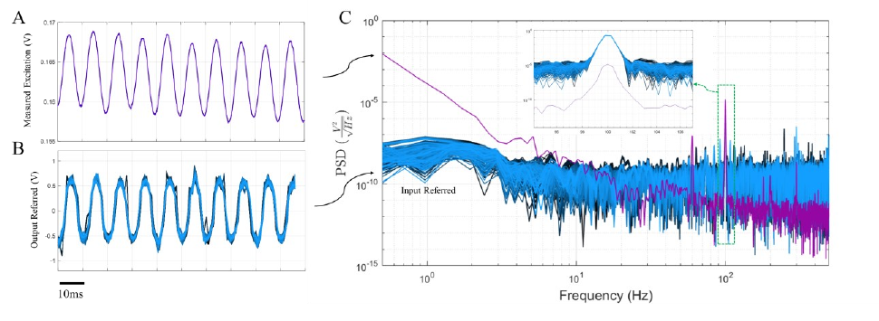
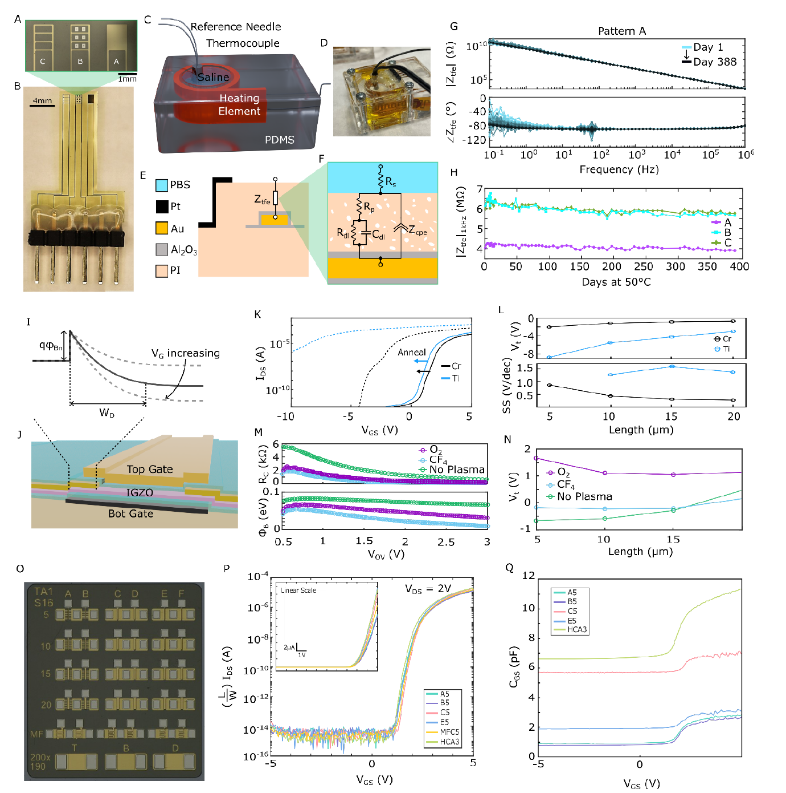
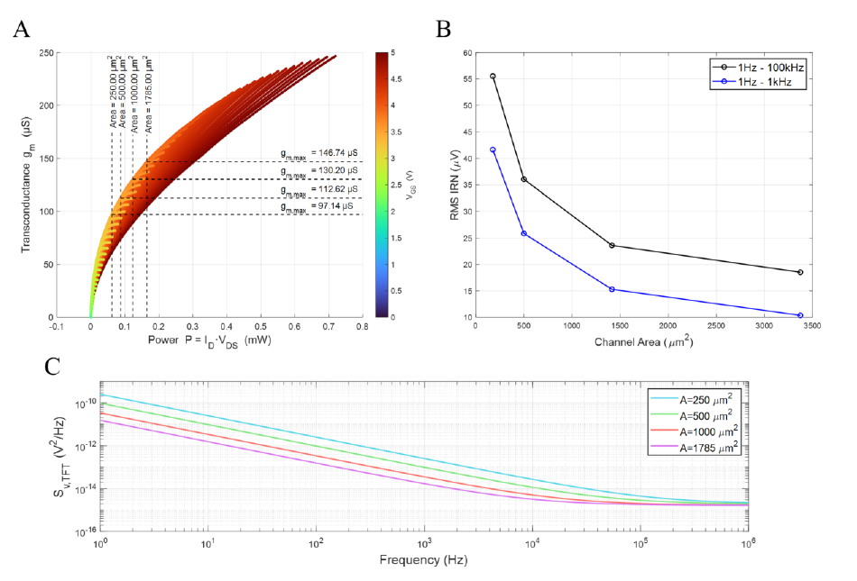
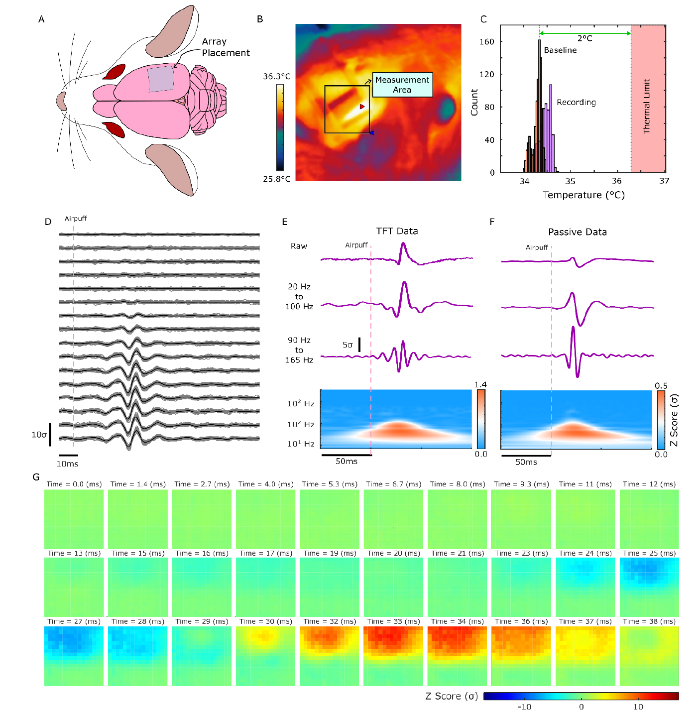
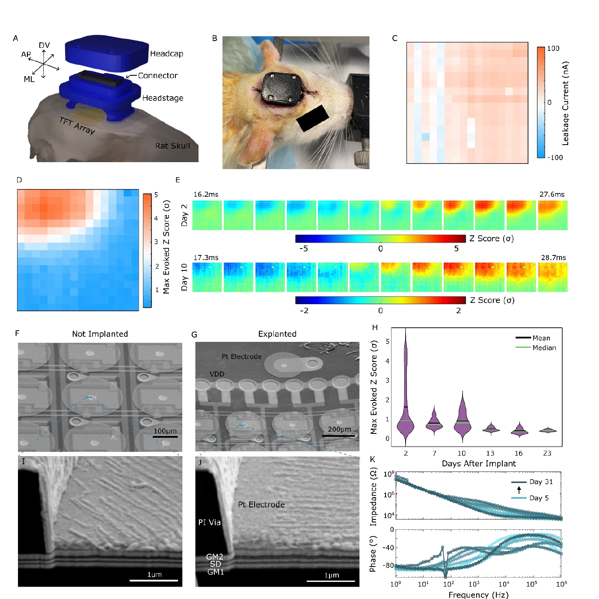
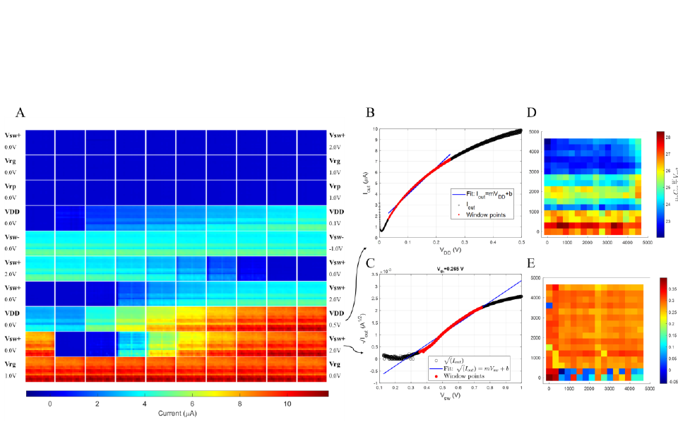
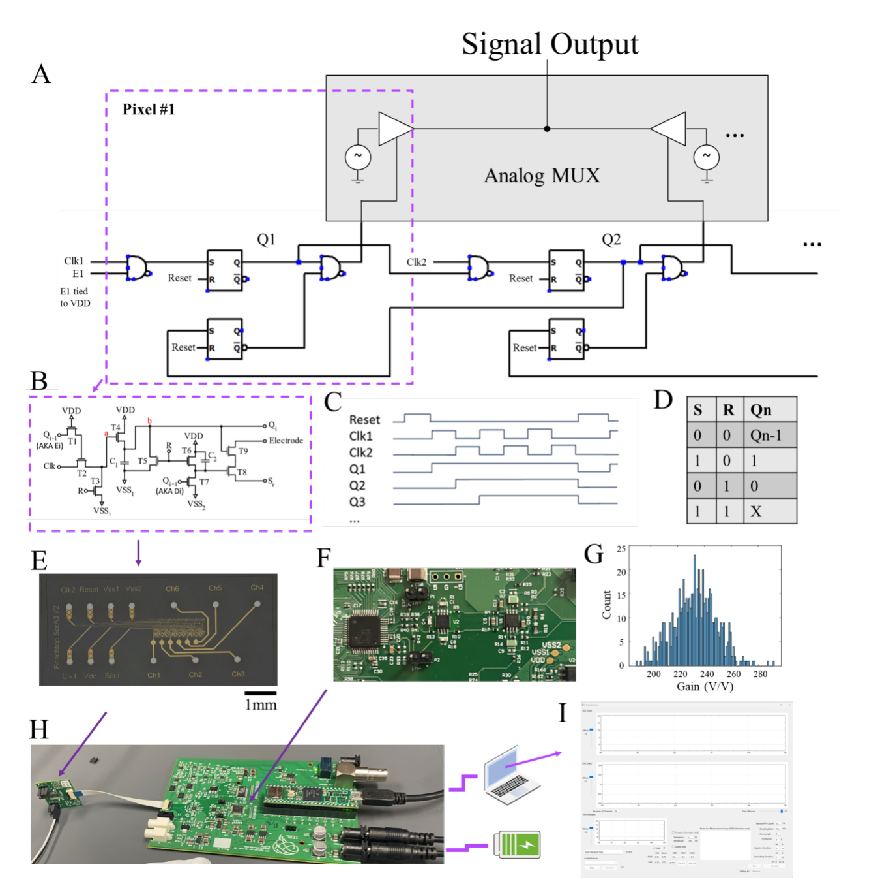

# Bourhis 等：全文中英对译与阅读注

原文：[A Thin Film Transistor Backplane for Scalable Chronic Neural Interfaces](../literature/2026.06.23.733868v1.full.pdf)，bioRxiv 预印本，2026，DOI：[10.64898/2026.06.23.733868](https://doi.org/10.64898/2026.06.23.733868)。

补充材料：<a href="../literature/media-1.pdf">media-1.pdf</a>。

<small>原 PDF 第 1 页</small>

**A Thin Film Transistor Backplane for Scalable Chronic Neural Interfaces**

**用于可扩展慢性神经接口的薄膜晶体管背板**

Andrew M. Bourhis1, Ritwik Vatsyayan1, Karen J. Tonsfeldt1,2, Ian Galton1, Shadi A. Dayeh1,3

¹ Department of Electrical and Computer Engineering, University of California San Diego, La Jolla, CA, 92093 USA

² Department of Obstetrics, Gynecology, and Reproductive Sciences, Center for Reproductive Science and Medicine, University of California San Diego, La Jolla, California 92093, United States

³ Department of Bioengineering, Department of Nanoengineering, Department of Neurological Surgery, and Materials Science and Engineering Program, University of California San Diego, La Jolla, California 92093, United States

Corresponding author: S.A.D, sdayeh@ucsd.edu

**作者与单位**

Andrew M. Bourhis、Ritwik Vatsyayan、Karen J. Tonsfeldt、Ian Galton、Shadi A. Dayeh。¹ 加州大学圣迭戈分校电气与计算机工程系，美国加利福尼亚州拉霍亚 92093；² 该校妇产与生殖科学系、生殖科学与医学中心；³ 该校生物工程系、纳米工程系、神经外科系及材料科学与工程项目。通讯作者 S. A. Dayeh，邮箱 sdayeh@ucsd.edu。

**Abstract**

Scaling neural interfaces to ever-higher channel counts has accelerated rapidly with advances in thin-film fabrication, lithography, and connectorization, enabling passive arrays to reach thousands of channels and chart credible pathways to much larger formats. Integrating active electronics directly at the sensing sites offers a complementary route to higher channel density by reducing the number of interconnects required to access large arrays. Here we introduce a monolithic flexible thin-film integrated circuit platform for active neural sensing, inspired by active-matrix display technology. The system integrates dual-gate amorphous indium gallium zinc oxide transistors on polyimide substrates to implement in-pixel transconductance amplification and row-column time-division multiplexing, improving scability for high-channel-count applications. Co-optimization of device architecture, contact engineering, and a hybrid ceramic-polymer thin-film encapsulation yields stable operation with projected lifetimes exceeding 38 years under accelerated aging. In acute and chronic in vivo rat studies, the platform exhibits negligible thermal burden, robust sensory-evoked recordings, and stable functionality over 30 days despite tissue encapsulation. These results establish display-inspired flexible thin-film electronics as a scalable building block for next-generation neural interfaces.

**摘要**

薄膜制造、光刻和连接器技术的进步使无源神经阵列迅速扩展到数千通道，并为更大规模提供了可信路径。把有源电子器件直接集成在传感点，可以减少访问大阵列所需的互连线数，从而提高通道密度。本文提出受有源矩阵显示技术启发的单片柔性薄膜集成电路平台：在聚酰亚胺基底上集成双栅非晶铟镓锌氧化物晶体管，实现像素内跨导放大和行列时分复用。通过协同优化器件结构、接触工程和陶瓷/聚合物混合薄膜封装，系统获得稳定运行；加速老化模型给出的寿命预测超过 38 年。大鼠急性和慢性体内研究显示，其热负担可忽略，可稳定记录感觉诱发信号，并在组织包裹形成后维持约 30 天功能。结果表明，借鉴显示技术的柔性薄膜电子器件可以成为下一代可扩展神经接口的基本构件。

<small>原 PDF 第 1–2 页</small>

**Introduction**

Over the past century, advances in neurotechnology have produced tools capable of recording neural activity across a wide range of spatial and temporal scales. Yet despite this progress, building systems capable of sampling the full tapestry of neural activity remains a major challenge. Electrocorticography (ECoG) and related surface -based interfaces capture the integrated activity of large neuronal populations across the cortex, offering a unique balance between signal stability, coverage, and invasiveness 1. Progress in this space has consistently required navigating <mark>**trade-offs** among spatial resolution, cortical coverage, and surgical burden from early low-density surface electrodes</mark> to modern microfabricated arrays capable of dense sampling over increasingly large cortical areas 2-6. Recent advances in thin-film fabrication, lithography, and connectorization have enabled passive high-density electrode arrays with an order-of-magnitude higher channel count than the best prior designs, and credible pathways now exist to scale passive systems further than previously thought possible4-7. Such scaling, however, introduces engineering challenges, including increased connector width, interconnect routing density, and multi-layer metallization complexity, as each additional channel requires a dedicated electrical lead. Thin film technologies have enabled continued scaling by reducing interconnect pitch footprint, but this comes at the cost of increased fabrication complexity and mechanical considerations that must be carefully managed for chronic implantation and clinical translation.

**引言**

过去一个世纪的神经技术已能在广泛的空间与时间尺度上记录神经活动，但全面采集神经活动仍是难题。皮层电图ECoG及相关表面接口捕捉大范围皮层神经元群的综合活动，在信号稳定性、皮层覆盖范围与侵入程度之间取得平衡。该领域从早期低密度表面电极发展到如今微加工的高密度大面积阵列，始终需要权衡空间分辨率、皮层覆盖范围和手术侵入程度。近期薄膜制造、光刻和连接器的进展，使无源高密度电极阵列的通道数较此前最佳设计提高一个数量级，并为进一步扩展提供可能；但每增加一个通道通常仍需增加一条独立导线，引出连接器宽度、布线密度和多层金属化等问题。薄膜技术通过减小互连间距继续推动无源阵列扩展，但也增加制造复杂度，并带来慢性植入及临床转化时必须处理的力学问题。

<mark>Active electrode arrays</mark>, which integrate local transistors in the same substrate as the sensing electrodes, provide a complementary strategy for scaling neural interfaces by decreasing the number of external interconnects required to access large arrays. <mark>Silicon-based</mark> implementations of such systems have demonstrated promising electrical performance, including low noise, high power efficiency, and sophisticated on -chip signal processing capabilities, and have played a central role in advancing high -channel-count neural recording technologies 8-13. For chronic applications, however, <mark>the mechanical mismatch between rigid silicon substrates and soft neural tissue</mark> introduces challenges related to long-term reliability and tissue response. Approaches aimed at improving mechanical compliance such as aggressive substrate thinning, narrow probe geometries, or transfer of silicon devices onto flexible carriers 3,14-16 have shown promise but can also introduce additional considerations, including increased fracture susceptibility, overreliance on brittle inorganic encapsulation layers, and added constraints on long-term hermiticity in physiological environments. More fundamentally, the electronic properties of silicon are intrinsically linked to its crystalline bulk structure, which limits the extent to which mechanical compliance can be engineered independently of device performance.

将局部晶体管与传感电极做在同一基底的有源电极阵列，可减少访问大阵列所需的外部导线。硅基有源方案已展示低噪声、高能效和复杂片上信号处理能力，对高通道数神经记录的发展起到重要作用。不过，硬硅与软神经组织之间的力学失配，对慢性应用的长期可靠性和组织反应构成挑战。基底极薄化、窄探针及将硅器件转移到柔性载体等方法改善了顺应性，同时可能增加断裂风险、对脆性无机封装的依赖及生理环境中长期密封性的约束。硅的电子特性又与其晶体体结构紧密相关，使机械顺应性难以独立于器件性能进行设计。

Thin-film transistor (TFT) technologies, which are widely deployed in active-matrix organic light-emitting diode (AMOLED) displays (including most modern smartphones and smartwatches)17,18, offer an alternative electronic platform on which transistor device function is largely decoupled from the mechanical properties of the underlying substrate. TFTs can be fabricated directly on polymeric and other flexible materials using low-temperature processes, enabling substrate-agnostic circuit integration. The downsides are that <mark>the amorphous or polycrystalline nature of thin-film semiconductors result in reduced carrier mobility, elevated noise and off-state current leakage, and long-term electrical instability compared to crystalline silicon19-22</mark>. In addition, <mark>the monolithic integration of complementary TFTs remains an active area of research23</mark>, placing greater demands on the performance and stability of monopolar semiconductor technologies in practical circuit implementations. As a result, many prior active neural interfaces have relied on silicon-based transistors with post-fabrication mechanical adaptations or heterogeneous integration schemes24,25, which can increase process complexity and impose additional challenges for scalable, clinically robust systems.

薄膜晶体管广泛用于 AMOLED 显示屏，包括现代手机和智能手表。其器件功能与下方基底的力学性质在较大程度上分离，可用低温工艺直接在聚合物等柔性材料上制作电路。但与晶体硅相比，非晶或多晶薄膜半导体通常载流子迁移率较低、噪声和关态漏电较高，长期电学稳定性也较弱。互补 TFT 的单片集成仍在研究中，因此实用电路更加依赖单极性半导体的性能与稳定性。已有不少有源神经接口采用后加工的硅器件力学改造或异质集成，也因此增加工艺复杂度与可扩展、临床可靠系统的实现难度。

<small>原 PDF 第 2–3 页</small>

In this work, we present a fully monolithic flexible integrated circuit (FIC) platform for active neural sensing, inspired by active -matrix display architectures. The platform employs <mark>dual-gate amorphous indium gallium zinc oxide (a -IGZO) TFTs</mark> fabricated directly on polyimide substrates and encapsulated using a multilayer atomic -layer-deposited aluminum oxide thin-film barrier. Through systematic co-optimization of contact engineering, device architecture, and encapsulation strategy, we realize a **256 -channel** electrocorticography array implementing row - column addressing with <mark>in-pixel transconductance amplification</mark>. This architecture reduces interconnect scaling from linear proportionality to **square root proportionality** while preserving mechanical compliance and signal fidelity comparable to passive surface arrays. The platform was validated through extensive benchtop characterization, including over one year of accelerated aging tests projecting operational lifetimes exceeding 38 years, followed by acute and chronic in vivo experiments in Sprague-Dawley rats. Acute sensory-evoked recordings demonstrated negligible thermal burden 26-32 and robust signal quality relative to a matched passive array. A 30-day chronic implantation confirmed stable electrical operation, maintained encapsulation integrity33-40, and captured consistent spatiotemporal cortical signal s despite the expected development of fibrotic tissue observed upon explant. This work represents <mark>the first demonstration of a fully monolithic flexible TFT -based active neural interface maintaining functionality over multiple weeks in vivo</mark>, and establishes design principles for translating display-inspired thin-film electronics to scalable implantable neural interfaces.

本文提出借鉴有源矩阵显示架构的单片柔性集成电路（FIC）平台。双栅 a-IGZO TFT 直接在聚酰亚胺上制作，采用多层 ALD 氧化铝薄膜屏障封装。通过接触工程、器件结构和封装的共同优化，我们实现 256 通道 ECoG 阵列，使用像素内跨导放大和行列寻址。所需互连线数随电极数的增长由线性量级降为平方根量级，同时保持柔顺性及与无源表面阵列相当的信号保真度。平台先经台架验证，包括一年以上加速老化并推算超过 38 年的工作寿命，随后进入 Sprague–Dawley 大鼠急性和慢性实验。急性感觉诱发记录显示热负担很小，信号质量可与匹配的无源阵列比较。慢性植入约 30 天后，阵列维持电学运行及封装完整性；虽然取出后可见预期的纤维组织，仍能记录一致的皮层时空信号。这项工作首次展示了在体内连续数周保持功能的完全单片柔性 TFT 有源神经接口，并确立了将显示领域薄膜电子技术用于可扩展植入式神经接口的设计原则。

**Results and Discussion**

**Flexible Thin Film Integrated Circuit Platform for Neural Sensing**

Inspired by active-matrix organic light emitting diode (AMOLED) display technology, we developed a monolithic thin film transistor fabrication process enabling fully integrated flexible neural interfaces on biocompatible polyimide substrates ( Fig. 1). Our platform employs dual-gate amorphous indium gallium zinc oxide (a-IGZO) TFTs, selected for their exceptional electron mobility (~10-20 cm2/Vs), low-temperature processing compatibility (deposited at <=200°C), and substrate-agnostic fabrication. Unlike typical silicon-based approaches, which require post-fabrication transfer or aggressive thinning, the fabrication process (Supplementary Fig. 1) produces inherently flexible circuits without compromising hermetic encapsulation (Supplementary Fig. 2-5) or introducing mechanical failure modes associated with brittle semiconductors. Furthermore, the monolithic fabrication process allows for greater design flexibility compared to heterogeneous integration strategies which may, for example, rely on thick inorganic layers to mitigate seam or void formation around transferred layers. A monolithic fabrication strategy on the other hand can achieve much finer feature size and superior morphological feature control.

**结果与讨论**

**用于神经信号传感的柔性薄膜集成电路平台**

受 AMOLED 技术启发，我们在生物相容的聚酰亚胺基底上开发单片 TFT 制程。所用双栅 a-IGZO TFT 具有约 10–20 cm²/(V·s) 的电子迁移率，可在不高于约 200 °C 的温度沉积，并适用于不同基底。与先制造硅器件再转移或极薄化的路径相比，该工艺直接形成柔性电路；单片方式还可避免异质器件转移接缝附近为防止空隙而引入较厚无机层，并有利于更小特征尺寸和形貌控制。

The fabrication methodology seamlessly integrates TFTs, capacitors, and metal routing with atomic layer deposited (ALD) aluminum oxide thin-film encapsulation layers (Supplementary Fig. 6). Multiple ALD Al2O3 barriers (≥ 30nm each) conformally coat the active electronics, and polyimide layers serve as the primary structural substrate and biotic interface material. This hybrid approach exploits complementary material properties: polyimide provides mechanical compliance, planarization, and bulk insulation, while the ceramic barriers suppress moisture permeation due to their dense structure and low water vapor transmission rate. Inorganic trenches patterned between polyimide layers enhance inter-layer adhesion and create barriers between active regions and array boarders, mitigating delamination risks and improving mechanical robustness. Arrays were fabricated on 4-inch carrier wafers containing multiple test coupons (Supplementary Fig. 7), then mechanically released in an electrostatically controlled environment and bonded to a breakout board with a minimal-footprint top-side mezzanine connectors (Fig. 1A-E). A representative cross section of a TFT with all encapsulated metal traces and the top-side electrode is shown in Fig. 1F.

制程同时集成 TFT、电容、金属布线与 ALD 氧化铝封装。多层至少 30 nm 的 Al₂O₃ 覆盖有源电子器件；聚酰亚胺承担主要结构基底和生物接触界面。聚酰亚胺提供柔顺性、平坦化与体绝缘，致密陶瓷屏障则抑制水汽渗透。聚酰亚胺层间刻出的无机沟槽增强粘附，并隔开有源区域与阵列边界，降低分层风险。阵列在 4 英寸载片晶圆上制作，包含多个测试样片；随后在静电受控环境中机械剥离，以小占地面积的顶面板间连接器连接到转接电路板。图 1F 给出封装金属走线、TFT 和顶部电极的代表性截面。

<small>原 PDF 第 4 页</small>

原文图 1。G–I 是理解 M1/M2 像素、行端 TIA、直流反馈与列时序的主要图。

Figure 1. Summary of proposed active neural interface technology stack based on a-IGZO TFTs. A-B) image of 4-inch wafer with exploded view showing layer stack-up containing organic and inorganic encapsulation layers surrounding interconnect metals, TFTs, and top electrode arrays. C) Rendering of 16x16 array of electrodes with pertinent layers separated for easier viewing. D-E) Photographs of 16x16 array bonded to breakout printed circuit board with zoomed-in optical microscope image of the top-view of a few pixel circuits and their corresponding electrodes. F) Cross section rendering representing the key features of the stack-up, including the interconnect layer, the dual-gate TFT, and the sensing electrode. G-I) schematic and block diagrams shown together with simplified timing diagram to demonstrate the proposed transconductor pixel circuit and TDMA shared data acquisition system (DAQ). <mark>J-K) power spectral density and corresponding scalograms shown for benchtop measurements in saline taken with an input reference chirp signal. </mark> L-M)  <mark>corresponding measured bias current and calculated gain histograms and heatmaps </mark> for all 256 channels of data presented in panels J-K. Measurements demonstrate 100% yield arrays with high process uniformity despite a lack of in-pixel compensation for device characteristics variation.
**图 1 图注**

a-IGZO TFT 有源神经接口技术栈概览。A-B) 4 英寸晶圆照片及分层图，显示有机/无机封装如何包围互连金属、TFT 和顶部电极。C) 16×16 电极阵列分层示意。D-E) 阵列与转接 PCB 连接后的照片及几个像素电路/电极的顶视显微图。F) 互连层、双栅 TFT 和传感电极的截面示意。G-I) 跨导像素、共享时分采集系统及简化时序。J-K) 盐水台架中以扫频信号激励得到的功率谱密度和时频图。L-M) 全部 256 通道的偏置电流与计算增益的直方图、热图。测量显示，在未作像素内器件参数补偿的情况下，阵列成品率为 100%，工艺均匀性较高。

从图中可以看出，偏置电流约为90μA左右，增益约为700（需要这么大的放大倍数吗？）

<small>原 PDF 第 4–5 页</small>

The 256-channel arrays implement an active row-column addressing architecture arranged as a 16x16 matrix of platinum electrodes with on-site “pixel” driving circuits beneath each electrode. This on-site active sensing scheme reduces the interconnect bottleneck from $O(n)$ for passive arrays to $O(\sqrt{n})$ - a critical enabler used in the display field to scale modern mobile displays to millions of pixels . <mark>Each pixel consists of a sensing TFT (M1) operated in saturation as a transconductor, a switching TFT (M2) for column selection (Fig. 1G), and in later iterations of the technology, a **pseudo-resistor and coupling capacitor** for bias stability and DC isolation (Supplementary Fig. 8, 9)</mark>. Column address lines sequentially enabled pixels while parallel row readout lines simultaneously measure current outputs from all 16 rows through <mark>high -gain, low-noise transimpedance amplifiers</mark>, thereby enabling sequential time division multiple access (TDMA) measurements. A critical innovation that provides an additional avenue for future optimization is the integration of digital feedback: <mark>a low-pass digital filter continuously measures and subtracts the DC bias current component at each TIA input from each individual pixel, dramatically increasing dynamic range and enabling per-pixel calibration of operating points</mark>. Optimized custom firmware and software handled data acquisition, packaging, transmitting, and logging of the output and drift data shown in Fig. 1H for all 16 parallel channels. This mixed-signal approach significantly reduces power consumption while maintaining high transconductance (Fig. 1H-I). Combined with burst sampling at elevated sampling rates during each column period to reduce aliasing noise, it achieves ~1ksps per channel with measured per-pixel end-to-end gains exceeding 800 V/V for nominal pixel operating currents of ~90 uA (Fig. 1L-M). It provides a stable mechanism for tracking DC and low -frequency signals associated with TFT operation and drift together with the inherent open -circuit potentials of each electrode (see VDrift in Fig. 1H). This general approach has been pursued in recent works and , when combined with the present mixed-signal architecture , has proven to be a promising avenue for resolving the noise-aliasing problem as well as lowering power scaling with higher channel counts25.

256 通道阵列采用有源行列寻址结构，由 16×16 个铂电极组成矩阵，每个电极下方都设有本地“像素”驱动电路。这种在传感位置进行有源传感的方案，将无源阵列的互连数量从随电极数 $n$ 增长的 $O(n)$ 降至 $O(\sqrt{n})$；这也是显示领域将现代移动显示屏扩展至数百万像素所采用的关键技术。每个像素包括工作在饱和区、充当跨导器件的传感 TFT（M1）和用于列选通的开关 TFT（M2，图 1G）；在该技术的后续版本中，还加入伪电阻和耦合电容，以稳定偏置并隔离直流（补充图 8、9）。列地址线依次使像素导通，而并行的行读出线通过高增益、低噪声跨阻放大器（TIA）同时测量全部 16 行的输出电流，从而实现时分多址（TDMA）测量。集成数字反馈是一项关键创新，也为今后的优化提供了途径：数字低通滤波器持续测量并扣除每个像素在相应 TIA 输入端的直流偏置电流分量，显著扩大动态范围，并实现逐像素工作点校准。经过优化的定制固件和软件负责采集、打包、传输和记录全部 16 个并行通道的输出及漂移数据，如图 1H 所示。这种混合信号方案在保持较高跨导的同时显著降低功耗（图 1H–I）。再结合每个列选通时段内以较高采样率进行的突发采样来降低混叠噪声，系统实现了约 1 kS/s 的每通道采样率；在像素标称工作电流约为 90 µA 时，实测每个像素的端到端增益超过 800 V/V（图 1L–M）。该方案还提供了一种稳定跟踪直流和低频信号的机制：这些信号既与 TFT 的工作状态及漂移有关，也与各电极固有的开路电位有关（见图 1H 中的 $V_{\mathrm{Drift}}$）。这一总体方法已见于近期研究；与本文的混合信号架构结合后，它显示出缓解噪声混叠问题、改善通道数增加时功耗扩展关系的潜力²⁵。

Benchtop characterization in phosphate-buffered saline using broadband chirp excitation confirmed a uniform frequency response from DC to 250Hz with minimal channel-to-channel variation (Fig. 1J-K). Spatial mapping of time-averaged pixel currents revealed a relatively large stochastic spread of bias currents (the range varied based on bias voltages), pointing to the need for future <mark>pixel architectures to address compensation of device process variation (i.e. threshold voltage variation) rather than relying on downstream digital normalization techniques such as Z-scoring</mark>. The system demonstrated accurate signal reconstruction through time -division multiplexing. For example, the power spectral density calculations shown in Fig. 1J-K indicate a measured total input-referred RMS noise of ~60µVrms. These benchtop validations established the electrical functionality and uniformity of the platform prior to in vivo recordings.

在 PBS 中用宽带扫频信号测试，DC–250 Hz 响应在通道间较一致。像素平均电流的空间分布显示偏置电流有较大随机离散，且范围受偏置电压影响；这表明未来的像素架构需要补偿阈值电压等器件工艺差异，而不能只靠后级 z 分数归一化。时分系统可重建输入信号；图 1J–K 的功率谱给出约 60 µV RMS 的总输入参考噪声。这些台架测试先于体内实验，验证了平台的电学功能和均匀性。

- 1 z-scoring是指什么
- 2 输入参考噪声如何计算得出
- 3 电路结构？当前电路结构是否完全参考2025年的文章 二硫化钼
- 4 电路中提到增加伪电阻和耦合电容是什么（阅读补充图8和9）

A-B)  ixel circuit for depletion-mode TFTs and DC-coupled measurement. C-D)  ixel circuit for enhancement-mode TFTs – necessitating pull-down switch architecture and pseudo-resistor with coupling capacitor to set DC bias.  

补充图 8（补充材料第 6 页）A-B) 为耗尽型 TFT 的直流耦合像素，C-D) 为增强型 TFT 的像素，其中下拉开关、伪电阻和耦合电容用于设置直流偏置。补充图 9（第 7 页）给出不同伪电阻偏置下的模拟幅频与相频响应，显示每个像素的高通响应可调。

补充图 26（补充材料第 19 页）A) 为无源铂电极对 5 mV、100 Hz 注入信号的测量；B) 为伪电阻像素结构 256 通道的响应；C) 为按 100 Hz 信号功率与无源电极测量对齐后的输入参考功率谱，插图显示对齐前的谱。

<small>原 PDF 第 5–6 页</small>

**Thin Film Encapsulation and TFT Optimizations for Long-term Active Implants**

Hermetic encapsulation represents one of the most significant challenges for flexible active implants, as conventional thin-film polymers exhibit water vapor transmission rates (WVTR) orders of magnitude higher than their bulk-material counterparts. We developed a thin film encapsulation strategy employing polymer substrates and encapsulation layers together with conformal atomic layer deposited high-quality ceramic inter-layers which encapsulate sensitive electronic devices within the FIC. To validate long-term reliability of our hybrid ALD Al2O3/polyimide encapsulation strategy, we conducted accelerated aging studies at 50°C in phosphate-buffered saline solution with continuous +5V DC bias stress applied between the metal patterns and the surrounding saline over a 388-day period (Fig. 2 A-H). Three encapsulated metal test patterns (Fig. 2A) were monitored via electrochemical impedance spectroscopy throughout the accelerated aging study (Fig. 2G). As shown in Fig. 2H, the impedance magnitude of the insulation at 1kHz declined gradually over the year-long study. Based on fitting a linear degradation model to this data and extrapolating to a failure threshold of one order of magnitude below the initial 1kHz impedance magnitude, we project a lifetime of ~15.4 years at the 50°C and +5V stress conditions. Applying an Arrhenius acceleration factor of ~2.5x yields an estimated operational lifetime exceeding ~38.5 years - far surpassing the requirements for clinical semi-chronic neural interfaces and demonstrating a clear translational pathway for the proposed thin film encapsulation methodology.

**薄膜封装与 TFT 优化**

柔性有源植入的一大难点是密封：常规薄膜聚合物的水汽透过率比块材高多个数量级。我们采用聚合物基底/封装层与高质量 ALD 陶瓷中间层构成屏障，并在 50 °C PBS 中对金属图形与周围盐水之间施加连续 +5 V 直流应力，进行 388 天加速老化实验。三种封装金属测试图形在整个加速老化期间接受电化学阻抗谱监测。1 kHz 绝缘阻抗幅值在一年中逐渐降低。以线性退化模型拟合，并把失效阈值定义为初始 1 kHz 阻抗下降一个数量级，推得在 50 °C、+5 V 应力条件下的寿命约 15.4 年；再乘约 2.5 的 Arrhenius 加速系数，得到超过约 38.5 年的预计工作寿命——这远远超过临床半慢性神经接口的要求，并展现出所提出的薄膜封装方法清晰的转化路径。

<small>原 PDF 第 7–8 页</small>

原文图 2。G–H 为 388 天绝缘阻抗测量，K–N 对比 Cr/Ti 接点及等离子处理，P–Q 展示器件结构与电容。

Figure 2. Overview of FIC technology developments. A-B) photograph and optical microscope image inset for encapsulation test samples used in accelerated aging benchtop study. C-D) rendering and corresponding photograph of a PDMS-based accelerated aging soak chamber consisting of a heated saline well wherein the sample shown in panel B was immersed for over one year at 50°C. E-F) Corresponding cross-sectional rendering showing the expected insulation impedance of the imbedded metal leads, together with dummy electrode contacts which were used to assess morphological impacts of thin film encapsulation failure. G-H) Electrochemical impedance spectra and corresponding 1khz impedance magnitude plotted over the duration of the 388-day study. This study was conducted with a 5V DC bias applied across the insulation shown in panels E-F to simulate worst-case scenario of constant operation. I-J) TFT source/drain contact location and corresponding energy diagram as a function of gate bias. K) Transfer curves measured for samples with Cr and Ti contacts before and after annealing. L) Corresponding device characteristics as function of channel length after annealing steps. M-N) Details on gate bias dependent contact resistance and barrier height highlighted for three plasma treatment conditions along with corresponding threshold voltages. O) Microscope image of test coupons used for reported measurements. P-Q) Transfer curves and capacitance-voltage curves for a set of different TFT architectures with details reported in Supplementary Fig. 14-16. Legend in panel P shows code corresponding to test coupons like that shown in panel O, where the letter corresponds to the column code and the number corresponds to the channel length.

**图 2 图注**

FIC 技术开发概览。A-B) 用于加速老化的样片照片和显微图。C-D) PDMS 浸泡腔示意和实物，样片在 50 °C 加热盐水中浸泡逾一年。E-F) 嵌入金属线的绝缘截面与预期阻抗，以及用于观察封装失效形貌的虚设电极接点。G-H) 388 天的电化学阻抗谱及 1 kHz 阻抗。该实验在绝缘层两端施加 5 V DC，以模拟持续工作的最不利情况。I-J) TFT 源漏接点位置及随栅偏置变化的能带示意。K) Cr 和 Ti 接点在退火前后的转移曲线。L) 不同沟道长度器件的对应特性。M-N) 三种等离子处理条件下，接触电阻、势垒高度的栅偏压依赖以及阈值电压。O) 测试样片显微图。P-Q) 不同 TFT 结构的转移曲线与电容–电压曲线；器件编号及结构细节见原文和其所引用的补充图。P 图图例中的字母对应图 2O 测试样片的列编号，数字对应沟道长度。

注：可以进行类似的加速老化实验

Scanning electron microscopy of the age-accelerated samples revealed surface contamination from the phosphate buffer and degraded thermocouple (Supplementary Fig. 4), but no visible delamination, cracking, pinhole defect propagation, or metal corrosion of the encapsulated traces was observed. The ALD alumina layers remained intact with no morphological changes evident, and the platinum dummy contacts from Pattern B (shown in Fig. 2A) appeared in good condition, with only occasional slight peeling at the edges of the contacts which was likely a result of surface scratching caused by intermittent handling during the study . The demonstrated longevity establishes that thin -film encapsulation, when properly engineered with high-quality conformal multi-layer ceramic/polymer stacks, can provide hermeticity at a level of robustness appropriate for implantable electronics applications while maintaining the mechanical compliance essential for highly scalable neural interfaces.

加速老化样片的扫描电镜检查显示来自磷酸盐缓冲液及退化热电偶的表面污染，但未见封装走线分层、开裂、针孔扩展或金属腐蚀。ALD 氧化铝层形貌保持完整；图形 B 的 Pt 虚设接点总体状态良好，偶见轻微边缘剥离，可能来自实验期间搬运造成的表面擦伤。这些结果说明，经精心设计的共形多层陶瓷/聚合物封装可为植入电子器件提供较强密封性，同时保留柔性接口所需的机械顺应性。

Notably, achieving this robust encapsulation necessitated process temperatures up to ~200°C during the final alumina passivation and polyimide curing steps (included thin film encapsulation material and processing characteristics are summarized in Supplementary Table 1). This thermal budget initially caused significant instabilities in the TFT characteristics, motivating comprehensive device-level optimizations. We discovered that titanium source/drain contacts, while often used in industry because it provides a suitable work function alignment to IGZO, acted as oxygen and hydrogen getters during thermal processing, notably extracting oxygen from the IGZO channel and creating threshold voltage shifts by increasing oxygen vacancy density (Supplementary Fig. 10, 11). The estimated Gibbs free energy of formation (Supplementary Table 2) for TiO2 (-445 kJ/mol O) compared to that of IGZO (-306 kJ/mol O) thermodynamically favored this oxygen redistribution, resulting in unacceptable threshold voltage shifts during thermal processing. Substituting chromium contacts, which are expected to exhibit lower oxygen diffusivity and a smaller energetic driving force for oxidation (-351 kJ/mol O) dramatically improved transfer curve stability when compared against on the same wafer undergoing identical processing (Fig. 2 K). The chromium contacts also exhibited substantially reduced channel-length dependence on threshold voltage shift compared to titanium (Fig. 2L), which we attribute to a lower lateral diffusion of oxygen vacancies into the channel from the contacts during thermal annealing steps .

坚固封装的最后氧化铝钝化和聚酰亚胺固化步骤需要约 200 °C 的温度。最初，这一热预算显著改变 TFT 特性，因此对器件进行了全面优化。Ti 源漏接点虽常用于与 IGZO 功函数匹配，但在热处理中会吸收氧和氢，尤其会从 IGZO 沟道抽取氧，增加氧空位并移动阈值电压。TiO₂ 的估算形成自由能约 −445 kJ/mol O，而 IGZO 对应值约 −306 kJ/mol O，因此氧重新分配在热力学上有利。改用氧扩散较弱、氧化驱动力较小的 Cr（约 −351 kJ/mol O）后，同晶圆、同工艺比较的转移曲线稳定性大幅提高；阈值移动对沟道长度的依赖也减弱。我们将其归因于退火时接触区氧空位向沟道的横向扩散减少。

<small>原 PDF 第 8–9 页</small>

We also tested various plasma treatments to the IGZO contacts prior to source and drain metal deposition (Fig. 2M-N & Supplementary Fig. 12-14) and found that the <mark>fluorine plasma treatment chemistry resulted in the best stability, lowest gate-bias dependent contact resistance and estimated contact barrier height, and threshold voltages closest to zero.</mark> We attribute these desirable traits to the fluorine atoms substituting for oxygen vacancies and forming more stable bonds compared to mobile ions such as hydrogen while still providing a free electron donor to the IGZO film. Beyond fundamental device fabrication optimizations, we also explored several layouts and device architectures to balance current drive, parasitic capacitance, and routing density, some of which are shown in Fig. 2O (additional details in Supplementary Fig. 15-18). The multi-tap contacts used in Columns A and B of the test coupons shown in Fig. 2O aimed to reduce overlap area by 50% while maintaining mostly uniform fields due to contact current crowding and resulting in >70% of the effective channel width, demonstrating a pseudo-self-aligned TFT architecture without prohibitively high source and drain resistances. The benefit of this approach can be seen in Fig. 2Q, where devices A5 and B5 show substantially lower capacitance, attributed to the lower overlap capacitance. Honeycomb and multi-finger layouts (denoted HCA3 and MFC5 respectively in Fig. 2P,Q) achieved the highest packing density with subthreshold slopes as low as ~110 mV/dec. Supplementary Fig. 18 shows device architecture breakdown characteristics well-exceeding the targeted maximum bias voltages of ±5V employed in our circuits. These device-level safety margins, together with current-limiting resistors and a ground current detection and auto-shut-off mechanism provide robust operation against the electrical hazards present in chronic implant scenarios. The successful co -optimization of insulation longevity and device stability represents a critical milestone for translating flexible TFT technology to implantable neural interfaces, where the slightest system failure is intolerable.

在源漏金属沉积前，我们还测试了不同的 IGZO 接触区等离子处理。氟等离子条件表现出最佳稳定性、较低的栅偏置相关接触电阻与估计势垒高度，并使阈值更接近零。我们将这些特性归因于，氟取代氧空位并形成比氢等可移动离子更稳定的键，同时仍可向 IGZO 提供自由电子。在器件布局方面，我们比较了驱动电流、寄生电容与布线密度。测试样片 A/B 列使用多触点接点，目标是在保持较均匀电场及超过 70% 有效沟道宽度的同时，使重叠面积减半。多触点结构没有带来过高的源漏电阻；图 2Q 中 A5/B5 的电容显著下降，主要来自重叠电容降低。蜂窝和多指结构达到最高布局密度，亚阈值摆幅最低约 110 mV/dec。补充图 18 的击穿特性高于电路目标最大偏置 ±5 V；再加限流电阻、接地电流检测与自动关断机制，构成慢性植入时的电气安全裕量。绝缘寿命与器件稳定性共同优化，是柔性 TFT 进入植入式神经接口的重要前提。

Finally, building off previous modeling efforts in our lab 25, we developed a simulation platform which assisted us in determining key biasing and circuit design parameters. Supplementary Fig. 19-23 (along with Supplementary Table 3) showcase this platform along with key calculations that help us to assess the impact of thin film stack-ups, device sizing and biasing, the duty cycling introduced from our TDMA approach , and expected electrode and device noise. These simulations, together with benchtop characterization (additional details shared in Supplementary Fig. 24-27) helped us assess the viability of the approach outlined in Fig. 1 and 2 prior to translating our efforts to acute experiments.

基于先前的建模工作，我们建立仿真平台，用于确定偏置与电路参数。所引用的补充图 19–23、补充表 3 分析薄膜叠层、器件尺寸、偏置、TDMA 占空比及预期电极/器件噪声；再结合台架表征，判断图 1–2 所示方案能否进入急性动物实验。

补充图 23（补充材料第 17 页）A) 给出不同沟道面积器件的跨导与功耗、偏置关系；B) 比较 1 Hz–1 kHz 和 1 Hz–100 kHz 两个频段的栅极输入参考积分噪声；C) 给出相应的输入参考噪声谱密度。这些曲线用于器件尺寸与偏置选择。

**Acute In Vivo Recording**

We validated the active arrays through acute cortical recordings in anesthetized Sprague - Dawley rats during <mark>sensory-evoked whisker stimulation experiments</mark> (Supplementary Fig. 28). In each case, the array was positioned epidurally over the S1 whisker barrel cortex (Fig. 3A), and contralateral whisker deflections were delivered via air puff s while the array recorded broadband neural activity at ~1ksps. A critical safety consideration for active implants is thermal burden to tissue. We employed infrared thermography to measure cortical surface temperatures before, during, and after the arrays were set to their maximum pixel current and gain settings (~140 µS TFT transconductance, or **~750 V/V system gain**). The resulting maximum temperature measurement over the cortical surface was captured for several minutes and subsequently segmented into “Baseline” and “Recording” windows (Fig. 3B-C). The data show negligible thermal rise correlated with the operation of the array, clearly below the 2°C limit for chronic implants. The electrode pixel area (300µm x 300µm) in our array design was 180 times larger than the sensing TFT channel area (100µm x 5µm). The sparsity of heat-generating elements together with the 1:16 time division multiplexing of pixel columns (6.25% duty cycle), limited the resulting average power density at each pixel site, allowing for heat to dissipate over a larger area, thus lowering the tissue thermal rise. Our electrothermal simulation results also indicate that the lateral heat spreading through the alumina encapsulation layers likely helped maintain thermal loads well within safety margins.

**急性体内记录**

在麻醉 Sprague–Dawley 大鼠中，以胡须感觉刺激验证有源阵列。阵列置于 S1 胡须桶状皮层上方硬膜外位置，对侧胡须由气流偏转，阵列以约 1 kS/s 记录宽带神经活动。我们用红外热成像比较像素电流及增益设为最大时，记录前、中、后的皮层表面温度；该设置下 TFT 跨导约 140 µS、系统增益约 750 V/V。结果显示与阵列工作相关的温升可忽略，明显低于慢性植入器件常用的 2 °C 限值。每个电极面积 300 × 300 µm²，约为 100 × 5 µm² 传感 TFT 沟道面积的 180 倍；发热元件分散，加上 1:16 列时分复用带来的 6.25% 占空比，降低每点平均功率密度。电热仿真还提示，氧化铝层中的横向导热有助于控制温升。

又是一个用拨胡须作为范式的，但是我们的尝试就是不太成功

<small>原 PDF 第 10 页</small>

原文图 3。B–C 是热成像与温度直方图；E–F 对比 TFT 和无源阵列的单通道波形；G 给出 16×16 阵列诱发响应的空间传播。

Figure 3. Acute recording of sensory-evoked responses from whisker stimulation. A) Diagram of array placement on rat sensory barrel field. B) infrared surface thermography showing measurement area corresponding to panel A location. C) Corresponding histogram of maximum surface temperature for baseline versus recording during a measurement with maximum bias current settings to determine worst-case thermal burden on cortical tissue. D) Waterfall plot from the middle column in the array showing the z-scored band-pass filtered trials in gray with trial-averages shown in black. E-F) Comparison of an electrode recording with raw and filtered data for the TFT-based active sensing array and an identical passive array. Similar digital filter designs were used to process both datasets to provide a fair comparison, and z-scores were calculated after filtering so as to provide bandwidth-dependent z-scoring details. Corresponding scalograms of the “raw” data are shown below the time-domain traces. G) tile plot heatmaps of the TFT array’s band-pass filtered trial average evoked responses.

**图 3 图注**

胡须刺激急性记录。A) 阵列位于大鼠感觉桶状皮层的示意。B) 红外表面热成像及测量区域。C) 最大偏置电流设置下，基线与记录窗口的表面最高温度直方图，用于评估最不利热负担。D) 阵列中列的瀑布图，灰线为各次带通滤波、z 标准化后的试次，黑线为试次平均。E-F) TFT 有源阵列与几何相同的无源阵列单电极原始/滤波数据对比；两组数据采用相似数字滤波，并在滤波后计算 z 分数；下方是原始数据的时频图。G) TFT 阵列带通滤波后试次平均诱发反应的二维热图。

从图中E/F其实能够看出来无源电极和有源电极的峰形状存在差异；边上的一些小的波形可能与滤波器有关。

看起来有源电极的峰值是低于无源电极的，没有比较频域的情况

为什么z-scoring能够作为一个判断标准呢？

<small>原 PDF 第 11 页</small>

After establishing safe thermal loads under maximum gain and operating power conditions, we captured sensory evoked potentials from another array and compared the results to a comparable passive array with equivalent planar platinum electrode size and pitch. The trial averaged evoked responses are shown in Fig. 3D-G. A waterfall plot of band-pass filtered trials and their resulting trial averages are shown in gray and black traces respectively for the middle of the array in Fig. 3D. The corresponding trial averaged z-scored waveforms for a single responsive channel from both the FIC-based array and the passive comparison array (which connected to an Intan Technologies recording system) is plotted in Fig. 3E-F. Both datasets were captured from the same animal with identical electrode contact geometries and similar cortical coverage. The TFT array waveforms (Fig. 3E) are inverted and have slightly different shapes relative to the corresponding passive array waveforms ( Fig. 3F). We attribute these differences mostly to the inverting nature of the transimpedance amplifier and the system transfer function for the active neural interface system. While th e differences could be compensated via postprocessing that utilize estimations of each per-pixel system transfer function, we decided that without more rigorous system calibration in place to determine the precise deconvolution across frequencies , a z-scoring methodology would provide a fairer method of comparison.

确认最大增益和功率条件下的热负担安全后，我们用另一块有源阵列记录感觉诱发电位，与电极尺寸和间距相同的无源阵列比较。图 3D–G 给出试次平均响应；中列的瀑布图以灰线显示各次带通滤波试验，以黑线显示均值。两套阵列在同一只动物上采集，接触几何和皮层覆盖相似；无源阵列连接 Intan 系统。有源阵列波形相对无源阵列呈反相，形状也略有差异，我们主要将其归因于 TIA 的反相特性以及有源系统整体传递函数。若逐像素、逐频率准确标定，可作后处理反卷积；在缺少充分系统校准时，我们选择用 z 分数作比较。

In the frequency domain, it becomes apparent that the captured evoked cortical potentials for both electrode arrays share a similar bandwidth up to ~200Hz, with the majority of the gamma and higher-frequency signal content beginning roughly 20ms after stimulus and ending roughly 40ms after stimulus. Notably, the passive system appeared to have worse z-scoring at lower frequency which we attribute to both the difference in signal conditioning mechanisms and the difference in routing and loading (noting that the high input impedance of the sensing TFT gate minimizes signal attenuation and provides on -site buffering). The passive system also appeared to have improved signal to noise ratios (as evident by increased z-scores in Fig. 3F) within the high-gamma band. This is likely a result of noise-folding from aliasing due to the on-site multiplexing together with the lower sampling rates employed in our custom acquisition system as compared to the passive recording system which used the Intan Recording Controller , sampling at 20ksps. Despite these limitations, we see robust sensory responses for our active neural sensing arrays with z-score peak responses exceeding 8σ in maximally responsive channels and occurring within the expected 20-30ms post-stimulus delay time. The spatiotemporal response propagation presented in the tile plot in Fig. 3G also validates the functionality of our active sensing scheme. We see clear spatiotemporal propagation of the whisker barrel field response to stimulation , with negligible observed spatial artifacts. These results establish that the TFT-based platform can capture high-fidelity neural signals with spatiotemporal resolution comparable to state-of-the-art passive arrays while offering a viable pathway to dramatically increased channel counts through the reduced interconnect requirements.

在频域，两套阵列记录的诱发皮层电位都覆盖到约 200 Hz；多数伽马及更高频成分从刺激后约 20 ms 开始，到约 40 ms 结束。无源系统低频 z 分数较差，我们将其归因于信号处理、布线和负载差异，同时指出传感 TFT 栅极的高输入阻抗可减小信号衰减并提供现场缓冲。无源系统在高伽马频段的 z 分数较高；这很可能与有源阵列本地复用的噪声折叠及较低采样率有关，无源 Intan 系统以 20 kS/s 采样。有源阵列最强响应通道的峰值超过 8σ，发生在预期的刺激后 20–30 ms。图 3G 的二维热图显示清晰的诱发响应时空传播，未观察到明显空间伪迹。

<small>原 PDF 第 11–12 页</small>

**Chronic Recording in Sprague-Dawley Rats**

To assess translational viability, we conducted a month-long chronic implant study in Sprague-Dawley rats with the active array positioned epidurally over the S1 barrel cortex. The chronic implant housing shown in Fig. 4A was designed to house the array. The implant consisted of the same 256-channel design used in the acute study pre -assembled into the housing and implanted using a combination of medical-grade Metabond bone cement, Kwik-Cast silicone sealant, and Gelfoam (Supplementary Fig. 29-30). A critical design feature enabling chronic implant success was the implementation of pseudo-resistor-based bias stabilization and ESD protection. Between recording sessions, all array terminals were electrically shorted via a removable connector shunt, preventing static charge accumulation across the gate dielectrics - a failure mode we identified during earlier pilot studies when low-humidity vivarium conditions generated substantial electrostatic fields within the insulating cages .

**Sprague–Dawley 大鼠慢性记录**

为评估转化潜力，我们把同款 256 通道阵列置于 S1 桶状皮层上方，开展约一个月的硬膜外植入。图 4A 的植入外壳容纳预装配的阵列，并采用医用 Metabond 骨水泥、Kwik-Cast 硅胶等材料固定、封闭。封闭材料还包括 Gelfoam。慢性实验的关键设计是伪电阻栅极偏置稳定及静电放电保护。两次记录之间，用可拆卸连接器短接片把阵列所有端子电气短接，以防栅介质两端积累静电。此前的预实验发现，动物房低湿度和绝缘笼环境可能产生显著静电场，并造成失效。

Electrochemical impedance spectroscopy of a passive reference electrode (SEM image seen in Fig. 4G) on the array are reported in Fig. 4K and Supplementary Fig. 31 to show a gradual impedance increase over the month -long study (from ~30 kΩ to ~60 kΩ at 1kHz), consistent with expected fibrotic encapsulation of the epidural implant. Critically, the insulation impedance of a dedicated encapsulated test pattern (a similar pattern to those shown in Fig. 2A-B) remained capacitive, as predicted by our accelerated aging studies. Furthermore, the pixel performance was assessed through calculated kernel densities of transconductance efficiency across all recordings of the chronic study (Supplementary Fig. 32, 33), indicating similar sensing TFT operating regimes were achievable throughout the experiment. We attribute this in part to the stability of our TFTs owing to the optimizations in fabrication processing conditions discussed above, along with our thin film encapsulation strategy which incorporated high-density ALD-deposited alumina that appeared to effectively protect the oxide TFTs from environmental aggressors.

阵列上的一个无源参考电极在一个月内的 1 kHz 阻抗由约 30 kΩ 逐渐升至约 60 kΩ，与硬膜外植入后的纤维包裹相符。专门封装的测试图形绝缘阻抗仍呈电容性，与加速老化预期一致。我们还用各次记录的跨导效率分布评估像素性能，发现传感 TFT 在研究期间可保持类似的工作区域。我们将其部分归功于上文制程优化带来的 TFT 稳定性，以及高致密 ALD 氧化铝封装对氧化物 TFT 的保护。

<small>原 PDF 第 13 页</small>

原文图 4。C 为逐像素漏电流图，D–E 为诱发响应空间图，H 为跨天 z 分数分布，K 为无源参考电极阻抗变化。

Figure 4. Overview of chronic implant study showcasing long-term viability of our active neural interface. A) 3D rendering of the chronic implant. B) image of the rat post-implantation showing the headstage and headcap . C) Exemplary leakage current measurement taken prior to each recording, plotted spatially for all pixels . D) maximum evoked z-score within response window for trial-averaged high-gamma activity on day 2 of study. E) Days 2 and 10 tile plots for evoked responses showing clear evoked responses corresponding to whisker barrel activity. F-G) Scanning electron microscopy of post-mortem explanted array compared against a non-implanted array (fabricated on same sample wafer but not implanted) with corresponding cross-sectional FIB imaging demonstrating identical layer stack-up of electrode via sidewall profile and underlying TFT stack. H) Violin plots across implant days showing max evoked z-scores across all sensory-evoked recordings. K) Electrochemical impedance spectra of passive electrode (shown in panel G) throughout duration of implant showing increasing 1khz impedance magnitude resulting from the development of encapsulation tissue between the cortical surface and the electrode array.

**图 4 图注**

慢性植入研究概览。A) 植入外壳三维示意。B) 术后大鼠的头端和头帽。C) 每次记录前测得并绘制为空间图的各像素漏电流。D) 研究第 2 天、试次平均高伽马响应窗口内的最高 z 分数。E) 第 2 天和第 10 天的二维诱发响应图。F-G) 取出后的阵列与同晶圆未植入阵列的扫描电镜比较，及 FIB 截面：电极通孔侧壁与下方 TFT 叠层形貌相似。H) 各植入日诱发记录的最大 z 分数小提琴图。K) 图 G 所示无源电极在植入期间的电化学阻抗谱；1 kHz 阻抗增加归因于皮层与电极之间包裹组织的形成。

<small>原 PDF 第 13–14 页</small>

Array calibration measurements conducted during each recording session demonstrated stable TFT operation, as can be seen in Fig. 4C, where per-pixel leakage current and other relevant characteristics were assessed prior to each recording through a bias sweeping procedure discussed in Supplementary Fig. 25. Sensory evoked recordings performed on days 2, 7, 10, 13, 16, and 23 consistently captured whisker deflection responses with clear spatiotemporal structure (Fig. 4 D-E), though the final recording on day 31 was unsuccessful due to a partially damaged headstage. Trial-averaged high-gamma signals revealed peak z-scores around 5σ in the first recording on Day 2 with some variation and gradual decline across the study duration attributed to the variable nature of evoked sensory responses under anesthesia together with the observed development of fibrotic encapsulating tissue. Nevertheless, the spatiotemporal wave dynamics of evoked responses remained consistent across recording days, with weighted centroids clustering within a ~400 μm region of the array (Supplementary Fig. 34), with subtle differences in propagation direction and spatial spreading which is believed to be related to variation in whisker stimulation, anesthesia, and encapsulation tissue development between the implant and the cortex. These results demonstrate that the addressing architecture maintained channel independence and spatial fidelity throughout the implant duration, regardless of a weakening signal source due to the natural angiogenesis associated with wound healing.

每次记录前都进行阵列校准，包括偏置扫描，并检查逐像素漏电流和相关特性。第 2、7、10、13、16、23 天的胡须诱发记录均有清晰时空结构；第 31 天因头端部分损坏，未能成功记录。第 2 天试次平均高伽马峰值约 5σ，此后有所波动和缓慢降低。这种变化可归因于麻醉下感觉反应的自然变异和逐渐形成的纤维包裹。尽管信号减弱，诱发波的时空动力学跨天保持一致；加权中心集中在阵列约 400 µm 的区域内。传播方向和空间扩散的细微差异，可能与胡须刺激、麻醉和皮层与阵列之间的包裹组织变化相关。这些结果表明，即便创伤愈合相关的自然血管新生使信号源减弱，整个植入期行列寻址仍保持了通道独立性和空间保真度。

补充图 25（补充材料第 19 页）A) 展示阵列偏置扫描及电流图，完整校准序列用时 10 s；B-C) 给出用于提取像素参数的代表性拟合；D-E) 为对应参数的空间图。

Post-explant analysis revealed 1-2 mm thick fibrous encapsulation surrounding the cranial window and underlying the array - an expected foreign body response for epidural implants. Despite this tissue growth, the flexible array remained mechanically intact with no visible delamination, cracking, or material degradation. Scanning electron microscopy of the explanted array after thorough cleaning showed surface morphology and cross-sectional layer thicknesses identical to a pre-implant reference sample, with no evidence of Al2O3 dissolution, polyimide swelling or degradation, or platinum electrode corrosion or delamination (Fig. 4 F-G). This structural preservation after 30 days of in vivo exposure, combined with the maintained electrical functionality, strongly suggests that the encapsulation strategy is viable for long-term implantation.

取出后可见颅窗周围及阵列下方约 1–2 mm 厚纤维组织，属于硬膜外植入的异物反应。柔性阵列仍机械完整，未见明显分层、开裂或材料退化；清洁后的扫描电镜显示表面及截面层厚与植入前参照片相同，也未见 Al₂O₃ 溶解、聚酰亚胺肿胀/退化或 Pt 电极腐蚀/剥离。30 天体内暴露后的结构保存与持续电学功能表明封装方案具备更长期植入的潜力。

The chronic study represents the first published demonstration of a fully integrated flexible TFT-based active neural interface maintaining functionality over multiple weeks in vivo. While the one-month duration is modest compared to multi-year clinical requirements, the combination of projected encapsulation lifetime (>38 years), stable device characteristics, and successful signal capture establishes a foundation for translational development. Key challenges for future work include reducing foreign body response through subdural placement, improving per-pixel gain uniformity through compensation circuitry, and extending the channel count through the combined use of custom driver integrated circuitry and TFT-based shift-register gate addressing. Towards these goals, we also developed and validated TFT-based dynamic shift-register architectures shown in Supplementary Fig. 35 - 39 which paves the way for future flexibility scalability improvements. In modern-day AMOLED displays, gate-on-array (GOA) approaches have unlocked unprecedented scalability in pixel densities and narrow display panel boarders. The NMOS-only dynamic shift-register architecture provides a feasible pathway for implementing next-generation flexible active neural interface circuits which can scale towards pixel densities comparable to modern -day mobile displays (e.g. millions of pixels).

这项慢性研究首次报道了全单片柔性 TFT 有源神经接口在体内连续数周保持功能。虽然一个月仍短于多年临床需求，但超过 38 年的封装寿命预测、稳定的器件特性和成功的信号采集为转化研究奠定了基础；下一步包括通过硬膜下放置减轻异物反应、以像素补偿电路改善增益均匀性，以及结合定制驱动 IC 和 TFT 移位寄存器扩展通道数。补充图 35–39 展示了我们开发并验证的 TFT 动态移位寄存器。AMOLED 中的 gate-on-array 技术已经支持高像素密度及窄边框；仅用 NMOS 的动态移位寄存器也可推动柔性神经接口向更高像素密度扩展。

补充图 35（补充材料第 26 页）A) 为动态逻辑列寻址概念；B) 为 TFT 锁存单元；C) 为逐级传播时序；E) 为制成的六通道移位寄存器阵列；F) 为采集板；G) 为其模拟前端增益直方图，设计中频增益约 230 V/V；H-I) 为台架系统和连接。

<small>原 PDF 第 15 页</small>

**Conclusion**

We have demonstrated a monolithic FIC platform for active neural sensing that addresses the fundamental interconnect bottleneck that has limited passive electrode arrays. By adapting high-definition AMOLED display technology to neural interfaces, our a-IGZO TFT-based system achieved O(√𝑛) interconnect scaling (with next-generation scaling methodologies presented in Supplementary Fig. 35 - 39) through in-pixel power amplification and row-column multiplexing while maintaining mechanical compliance with neural tissue. Critical innovations in thin film device fabrication and architecture s helped to enable this technology, including contact engineering, surface treatment, and careful attention to layer stack -up design. Year-long accelerated aging studies projected >38-year operational lifetimes for our hybrid ALD Al2O3/polyimide encapsulation stack, bringing into question the need for bulky metallic or ceramic enclosures used in conventional implantable electronics. Acute and chronic in vivo validation in the rat model confirmed safe operation with negligible thermal burden, signal quality exceeding comparable passive arrays, and maintained functionality over 30 days of implantation. These results, to our knowledge, represent the first demonstration of a fully integrated flexible TFT-based active neural interface maintaining chronic functionality.

**结论**

我们展示的单片 FIC 有源神经传感平台，针对无源阵列的互连瓶颈，在像素内放大和行列复用下实现 O(√n) 的互连规模。接触工程、表面处理和叠层设计是关键技术环节。约一年的加速老化实验支持对 ALD Al₂O₃/聚酰亚胺封装作超过 38 年工作寿命的模型预测。大鼠急性和慢性验证显示热负担很小，信号质量超过了匹配的无源阵列，且植入约 30 天后保持功能。据我们所知，这是首个慢性保持功能的全单片柔性 TFT 有源神经接口。

Compared to silicon-based active neural interfaces, our approach offers distinct advantages in mechanical compliance and substrate-agnostic fabrication, offering the potential to reduce implant invasiveness over thicker, more rigid alternatives. The monolithic fabrication approach presented here provides an easier path to high-yield commercial fabrication at volume while maintaining full design flexibility for future design optimizations as compared to more heterogeneous fabrication approaches which may require more advanced integration strategies that may compromise hermeticity of encapsulation and set limits on implant size . These advantages make our approach amenable to more traditional panel manufacturing flows which further elevates the likelihood of future clinical translation.

相对硅基有源接口，该方法具有柔顺性和基底无关制造优势，有望比更厚、更硬的器件降低植入侵入性。单片制造还可能简化大批量高良率生产，并为后续设计保留灵活性；相比之下，异质集成可能对封装密封性和尺寸提出额外要求。传统面板制造流程或可承接该技术。

Looking forward, several exciting pathways exist to advance this platform toward clinical viability. First, incorporating in-pixel compensation circuits - such as threshold voltage and bias stress compensation - would dramatically improve gain uniformity and device stability across larger arrays. Second, integrating dynamic shift registers for gate driver addressing, as employed in modern AMOLED displays, could reduce interconnect scaling even further, unlocking the potential for broader cortical coverage with higher channel counts. A third future direction is to directly integrate an ASIC similar to the one our group developed at UCSD37 into the flexible substrate through flip-chip bonding to consolidate all analog front-end, digitization, and clock generation into a single ultra-low-profile implantable package. This approach would reduce the entire system size to a highly scalable and easily implantable form factor, though it should be noted that the integration of rigid ASICs directly into the flexible substrate would require significant technological development and introduces many challenges that were discussed in the above introduction section. Finally, if thin film transistor technology ever advances to a point where the mixed-signal front-end circuitry can be reasonably implemented on-flex, this would unlock the potential for fully monolithic implants. Unfortunately, for this ultimate dream to be realized, several technology blocks are still needed, including a thin-film battery or super capacitor and a more advanced complementary thin film transistor technology

后续方向包括：第一，像素内阈值电压和偏置应力补偿，以改善大阵列增益均匀性与稳定性；第二，借鉴 AMOLED 的动态移位寄存器作栅驱动，进一步减少互连；第三，通过倒装焊把课题组开发的 ASIC 与柔性基底结合，把模拟前端、数字化和时钟发生集成在更薄的植入封装内，但刚性 ASIC 的直接集成也带来工艺与可靠性挑战。更远的目标是在柔性基底上实现混合信号前端，使植入体完全单片化；为此仍需薄膜电池或超级电容，以及更成熟的互补 TFT 技术。

<small>原 PDF 第 15–16 页</small>

**Methods**

**Fabrication of FIC**

All fabrication was carried out at the UC San Diego Nanofabrication Facility (Nano3) on 4-inch silicon carrier wafers through a three-phase process (Supplementary Fig. 1). Phase 1 establishes the bottom metallization and hermetic vertical interconnects (vias). A 10 µm polyimide film (HD MicroSystems PI2611) was spun-cast onto cleaned silicon wafers, followed by atomic layer deposition of >30 nm Al2O3 at 200°C using trimethylaluminum and H2O precursors. Chrome/gold bilayers (20/200 nm) were sputtered and patterned via a two-step photolithography and wet etching process. A second Al2O3 layer conformally passivated the metallization, and a 4.5 µm polyimide layer was spun-cast and cured on top. Vias were dry-etched with oxygen plasma using high pressure (>30 mTorr) to achieve graded sidewall profiles, then passivated with an additional ALD-deposited Al2O3 layer.

**方法｜FIC 制造**

全部器件在加州大学圣迭戈分校 Nano3 纳米加工设施，基于 4 英寸硅载片晶圆，经三个阶段制造。第一阶段形成底层金属和密封垂直通孔：在清洁硅片上旋涂 10 µm 聚酰亚胺 PI2611；以三甲基铝和水为前驱体，在 200 °C ALD 沉积超过 30 nm Al₂O₃；溅射 20/200 nm Cr/Au 并以两步光刻、湿法刻蚀图形化；再用 Al₂O₃ 覆盖金属，旋涂并固化 4.5 µm 聚酰亚胺。通孔以高于 30 mTorr 的高压氧等离子干法刻蚀，获得渐变侧壁，随后再沉积 ALD Al₂O₃ 钝化。

Phase 2 of the fabrication flow formed the dual-gate TFT stack. Chrome/gold (50/100 nm) formed the bottom gate, with gold removed selectively from the channel regions to reduce electric field enhancement on sharp negative line edges. After cleaning with oxygen plasma and heated Remover-PG, a 25 nm Al2O3 gate dielectric was deposited via thermal ALD with TMA a pre-pulse nucleation recipe used to improve film density and reduce pin -hole formation. Samples were immediately transferred to an ultra -high vacuum RF magnetron sputtering system (base pressure <4e-8 Torr) and slowly brought to a stable processing temperature of 200°C. A 30 nm amorphous IGZO film was deposited at 2 mTorr with an O 2:Ar partial pressure ranging from 15% to 30% based on desired device characteristics (with roughly a 4%/V linear relationship observed between partial pressure and final threshold voltage). IGZO and bottom gate dielectric were subsequently patterned via wet etching . Source and drain contacts (20 nm Cr or Ti / 50nm Au) were deposited via electron-beam evaporation following a low-power plasma treatment and subsequently lifted off under Remover -PG. Finally, the top gate dielectric (25 nm Al2O3) and Cr/Au top gate were sequentially deposited and patterned using ALD and sputtering respectively.

第二阶段形成双栅 TFT：50/100 nm Cr/Au 作底栅，沟道区选择性去除 Au，以减轻尖锐线边缘的电场增强。经氧等离子和加热 Remover-PG 清洁，以 TMA 预脉冲成核工艺热 ALD 沉积 25 nm Al₂O₃ 栅介质，提高致密度并减少针孔。样品立即转移到本底压强低于 4×10⁻⁸ Torr 的超高真空射频磁控溅射系统，缓慢升至 200 °C。在 2 mTorr 下沉积 30 nm 非晶 IGZO；O₂:Ar 比例按目标特性在 15%–30% 间调整，观察到阈值电压与分压约呈 4%/V 的线性关系。IGZO 及底栅介质经湿法刻蚀图形化；低功率等离子处理后，以电子束蒸发沉积 20 nm Cr 或 Ti 加 50 nm Au 源漏接点，随后剥离。最后依次用 ALD 和溅射形成 25 nm 顶栅 Al₂O₃ 与 Cr/Au 顶栅。

Phase 3 completed the encapsulation of the FICs. Another (>30nm) Al2O3 layer passivated the TFT stack, and after patterning to open up contacts and expose underlying organic layers (to improve adhesion) a final overmold of polyimide was spun-cast and cured under vacuum-oven at 195°C, with carefully controlled ramping and environmental monitoring in place to ensure consistency across fabricated batches. Top vias were dry-etched, and chrome/platinum (20/200 nm) electrode metallization was sputtered and patterned via lift-off. Outlines were defined through final dry-etching, and test coupons were then characterized using the B1500A semiconductor device analyzer prior to mechanically peeling samples from the carrier wafer in deionized water in an electrostatically controlled environment under microscope. Samples were then electrically bonded to custom printed circuit boards through silver epoxy selectively applied to bonding pads through a laser-cut stencil mask.

第三阶段完成 FIC 封装：以超过 30 nm Al₂O₃ 覆盖 TFT 叠层，开接点并暴露下方有机层以改善粘附；在 195 °C 真空烘箱中旋涂、固化最终聚酰亚胺外覆层，并控制升降温与环境条件。顶层通孔经干法刻蚀；溅射 20/200 nm Cr/Pt 电极金属并剥离成形。最终干法刻蚀定义轮廓；样片先经 B1500A 半导体器件分析仪表征，再在显微镜下于静电受控的去离子水环境中从载片机械剥离。银环氧通过激光切割模板选择性施于焊盘，将样品电气连接到定制 PCB。

<small>原 PDF 第 16–17 页</small>

**Animal Experiments and Surgical Procedures**

All animal experiments were approved by the UCSD Institutional Animal Care and Use Committee (IACUC), and a summary table of these experiments is included as Supplementary Table 4. Adult male Sprague-Dawley rats were used in both the acute and chronic studies . Craniotomies were performed in a sterile environment to expose the S1 sensory barrel field . General anesthesia (4% isoflurane gas) was administered to the rat through a stereotaxic nose-cone prior to surgical preparation, and titrated down to 1.5 -2.5% throughout the craniotomy (adjusting as needed based on heart rate and respiration rate) . Local anesthetic (lidocaine) was also administered in the scalp prior to incision. To mitigate anesthetic impact on sensor y-evoked activity animals were transferred from isoflurane to a ketamine/xylazine mixture after the craniotomy procedure. Body temperature was maintained through a surgical heating pad and monitored throughout the experiment and recording. Recordings were performed in a faraday cage which housed the custom acquisition equipment. In the chronic study, the sterile 3D-printed enclosure which housed the implanted array was made of ABS plastic and was secured to the rat skull using Metabond dental cement and sealed closed using Gelfoam, Kwikcast silicone, an additional 3D printed cover-plate, and a final Metabond layer. The scalp was sutured closed around the enclosure to reduce the wound area and improve the surgical outcome. A topical antibiotic was applied to the scalp and edges of the enclosure after suturing (and as needed after the surgery) and an anti-inflammatory (Carprofen) was administered to the rat after surgery. Buprenorphine (Ethiqa XR) was also administered during and after surgery. Rats were monitored for behavioral changes and weight loss throughout the study. At the end of the studies, rats were euthanized under deep anesthesia using a 120 mg/kg sodium pentobarbital intraperitoneal injection.

**方法｜动物实验与手术**

全部动物实验得到 UCSD IACUC 批准，实验概要见补充表 4。急性与慢性研究均用成年雄性 Sprague–Dawley 大鼠。无菌开颅暴露 S1 感觉桶状皮层；术前通过立体定位鼻锥给予 4% 异氟烷全麻，开颅期间按心率和呼吸调整到 1.5%–2.5%，切开前头皮局部给予利多卡因。为减轻异氟烷对感觉诱发活动的影响，开颅后换用氯胺酮/赛拉嗪混合麻醉。通过手术加热垫维持并监测体温。记录在容纳定制采集设备的法拉第笼内进行。慢性研究的无菌 3D 打印 ABS 外壳以 Metabond 牙科骨水泥固定于颅骨，依次用 Gelfoam、Kwikcast 硅胶、3D 打印盖板及另一层 Metabond 封闭。头皮在外壳周围缝合，以缩小创口；缝合后和术后按需在头皮及外壳边缘涂抗生素，术后给予卡洛芬和丁丙诺啡。全程监测行为和体重；实验结束时，在深麻醉下腹腔注射 120 mg/kg 戊巴比妥钠实施安乐死。

**Data Acquisition and Analysis**

A fully custom battery-powered acquisition system was developed to record from the TFT-based active neural interfaces. The system consists of a dedicated microcontroller running optimized firmware that controls voltage regulators, parallel ADCs and DACs, gate driver circuits, and an electrically isolated transistor -transistor logic (TTL) synchronizing output. Arrays were connected via mezzanine connectors and a flat flexible cable interposer to this external driver circuitry which generated sequential column address clocks while simultaneously measuring pixel currents through 16 parallel transimpedance amplifiers (5.1 MΩ gain). Data were streamed in real-time via USB 2.0 to a recording laptop running custom C++ software. A worker thread serviced the data queue to main tain negligible USB latency and ensure zero data loss. Data were logged using memory-mapped binary files, enabling simultaneous acquisition and visualization of both the 256-channels of 16-bit recording data and 256-channels of 16-bit low-frequency drift data, and each parallel sample was packaged with timestamp and frame number header data at the microcontroller-level to ensure consistency in acquisition sampling frequency and to help check against data loss . The graphical user interface displayed real -time waterfall plots and spatial heatmaps of both high -frequency signals and pixel DC bias currents. Auto-calibration sequences, system settings, and hardware-level debugging data were logged alongside neural data and case notes to provide full visibility into system performance and to streamline recording sessions.

**方法｜数据采集与分析**

为 TFT 有源接口开发全定制电池供电采集系统。微控制器固件管理电压稳压器、并行 ADC/DAC、栅驱动和电隔离 TTL 同步输出。阵列通过板间连接器与柔性扁平线缆接外部驱动电路；外部电路顺序产生列地址时钟，同时通过 16 路并行、跨阻增益 5.1 MΩ 的 TIA 测量像素电流。数据经 USB 2.0 实时传到运行定制 C++ 软件的笔记本；工作线程维护队列，采用内存映射二进制文件记录 256 路 16 位神经数据及 256 路 16 位低频漂移数据。微控制器为各并行样本附时间戳与帧号，用于核对采样频率及丢包；界面实时显示高频信号与像素 DC 电流的瀑布图、空间热图。自动校准、系统设置和硬件调试数据也与神经数据及实验记录一起保存。

<small>原 PDF 第 17–18 页</small>

For sensory-evoked experiments, the TTL output triggered a benchtop air -puff system (PV830 Pneumatic Pump) to deliver contralateral whisker deflections at 20 psi with 0.5 Hz frequency (2 second inter-trial interval). Trigger timing was automatically logged relative to acquisition timestamps. Each recording file typically consisted of up to 2 minutes of continuous acquisition with an 11 second baseline preceding the first stimulus onset. Acute experiments lasted several hours, and chronic recording sessions were limited to 1.5 hours to minimize anesthetic duration. Raw data were resampled using spline interpolation (effectively implementing a digital fractional-delay filter) to eliminate phase offsets between time -division-multiplexed columns, producing a uniform time vector at 16 times the per-pixel sampling rate (~6.4 kHz effective sampling frequency). Digital filtering was implemented in MATLAB using the following cascade: 2nd-order Butterworth bandstop filters at 60 Hz (59 -61 Hz), 120 Hz (119-121 Hz), and 180 Hz (179-181 Hz) to remove line noise and harmonics, plu s a bandstop at Fs/4 to suppress aliasing artifacts. Broadband gamma (20-100 Hz passband, 10 Hz and 110 Hz stopbands) and high-gamma (90-165 Hz passband, 55 Hz and 200 Hz stopbands) filtering employed Butterworth bandpass designs with 1 dB passband ripple and 10 dB stopband attenuation. All filters were applied using zero-phase digital filtering (filtfilt) to prevent temporal distortions. Data were z-scored on a per-pixel basis using session-wide mean and standard deviation to enable comparison across varying gain settings. Trial-averaged evoked responses were calculated by segmenting filtered data into stimulus-aligned windows. Spatial heatmaps displayed maximum z-scores during 0-50 ms post-stimulus intervals. Time-frequency analysis employed continuous wavelet transforms to generate scalograms. Weighted centroids of evoked activity were calculated on thresholded binary masks (threshold = maximum pixel value minus 2 standard deviations across pixels).

TTL 输出触发 PV830 气动泵，以 20 psi、0.5 Hz（试次间隔 2 s）偏转对侧胡须；触发时间与采集时间戳自动对齐。每个记录文件通常最多持续 2 分钟，首刺激前有 11 s 基线。急性实验持续数小时，慢性单次记录限于 1.5 小时，以控制麻醉时长。原始数据用样条插值重新采样，相当于数字分数延迟滤波，用以校正时分复用各列的相位差；得到的统一时间轴约为 6.4 kHz，是每点采样率的 16 倍。MATLAB 数字处理先串联 60、120、180 Hz 陷波滤波器及 Fs/4 陷波，以去除工频、谐波及混叠伪迹。宽伽马滤波器通带 20–100 Hz、阻带 10 和 110 Hz；高伽马通带 90–165 Hz、阻带 55 和 200 Hz，均采用 Butterworth 带通设计，通带波动 1 dB、阻带衰减 10 dB。所有滤波均用 `filtfilt` 零相位处理，避免时间位置失真。每像素依据整次记录的均值和标准差作 z 标准化，以便比较不同增益设置。诱发反应通过按刺激时间分段并作试次平均得到；热图显示刺激后 0–50 ms 的最大 z 分数。时频图用连续小波变换生成；活动加权中心在阈值化二值图上计算，阈值为全阵列最大像素值减去像素间两个标准差。

Electrochemical impedance spectroscopy measurements were acquired using a Gamry Interface 1000E with potentiostatic mode, 10 mV RMS AC excitation, 0V DC relative to open-circuit potential, and frequency sweep from 1 MHz to 1 Hz. Measurements were performed in saline benchtop experiments, at each chronic recording session, and post-explant for passive reference electrodes and encapsulated test patterns. Continuity measurements were also monitored across the encapsulated test patterns to ensure bonding pad viability throughout the chronic study.

电化学阻抗谱使用 Gamry Interface 1000E 恒电位模式，10 mV RMS 交流激励，相对开路电位 0 V DC，扫频 1 MHz 至 1 Hz。盐水台架、每次慢性记录和取出后均对无源参考电极及封装测试图形进行测量；同时监测封装测试图形的导通性，确认慢性研究期间焊盘连接可用。

**Acknowledgements**

This work was performed in part in the San Diego Nanotechnology Infrastructure (SDNI) of UCSD, a member of the National Nanotechnology Coordinated Infrastructure, which is supported by the NSF (grant ECCS1542148). The authors would like to acknowledge support from the Nano3 staff, in particular Patrick Driscoll, who provided countless hours of technical support and insight into the fabrication equipment required for this research. The authors would also like to acknowledge support from Dr Hoi Sang U of UC San Diego for his guidance in the animal studies and superb surgical training. Finally, the authors would like to acknowledge the pivotal impact of Dr. Hongseok Oh, currently at Soongsil University, who not only provided training and guidance, but also helped lay the groundwork for the fabrication of IGZO thin film transistors implemented in this work. The research presented here built on nearly a decade of know-how that all began with Dr. Oh and his published works on zinc oxide pressure sensors.

**致谢**

部分工作在 UCSD 的 San Diego Nanotechnology Infrastructure 完成，该设施属于美国国家纳米技术协调基础设施，并由 NSF 项目 ECCS1542148 支持。谨向 Nano3 团队致谢，特别是 Patrick Driscoll 对工艺设备提供的长期技术支持；感谢 UC San Diego 的 Hoi Sang U 医生指导动物实验并提供手术培训；特别感谢现任崇实大学的 Hongseok Oh 医生，他提供培训和指导，也为本文 IGZO TFT 制造奠定基础。这项研究承接了近十年从 Oh 医生氧化锌压力传感器工作开始积累的经验。

<small>原 PDF 第 18–19 页</small>

**Author contributions**

Conceptualization: A.M.B, S.A.D, I.G. Method Development: A.M.B., R.V., K.J.T., S.A.D., I.G. Fabrication: A.M.B., R.V. Data Collection: A.M.B., R.V. Data Processing: A.M.B Funding Acquisition: A.M.B., S.A.D., I.G. Project Administration: S.A.D., I.G. Manuscript writing: A.M.B., S.A.D. Manuscript Reviewing & Editing: A.M.B., R.V., K.J.T., S.A.D., I.G.

**作者贡献**

构思：A.M.B.、S.A.D.、I.G.；方法开发：A.M.B.、R.V.、K.J.T.、S.A.D.、I.G.；制造：A.M.B.、R.V.；数据采集：A.M.B.、R.V.；数据处理：A.M.B.；经费获取：A.M.B.、S.A.D.、I.G.；项目管理：S.A.D.、I.G.。论文写作：A.M.B.、S.A.D.；审阅与编辑：A.M.B.、R.V.、K.J.T.、S.A.D.、I.G.。

**Funding**

National Institutes of Health BRAIN® Initiative R01NS123655-01 (S.A.D.). National Institutes of Health BRAIN® Initiative UG3NS123723-01 (S.A.D.). National Institutes of Health NBIB DP2-EB029757 (S.A.D.). National Science Foundation Graduate Research Fellowship Program no. DGE-1650112 (A.M.B.). National Institutes of Health BRAIN® Initiative K99 NS119291 (K.J.T.).

**资助**

美国 NIH BRAIN Initiative R01NS123655-01（S.A.D.）、UG3NS123723-01（S.A.D.）、K99 NS119291（K.J.T.）；NIH NBIB DP2-EB029757（S.A.D.）；美国 NSF 研究生研究奖学金 DGE-1650112（A.M.B.）。

**Competing interests**

The authors declare the following competing interests: A.M.B and S.A.D are named inventors of a patent-pending application of the inorganic/organic thin film encapsulation strategy developed in this work.

**利益冲突**

A.M.B. 与 S.A.D. 是本文无机/有机薄膜封装方案待决专利申请的列名发明人。

**Data and Code Availability**

All data can be found in the main text or supplementary materials. Other data that support the findings of this study are available from the corresponding author upon reasonable request. The code used for processing the data are also available from the corresponding author upon reasonable request.

**数据与代码**

正文及补充资料提供部分数据；支持研究结论的其他数据和处理代码可向通讯作者合理申请。

## 参考文献

<small>原 PDF 第 19–25 页</small>

1. Leski, S., Lindén, H., Tetzlaff, T., Pettersen, K. H. & Einevoll, G. T. Frequency Dependence of Signal Power and Spatial Reach of the Local Field Potential. PLoS Comput Biol 9, (2013).

2. Wise, K. D., Angell, J. B. & Starr, A. An Integrated-Circuit Approach to Extracellular Microelectrodes. IEEE Trans Biomed Eng BME-17, 238-247 (1970).

3. Chiang, C. H., Won, S. M., Orsborn, A. L., Yu, K. J., Trumpis, M., Bent, B., Wang, C., Xue, Y., Min, S., Woods, V., Yu, C., Kim, B. H., Kim, S. B., Huq, R., Li, J., Seo, K. J., Vitale, F., Richardson, A., Fang, H., Huang, Y., Shepard, K., Pesaran, B., Rogers, J. A. & Viventi, J. Development of a neural interface for high-definition, long-term recording in rodents and nonhuman primates. Sci Transl Med 12, 4682 (2020).

4. Tchoe, Y., Bourhis, A. M., Cleary, D. R., Stedelin, B., Lee, J., Tonsfeldt, K. J., Brown, E. C., Siler, D. A., Paulk, A. C., Yang, J. C., Oh, H., Ro, Y. G., Lee, K., Russman, S. M., Ganji, M., Galton, I., Ben-Haim, S., Raslan, A. M. & Dayeh, S. A. Human brain mapping with multithousand-channel PtNRGrids resolves spatiotemporal dynamics. Sci Transl Med 14, eabj1441 (2022).

5. Tan, H., Paulk, A. C., Stedelin, B., Cleary, D. R., Nerison, C., Tchoe, Y., Brown, E. C., Bourhis, A., Russman, S., Lee, J., Tonsfeldt, K. J., Yang, J. C., Oh, H., Ro, Y. G., Lee, K., Ganji, M., Galton, I., Siler, D., Han, S. J., Collins, K. L., Ben-Haim, S., Halgren, E., Cash, S. S., Dayeh, S. & Raslan, A. M. Intraoperative application and early experience with novel high-resolution, high-channel-count thin-film electrodes for human microelectrocorticography. J Neurosurg 140, 665-676 (2024).

6. Vatsyayan, R., Lee, J., Bourhis, A. M., Tchoe, Y., Cleary, D. R., Tonsfeldt, K. J., Lee, K., Montgomery-Walsh, R., Paulk, A. C., U, H. S., Cash, S. S. & Dayeh, S. A. Electrochemical and electrophysiological considerations for clinical high channel count neural interfaces. MRS Bull 48, 531-546 (2023).

7. Lee, S. H., Thunemann, M., Lee, K., Cleary, D. R., Tonsfeldt, K. J., Oh, H., Azzazy, F., Tchoe, Y., Bourhis, A. M., Hossain, L., Ro, Y. G., Tanaka, A., Kılıç, K., Devor, A. & Dayeh, S. A. Scalable Thousand Channel Penetrating Microneedle Arrays on Flex for Multimodal and Large Area Coverage BrainMachine Interfaces. Adv Funct Mater 32, 2112045 (2022).

8. Sahasrabuddhe, K., Khan, A. A., Singh, A. P., Stern, T. M., Ng, Y., Tadić, A., Orel, P., Lareau, C., Pouzzner, D., Nishimura, K., Boergens, K. M., Shivakumar, S., Hopper, M. S., Kerr, B., Hanna, M. E. S., Edgington, R. J., McNamara, I., Fell, D., Gao, P., Babaie-Fishani, A., Veijalainen, S., Klekachev, A. V., Stuckey, A. M., Luyssaert, B., Kozai, T. D. Y., Xie, C., Gilja, V., Dierickx, B., Kong, Y., Straka, M., Sohal, H. S. & Angle, M. R. The Argo: A high channel count recording system for neural recording in vivo. J Neural Eng 18, 015002 (2021).

9. Steinmetz, N. A., Aydin, C., Lebedeva, A., Okun, M., Pachitariu, M., Bauza, M., Beau, M., Bhagat, J., Böhm, C., Broux, M., Chen, S., Colonell, J., Gardner, R. J., Karsh, B., Kloosterman, F., Kostadinov, D., Mora-Lopez, C., O’Callaghan, J., Park, J., Putzeys, J., Sauerbrei, B., van Daal, R. J. J., Vollan, A. Z., Wang, S., Welkenhuysen, M., Ye, Z., Dudman, J. T., Dutta, B., Hantman, A. W., Harris, K. D., Lee, A. K., Moser, E. I., O’Keefe, J., Renart, A., Svoboda, K., Häusser, M., Haesler, S., Carandini, M. & Harris, T. D. Neuropixels 2.0: A miniaturized high-density probe for stable, long-term brain recordings. Science (1979) 372, (2021).

10. Jun, J. J., Steinmetz, N. A., Siegle, J. H., Denman, D. J., Bauza, M., Barbarits, B., Lee, A. K., Anastassiou, C. A., Andrei, A., Aydin, Ç., Barbic, M., Blanche, T. J., Bonin, V., Couto, J., Dutta, B., Gratiy, S. L., Gutnisky, D. A., Häusser, M., Karsh, B., Ledochowitsch, P., Lopez, C. M., Mitelut, C., Musa, S., Okun, M., Pachitariu, M., Putzeys, J., Rich, P. D., Rossant, C., Sun, W. L., Svoboda, K., Carandini, M., Harris, K. D., Koch, C., O’Keefe, J. & Harris, T. D. Fully integrated silicon probes for high-density recording of neural activity. Nature 551, 232-236 (2017).

11. Raducanu, B. C., Yazicioglu, R. F., Lopez, C. M., Ballini, M., Putzeys, J., Wang, S., Andrei, A., Rochus, V., Welkenhuysen, M., van Helleputte, N., Musa, S., Puers, R., Kloosterman, F., van Hoof, C., Fiáth, R., Ulbert, I. & Mitra, S. Time Multiplexed Active Neural Probe with 1356 Parallel Recording Sites. Sensors 2017, Vol. 17, Page 2388 17, 2388 (2017).

12. Angotzi, G. N., Malerba, M., Boi, F., Miele, E., Maccione, A., Amin, H., Crepaldi, M. & Berdondini, L. A Synchronous Neural Recording Platform for Multiple High -Resolution CMOS Probes and Passive Electrode Arrays. IEEE Trans Biomed Circuits Syst 12, 532 - 542 (2018).

13. Angotzi, G. N., Boi, F., Lecomte, A., Miele, E., Malerba, M., Zucca, S., Casile, A. & Berdondini, L. SiNAPS: An implantable active pixel sensor CMOS -probe for simultaneous large-scale neural recordings. Biosens Bioelectron 126, 355 -364 (2019).

14. Fang, H., Yu, K. J., Gloschat, C., Yang, Z., Song, E., Chiang, C. H., Zhao, J., Won, S. M., Xu, S., Trumpis, M., Zhong, Y., Han, S. W., Xue, Y., Xu, D., Choi, S. W., Cauwenberghs, G., Kay, M., Huang, Y., Viventi, J., Efimov, I. R. & Rogers, J. A. Capacitively coupled arrays of multiplexed flexible silicon transistors for long -term cardiac electrophysiology. Nat Biomed Eng 1, (2017).

15. Fang, H., Zhao, J., Yu, K. J., Song, E., Farimani, A. B., Chiang, C. H., Jin, X., Xue, Y., Xu, D., Du, W., Seo, K. J., Zhong, Y., Yang, Z., Won, S. M., Fang, G., Choi, S. W., Chaudhuri, S., Huang, Y., Alam, M. A., Viventi, J., Aluru, N. R. & Rogers, J. A. Ultrathin, transferred layers of thermally grown silicon dioxide as biofluid barriers for biointegrated flexible electronic systems. Proc Natl Acad Sci U S A 113, 11682-11687 (2016).

16. Viventi, J., Kim, D. H., Vigeland, L., Frechette, E. S., Blanco, J. A., Kim, Y. S., Avrin, A. E., Tiruvadi, V. R., Hwang, S. W., Vanleer, A. C., Wulsin, D. F., Davis, K., Gelber, C. E., Palmer, L., Van Der Spiegel, J., Wu, J., Xiao, J., Huang, Y., Contreras, D., Rogers, J. A. & Litt, B. Flexible, foldable, actively multiplexed, high-density electrode array for mapping brain activity in vivo. Nat Neurosci 14, 1599-1605 (2011).

17. Shin, W. S., Ahn, H. A., Na, J. S., Hong, S. K., Kwon, O. K., Lee, J. H., Um, J. G., Jang, J., Kim, S. H. & Lee, J. S. A driving method of pixel circuit using a-IGZOTFT for suppression of threshold voltage shift in AMLED displays. IEEE Electron Device Letters 38, 760-762 (2017).

18. Sodhani, A., Goswami, R. & Kandpal, K. Design of Pixel Circuit Using a-IGZO TFTs to Enhance Uniformity of AMOLED Displays by Threshold Voltage Compensation. Arab J Sci Eng 46, 9663-9672 (2021).

19. Nenashev, A. V., Oelerich, J. O., Greiner, S. H. M., Dvurechenskii, A. V., Gebhard, F. & Baranovskii, S. D. Percolation description of charge transport in amorphous oxide semiconductors. Phys Rev B 100, (2019).

20. Song, H., Kang, G., Kang, Y. & Han, S. The Nature of the Oxygen Vacancy in Amorphous Oxide Semiconductors: Shallow Versus Deep. Phys Status Solidi B Basic Res 256, (2019).

21. Srivastava, J., Nahas, S., Bhowmick, S. & Gaur, A. Electronic structure and transport in amorphous metal oxide and amorphous metal oxy-nitride semiconductors. J Appl Phys 126, (2018).

22. Luo, Y. & Flewitt, A. J. Revisiting multiple trapping and release charge transport in amorphous semiconductors exemplified by hydrogenated amorphous silicon. J Non Cryst Solids 654, 123436 (2025).

23. Vatsyayan, R. & Dayeh, S. A. A Comprehensive Large Signal, Small Signal, and Noise Model for IGZO Thin Film Transistor Circuits. IEEE Trans Electron Devices 70, 4647- 4654 (2023).

24. Londoño-Ramírez, H., Huang, X., Cools, J., Chrzanowska, A., Brunner, C., Ballini, M., Hoffman, L., Steudel, S., Rolin, C., Mora Lopez, C., Genoe, J. & Haesler, S. Multiplexed Surface Electrode Arrays Based on Metal Oxide Thin-Film Electronics for High-Resolution Cortical Mapping. Advanced Science 11, 2308507 (2024).

25. Fathy, N. S. K., Vatsyayan, R., Bourhis, A. M., Dayeh, S. A. & Mercier, P. P. A 0.00179 mm2/Ch Chopper-Stabilized TDMA Neural Recording System With Dynamic EOV Cancellation and Predictive Mixed-Signal Impedance Boosting. IEEE Trans Biomed Circuits Syst 18, 908-922 (2024).

26. Kambic, H. & Saidel, G. M. Characterization of tissue morphology, angiogenesis, and temperature in the adaptive response of muscle tissue to chronic heating. https://www.researchgate.net/publication/13406967.

27. Okazaki, Y., Davies, C. R., Matsuyoshi, T., Fukamachi, K., Wika, K. E. & Harasaki, H. Heat from an implanted power source is mainly dissipated by blood perfusion. ASAIO Journal 43, (1997).

28. Saidel, G. M., Davies, C. R., Liu, E. H. & Harasaki, H. Temperature and perfusion responses of muscle and lung tissue during chronic heating in vivo. Med Biol Eng Comput 39, 126-133 (2001).

29. Davies, C. R., Fukumura, F., Fukamachi, K., Muramoto, K., Himley, S. C., Massiello, A., Chen, J. F. & Harasaki, H. Adaptation of tissue to a chronic heat load. ASAIO Journal 40, (1994).

30. Carslaw, H. S. & Jaeger, J. C. Conduction of Heat in Solids (paperback, ). 353-387 (1959).

31. Perkowski, D. M., Kulchytsky-Zhyhailo, R. & Kołodziejczyk, W. On axisymmetric heat conduction problem for multilayer graded coated half-space. Journal of Theoretical and Applied Mechanics (Poland) 56, 147-156 (2018).

32. Muzychka, Y. S., Yovanovich, M. M. & Culham, J. R. Thermal spreading resistance in compound and orthotropic systems. J Thermophys Heat Trans 18, 45-51 (2004).

33. Groner, M. D., Fabreguette, F. H., Elam, J. W. & George, S. M. Low-Temperature Al2O3 Atomic Layer Deposition. Chemistry of Materials 16, 639-645 (2004).

34. Willis, S. A., Mcguinness, E. K., Li, Y. & Losego, M. D. A Re-examination of the Aqueous Stability of Atomic Layer Deposited (ALD) Amorphous Alumina (Al2O3) Thin Films and the Use of a Post-Deposition Air Plasma Anneal to Enhance Stability.

35. Finch, D. S., Oreskovic, T., Ramadurai, K., Herrmann, C. F., George, S. M. & Mahajan, R. L. Biocompatibility of atomic layer-deposited alumina thin films. J Biomed Mater Res A 87, 100-106 (2008).

36. Carcia, P. F., McLean, R. S., Reilly, M. H., Groner, M. D. & George, S. M. Ca test of Al 2O 3 gas diffusion barriers grown by atomic layer deposition on polymers. Appl Phys Lett 89, (2006).

37. Maindron, T., Aventurier, B., Ghazouani, A., Jullien, T., Rochat, N., Simon, J. Y. & Viasnoff, E. Investigation of Al2O3 barrier film properties made by atomic layer deposition onto fluorescent tris-(8-hydroxyquinoline) aluminium molecular films. Thin Solid Films 548, 517-525 (2013).

38. Rahman, M. M., Kim, J. G., Kim, D. H. & Kim, T. W. Characterization of Al Incorporation into HfO2 Dielectric by Atomic Layer Deposition. Micromachines (Basel) 10, 361 (2019).

39. Martínez-Puente, M. A., Horley, P., Aguirre -Tostado, F. S., López-Medina, J., Borbón-Nuñez, H. A., Tiznado, H., Susarrey-Arce, A. & Martínez-Guerra, E. ALD and PEALD deposition of HfO2 and its effects on the nature of oxygen vacancies. Materials Science and Engineering: B 285, 115964 (2022).

40. Forssell, M., Ong, X. C. & Fedder, G. K. Multilayer ALD ceramic films for enhancement of parylene barrier properties in compliant neural probes with bonded chips. in 2018 Solid-State Sensors, Actuators and Microsystems Workshop, Hilton Head 2018 272 -275 (Transducer Research Foundation, 2018). doi:10.31438/trf.hh2018.78.

41. Kil, S. & Jeong, J. Rapid thermal annealing effect on performance variations of solution processed indium-gallium-zinc-oxide thin-film transistors. AIP Adv 13, (2023).

42. Zhang, W., Fan, Z., Shen, A. & Dong, C. Atmosphere Effect in Post-Annealing Treatments for Amorphous InGaZnO Thin-Film Transistors with SiOx Passivation Layers. Micromachines (Basel) 12, 1551 (2021).

43. Work function — Periodic table. https://pse-info.de/en/scale/work_function?utm_source=chatgpt.com.

44. Rivas-Aguilar, M. E., Hernandez-Como, N., Gutierrez-Heredia, G., Sánchez-Martínez, A., Ramirez, M. M., Mejia, I. & Quevedo-López, M. A. Specific contact resistance of IGZO thin film transistors with metallic and transparent conductive oxides electrodes and XPS study of the contact/semiconductor interfaces. Current Applied Physics 18, 834-842 (2018).

45. Horváth, Á., Sulyok, A., Dücső, C. & Schiller, R. Work function of titanium thin layers. J Appl Phys 134, (2023).

46. Dean, J. A. Lange’s Handbook of Chemistry, 12th ed. (1979).

47. Leybo, D., Etim, U. J., Monai, M., Bare, S. R., Zhong, Z. & Vogt, C. Supplementary information Metal Support Interactions in Metal Oxide-Supported Atomic, Cluster, and Nanoparticle Catalysis. (2024).

48. Haynes, W. M., Lide, D. R. & Bruno, T. J. CRC Handbook of Chemistry and Physics 97 th Edition.

49. InGaZnO4 (ZnGaInO4) Crystal Structure: Datasheet. Preprint at https://materials.springer.com/isp/crystallographic/docs/sd_1402632.

50. Knobelspies, S., Takabayashi, A., Daus, A., Cantarella, G., Münzenrieder, N. & Tröster, G. Improvement of contact resistance in flexible a-IGZO thin-film transistors by CF4/O2 plasma treatment. Solid State Electron 150, 23-27 (2018).

51. Wang, W., Li, L., Lu, C., Liu, Y., Lv, H., Xu, G., Ji, Z. & Liu, M. Analysis of the contact resistance in amorphous InGaZnO thin film transistors. Appl Phys Lett 107, (2015).

52. Weibull, W. A Statistical Distribution Function of Wide Applicability. J Appl Mech 18, 293-297 (1951).

53. Wang, Y., Chan, Y. C., Gui, Z. L., Webb, D. P. & Li, L. T. Application of Weibull distribution analysis to the dielectric failure of multilayer ceramic capacitors. Materials Science and Engineering: B 47, 197-203 (1997).

54. Chiou, Y. L., Gambino, J. P. & Mohammad, M. Determination of the Fowler-Nordheim tunneling parameters from the Fowler-Nordheim plot. Solid State Electron 45, 1787-1791 (2001).

55. Overview - Alumina, 96%, Al 2 O 3. https://www.matweb.com/search/datasheet_print.aspx?matguid=204094cb0fd34c099b8a 52c9c7df1d5c.

56. Harper, A. F., Iwanowski, K., Witt, W. C., Payne, M. C. & Simoncelli, M. Vibrational and thermal properties of amorphous alumina from first principles. Phys Rev Mater 8, 043601 (2024).

57. Kapton® HN. https://www.dupont.com/electronics-industrial/kapton-hn.html.

58. DuPontTM Kapton® 500VN Polyimide Film, 125 Micron Thickness. https://www.matweb.com/search/datasheet_print.aspx?matguid=338573ad1bdf4586aa17f ab95f3a57d7&utm_source=chatgpt.com.

59. Mohammadi, A., Bianchi, L., Asadi, S. & Saccomandi, P. Measurement of ex vivo liver, brain and pancreas thermal properties as function of temperature. Sensors 21, (2021).

60. Khadka, N., Harmsen, I. E., Lozano, A. M. & Bikson, M. Bio-Heat Model of Kilohertz-Frequency Deep Brain Stimulation Increases Brain Tissue Temperature. Neuromodulation 23, 489-495 (2020).

61. Dennard, R. H., Gaensslen, F. H., Yu, H.-N., Rideout, V. L., Bassous, E. & LeBlanc, A. Design of Ion-Implanted MOSFET’S with Very Small Physical Dimensions. https://ieeexplore.ieee.org/stamp/stamp.jsp?tp=&arnumber=1050511&tag=1 (1974).

62. Kang, S. K., Yin, L. & Bettinger, C. The emergence of transient electronic devices. MRS Bull 45, 87-95 (2020).

63. International Standard. Plastics - Film and Sheeting - Determination of Water Vapour Transmission Rate. (2003).

64. ASTM International. Standard Test Method for Water Vapor Transmission Rate Through Plastic Film and Sheeting Using a Modulated Infrared Sensor. https://compass.astm.org/document/?contentCode=ASTM%7CF1249-20%7Cen-US&proxycl=https%3A%2F%2Fsecure.astm.org&fromLogin=true.

65. AZO Materials. Properties: Titanium (Ti) - Properties, Applications. https://www.azom.com/properties.aspx?ArticleID=712.

66. Aerospace Specification Metals. ASM Material Data Sheet. https://asm.matweb.com/search/specificmaterial.asp?bassnum=mtu020.

67. EB Industries. Laser Hermetic Sealing Titanium - EB Industries. https://ebindustries.com/laser-hermetic-sealing-titanium/.

68. MatWeb. 99.6% Alumina, thin-film substrate. https://www.matweb.com/search/DataSheet.aspx?MatGUID=a70504db07a9497abac64a3 ec4cc7096&ckck=1.

69. Kyocera Corporation. Fine Ceramics for Electronics. (2024).

70. UQG Optics. Floated Borosilicate Glass - Datasheet. www.uqgoptics.com.

71. Specialty Coating Systems. SCS PARYLENE PROPERTIES High performance conformal coatings. https://nrf.aux.eng.ufl.edu/_files/documents/176.pdf (2021).

72. Specialty Coating Systems. Moisture Protection of Parylene | Specialty Coating Systems. https://scscoatings.com/newsroom/blog/moisture-protection-of-parylene/ (2022).

73. Ortigoza-Diaz, J., Scholten, K., Larson, C., Cobo, A., Hudson, T., Yoo, J., Baldwin, A., Hirschberg, A. W. & Meng, E. Techniques and considerations in the microfabrication of parylene c microelectromechanical systems. Micromachines vol. 9 Preprint at https://doi.org/10.3390/mi9090422 (2018).

74. Balakrishnan, G., Song, J., Mou, C. & Bettinger, C. J. Recent Progress in Materials Chemistry to Advance Flexible Bioelectronics in Medicine. Adv Mater 34, e2106787 (2022).

75. HD MicroSystems. PI-2600 Series Process Guide. http://www.dupont.com/content/dam/dupont/products-and-services/electronic-and-electrical-materials/semiconductor-fabrication-and-packaging-materials/documents/PI- 2600_ProcessGuide.pdf.

76. Verplancke, R., Cauwe, M., Schaubroeck, D., Cuypers, D., Vandecasteele, B., Mader, L., Vanhaverbeke, C., Ballini, M., O’Callaghan, J., Goikoetxea, E., Braeken, D., Kundu, A., Patrick, E., Maghari, N., Otto, K., Bashirullah, R. & Op De Beeck, M. Development of an active high-density transverse intrafascicular micro-electrode probe. Journal of Micromechanics and Microengineering 30, (2020).

77. Dow Inc. SYLGARD 184 Silicone Elastomer - Technical Data Sheet. (2019).

78. Sandia National Laboratories. Sylgard 184: Young’s Modulus at 23C - Polymer Properties. https://www.sandia.gov/polymer-properties/sylgard-184-youngs-modulus-at- 23c/.

79. Schneider, F., Fellner, T., Wilde, J. & Wallrabe, U. Mechanical properties of silicones for MEMS. in Journal of Micromechanics and Microengineering vol. 18 (2008).

80. Laperos. LAPEROS ® LCP Liquid Crystal Polymer (LCP). https://www.polyplastics.com/Gidb/GradeInfoDownloadAction.do?_LOCALE=ENGLIS H&fileNo=1&gradeId=2483&langId=1.

81. Jack Browne. Liquid-Crystalline Polymers Bond Multilayer Circuits | Microwaves & RF. https://www.mwrf.com/materials/article/21842697/liquid -crystalline-polymers-bond-multilayer-circuits (2004).

82. Carcia, P. F., McLean, R. S., Reilly, M. H., Groner, M. D. & George, S. M. Ca test of Al 2O 3 gas diffusion barriers grown by atomic layer deposition on polymers. Appl Phys Lett 89, (2006).

83. Maindron, T., Aventurier, B., Ghazouani, A., Jullien, T., Rochat, N., Simon, J. Y. & Viasnoff, E. Investigation of Al2O3 barrier film properties made by atomic layer deposition onto fluorescent tris -(8-hydroxyquinoline) aluminium molecular films. Thin Solid Films 548, 517-525 (2013).

84. Rahman, M. M., Kim, J. G., Kim, D. H. & Kim, T. W. Characterization of Al Incorporation into HfO2 Dielectric by Atomic Layer Deposition. Micromachines (Basel) 10, 361 (2019).

85. Martínez-Puente, M. A., Horley, P., Aguirre -Tostado, F. S., López-Medina, J., Borbón-Nuñez, H. A., Tiznado, H., Susarrey-Arce, A. & Martínez-Guerra, E. ALD and PEALD deposition of HfO2 and its effects on the nature of oxygen vacancies. Materials Science and Engineering: B 285, 115964 (2022).

86. Forssell, M., Ong, X. C. & Fedder, G. K. Multilayer ALD ceramic films for enhancement of parylene barrier properties in compliant neural probes with bonded chips. in 2018 Solid-State Sensors, Actuators and Microsystems Workshop, Hilton Head 2018 272-275 (Transducer Research Foundation, 2018). doi:10.31438/trf.hh2018.78.

87. Pérez-Prieto, N. & Delgado-Restituto, M. Recording Strategies for High Channel Count, Densely Spaced Microelectrode Arrays. Front Neurosci 15, 681085 (2021).

88. Harrison, R. R. & Charles, C. A low -power low-noise CMOS amplifier for neural recording applications. IEEE J Solid-State Circuits 38, 958-965 (2003).

89. E Papp, T. L. E. C. G. J. J. B. Waxholm Space atlas of the Sprague Dawley rat brain. Neuroimage 97, 374-386 (2014).

90. Kleven, H., Bjerke, I. E., Clascá, F., Groenewegen, H. J., Bjaalie, J. G. & Leergaard, T. B. Waxholm Space atlas of the rat brain: a 3D atlas supporting data analysis and integration. Nat Methods 20, 1822-1829 (2023).

91. Oosterhout, K. V., Chilundo, A., Branco, M. P., Aa rnoutse, E. J., Timmermans, M., Fattori, M., Ramsey, N. F., Cantatore, E. Brain-Computer Interfaces Using Flexible Electronics: An a-IGZO Front-End for Active ECoG Electrodes . Advanced Science 12, 2408576 (2025).

## 阅读注：把器件、电路和实验结果连起来

以下是对原文的解释与核对，均非作者原句。

### 1. 两个 TFT 分别做什么（原文第 4–5 页）

每个电极下有 **M1 传感/跨导 TFT** 和 **M2 列选 TFT**。电极电位加到 M1 栅端，M1 的漏极电流随输入变化；列地址使 M2 导通时，该电流才进入行读出线。因此图 1G 的“像素放大”是电压到电流的局部转换，不等于像素中有一套完整运放。后续版本提到的耦合电容与伪电阻用于建立 M1 栅极 DC 工作点，器件数量仍为两个 TFT。

“单片”指柔性背板上的电极、TFT、电容、布线与封装在同一制程形成；16 路行端 TIA、ADC、DAC 和数字控制位于外接采集硬件。对 16×16 阵列，行列引线的理想计数为 16+16=32，即 `2√256`，这就是文中 O(√n) 互连论证的具体含义。

### 2. 从电极到数字输出的增益（原文第 5、17 页）

图 1H 的路径可写为“小信号电极电压 → M1 跨导电流 → 行端 TIA 电压 → ADC/数字处理”。方法部分给出 TIA 跨阻为 **5.1 MΩ**。在一阶近似下，低频幅值增益约为 `g_m × R_TIA`，TIA 会引入反相；例如急性热测试给出的 `g_m ≈ 140 µS` 对应约 `140 µS × 5.1 MΩ ≈ 714 V/V`，与作者所述约 750 V/V 属同一量级。正文报告的超过 800 V/V 是另一个典型工作条件下的端到端实测结果。

### 3. 栅极工作点与行端 DC 扣除是两件事（原文第 5、12 页）

M1 需要稳定的栅极 DC 偏置才能维持跨导工作；交流耦合版本用伪电阻提供该回路。像素间的静态电流仍会不同，图 1H 以数字低通估计每个被选像素的 DC 分量，再由 DAC 在行端 TIA 输入处扣除，以避免静态电流占满后端摆幅。前者决定像素工作点，后者恢复读出动态范围。慢性植入期间，端子间的可拆卸短接片则用于防静电，作用又不同于这两种偏置/补偿电路。

### 4. 采样率与后处理时间轴（原文第 5、9、17 页）

正文把系统能力写作约 **1 kS/s/点**。方法部分另称，样条插值后形成约 **6.4 kHz** 的统一时间轴，且其频率是原始逐像素采样率的 16 倍；按这个关系反推，该批分析数据的逐像素原始频率约为 **400 S/s**。这两个数字可能对应不同设置，正文没有在同一段交代清楚。插值用于校正 16 列时隙的相位偏移，不增加原始采样的信息量；引用体内高伽马结果时应同时标明实际采集条件。

### 5. 如何理解约 60 µV RMS（原文第 4–5 页）

该值由盐水台架测得的功率谱推算，为作者报告的 **整机输入参考总噪声**。正文没有在这一数值旁明确写出统一的噪声积分频带，因此与其他论文的“1–100 Hz”或“10 Hz–4 kHz”数值比较时，需回到谱图与测量设置。图 1L–M 还显示各像素偏置电流和增益有离散；图注中的“100% yield”描述的是测试阵列的功能点位，不代表慢性每一天都有 256 个通道取得同等质量的神经记录。

### 6. 加速老化的三层证据（原文第 5–8 页）

实验直接观察的是 **50 °C PBS、+5 V 应力、388 天** 的封装样片；以 1 kHz 绝缘阻抗下降一个数量级定义失效并拟合线性退化，得到该应力条件下约 **15.4 年**；再应用约 **2.5 倍 Arrhenius 加速因子**，得出生理条件下约 **38.5 年** 的预测。后两个数值是模型外推，不能作为已完成的多年植入寿命。慢性大鼠实验进一步提供了约一个月的体内结构与功能证据。

### 7. 急性比较中的增益、带宽与 z 分数（原文第 9–11 页）

作者用相同几何的 Pt 电极接触面对比有源和无源阵列。有源输出反相主要来自 TIA；两套系统的传递函数、布线负载与采样率不同，因此作者在滤波后用 z 分数比较诱发事件。最强有源通道超过 **8σ**，但无源 Intan 的 **20 kS/s** 及其高伽马 z 分数优势也写在正文中。结论中关于“信号质量超过无源阵列”的概括，应结合具体频带和指标阅读。

### 8. 慢性记录的时间边界（原文第 11–14 页）

成功取得感觉诱发记录的日期为术后第 **2、7、10、13、16、23 天**；第 **31 天** 因头端部分损坏未成功记录。被动参考电极 1 kHz 阻抗从约 **30 kΩ** 升至约 **60 kΩ**，取出时阵列下方有约 **1–2 mm** 纤维组织。跨天响应的加权中心仍集中在约 **400 µm** 区域；这支持阵列在已取得的数据期间保留空间信息，但不能把头端损坏归为 TFT 或薄膜封装失效。
