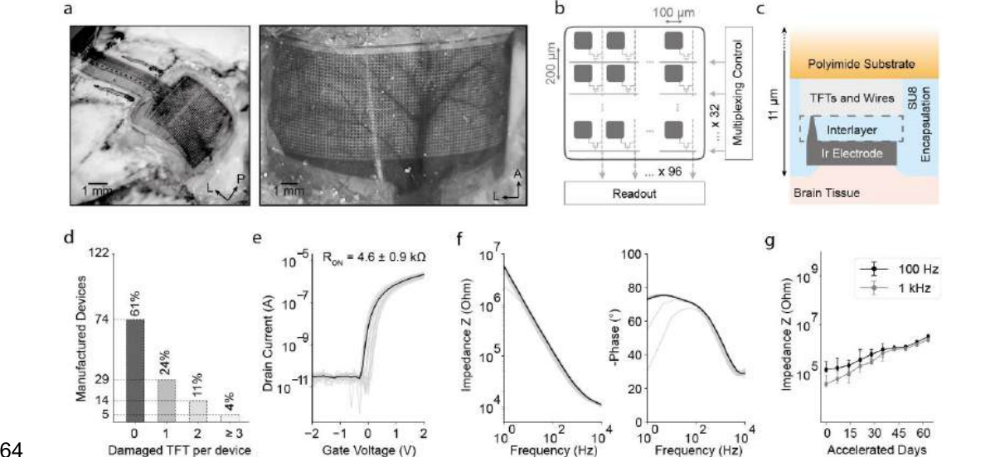
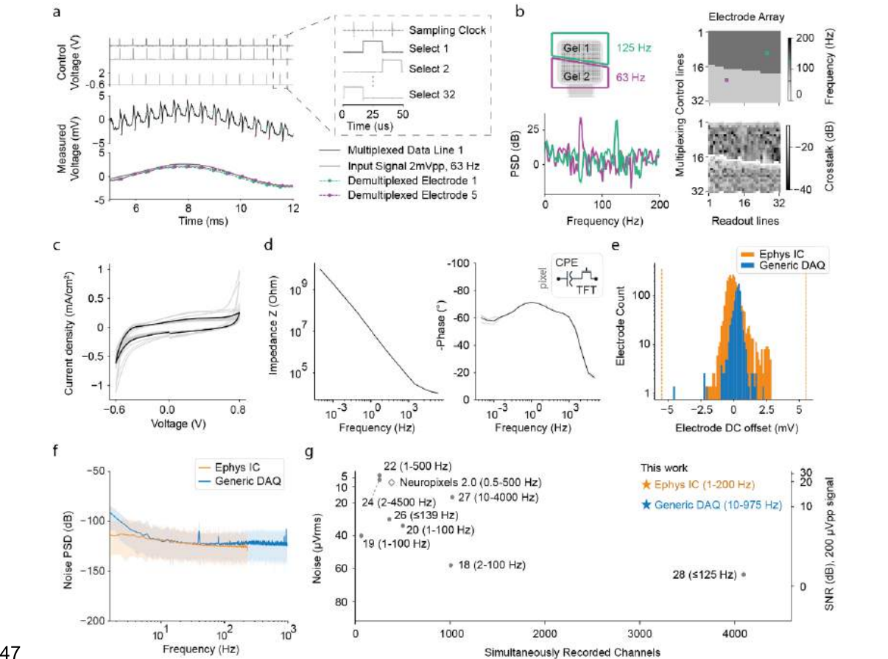
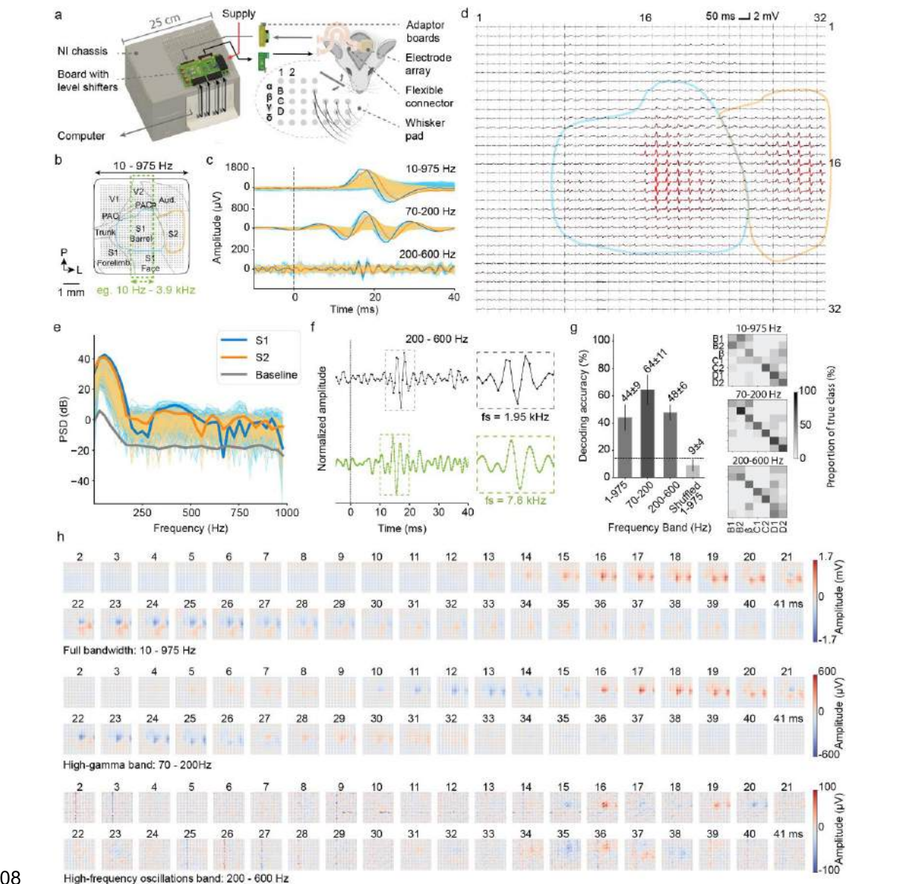
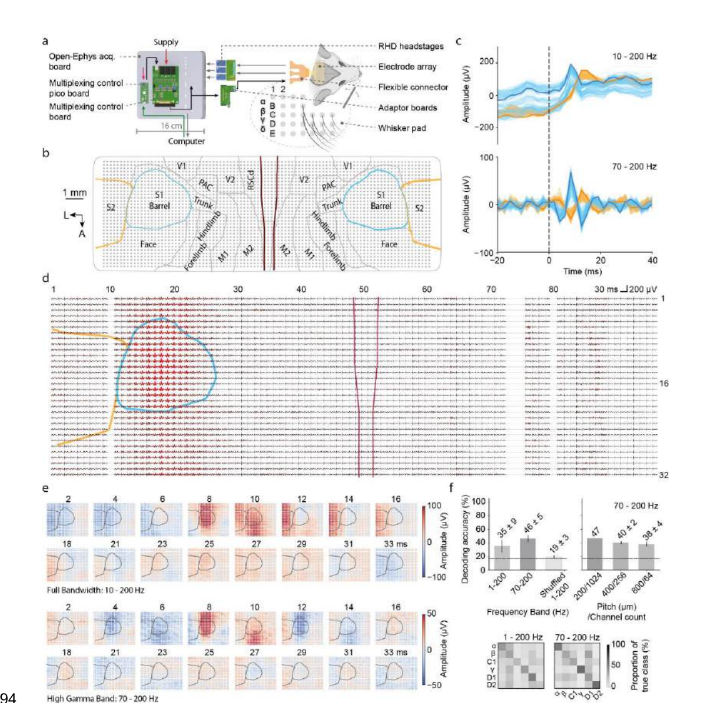
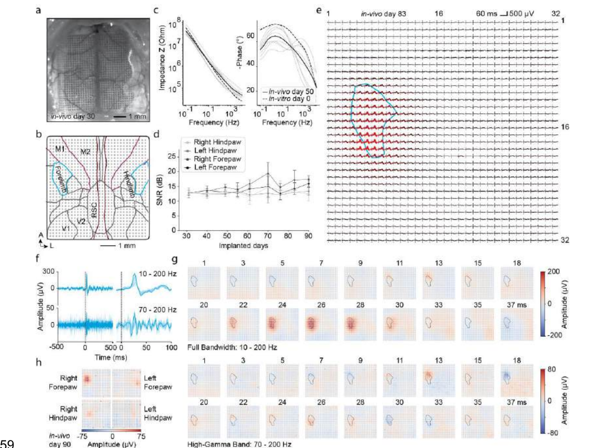
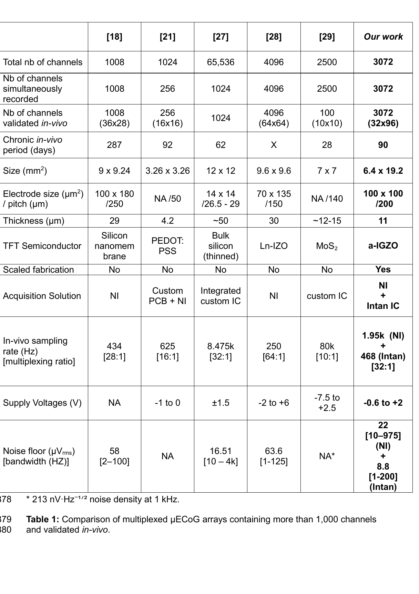

# Coulson 等：全文中英对译与阅读注

原文：[A widely adoptable, multiplexed, thin-film μECoG array with 3,072-channels for low-noise, large-scale, high-density recordings](../literature/Coulson_3072_multiplexed_muECoG.pdf)。

编排说明：按原 PDF 正文段落逐段保留英文并对译；跨页同一段合并，图注、方法、参考文献和 PDF 内附的补充材料另列。英文中的行末断词及上下标按版面恢复。紫色阅读注为解释，不是作者原句。

<small>原 PDF 第 1 页</small>

**A widely adoptable, multiplexed, thin-film μECoG array with 3,072-channels for low-noise, large-scale, high-density recordings**

**一种易于广泛采用的 3,072 通道复用薄膜 μECoG 阵列：低噪声、大范围、高密度记录**

P. Coulson¹,², S. Luijten¹, F. De Roose², A. Portoghese¹,³, K. Nguyen¹,³, A. Wyplosz⁴, K. Myny³, J. Genoe²,³, S. Haesler¹,³

¹ VIB–KU Leuven Center for Neuroscience, Belgium; ² imec, Leuven, Belgium; ³ KU Leuven, Leuven, Belgium; ⁴ Ecole des Mines de St-Etienne, France.

**作者与单位**

P. Coulson 等九位作者。¹ 比利时 VIB–KU Leuven 神经科学中心；² 比利时鲁汶 imec；³ 比利时 KU Leuven；⁴ 法国圣艾蒂安国立高等矿业学校。

**Abstract**

**摘要**

High-density micro-electrocorticography (μECoG) enables detailed recordings of neural activity across distributed cortical networks, but scaling to thousands of electrodes remains challenging due to the increasing complexity of interconnect wiring and acquisition hardware for large arrays. Here, we present a flexible multiplexed μECoG device enabling simultaneous recordings from up to 3,072 electrodes using standard electrophysiology acquisition hardware. The embedded thin-film transistors achieve large-scale low-noise recordings thanks to their robust industrial manufacturing, and were co-designed with a compatible electrode material enabling large-area, high-density cortical coverage in a format that can be readily deployed in existing electrophysiology infrastructure. Chronic in-vivo recordings in rodents captured cortical activity over 3 months across conventional local field potentials extending to the high-gamma band. Together, these results establish the first industrially manufactured, broadly accessible, large-scale and high-density cortical interface for neuroscience and neurotechnology.

高密度微皮层电图（μECoG）能够细致记录分布式皮层网络中的神经活动，但当电极数增加到数千个时，阵列互连和采集硬件的复杂度成为扩展障碍。本文提出一种柔性复用 μECoG 器件，可借助标准电生理采集硬件同时记录多达 3,072 个电极。嵌入式薄膜晶体管通过稳健的工业制程实现大规模、低噪声记录；与其协同设计的电极材料使阵列能以高密度覆盖大面积皮层，并接入现有电生理基础设施。啮齿动物的慢性体内记录持续 3 个月，记录频段从传统局部场电位延伸到高伽马。作者据此认为，该器件是首个工业制造、易于广泛采用的大规模高密度皮层接口。

<small>原 PDF 第 2 页</small>

**Introduction**

**引言**

Electrocorticography (ECoG) is a recording technique measuring cortical activity from the brain surface with high temporal resolution and signal-to-noise ratio1. Conventional ECoG is widely used in clinical practice for functional mapping and seizure localization prior to resective epilepsy surgery2. It has also become an important recording modality for brain-computer interfaces (BCIs), where it provides a less invasive and more stable alternative to intracortical probes3–5. A typical ECoG array consists of centimeter-scale planar metal electrodes integrated on a large-area flexible substrate spanning up to 10 cm of the cortex. More recently, micro-electrocorticography arrays (µECoGs) have been developed to improve spatial resolution by decreasing the electrodes size to the micrometer-scale and increasing their density. This enhanced resolution has uncovered spatially localized cortical activity6,7 and led to a boost in decoding accuracy for motor8, speech9,10, and auditory processes11. However, current µECoG arrays typically cannot maintain high electrode densities while providing large-area coverage as their electrode count remains limited. This scaling gap prevents the recording of cortical activity with high-resolution over multiple functionally relevant brain areas.

皮层电图（ECoG）从脑表面记录皮层活动，具有较高的时间分辨率和信噪比。传统 ECoG 广泛用于癫痫切除术前的功能定位和致痫灶定位；在脑机接口中，它也比皮层内探针侵入性更小、稳定性更高。典型 ECoG 阵列在大面积柔性基底上集成厘米尺度的平面金属电极，可覆盖长达约 10 cm 的皮层表面。近年来，μECoG 通过将电极缩小到微米尺度并提高密度来改善空间分辨率，揭示空间上更局限的皮层活动，并提高运动、言语和听觉过程的解码精度。不过，现有 μECoG 的电极总数有限，通常难以同时实现高密度和大面积覆盖，因而难以在多个相关脑区进行高分辨率记录。

Scaling µECoG arrays to thousands of recording channels presents substantial challenges in device interconnection, fabrication, and system integration. As both density and coverage increase, the number of recording electrodes rapidly rises, making the routing of individual connections to external electronics increasingly complex. Although advances in microfabrication have enabled the production of flexible thin-film arrays containing hundreds of densely packed electrodes12, and in some cases over a thousand electrodes13–16, these devices still integrate one dedicated interconnect per electrode. Consequently, the dense one-to-one architecture requires increasingly narrow and closely spaced metal traces, reducing fabrication yield, mechanical robustness and recording accuracy while limiting the available area for electrodes and making further increases in channel count progressively more challenging. Furthermore, interfacing thousands of recording lines with external acquisition systems requires bulky custom connectors13,15–17 complicating chronic implantation and limiting the translation of these devices beyond intraoperative use. To overcome these limitations, active µECoG devices integrate transistors implementing time-division multiplexing where several electrodes are sequentially sampled using the same recording line18–22. This strategy enables a quadratic increase in electrode count with only a linear increase in the number of interconnects; thereby creating an opportunity to drastically scale both the density and coverage of these devices.

把 μECoG 扩展到数千通道，必须解决器件连接、制造和系统集成难题。覆盖面积与电极密度增加时，逐个电极引出到外部电子设备的布线迅速变得复杂。尽管微加工已能制造数百甚至上千个电极的柔性薄膜阵列，这些阵列仍通常每个电极配一根独立引线。一对一结构迫使金属走线更细、更密，降低制造良率、机械稳健性和记录准确性，也挤占电极面积；连接数千条记录线还需要体积较大的定制连接器，给慢性植入和术中以外的应用带来困难。有源 μECoG 则用晶体管作时分复用，让多个电极依次共用一条记录线。由此，互连数量线性增长即可支持电极数量按平方关系增长，为同时扩大密度和覆盖范围提供路径。

In practice, implementing multiplexing in flexible μECoG arrays faces challenges: while several devices with tens to hundreds of electrodes19,22–26 have been demonstrated, only three examples integrating over a thousand simultaneously sampled electrodes have been validated in-vivo18,27,28. Three main issues continue to limit the wide adoption of multiplexed arrays. First, achieving high-yield manufacturing of flexible and biocompatible active devices while maintaining high device performance remains a major bottleneck. Two of the three afore-mentioned examples rely on thinned silicon technology, which provides high-performance transistors but requires complex and expensive processing and transfer steps that can introduce defects and reduce manufacturing yield. Several other approaches based on inherently flexible technologies have emphasized the potential for scalable manufacturing19,22,24,26,29, yet their demonstrations remain limited to research-scale fabrication and do not establish the feasibility of high-yield industrial production. Consequently, despite significant progress in active neural interfaces, no flexible multiplexed device manufactured through a demonstrated high-yield industrial process has been reported. The second major challenge of multiplexing ECoGs arrays today is their inherent electrical noise. Neural signals at the cortical surface exhibit amplitudes in the tens to hundreds of microvolt range, yet previous kilo-scale devices have reported relatively low signal-to-noise ratios with median noise levels of 16.5, 58 and 63 μVrms18,27,28. The third major problem limiting the utility of current multiplexed electrode arrays comes from their inability to interface with commercial electrophysiology integrated circuits (ICs). The challenge is that electrodes exhibit DC offsets in the hundreds of millivolts range17,22,30, which can be one to two orders of magnitude larger than the small signal amplitudes recorded from the cortical surface. To accurately record such signals, acquisition tools with large input ranges and high resolution are required but easily become cumbersome when the number of channels increases. The simplest strategy to remove these offsets is to use AC coupling through the integration of capacitors at the input of the devices16,31. However, embedding large metal plates at each electrode site drastically limits the density of the electrode array17. In Chiang et al. (2020)18, capacitive coupling between the electrode and brain tissue was created through the deposition of a thin SiO₂ layer on top of the electrode. This approach resulted in a small capacitance creating a mismatch in impedance with the readout system and therefore requiring a source-follower amplifier to buffer the signals before multiplexing. The added transistor introduced in this architecture increased the input-referred noise and thereby deteriorated the quality of the recordings. Another approach to mitigate the DC offsets is to externalize the added circuitry by designing a custom integrated circuit (IC) implementing dedicated offset removal techniques20,30,32–35. However, the long lead times, and high costs inherent to their development limit design iterations and thereby prevents tailored optimization to neural applications, refraining the broader dissemination of these systems.

柔性 μECoG 中实现复用仍有三个主要障碍。首先，虽然几十至几百电极的方案已有不少，仅有三个超过千个电极且经过体内验证的例子。三者中的两种依赖减薄硅：晶体管性能高，但加工与转移复杂、昂贵，可能引入缺陷、降低良率。其他本征柔性方案虽展示了扩展潜力，仍停留在研究级制造，尚未证明高良率工业生产。其次是电噪声：脑表面信号仅几十至几百微伏，而已有千级阵列的中位噪声分别达到 16.5、58 和 63 μVᵣₘₛ。第三是与商用电生理芯片接口困难。电极的直流偏置可达数百毫伏，远大于神经信号；若依赖大输入范围、高分辨率外部采集设备，通道数增大时系统会很笨重。逐电极交流耦合电容占据高密度像素面积；另有方案在电极上覆薄 SiO₂ 获得电容耦合，但电容过小，需增加源跟随器作阻抗缓冲，进而提高输入参考噪声。定制读出 IC 可以消除偏置，却存在开发周期长、成本高和迭代慢的问题，不利于普及。

注：参考文献28是我们的文章，这里也被用作噪声水平的对比 63 μV

除此之外，还点评了电极的直流偏置大（Viventi方案，电流镜偏置）和SiO2电容耦合的问题（电容过小？？需要添加源极跟随器？）

定制读出IC迭代慢也算是缺点？这就是你们踢掉电路团队的理由哈哈哈哈

<small>原 PDF 第 3 页</small>

To address these challenges, we developed a multi-thousand channel multiplexed µECoG array which can be readily adopted in research settings thanks to two key features: robust industrial manufacturing enabling large-scale production of the devices, and direct compatibility with a widely used compact commercial data acquisition system. The amorphous indium-gallium-zinc oxide (a-IGZO) semiconductor technology which forms the basis of this device was originally developed for the display industry and has since matured into a robust thin-film electronics platform. It has been shown to be non-cytotoxic according to ISO standards22, is industrially established in display backplanes36 and is increasingly being explored for advanced integrated circuits, including microprocessors37, for which functional yields of up to 81% have been reported38. Leveraging this standardized fabrication flow, the high manufacturing yield enabled the realization of large-scale multiplexed μECoG arrays integrating 3,072 electrodes. We have also overcome the challenge posed by electrode DC offsets by carefully selecting an electrode material inducing a capacitive, non-faradaic, interface with the tissue, which enables the simultaneous recording of the 3,072 signals via a standard acquisition chain. We validated the recording of cortical evoked potentials in rodents in-vivo using two commercial acquisition platforms, including a broadly adopted electrophysiology integrated circuit, demonstrating that high-density multiplexed μECoG recordings can be achieved without custom acquisition electronics and readily integrated into existing electrophysiology workflows. We further demonstrated that the electrode arrays were still functioning after 3 months of chronic implantation, supporting the potential of this technology for long-term neurotechnology applications.

为解决这些问题，作者开发了数千通道复用 μECoG，具备两项关键特性：可用于大规模生产的工业制程，以及直接兼容常用的紧凑商用采集系统。器件采用源于显示产业、工艺已成熟的非晶铟镓锌氧化物（a-IGZO）半导体平台；已有研究按 ISO 标准证明其无细胞毒性，该技术也用于显示背板和先进集成电路。标准化制程与较高良率支持实现 3,072 电极阵列。作者还选择主要通过电容性、非法拉第过程与组织耦合的电极材料，以降低直流偏置，从而经标准采集链同时读出 3,072 个信号。两种商用采集平台在啮齿动物体内记录到了皮层诱发电位，其中包括常用电生理 IC；阵列在慢性植入 3 个月后仍有功能。这些结果支持其作为长期神经技术平台的潜力。

<small>原 PDF 第 4 页</small>

**Results**

**结果**

**µECoG array description and characterization**

**μECoG 阵列结构与表征**

The high-density multiplexed μECoG array was developed in two configurations. The smaller version incorporates 1,024 electrodes arranged in a 32 x 32 matrix spanning an area of 6.4 x 6.4 mm2. The larger version integrates 3,072 electrodes in a 32 × 96 array, providing threefold greater cortical coverage (6.4 × 19.2 mm²). (Figure 1a). Figure 1b details their design where individual 100 × 100 µm² iridium electrodes are arranged with a 200 µm pitch and connected to a dedicated thin-film transistor (TFT) used to address the 32 electrodes sharing a common recording line. This architecture enables dense spatial sampling of cortical activity using <mark>only 128 interconnects instead of 3,072</mark>, avoiding the need for complex connection schemes. To minimize noise contributions, no additional circuitry was integrated at the electrode sites for signal amplification or buffering. Time-division multiplexing was implemented to sample all electrodes simultaneously while maintaining a per-electrode bandwidth of 1 to 200 Hz targeting local field potentials (LFPs). To satisfy the Nyquist criterion, each electrode was sampled at a minimum of 400 Hz. Accounting for the 32:1 multiplexing ratio, this corresponds to a minimum recording line sampling frequency of 12.8 kHz (32 × 400 Hz).

高密度复用阵列有两种规格：32×32 的 1,024 电极版覆盖 6.4×6.4 mm²；32×96 的 3,072 电极版覆盖 6.4×19.2 mm²，面积约为前者三倍。每个铱电极为 100×100 μm²，间距 200 μm，并各配一只 TFT；每条记录线由 32 个电极共用。因此 3,072 个电极只需 128 条互连，而非 3,072 条。为减少噪声，电极位点没有额外放大或缓冲电路。作者设计时分复用以覆盖 1–200 Hz 的局部场电位：每点至少 400 Hz 采样，32:1 复用后每条记录线至少须以 12.8 kHz 采样。

The backplane of the array comprising the substrate and circuitry was industrially manufactured providing high-yield devices with robust, scaled fabrication. Figure 1c outlines the device stack. The thin-film transistors were based on the amorphous indium-gallium-zinc oxide (a-IGZO) semiconductor and fabricated on a thin 9 µm-thick flexible polyimide substrate providing a high degree of conformability to the cortical surface (Figure 1a,c and Supplementary Figure1). As high-performance electrode materials are not standard to the semiconductor industry, the front-end electrode and encapsulation layers were deposited during post-processing in a separate facility. Following bonding to a flexible printed circuit board (PCB) used as a connector, <mark>a final yield of 61%</mark> was achieved for fully functional μECoG arrays without any defective electrode-transistor pairs (Figure 1d). Electrical characterization identified electrostatic discharge (ESD) induced breakdown of the transistor gate oxide as the dominant failure mechanism which only occurred during the bonding process39.

阵列的基底、晶体管与布线背板由工业生产。a-IGZO TFT 位于约 9 μm 厚的柔性聚酰亚胺基底上，可贴合皮层曲面。电极与封装层并非标准半导体背板工艺的一部分，而是在另一设施后加工。将阵列与作为连接器的柔性 PCB 键合后，所有电极—TFT 对均正常工作的器件良率为 61%。主要失效机制是键合阶段静电放电造成的晶体管栅氧化层击穿。

The electrical performance of the a-IGZO transistors is shown through their Id/Vg characteristic in Figure 1e. The devices exhibited a field-effect mobility reaching 20 cm² V⁻¹ s⁻¹ and were operated at low voltages between −0.6 and +2 V with an on/off ratio of >10⁵. Their off-state current was measured at 28.8 ± 10.5 pA, demonstrating an exceptionally low leakage and limiting crosstalk between channels to -98.9 ± 6.1 dB in the multiplexed architecture. At 2 V, the transistors have an on-state resistance (Ron) of only 4.6 ± 0.9 kΩ, ensuring low thermal noise estimated at only 123 ± 12 nVᵣₘₛ within the 1 to 200 Hz bandwidth.

图 1e 展示 a-IGZO TFT 的漏极电流—栅极电压特性。器件场效应迁移率可达 20 cm²/(V·s)，栅极控制电压为 −0.6 至 +2 V，开关电流比大于 10⁵。关断电流为 28.8 ± 10.5 pA，漏电很低；作者给出的复用结构通道串扰为 −98.9 ± 6.1 dB。栅压为 2 V 时，导通电阻仅 4.6 ± 0.9 kΩ，据此估算在 1–200 Hz 内产生 123 ± 12 nVᵣₘₛ 热噪声。

Low-noise signal acquisition additionally requires a stable and low-impedance electrode interface. As shown in Figure 1f the small iridium electrodes reached impedance magnitudes of only 122.5 ± 9.5 kΩ at 100 Hz, and 23.5 ± 1.5 kΩ at 1 kHz. The robustness of the fabrication method is also exemplified in this Figure as only 2 electrodes among the 1,024 electrodes of the device tested exhibited a slightly varying behaviour at low frequencies which did not preclude their use. We evaluated the long-term stability of the μECoG arrays using electrochemical impedance spectroscopy (EIS) in accelerated aging conditions, where the device was immersed in phosphate-buffered saline (PBS) at 60°C for 65 days. Over the course of the experiment, under constant bias, the impedance of the combined electrode-transistor pair increased progressively (Figure 1g). Despite this increase, the impedance remained sufficiently low to support neural signal acquisition for at least 30 days under accelerated aging conditions. We found no evidence of encapsulation failure over the complete 65 days of the analysis which equates to 320 days at 37°C following Arrhenius scaling.

低噪声采集还需要稳定、低阻抗的电极界面。小面积铱电极在 100 Hz 的阻抗为 122.5 ± 9.5 kΩ，在 1 kHz 为 23.5 ± 1.5 kΩ；所测 1,024 个电极中仅两个在低频表现略有差异，仍可使用。为评估长期稳定性，作者在 60 °C 的 PBS 中持续偏置浸泡器件 65 天，利用电化学阻抗谱（EIS）跟踪。电极—TFT 对的阻抗逐渐上升，但在加速老化条件下至少前 30 天仍足以支持神经采集。整个 65 天未发现封装失效；作者依 Arrhenius 换算，将其视为约等于 37 °C 下 320 天的材料稳定性证据。

<small>原 PDF 第 5 页</small>

Figure 1: High-density multiplexed μECoG array description and characterization. (a) Pictures of implanted devices on rat cortex, (left) 1,024 electrodes and (right) 3,072 electrodes. (b) Schematic of the multiplexing architecture. Each electrode is paired with 1 TFT laid out in a 32 x 96 or 32 x 32 matrix. (c) Schematic of the device stack outlining the industrially manufactured backplane consisting of substrate, TFTs and interconnects, and the three post-processed layers. (d) Number of devices per batch detailing the number of damaged TFTs per device. With no damaged TFT, the device is considered fully functional. (e) Id/Vg characteristic of the a-IGZO thin-film transistors, n=25. (f) EIS of the electrode-transistor pairs for a full 1,024 electrodes device. (g) μECoG array lifetime assessed through EIS in accelerated aging conditions at 60°C.

**图 1 图注**

图 1｜阵列结构和表征。a：植于大鼠皮层的 1,024 与 3,072 电极阵列照片。b：复用架构；每个电极配一只 TFT，形成 32×32 或 32×96 矩阵。c：器件叠层，包括工业制造的基底、TFT、互连背板及三个后加工层。d：各批器件受损 TFT 数量；没有受损 TFT 才算完全可用。e：a-IGZO TFT 的漏电流—栅电压曲线，n=25。f：完整 1,024 电极阵列各电极—TFT 对的 EIS。g：60 °C 加速老化条件下的寿命 EIS。

The performance of the time-division multiplexing architecture was evaluated in-vitro by immersing the μECoG arrays in PBS and applying a single sinusoidal signal picked up by all the electrodes. Figure 2a shows the sequential selection of the 32 transistors connected to each recording line and its inset highlights the delay introduced between the rising edge of the control signals and the sampling clock, providing sufficient settling time before sampling. Representative traces from a multiplexed recording line and corresponding demultiplexed electrodes demonstrate the faithful reconstruction of the applied waveform, indicating that the multiplexing process does not introduce appreciable signal distortion or attenuation.

作者将阵列浸入 PBS，用所有电极共同接收的正弦信号检验时分复用。图 2a 展示一条记录线上 32 只 TFT 依次选通；控制信号上升沿与采样时钟之间特意留出延时，让信号稳定后再取样。复用线原始波形及解复用后的单电极波形表明，施加的正弦信号可重建，复用没有造成明显失真或衰减。

Crosstalk induced by the multiplexing scheme was evaluated in dry conditions where the contribution of the thin-film transistor could be separated from that of the electrode. We compared adjacent electrodes (200 µm pitch) either sharing a readout line or connected to distinct readout lines, and distant electrodes (1000 µm pitch) in the same conditions. Crosstalk was resolved only between adjacent electrodes on different readout lines, where the median was −27.7 dB. No crosstalk was resolved in the other conditions, and importantly not between electrodes sharing a readout line. Supplementary Figure 2 summarizes these results, which demonstrate the ability of the a-IGZO transistors to effectively suppress current flow in the off-state.

为分离 TFT 本身与电极的影响，作者在干态下测试复用串扰，比较相邻（200 μm 间距）及相距较远（1 mm 间距）的电极，并分别考虑是否共用记录线。只有位于不同记录线上的相邻电极测出串扰，中位数为 −27.7 dB；其他条件、尤其共用记录线的电极之间未检出串扰。这支持 a-IGZO TFT 关断时能够抑制电流流动。

<small>原 PDF 第 6 页</small>

To assess whether the device could faithfully acquire different signals through electrodes sharing a recording line with negligible crosstalk, we placed it below an agar-based phantom consisting of two independently driven regions as displayed in Figure 2b and Supplementary Figure 3. Distinct sinusoidal signals were applied to each region, creating two spatially separated signal sources below the μECoG array. The power spectral density of each electrode signal was computed and the frequency corresponding to its highest peak was mapped onto the array revealing two clearly localized regions corresponding to the applied stimuli. This analysis confirmed the selective detection of the input frequencies, demonstrating the ability of the array to simultaneously record different signals through the multiplexed readout scheme. Under these conditions, we were able to quantify the crosstalk between the two regions. This measurement is close to a realistic in-vivo scenario as it includes both the TFT operation and the electrode impedance, but cannot resolve crosstalk between adjacent electrodes, only between the two large regions. We found -25.1 ± 5.1 dB at 125 Hz and -28.5 ± 5.0 dB at 63 Hz. Coupling did not vary with distance from the boundary between the driven regions and was phase-locked to the source, excluding volume conduction and reference pickup respectively. These levels correspond to ~5% amplitude leakage between the independently driven regions, which, for a representative 500 µVpp neural signal, would correspond to a leaked component of only ~8.8 µVrms. We show in the following section that this crosstalk level is at the noise floor and therefore does not limit signal fidelity.

为测试共用记录线的电极能否同时区分不同信号，作者在阵列上放置两个独立驱动的琼脂脑模区域，分别施加不同频率的正弦信号。每个电极的功率谱主峰在阵列上形成两个清楚分开的区域，说明复用读出仍能选择性检测各自的输入频率。该测试同时包含 TFT 与电极阻抗，较接近体内情形，但只能量化两大片区域之间的串扰，不能分辨相邻电极之间的串扰。在 125 Hz 和 63 Hz，串扰分别为 −25.1 ± 5.1 dB 与 −28.5 ± 5.0 dB。串扰幅度不随距区域边界的距离变化，且其相位锁定于信号源；作者据此分别排除体积传导和参考端拾取的解释。这约等于 5% 幅值泄漏；对于代表性的 500 μV 峰峰值信号，泄漏约为 8.8 μVᵣₘₛ，接近后文所述噪声底。

As illustrated in Figure 2a, the multiplexed μECoG output exhibits a step-like waveform arising from the superposition of electrode-specific DC offsets and neural signals. Although such signals can be acquired using external amplifiers with large input voltage ranges, their extensive footprints limit their use with high-channel count electrode arrays. Compatibility with compact external ICs therefore requires minimizing the DC offset spread across channels. The usual remedy, a DC-blocking capacitor on every channel, cannot be integrated within the limited area available in high-density arrays. We therefore addressed the offset at the electrode–electrolyte interface itself, by choosing an electrode material that behaves as a capacitor rather than a charge-transfer interface. Iridium, a noble metal widely used in neural interfaces for its chemical stability and biocompatibility, was selected because it is expected to couple predominantly capacitively to the electrolyte, so that each electrode acts as its own series DC-blocking element and channel-to-channel offset variations are minimized. To validate this operating principle, we characterized the iridium electrodes by cyclic voltammetry and electrochemical impedance spectroscopy. Cyclic voltammetry measurements revealed no discernible redox peaks, indicating the absence of faradaic reactions which would introduce a resistive charge-transfer pathway at the interface (Figure 2c). Consistently, electrochemical impedance spectroscopy at frequencies below 1mHz showed no low-frequency resistive plateau associated with charge-transfer resistance (Figure 2d). Together, these results demonstrate that the iridium electrodes operate predominantly through capacitive coupling and can therefore be modelled as a constant-phase element in series with the transistor on-state resistance (Figure 2d and Supplementary Figure 4). The resulting electrode DC offsets were measured with two readout systems, a generic off-the-shelf data acquisition (DAQ) system with a ±200 mV input range, and a commercial electrophysiology IC with a ±5 mV input range (Figure 2e). Across the readout lines, offset ranges reaching only <mark>2.29 ± 1.12 mV</mark> were measured, establishing the ability of iridium electrodes to provide offset rejection for multiplexed high-density μECoG arrays.

图 2a 的复用输出呈阶梯状，是各电极特有直流偏置与神经信号叠加的结果。大输入范围外部放大器能接收它，却不利于千级紧凑系统；要使用输入范围小的商用 IC，就须减小电极间偏置跨度。逐通道隔直电容无法放入高密度像素，因此作者从电极—电解质界面着手：选用化学稳定且生物相容的铱，使其主要呈电容耦合而非电荷转移，相当于每个电极自带串联隔直效应。循环伏安没有明显氧化还原峰，低于 1 mHz 的 EIS 也没有表明电荷转移电阻的低频电阻平台；电极可用常相位元件串联 TFT 导通电阻建模。用输入范围 ±200 mV 的通用 DAQ 和 ±5 mV 的电生理 IC 检验，记录线内的电极偏置跨度为 2.29 ± 1.12 mV，证明该材料有助于在复用阵列中抑制直流偏置差异。

<small>原 PDF 第 7 页</small>

Noise levels for both readout solutions were characterized in-vitro, and their power spectral densities (PSDs) are shown in Figure 2f. Owing to the DC-coupled architecture of the generic DAQ, low-frequency noise was dominated by the 1/f contribution of the electrode-transistor interface. Consequently, when coupled to the μECoG device, the system exhibited a noise level of <mark>64.2 ± 24.6 μVrms</mark> over the 1-975 Hz bandwidth. Restricting the analysis to the 10-975 Hz band reduced the noise floor to <mark>22 ± 11.7 μVrms</mark>. In contrast, the electrophysiology IC achieved a noise level of <mark>8.8 ± 4.6 μVrms</mark> across the 1-200 Hz bandwidth, comparable to values reported for custom integrated readout solutions. Figure 2g benchmarks these results against the state of the art for multiplexed μECoG arrays, demonstrating noise performance on par with leading technologies while enabling the simultaneous recording of over three times more channels than existing systems.

两种读出方案的体外噪声功率谱见图 2f。通用 DAQ 为直流耦合，低频受电极—晶体管界面 1/f 噪声支配；连接阵列后，1–975 Hz 积分噪声为 64.2 ± 24.6 μVᵣₘₛ，若仅计 10–975 Hz，则降至 22 ± 11.7 μVᵣₘₛ。商用电生理 IC 在 1–200 Hz 内为 8.8 ± 4.6 μVᵣₘₛ，接近一些定制读出方案。作者认为，该系统虽然同时记录更多电极，噪声表现仍可与领先的复用 μECoG 方案相比。注意三组数字的积分频带不同。

Figure 2: Time-division multiplexing characterization. (a) TDM tested in PBS solution. Control voltages used to sequentially select the TFTs are detailed in inset. A representative multiplexed readout line is shown, together with two corresponding demultiplexed signals. Input signal of 2mVpp at 63Hz. (b) TDM tested with 2 agar-based phantoms placed on the array, each submitted to a different signal (top) 99 μVrms 63Hz. (bottom) 77.5 μVrms 125 Hz. (bottom left) PSD analysis of two representative electrodes, (top right) PSD frequency with maximum power across the array, and (bottom right) crosstalk computed across the array. (c) Cyclic voltammetry measurements of iridium electrodes with scan rate of 100mV.s- 1, n=27. (c) Electrode impedance spectroscopy of the electrode-transistor pairs at low frequencies confirming the capacitive behaviour of the electrodes, n=4. An equivalent circuit model is shown in inset. (e) Electrode DC offsets measured with a standard electrophysiology IC with lo input range of only ±5 mV, and a generic off-the-shelf DAQ with high input range of ±200 mV. Dashed lines represent the limits of the IC’s input range. (f) Noise PSD measured with the standard electrophysiology IC and the generic DAQ. (g) Comparison to state-of-the-art multiplexed µECoG arrays and to the electrophysiology standard Neuropixels40. References [21,23,25,29] were not included as noise values were not reported. SNR values are computed using reported noise values and a representative 200 μVpp signal.

**图 2 图注**

图 2｜时分复用表征。a：PBS 中的控制波形、复用读出线和两个解复用电极信号，输入为 63 Hz、2 mV 峰峰值。b：阵列上的两个琼脂区域分别施加 63 与 125 Hz 信号；显示代表电极功率谱、阵列主频分布和串扰分布。c：铱电极循环伏安，扫描速率 100 mV/s，n=27。d：电极—TFT 对的低频阻抗谱与等效电路，n=4，用于验证电容性。e：分别用 ±5 mV 电生理 IC 和 ±200 mV 通用 DAQ 测电极直流偏置。f：两种采集方案的噪声功率谱。g：与其他复用 μECoG 和 Neuropixels 比较；部分文献因未报告噪声而未纳入，SNR 按代表性 200 μV 峰峰值信号计算。

<small>原 PDF 第 8 页</small>

**High-density recordings in-vivo**

**高密度体内记录**

To evaluate the performance of our multiplexed μECoG array in-vivo, acute recordings were performed in three Long–Evans rats. Figure 3a details the experimental setup, where neural signals were acquired using a generic data acquisition system based on a National Instruments (NI) solution. It controls the time-division multiplexing through level shifters to operate the TFTs between -0.6 and +2V, and acquires the data though each recording line at a sampling rate of 62.5 kHz, corresponding to a per-electrode bandwidth of 10-975 Hz. A 32 x 32 μECoG array, spanning 6.4 × 6.4 mm², was positioned epidurally over the left somatosensory cortex as shown in Figures 1a and 3a,b, with the barrel field centred beneath the array and the secondary somatosensory cortex located at its lateral edge. Individual whiskers were sequentially deflected using a piezoelectric stimulator while cortical activity was recorded simultaneously across the entire array.

作者在三只 Long–Evans 大鼠中开展急性体内验证。NI 通用采集系统经电平转换器使 TFT 在 −0.6 至 +2 V 间切换，每条记录线以 62.5 kHz 采样，对应每电极 10–975 Hz 带宽。32×32 的 1,024 电极阵列置于左侧体感皮层硬膜上，覆盖 S1 胡须桶状皮层，外侧边缘接近 S2。压电刺激器依次偏转单根胡须，阵列同步记录整片皮层活动。

A representative response to the deflection of whisker C2 is shown in Figures 3c,d. Clear stimulus-evoked potentials are observed in both the primary (S1) and secondary (S2) somatosensory cortices. Figure 3c compares the signals recorded from the electrodes located over S1 and S2 and outlines the electrode signals with the largest amplitude in each area. Consistently with the expected cortical response, S1 exhibited a shorter latency and larger amplitude than S2 while both areas exhibit an evoked potential starting between 5 and 10 ms post-stimulus and lasting 20 ms. Filtering the recordings into the high-gamma and high-frequency oscillation (HFO) bands, respectively 70-200 and 200-600 Hz, revealed that stimulus-related activity remained clearly detectable in both frequency ranges. The corresponding power spectral density analysis presented in Figure 3e revealed stimulus-induced increases across the recorded frequency range relative to baseline. The largest difference was observed below 200 Hz, encompassing both the conventional ECoG and high-gamma bands, while smaller increases in power remained detectable at higher frequencies.

C2 胡须偏转后，S1 与 S2 都出现清晰诱发电位。符合预期，S1 反应的潜伏期比 S2 更短、幅度更大；两区反应在刺激后约 5–10 ms 起始，持续约 20 ms。将数据分别滤至 70–200 Hz 高伽马和 200–600 Hz 高频振荡频段后，仍能发现刺激相关活动。相对基线，记录频段内均可见刺激后的谱功率增加，但 200 Hz 以下最明显，高于 200 Hz 的变化较小。

Thanks to the multiplexing architecture, arbitrary sets of electrodes can be selected and recorded with higher sampling rate, allowing spatial coverage and/or density to be traded for temporal bandwidth. Figure 3b provides an example of a user-defined subset selection of 256 electrodes arranged as an 8 × 32 matrix targeting the S1 barrel field. The upper bound of the bandwidth was thus increased from 975 Hz to 3.9 kHz. When waveform shape analysis is performed, this approach allows the high-fidelity delineation of waveforms in all frequency bands of interest, including the higher-frequency HFO band as shown in Figure 3f. Supplementary Figure 5 and Supplementary Videos 4-7 detail the waveforms and evolution of the evoked response recorded with this alternative approach.

复用架构允许只选择任意一组电极，以空间覆盖范围或电极密度换取更高的频率带宽。图 3b 选用针对 S1 胡须区的 8×32、共 256 个电极，将上截止频率从 975 Hz 提升至 3.9 kHz。因此可以更准确地还原波形，包括高频振荡频段；补充图与视频展示了相应波形和诱发反应时空演变。

To quantify the information contained within the different frequency bands, a linear discriminant analysis (LDA) classifier was trained to predict the identity of the stimulated whisker from single-trial responses. Decoding performance was evaluated as a function of frequency band and outlined in Figure 3g. Signals filtered in the high-gamma band yielded the highest classification accuracy. Across all frequency bands, neighbouring whiskers accounted for the majority of classification errors, consistently with the somatotopic organization of the barrel cortex.

作者用线性判别分析（LDA）从单次响应预测受刺激的胡须，比较不同频段的解码性能。高伽马数据的准确率最高；各频段误判主要发生在相邻胡须之间，符合桶状皮层的躯体定位结构。

<small>原 PDF 第 9 页</small>

The spatiotemporal evolution of the evoked responses is illustrated in Videos 1-3 and representative snapshots are featured in Figure 3h. As frequency increases, the cortical activation becomes progressively more spatially and temporally confined, highlighting the benefits of high-density recordings in these bands.

视频与图 3h 展示诱发反应的时空演变。频率越高，皮层激活的空间范围和持续时间越局限，体现高密度采样在这些频段的价值。

Figure 3: Acute high-density in-vivo recordings in anesthetized rats during whisker stimulation. (a) (left) Schematic of the recording setup including the National Instruments chassis and modules connected to a custom board integrating level shifters used to control the multiplexing. Two small adaptor boards interface with the 1,024 electrodes array. The arrows represent signals: black as the multiplexing controls, grey as the acquired data and red as the power supplies. (right) Experimental paradigm and whisker pad of the animal. (b) Schematic depicting the brain areas covered by the μECoG array. When sampling the full array each electrode’s bandwidth spans 10-975Hz, while with a subset of electrodes it can increase to, for example, 10 Hz to 3.9 kHz. (c) Evoked responses across the array. (d) Detailed signal traces of electrodes in S1 and S2, with the bold line showing the electrodes with the highest amplitude in the high-gamma band. (e) Power spectral density of the evoked response in both S1 and S2 regions, with the two maximum responders in bold and their averaged baseline in grey. (f) Representative waveforms recorded with higher sampling rate at 7.8 kHz, filtered in HFO band to exemplify the higher-fidelity recordings obtained in this recording mode. (g) (left) Decoding accuracy of the LDA classifier with varying bandwidth and (right) corresponding confusion matrices. The shuffled condition corresponds to an empirical chance-level distribution obtained by randomly permuting class labels prior to classification. (h) Heatmaps showing the evoked transient response for the full bandwidth (top), the high-gamma band (middle) and the high frequency oscillations band (bottom).

**图 3 图注**

图 3｜麻醉大鼠胡须刺激时的高密度急性体内记录。a：NI 机箱和模块、控制复用的电平转换板、连接 1,024 电极阵列的适配板及实验范式；黑、灰、红箭头分别表示控制、采集和供电。b：阵列所覆盖脑区；全阵列时每点带宽为 10–975 Hz，选择子集时可提高至约 10 Hz–3.9 kHz。c：全阵列诱发反应。d：S1 与 S2 代表电极波形，粗线为高伽马最大响应。e：两区的响应功率谱和平均基线。f：以更高采样率记录的高频振荡波形。g：不同带宽下的 LDA 胡须解码准确率及混淆矩阵；随机置乱标签构成机会水平。h：全带宽、高伽马和高频振荡的诱发瞬态热图。

<small>原 PDF 第 10 页</small>

**Large-scale cortical recordings using commercial electrophysiology integrated circuit**

**使用商用电生理集成电路的大面积皮层记录**

**System description**

**系统结构**

To pave the way for widespread access of high-density μECoG recordings in research and clinical settings, we investigated whether our multiplexed electrode array could be paired with a compact commercial electrophysiology integrated circuit (IC). We selected the field’s standard, the Intan Technologies RHD amplifier chip, and developed a simple experimental setup based on a combination of three Intan RHD headstages to acquire signals from a 3,072 electrodes array (Figures 1a and 4a). Each headstage reads 32 recording lines of the array, while each recording line multiplexes the signals of 32 electrodes, yielding a 32 x 96 matrix. This achievement makes the scalability of our μECoG array primarily a function of the number of headstages used, so expanding the channel count becomes straightforward and cost-effective. To the best of our knowledge, no other multiplexed array has been demonstrated to interface with such a widely adopted platform, providing the first multi-thousand-channel μECoG system that can be readily integrated into existing recording workflows.

为让高密度 μECoG 更易用于研究和临床，作者考察阵列是否能接入紧凑的商用电生理 IC。他们选用 Intan RHD 放大芯片，用三个 RHD 头端读出 3,072 电极阵列：每个头端接 32 条记录线，每条线复用 32 个电极，构成 32×96 矩阵。作者认为可通过增加头端数扩展通道，成本和实施复杂度较低；据其所知，此前尚无同等规模复用阵列接入这一常用平台。

Interfacing a multiplexed device with this IC requires addressing two main challenges. First, the multiplexed signals must remain within the chip’s voltage input range, which is limited to only ±5 mV. Thanks to the capacitive interface exhibited by iridium electrodes, such low DC offsets could be achieved (Figure 2e). Furthermore, an equivalent capacitance for the constant phase element modelling the electrode interface can be derived in the relevant frequency band of 0.1 to 1000 Hz and reaches magnitudes between 1 nF at 10 kHz and 200 nF, at 0.1 mHz (Supplementary Figure 4). Within this range, no mismatch appears between the input capacitor of the Intan chip, at 12pF, and the capacitive input discarding the need for buffering at the electrode site.

将阵列接入 Intan 系统有两个难点。第一，复用信号必须保持在芯片 ±5 mV 的输入范围内；铱电极的电容性界面使直流偏置足够小。将该界面常相位元件换算为等效电容，作者报告其随频率变化，从 10 kHz 的约 1 nF 到 0.1 mHz 的约 200 nF；相较 Intan 输入端 12 pF 电容，不会形成明显的电容失配，因此电极位点无需另加缓冲器。

The second challenge arises from the fixed architecture of the commercial acquisition system, which incorporates a band-pass filter at its input. While this filter is beneficial when using individually wired electrodes because it suppresses electrode DC offsets and noise, it becomes problematic in a multiplexed configuration. For accurate measurements, the filter must fully settle after each electrode selection. Otherwise, the recorded signal may contain a time-varying fraction of the residual offset from the previously selected electrode, resulting in inter-channel crosstalk. If sufficient settling time is provided, the residual offsets appear as a stable DC level that can be readily removed using a digital high-pass filter. However, allowing the filter to fully settle limits the rate at which electrodes can be switched and therefore reduces the achievable sampling rate. Consequently, a trade-off exists between filter settling time and per-electrode sampling rate. The highest available cutoff frequency of the third-order Butterworth input filter is 20.5 kHz. By multiplexing at 15 kHz, we allocated 66.7 µs between successive electrode selections while preserving a per-electrode bandwidth of 234 Hz. The switching network reconfigures the multiplexer approximately 2 µs after each sample acquisition, leaving <mark>64.7 µs for filter settling</mark>. Under these conditions, the filter reaches 98.2% of its final value following a full-scale step transition. The resulting residual error therefore corresponds to an inter-channel crosstalk of only −35 dB.

第二个难点是商用芯片输入端的带通滤波器。接入逐电极独立布线的阵列时，它有助于抑制直流偏置和噪声，但复用电极每次切换后，滤波器必须稳定下来；否则前一电极的残余偏置会混入下一电极，形成通道串扰。若留足稳定时间，残余部分表现为稳定直流量，可用数字高通滤波去除，但等待会压低每点采样率。作者将三级 Butterworth 输入滤波器上截止频率设为可用最高值 20.5 kHz，选择 15 kHz 的复用频率，使相邻选通间隔 66.7 μs，每电极带宽仍约 234 Hz。每次采样后约 2 μs 重新配置复用器，剩余 64.7 μs 供滤波器稳定；全幅阶跃后达到最终值的 98.2%，估算相邻通道串扰约 −35 dB。

<small>原 PDF 第 11 页</small>

**In-vivo validation**

**体内验证**

We acutely placed the 3,072-electrode array epidurally over the cortex of two anaesthetized Long–Evans rats. As shown in Figures 1a and 4a,b, this larger array, spanning 6.4 × 19.2 mm², enabled the simultaneous coverage of both cerebral hemispheres, approaching whole-cortex recordings. Individual whiskers were deflected and the corresponding cortical activity captured. An example evoked potential is shown in Figures 4c where electrodes placed over the barrel field in S1 and S2 are outlined. Figure 4d also shows the responses across the full array. Due to the thin substrate, the placement of the electrode array was complex and therefore <mark>5 out of the 96 recording lines were damaged</mark> and exhibited high noise levels. They are displayed without their signals in Figure 4d. The remaining electrodes show clear stimulus-evoked potentials following whisker stimulation. The high-gamma band yielded a clear evoked waveform, comparable to the one obtained with the generic acquisition system despite the lower sampling rate. Supplementary Videos 8 and 9 show the spatiotemporal evolution of activity across the cortex, and snapshots over the right hemisphere are displayed in Figure 4e. Maximum differences of up to 90.5 µVpp between sequentially sampled electrodes confirm that crosstalk induced by the IC’s input filter remains below the noise floor with 1.61 µV maximum crosstalk.

作者把 6.4×19.2 mm² 的 3,072 电极阵列急性置于两只麻醉 Long–Evans 大鼠的硬膜上，可同时覆盖双侧半球，接近全皮层范围。胡须偏转后，S1、S2 及全阵列均见诱发反应。不过，超薄基底增加了阵列放置难度，96 条记录线中有 5 条在操作中损坏并产生高噪声；图 4d 保留其位置但不展示信号。其余电极有清晰的诱发电位，高伽马波形与通用 DAQ 方案相近，尽管采样率较低。相邻时隙所采电极之间的最大幅度差可达 90.5 μV 峰峰值，作者据此认为输入滤波器引起的最大串扰约 1.61 μV，低于噪声底。

With these recordings, we performed the same decoding analysis using an LDA classifier as in the previous experiments (Figure 4f). The accuracy decreased but still reached 2.2x chance level in the full bandwidth and 2.9x chance level in the high-gamma band, confirming that this system can yield specific and accurate signals. As expected, the highest accuracy was obtained for the high-gamma band. We also performed the decoding with subsampled electrodes to evaluate the impact of density on the decoder and found that accuracy decreased with decreasing density. This result emphasises the importance of using a high-density μECoG array when decoding somatotopic regions of the cortex.

对 Intan 记录再次做 LDA 胡须解码。准确率虽然下降，但全带宽为机会水平的 2.2 倍，高伽马为 2.9 倍，高伽马仍最佳。从阵列中选取更稀疏的电极子集时，准确率也下降，说明解码桶状皮层的体表定位信息需要较高电极密度。

This experiment demonstrates that large-scale, high-density multiplexed cortical recordings can be performed using a standard commercial electrophysiology tool without requiring custom acquisition systems.

该实验说明，标准商用电生理设备可以读出大面积、高密度复用皮层阵列，而无需另行开发专用采集系统。

<small>原 PDF 第 12–13 页</small>

Figure 4: Acute large-area, high-density, multiplexed µECoG recordings using Intan Technologies RHD amplifier ICs as readout. (a) (left) Recording setup including an Open Ephys acquisition board connected to three RHD headstages (blue PCBs) for the acquisition, and one Raspberry Pi Pico board connected to a custom board controlling the multiplexing scheme. Two small adaptor boards are used to interface with the probe. The arrows represent signals: green to control the Pico board, pink as the sampling clock used to synchronize the multiplexing scheme, black the multiplexing controls, grey the acquired data. (right) Experimental paradigm, with the whisker pad of the animal. (b) Schematic depicting the brain areas covered by the μECoG array. (c) Detailed signal traces of evoked response to Gamma whisker deflection in S1 and S2, bold line showing electrode signal with maximum amplitude evoked potential in the high-gamma band. (d) Full electrode array showing evoked responses to a stimulation of the Gamma whisker. Traces filtered in the high-gamma band (70-200Hz). Broken recording lines are visible but their signals were removed. (e) Heatmaps showing the evoked transient response on the right hemisphere. (f) Decoding accuracy of LDA classifier used to predict whisker identity. Analysis performed per frequency band and with varying electrode count and pitch. A 2x increase in pitch corresponds to a 2x decrease in electrode count. (bottom) Confusion matrices of the corresponding frequency bands. The shuffled condition corresponds to an empirical chance-level distribution obtained by randomly permuting class labels prior to classification.

**图 4 图注**

图 4｜以 Intan RHD 芯片读出的急性大面积记录。a：Open Ephys 采集板连接三个 RHD 头端；Raspberry Pi Pico 与定制控制板负责复用，两个小适配板连接阵列。绿色、粉色、黑色和灰色箭头依次表示 Pico 控制、同步采样时钟、复用控制及采集数据。b：阵列覆盖脑区。c：Gamma 胡须刺激在 S1/S2 的波形，粗线为高伽马最大响应。d：全阵列 70–200 Hz 诱发反应；损坏读出线的位置可见，但信号被移除。e：右半球瞬态热图。f：按频带、通道数和间距分析 LDA 解码及混淆矩阵；间距加倍意味着电极数减半；随机标签给出机会水平。

<small>原 PDF 第 13 页</small>

**Chronic high-density recordings using commercial acquisition readout IC**

**使用商用采集读出芯片的慢性高密度记录**

To assess the long-term stability of our technology, we chronically implanted the μECoG arrays over the cortex of two mice and monitored neural activity over time using both EIS measurements and stimulus evoked responses recorded with the commercial electrophysiology IC. Owing to the smaller size of the mouse brain, we used the 1,024 electrode version of the device, which provided coverage over a large fraction of the cortical surface including the primary somatosensory cortex, motor cortex, and anterior visual areas. To support chronic recordings, we developed a dedicated implantation strategy based on a custom 3D-printed headpost that protected both the implant and its connectors while allowing unrestricted movement of the animal within its home cage. A representative image acquired one month after implantation is shown in Figure 5a. Although a small amount of the transparent silicone used to secure the headpost spread over the lower-right corner of the device, the array remained stably positioned and continued to conform closely to the cortical surface during the three months investigated here. The large cortical coverage and high electrode density achieved with the device are readily apparent in the implanted preparation. Figure 5b illustrates the cortical regions covered by the array.

作者在两只小鼠的皮层表面长期植入阵列，通过定期测量 EIS、用商用电生理 IC 记录诱发反应来监测稳定性。由于小鼠大脑较小，实验使用覆盖大部分皮层（包括 S1、运动皮层与前部视觉区）的 1,024 电极版本。定制 3D 打印头柱保护植入物及连接器，同时让动物在笼内自由活动。术后一个月的照片显示，尽管用于固定头柱的少量透明硅胶蔓延到了阵列右下角，阵列在三个月观察期内仍保持稳定的位置，并紧贴皮层。

The integrity of the electrode-transistor pairs was assessed using in-vivo electrochemical impedance spectroscopy (EIS) measurements acquired 50 days after implantation (Figure 5c). For comparison, the median impedance obtained in-vitro is shown on the same graph. Due to differences in reference and counter electrodes used in the in-vitro and in-vivo measurements, direct comparison of absolute impedance magnitude and phase values is not appropriate. Nevertheless, the overall shape and frequency dependence of the impedance spectra remained consistent across conditions, indicating preservation of both the electrode interfaces and the associated thin-film transistors after chronic implantation. The median impedance magnitude was 442.6 ± 173.9 kΩ at 100 Hz and 92.1 ± 45.8 kΩ at 1 kHz.

术后第 50 天通过体内 EIS 评价电极—TFT 对完整性，并与体外中位阻抗谱比较。因两种测量使用的参考和对电极不同，绝对阻抗和相位不能直接比较；但谱形与频率依赖关系相似，支持电极界面及相关 TFT 在慢性植入后仍保持功能。体内中位阻抗在 100 Hz 为 442.6 ± 173.9 kΩ，在 1 kHz 为 92.1 ± 45.8 kΩ。

Because the barrel cortex was not covered bilaterally, an alternative stimulation paradigm was used to evoke activity across both hemispheres. Mechanical paw displacement was delivered using the same piezoelectric stimulation apparatus employed in previous experiments while cortical activity was recorded across the array. Figure 5d shows the signal-to-noise (SNR) ratio of these evoked responses over time for stimulations of all four limbs. A representative evoked potential following forelimb stimulation recorded 2.5 months after implantation is shown in Figures 5e with signals recorded over the forelimb region of S1 detailed in Figure 5f. Robust evoked activity was observed both in the full LFP bandwidth and in the high-gamma band demonstrating the stable acquisition of cortical signals over time. Figure 5g shows representative snapshots extracted from Supplementary Videos 10 and 11 illustrating the spatiotemporal evolution of neural activity during the evoked potential. Similarly, a heatmap of the largest response for each limb is shown in Figure 5h.

由于阵列并未双侧覆盖胡须桶状皮层，作者改用压电装置对四肢爪部进行机械位移刺激，以在双半球诱发活动。图 5d 给出四肢刺激诱发响应的 SNR 随时间变化；术后约 2.5 个月前肢刺激的全阵列及 S1 前肢区波形见图 5e、f。在完整 LFP 频段和高伽马频段均能记录到明显的诱发活动。图 5g、h 展示响应的时空快照和各肢体最大响应热图。

Evoked responses remained clearly detectable across the 1,024 electrodes array three months after implantation with no loss of recording lines observed and <mark>only four electrodes</mark> exhibiting no measurable signal. Furthermore, stimulus-related activity was still readily observable in the high-gamma band, with amplitudes reaching 75 µVpp, demonstrating that chronic implantation did not preclude the acquisition of higher-frequency cortical signals. Together, these findings demonstrate that the multiplexed μECoG array maintains stable recording performance over extended implantation periods, while preserving access to spatially resolved high-frequency cortical activity. The study endpoint of 3 months was reached without evidence of device failure, suggesting that the chronic lifetime of the implants may exceed the duration investigated here.

植入三个月后，1,024 电极阵列仍有清晰诱发反应，未丢失整条记录线，仅四个电极无可测信号。高伽马频段仍可见最高约 75 μV 峰峰值的刺激相关活动，表明慢性植入并未妨碍高频皮层信号采集。作者认为阵列在所测时段内保持了稳定的记录性能和对高频信号的空间分辨能力；三个月观察终点未见器件失效，但超过该时段的实际寿命尚未测得。

<small>原 PDF 第 14 页</small>

Figure 5: Chronic high-density multiplexed µECoG recordings in mice. (a) Picture of the device 30 days after implantation over the mouse cortex. (b) Schematic illustrating the covered brain areas. (c) Electrochemical impedance spectroscopy (EIS) measured on day 50 post-implantation and compared to the median of the in-vitro measurements. (d) SNR computed over time during mechanical stimulation of the animal’s paws. (e) Representative traces of the response to the forelimb stimulation performed 83 days after implantation across the full electrode array. (f) Example traces of the same evoked potential in the somatosensory forelimb area with the largest response highlighted in bold. (g) Heatmaps showing the same evoked transient response in the full bandwidth and in the high-gamma band. (h) Heatmaps of the largest response recorded for each paw on day 90 post-implantation.

**图 5 图注**

图 5｜小鼠慢性高密度记录。a：植入 30 天照片。b：覆盖脑区。c：术后第 50 天体内 EIS 与体外中位谱。d：四爪机械刺激的 SNR 随时间变化。e：术后第 83 天前肢刺激的全阵列波形。f：S1 前肢区同一响应的代表波形。g：全带宽与高伽马的诱发瞬态热图。h：术后第 90 天各爪刺激的最大响应热图。

<small>原 PDF 第 15 页</small>

**Discussion**

**讨论**

In this work, we demonstrated a multiplexed µECoG system capable of simultaneously recording cortical activity from 3,072 electrodes, while achieving compatibility with a commercial electrophysiology IC used as acquisition system. A comparison with previously reported multiplexed neural interfaces integrating over a thousand electrodes validated in-vivo is provided in Table 1. We established industrial production of the thin-film arrays, which yielded 61% fully functional devices. The a-IGZO transistors used in this work exhibited low noise and leakage leading to high-quality recordings with no discernible crosstalk between channels. Their high switching speed allowed for the selection of adjustable time-division multiplexing patterns with increased sampling frequencies.

本文展示可同时从 3,072 个电极记录、且兼容商用电生理 IC 的复用 μECoG。表 1 将其与已有的、经过体内验证的千通道级复用接口进行比较。工业制造的薄膜阵列中，61% 的器件完全可用。a-IGZO TFT 的低噪声、低漏电和较快切换速度使高质量记录与可调采样时序成为可能，作者认为通道间没有可辨别的明显串扰。

Although electrostatic discharge (ESD) was not observed during in-vivo use, gate-oxide breakdown represented the dominant fabrication failure mode and therefore an important target for future design optimization. We further demonstrated that the capacitive interfacing mechanism of the iridium electrode material prevented unwanted DC offsets from saturating the output electronics through the multiplexing architecture. Thereby, compatibility with off-the-shelf readout hardware was established, resulting in a high-density µECoG platform that can be readily integrated into existing electrophysiology workflows.

虽然体内使用中未观察到静电放电，制造阶段栅氧化层击穿仍是最主要的失效机制，值得后续优化。铱电极的电容性界面减少了会使复用读出饱和的直流偏置差异，使阵列能够与现成读出硬件兼容并融入常规电生理流程。

Through in-vivo validation we demonstrated that the μECoG arrays capture cortical activity across multiple physiologically relevant frequency bands, including beta (12.5-30 Hz), gamma (30-70 Hz), high-gamma (70-200 Hz), and high-frequency oscillations (200-600 Hz). We were able to robustly detect evoked potentials following single whisker deflections and showed that the high density of the electrode arrays was instrumental in decoding whisker identity. The high-gamma band, which is closely associated with local cortical processing and is widely exploited for BCI decoding, consistently yielded the highest decoding performance. Importantly, the arrays remained functional throughout a 3 months implantation period without evidence of device failure, <mark>their longevity therefore remains unknown beyond this period</mark>.

体内实验显示阵列可记录 β（12.5–30 Hz）、γ（30–70 Hz）、高伽马（70–200 Hz）和高频振荡（200–600 Hz）等生理频段。单根胡须刺激的诱发电位清晰可见，高电极密度有助于解码受刺激胡须的身份；与局部皮层处理密切相关的高伽马频段始终取得最佳解码表现。阵列植入三个月内没有观察到器件失效，但三个月以后的寿命尚不清楚。

Future work should extend chronic implantation beyond the period presented here and include a larger number of arrays to robustly evaluate long-term performance. Accelerated aging experiments suggest material stability equivalent to approximately 320 days at physiological temperature. In particular, future work should investigate the long-term effects of transistor biasing conditions on device stability and recording performance. Such studies could compare continuous operation with duty-cycled protocols representative of typical experimental and clinical use. Advanced encapsulation strategies could also delay the mechanical failure of the devices by improving the isolation of the supply voltages and control lines from the brain fluids. Demonstrating year-scale operation would be particularly relevant for long-term BCI and neuromonitoring applications.

未来需增加植入样本并延长观察，才能稳健评估长期表现。加速老化提示材料稳定性可相当于生理温度下约 320 天，但仍应研究持续偏置和间歇工作对 TFT 与记录质量的长期影响。改进封装有望更有效地隔离供电线、控制线与脑脊液，延迟机械失效。对长期 BCI 和神经监测而言，验证器件能否实际工作一年以上尤其重要。

The acquisition based on a generic solution showed higher performance in terms of sampling frequency and ensured low crosstalk thanks to the DC coupling of the interface. One DAQ module could acquire data through 32 recording lines at ~15 kHz each, which, with the 32:1 multiplexing ratio, could yield a 244 Hz bandwidth per electrode with 1,024 electrodes. Scalability both in the number of channels and bandwidth could easily be achieved using multiple modules, reaching multi-thousand channel recordings extending up to the spike band.

通用 DAQ 的直流耦合接口具有较高采样率和较低串扰。按作者的扩展估算，一个 DAQ 模块以每线约 15 kHz 采集 32 条记录线，配合 32:1 复用，可让 1,024 个电极各获得约 244 Hz 带宽；增加模块有望同时扩大通道数和带宽，向尖峰频段延伸。这是系统能力推演，不等于本文在所有电极上已测得尖峰信号。

The compatibility with a commercial electrophysiology IC established in this work provides the user with an alternative, more compact acquisition solution which can record signals in the LFP band with lower noise. To control the multiplexing scheme in this case, a simple PCB, integrating off-the-shelf shift registers and level shifters, was developed. In future versions, these components could be integrated within the electrode array enabling the device to communicate directly with a commercial control board and yielding an even more compact and user-friendly device. An additional benefit would be a further reduction in the number of interconnects, reducing further the size of the already small connectors. The largest acquisition board available at Intan Technologies integrates 1,024 inputs, which, with an identical 32:1 multiplexing ratio, could interface a 32,768 electrodes array. The challenge with this number of electrodes would then come down to the robustness of its manufacturing, and our work towards industrial fabrication of thin-film arrays is a key step towards addressing this challenge.

商用电生理 IC 提供更紧凑、在 LFP 频段噪声更低的替代读出方案。作者设计一块由现成移位寄存器和电平转换器组成的简单 PCB 来控制复用。未来若将这些部件集成进电极阵列，可直接与商用控制板通信，进一步缩小连接器。作者指出，Intan 当时最大的采集板有 1,024 个输入，若维持 32:1 复用，理论上可接 32,768 个电极；届时核心难题转为大规模制造的稳健性，但本文并未验证这一规模。

<small>原 PDF 第 16 页</small>

A frequent limitation of emerging neural interfaces is their dependence on custom acquisition electronics, which hinders dissemination beyond the laboratories that developed them. The versatility of the device developed in this work allowed for the recording of neural data through two commercial acquisition systems, including a compact commercial IC, standard to the field. Compared with approaches relying on fully integrated silicon ASICs, the thin-film transistor architecture employed here separates the sensing interface from the acquisition electronics while preserving scalability. This strategy enables large-area coverage and compatibility with established electrophysiology hardware. Moreover, the ultrathin IGZO-based electrode platform meets the critical requirement for mechanical flexibility, while matching the performance of native solid-state CMOS technology. Together with the industrial fabrication of the devices, these characteristics pave the way for their widespread deployment, accelerating the translation of high-density neural interfaces from specialized research settings toward broader neuroscience and neurotechnology applications.

许多新型神经接口依赖开发者自制采集电子设备，限制了实验室外的推广。本文阵列可接入两套商用采集系统，包括常见的紧凑电生理 IC。与完全片上集成硅 ASIC 的方案相比，这里的 TFT 架构将传感界面与采集电子设备分开，同时维持大面积扩展性；超薄 IGZO 电极平台也具备所需的柔性。作者认为，工业制程与现有硬件兼容性有助于扩大这一接口的应用范围。

<small>原 PDF 第 17 页</small>

**Methods**

**方法**

**Fabrication**

**制造**

Following finalization of the wafer design, fabrication of the thin-film transistor backplane and metal routing layers was performed at the industrial foundry PragmatIC Semiconductors. Upon reception of the wafers, three additional layers were deposited: a planarization layer, an electrode metal layer, and an encapsulation layer. The planarization and encapsulation layers consisted of the negative photoresist SU-8 (SU-8 2000.5 and SU-8 2002, MicroChem), deposited to thicknesses of 450 nm and 1.7 µm, respectively. The electrode layer, comprising 20 nm titanium and 120 nm iridium, was deposited by electron-beam evaporation and patterned by lift-off to define the electrode sites. Arrays were subsequently laser-contoured and diced using a UV picosecond-pulsed laser (Coherent Aethon picosecond laser system equipped with a Talisker 500 laser module, Coherent). In a subsequent process step performed at Philips Micro Devices, a flexible printed circuit board (PCB) connector was bonded to the arrays using anisotropic conductive film (ACF). Finally, the µECoG arrays were released from their glass carrier substrates by excimer laser debonding using a large-area beam profile.

晶圆设计完成后，PragmatIC Semiconductors 工业晶圆厂制造 TFT 背板与金属走线。收到晶圆后，再沉积平坦化、电极金属和封装三层。平坦化及封装分别使用负性光刻胶 SU-8 2000.5 和 SU-8 2002，厚度为 450 nm、1.7 μm。电极由 20 nm 钛和 120 nm 铱组成，电子束蒸发后经剥离工艺定义位点。阵列随后用紫外皮秒脉冲激光切割外形。Philips Micro Devices 再用各向异性导电膜（ACF）把柔性 PCB 连接器与阵列键合。最后，以大面积光束准分子激光将阵列从玻璃载体剥离。

**Characterization in dry conditions**

**干态表征**

Electrical characterization in dry conditions, including transistor measurements and process-flow characterization, was performed using a parameter analyzer (Agilent 4156, Agilent Technologies).

干态电学表征，包括 TFT 测量及工艺流程表征，采用 Agilent 4156 参数分析仪。

**In-vitro characterization**

**体外表征**

Electrochemical impedance spectroscopy (EIS) and cyclic voltammetry measurements were performed using a PalmSens4 potentiostat (PalmSens) with a platinum wire counter electrode and a Ag/AgCl reference electrode (ItalSens). All measurements were conducted in phosphate-buffered saline (PBS) inside a Faraday cage to minimize external noise. Equivalent-circuit fitting was performed using the impedance.py Python package.

体外 EIS 和循环伏安由 PalmSens4 恒电位仪完成，使用铂丝对电极、Ag/AgCl 参比电极；所有测量均在法拉第笼中的 PBS 内进行，以减少外部噪声。等效电路拟合使用 Python 软件包 impedance.py。

**Lifetime Measurements**

**寿命测量**

Device lifetime was assessed using a dedicated autonomous characterization platform. The system performed 26 EIS measurements per hour at 100 Hz and 1 kHz. Five electrodes were characterized during every measurement cycle, while the remaining electrodes were sampled randomly throughout the two-month experiment.

寿命实验使用专用自动表征平台，在 100 Hz 与 1 kHz 每小时进行 26 次 EIS。每个测量周期均测量五个固定电极，其余电极在两个月实验中随机抽样。

Transistors were continuously biased using an Arduino Due, which controlled the addressed recording lines. Four 32-input multiplexers (ADG732BSUZ, Analog Devices) were used to select the working, counter, and reference electrodes. Their outputs were connected to a PalmSens4 potentiostat (PalmSens). System operation, data acquisition, and data storage were automated through a custom Python program.

Arduino Due 持续给 TFT 加偏置并控制读出线选通。四个 32 输入 ADG732BSUZ 多路开关选择工作电极、对电极和参比电极，输出接 PalmSens4。自编 Python 程序自动执行操作、采集和存储。

**Thickness comparison on agar-phantoms**

**琼脂模型中的厚度比较**

Brain-shaped agar phantoms were fabricated using a mould produced by stereolithography (SLA) 3D printing (Formlabs Form 3). Agar phantoms consisted of 1% agarose in PBS to approximate the mechanical properties of brain tissue.

脑形琼脂模型由 SLA 3D 打印模具制成；材料为 PBS 中 1% 琼脂糖，用来近似脑组织的力学性质。

**Multiplexing**

**复用**

Two acquisition architectures were used for multiplexer control and data acquisition.

复用控制与信号采集采用以下两种架构。

<small>原 PDF 第 18 页</small>

**- National Instruments configuration**

**NI 配置**

In the first configuration, multiplexing control and signal acquisition were both performed using PXIe-6289 modules (National Instruments). Four modules were integrated into a PXIe-1084 chassis and controlled using a dedicated LabVIEW program. Each module controlled eight multiplexer lines and acquired data from eight recording lines. The aggregate acquisition rate of 500 kHz resulted in a per-line sampling rate of 62.5 kHz.

NI 架构中，复用控制和信号采集均由 PXIe-6289 模块承担：四个模块装入 PXIe-1084 机箱，以专用 LabVIEW 程序控制。每模块控制八条复用控制线，并采集八条记录线；总采样率 500 kHz，对应每条记录线 62.5 kHz。

A custom control board incorporating two SN74LVC16T245 level shifters was designed to convert the supply voltages required by the thin-film transistors from ±5 V to −0.6/+2 V. This board was connected to a daughter board through a VHDCI cable. The daughter board interfaced with the µECoG array through a compact FH62 connector (Hirose Electric Group).

作者设计的控制板含两片 SN74LVC16T245 电平转换器，将控制 TFT 所需电压由 ±5 V 转成 −0.6/+2 V。控制板经 VHDCI 线缆连接子板，再由子板上的紧凑 FH62 连接器接入 μECoG 阵列。

Detailed characterization of the multiplexing architecture in PBS and agar phantoms was performed using the PXIe-6289 system. Multiplexer switching patterns were measured using a DSO3074 oscilloscope (Voltcraft) at a sampling frequency of 250 kHz.

PBS 和琼脂模型中的复用详细表征使用 PXIe-6289；开关时序用 DSO3074 示波器以 250 kHz 测得。

**- Intan/Open Ephys configuration**

**Intan/Open Ephys 配置**

In the second configuration, a Raspberry Pi Pico was connected through its Programmable I/O interface to a custom PCB integrating SN74HCS595 (Texas Instruments) shift registers and SN74LVC16T245 (Texas Instruments) level shifters. This control board was connected to the same adaptor boards as in the first configuration to interface with the µECoG arrays. An adaptor board was developed to interface the device with three 32-channel RHD headstages (Intan Technologies), which were connected via SPI cables to an Open Ephys acquisition board41. To synchronize time-division multiplexing with data acquisition, the Open Ephys sampling clock was routed to the Pico through a 1 kΩ resistor in parallel with a BAT54 Schottky diode, limiting signal levels to the Pico's 3.3 V logic rail.

Intan/Open Ephys 架构中，Raspberry Pi Pico 的可编程 I/O 接到定制 PCB；板上有 SN74HCS595 移位寄存器和 SN74LVC16T245 电平转换器。控制板使用与 NI 方案相同的阵列适配板；另一个适配板把阵列接到三个 32 通道 Intan RHD 头端，再经 SPI 线缆连接 Open Ephys 采集板。为同步时分切换与采样，Open Ephys 采样时钟经并联的 1 kΩ 电阻与 BAT54 肖特基二极管送到 Pico，使电平限制在 3.3 V 逻辑电源轨以内。

**Crosstalk measurements**

**串扰测量**

Inter-channel crosstalk was evaluated using the National Instruments acquisition setup.

通道间串扰用 NI 采集架构测试。

For agar-phantom measurements, the µECoG array was positioned beneath two electrically isolated agarose-PBS gels. The agarose concentration was adjusted to produce mechanically stable gels and prevent conductive pathways between them. Each gel covered all recording lines and a subset of select lines. Sinusoidal signals of 77.5 µVrms at 125 Hz and 99 µVrms at 63 Hz were applied independently to the two gel regions through platinum-wire electrodes (ItalSens) using a Minirator MR-Pro signal generator (NTi Audio). Signals were acquired, demultiplexed, and converted to power spectral densities (PSDs). For each recording line, the boundary between the two gel regions was determined from the relative amplitudes of the two stimulation frequencies. Electrodes located within four rows of this boundary were excluded from analysis to avoid edge effects. Crosstalk was quantified as the ratio between victim-tone power and aggressor-tone power and expressed in decibels (10·log₁₀(Pvictim/Paggressor)).

琼脂模型实验把阵列放在两块电隔离的琼脂糖—PBS 凝胶下方。作者调节凝胶浓度，使其稳定且两块之间不形成导电通路。每块凝胶覆盖所有记录线和部分选通线，分别经铂丝电极施加 125 Hz、77.5 μVᵣₘₛ 与 63 Hz、99 μVᵣₘₛ 正弦信号。采集并解复用后计算 PSD；对每条记录线，根据两频率的相对幅度确定凝胶边界，排除边界附近四行电极以避免边缘效应。串扰按受扰频率功率与施扰频率功率之比计算，以 `10 log₁₀(P受扰/P施扰)` 表示为 dB。

For dry measurements, two electrode pads were contacted using tungsten probe needles and simultaneously driven by independent outputs of a waveform generator (Keysight 33622A) at 105 Hz and 73 Hz with an amplitude of 1 mVpp. Measurements were performed between electrodes sharing a recording line to assess multiplexing-induced crosstalk and between electrodes on different recording lines to assess spatial crosstalk arising from neighbouring electrodes and routing traces. Both adjacent (200 µm pitch) and separated (1 mm pitch) electrode pairs were evaluated. Signals were analyzed using power spectral densities and crosstalk was computed as the ratio of victim-tone to aggressor-tone power. Signal power was estimated by integrating the three-bin Hann main lobe centred on the nearest Fourier bin. The local noise floor was estimated as the median PSD within a frequency interval extending from 6 to 60 bins on either side of the tone. Each recording included both stimulation tones, allowing the amplitude recovered on the driven channel to be used as an internal quality-control metric. Two electrode-pair directions exhibiting amplitudes deviating by more than 1 dB from the population median were excluded from further analysis. Because the Keysight 33622A specification (±1% ±1 mVpp) permits substantial uncertainty at low-amplitude settings, amplitudes were referenced to the experimentally measured population median rather than the nominal generator output. The recovered median amplitudes were 947 µVpp at 105 Hz and 950 µVpp at 73 Hz, corresponding to deviations below 0.5 dB from the nominal value.

干态串扰测试中，钨探针接触两个电极焊盘，由 Keysight 33622A 双输出分别施加 105 Hz 与 73 Hz、标称 1 mV 峰峰值。共用记录线的电极用于评价复用串扰，不同记录线电极用于评价相邻电极及布线引起的空间串扰；同时测试 200 μm 相邻及 1 mm 分离电极。信号转为 PSD，并用受扰频率与施扰频率的功率比计算串扰；目标音调功率对最近傅里叶频点附近 Hann 主瓣的三个频点积分。局部噪声底取音调两侧 6–60 个频点范围内 PSD 的中位数。每次记录包含两种刺激频率，驱动通道恢复的幅值用作内部质控；偏离总体中位幅值超过 1 dB 的两个电极对方向被排除。由于信号发生器在小幅值设置下误差较大，幅值以实测总体中位数为参考，而非标称值；105 与 73 Hz 的恢复幅值分别为 947 与 950 μV 峰峰值，与标称值差异小于 0.5 dB。

<small>原 PDF 第 19 页</small>

**DC offset measurements**

**直流偏置测量**

To measure the DC offsets both with the NI and the Open Ephys/Intan Technologies solutions, the devices were immersed in a grounded PBS solution. For each electrode, the DC component of the signal was taken as the mean of the raw signal. To isolate the electrode-to-electrode variation from offsets common to a whole readout line, the mean offset of each readout line was subtracted from its electrodes. The offset range of each column was defined as the difference between the largest and smallest electrode offset within that column, which is unaffected by the column-mean subtraction, and is reported as mean ± standard deviation across columns.

NI 与 Open Ephys/Intan 的直流偏置都在接地 PBS 中测量。每个电极的直流分量取原始时间序列均值；为去除整条读出线共有的偏置，从该线各电极减去线均值。每列的偏置跨度定义为该列最大与最小电极偏置之差，不受减去列均值的影响；最终以各列的均值 ± 标准差报告。

**Noise measurements**

**噪声测量**

Noise was measured as the electrode arrays were immersed in grounded PBS solution. Each electrode’s time series was linearly detrended over the full analysis window. The power spectral density (PSD) of each channel was then estimated with Welch’s method, using a 2 s Hann window (frequency resolution of 0.5 Hz) with 50 % overlap between segments, and expressed in V²/Hz. PSDs are displayed in dB (10·log₁₀ of the PSD in V²/Hz) as the mean across electrodes, with the shaded area spanning the minimum to maximum across electrodes. Integrated root-mean-square (rms) noise was computed for each electrode by integrating the PSD over the frequency bands using the trapezoidal rule and taking the square root, and is reported in µVrms as mean ± standard deviation.

噪声同样在阵列浸入接地 PBS 时测量。先对每电极全分析窗时间序列作线性去趋势，再用 Welch 法估计 PSD：2 s Hann 窗、段间 50% 重叠，频率分辨率 0.5 Hz，单位 V²/Hz。图中将电极间平均 PSD 转成 dB，阴影显示最小至最大范围。每电极的积分均方根噪声是对指定频带 PSD 作梯形积分再开平方，以 μVᵣₘₛ 的均值 ± 标准差报告。

**Surgical procedure**

**手术步骤**

All animal experiments were done in accordance with the ethical protocol 089/2021 approved by the Animal Ethics Committee, KU Leuven and performed following the National Guidelines on the use of laboratory animals under the Belgian Royal Decree of May 2013 and the European Union Directive for animal experiments under approval no. 2010/63/EU.Five Long- Evans rats were used to validate the μECoG array. Anaesthesia was initiated by intraperitoneal administration of ketamine (75 mg kg⁻¹) and dexmedetomidine (1 mg kg⁻¹). Anaesthesia was maintained throughout the procedure by administering booster injections corresponding to half of the initial dose as required. Adequate anaesthetic depth was verified before surgery by confirming the absence of the pedal withdrawal reflex. Pre-operative analgesia consisted of meloxicam (1 mg kg⁻¹, intraperitoneal), and ophthalmic ointment (Duratears, Novartis) was applied to prevent corneal drying.

所有动物实验遵循 KU Leuven 动物伦理委员会批准的 089/2021 方案及比利时、欧盟相关规范。五只 Long–Evans 大鼠用于阵列验证。腹腔注射氯胺酮 75 mg/kg 与右美托咪定 1 mg/kg 诱导麻醉，必要时以初始剂量一半追加；术前确认足部撤回反射消失。术前腹腔注射美洛昔康 1 mg/kg 镇痛，并涂眼膏防止角膜干燥。

Animals were secured in a stereotaxic frame and maintained on a heating pad to preserve body temperature. Local anaesthesia was achieved by subcutaneous injection of 50 µL bupivacaine (Marcaine) at the surgical site, followed by a 5 min waiting period before incision.

动物固定于立体定位架，置于加热垫维持体温；手术部位皮下注射 50 μL 布比卡因局麻，等待五分钟后切开。

<small>原 PDF 第 20 页</small>

The scalp was shaved, disinfected with Iso-Betadine (Meda Pharma), and opened using a sterile surgical blade to expose the dorsal surface of the skull. Connective tissue was removed from the skull surface, and the left temporal muscle was removed.

剃除并用 Iso-Betadine 消毒头皮后，以无菌刀片切开，暴露背侧颅骨。清除颅骨表面结缔组织及左侧颞肌。

The size of the craniotomy was adapted to the μECoG arrays, for the 1,024 electrode version, only one hemisphere was targeted, while for the largest 3,072 electrodes μECoG array, both hemispheres were uncovered. The skull over the target region was progressively thinned using a low-speed dental drill while continuously irrigating with chilled saline to minimize thermal damage. Once the remaining bone became sufficiently thin and the dural vasculature was visible through the moistened skull, thinning was concluded. To avoid cement spills over the dura, two stainless-steel bone screws were implanted over the cerebellum before removing the remaining skull. The bone flap was then carefully removed with fine forceps while preserving the integrity of the dura mater. When minor bleeding occurred, haemostasis was achieved by applying a sterile compressed sponge. A head-post was subsequently attached to the skull using dental cement (Superbond C&B, Prestige Dental).

开颅范围随阵列大小调整：1,024 电极版仅针对单侧，3,072 电极版暴露双侧。用低速牙钻逐步磨薄颅骨，同时持续用冷盐水冲洗以减少热损伤；透过湿润薄骨看到硬脑膜血管后停止。为防止骨水泥滴落硬膜，先在小脑上方植入两枚不锈钢骨螺钉，再用细镊移除剩余骨瓣，保持硬膜完整。轻微出血用无菌压缩海绵止血；随后用 Superbond C&B 牙科水泥把头柱固定于颅骨。

**Chronic implantation**

**慢性植入**

For chronic experiments, two mice were implanted with the 1,024-electrode μECoG arrays. Anaesthesia was induced and maintained by intraperitoneal injection of ketamine (75 mg kg⁻¹) and medetomidine (1 mg kg⁻¹). Animals received pre-operative dexamethasone (1 mg kg⁻¹) and meloxicam (1 mg kg⁻¹) by intraperitoneal injection. All other surgical procedures, including skin preparation, local anaesthesia with bupivacaine, and craniotomy, were performed as described above.

慢性实验在两只小鼠植入 1,024 电极阵列。腹腔注射氯胺酮 75 mg/kg、甲托咪定 1 mg/kg 诱导并维持麻醉；术前腹腔注射地塞米松与美洛昔康各 1 mg/kg。皮肤准备、布比卡因局麻和开颅等其他步骤与上述相同。

A bilateral cranial window extending from approximately +2 to −6 mm relative to bregma and up to 6 mm laterally from the midline was created to expose most of the dorsal cortex. After removal of the skull while preserving the dura mater, the cortical surface was rinsed and treated with enrofloxacin (1 mg kg⁻¹) for 5 min before implantation. The μECoG array was positioned on the dura mater and covered with a custom curved glass cranial window adapted from Kim et al.42. A thin layer of silicone elastomer (Kwik-Sil, World Precision Instruments) was applied between the glass and the electrode array to provide gentle and uniform pressure on the cortical surface and maintain stable electrode contact. The glass window was fixed to the remaining skull using dental cement together with a custom 3D-printed headpost. A removable protective enclosure was mounted above the implant to protect the connectors and flexible interconnects while allowing unrestricted movement in the home cage. At the end of the procedure, anaesthesia was reversed using atipamezole (2 mg kg⁻¹, intraperitoneal). Animals received dexamethasone (1 mg kg⁻¹) and meloxicam (1 mg kg⁻¹) for three consecutive days following surgery. They also received emdotrim (16,7 mg trimethoprim and 83,3 mg sulfadiazine per ml), by adding 1 ml in their 240 ml drinking bottle for seven days. They were individually housed for the length of the experiment. Body weight and general health were monitored daily.

作者制作双侧颅窗，前后范围约为相对前囟 +2 至 −6 mm，向中线两侧各延伸至约 6 mm，暴露大部分背侧皮层。去骨时保留硬膜；植入前冲洗皮层表面，并用恩诺沙星 1 mg/kg 处理五分钟。阵列置于硬膜上，上覆定制弯曲玻璃颅窗；玻璃与阵列之间施加薄层 Kwik-Sil 硅橡胶，使阵列受到温和、均匀的压力并保持稳定接触。玻璃颅窗和 3D 打印头柱用牙科水泥固定在剩余颅骨上；可拆卸保护罩保护连接器及柔性互连，同时允许动物在笼中自由活动。术末以阿替美唑 2 mg/kg 逆转麻醉。术后三天继续给予地塞米松和美洛昔康各 1 mg/kg；饮水中加复方抗菌药 emdotrim 七天。动物单笼饲养，每天监测体重及健康。

**In-vivo recordings**

**体内记录**

During all experiments, the animals were laid on a heating pad, to preserve body temperature, within a Faraday, cage to prevent noise interference. The acute experiments were performed under anesthesia using ketamine (75 mg kg⁻¹) and medetomidine (1 mg kg⁻¹) and the μECoG array was first positioned on the dura. For the chronic experiments, isofluorane anesthesia was used. Initial recordings of spontaneous activity helped evaluate the contact between the electrodes and the brain tissue as well as the noise levels. Three referencing strategies were tested: a reference screw over the cerebellum, ground or the reference electrode integrated within the μECoG array and the option which yielded the lowest noise was selected. For whisker stimulation, the whiskers of the animals were sequentially inserted into a capillary glass tubes (World Precision Instruments Inc.) connected to a piezoelectric system controlled through an Arduino Due (Arduino). For the paw stimulation, the paws of the animals were sequentially placed on top of the piezoelectric plate. Each stimulation was repeated 15 to 50 times and the corresponding activity recorded through the μECoG array.

所有记录时动物置于法拉第笼内的加热垫上，以维持体温并减少电噪声。急性实验在氯胺酮、甲托咪定麻醉下先将阵列放在硬膜上；慢性记录使用异氟烷。先记录自发活动，以评估电极与脑组织的接触及噪声。作者比较了三种参考方案：小脑上方骨螺钉、地线和阵列内置参考电极，并选择噪声最低者。胡须刺激时，把胡须依次放入接压电系统的毛细玻璃管；爪刺激时将爪依次置于压电板上。每种刺激重复 15–50 次并同步记录。

<small>原 PDF 第 21 页</small>

**Signal processing**

**信号处理**

Whether the signals were recorded through the Open Ephys or LabVIEW platforms, their processing in Python was identical. Once loaded, they were first demultiplexed using the acquired digital signals as synchronization. Each electrode’s demultiplexed signal was then band-pass filtered using the Python filtfilt function within the library scipy in the frequencies of interest. The whisker stimulation was synchronized with the acquisition using TTL signals and the signals were epoched around the stimulation.

无论 Open Ephys 还是 LabVIEW 采集，Python 后处理流程相同：用采集到的数字同步信号先解复用，再按目标频带用 SciPy 的 `filtfilt` 对每电极信号作零相位带通滤波。胡须刺激由 TTL 与采集同步，数据按刺激时刻分段。

**Neural decoding of whisker identity**

**胡须身份解码**

Recordings from the multiplexed electrode arrays were band-pass filtered into varying frequency bands and the instantaneous amplitude of each band was extracted via the Hilbert transform. To allow comparison between the two acquisition systems, the 3,072 electrodes μECoG array was restricted to only 1,024 electrodes covering the same area as the smaller μECoG array over only one hemisphere. Noisy channels were identified from the variance of the pre-stimulus baseline window from −100 to 0 ms, rather than the evoked period, so that large stimulus-evoked responses would not be misclassified as noise: for each channel we computed a robust (median/MAD-based) z-score of the log baseline variance and flagged channels exceeding |z| > 3.5, taking the union of outliers across whiskers. Bad channels were detected once on the broadband signal, and the resulting set was applied uniformly across all bands.

解码时，先把阵列信号滤至不同频带，并用 Hilbert 变换取各频带瞬时幅值。为公平比较两种采集系统，仅保留 3,072 电极阵列中单侧半球上、与小阵列覆盖面积相同的 1,024 个电极。噪声通道依据刺激前 −100 至 0 ms 基线方差判定，而非诱发段，以免大响应被误判：对各通道基线方差取对数，计算基于中位数和 MAD 的稳健 z 分数，|z|>3.5 者记为异常，并合并各胡须的异常集合。坏通道只在宽带信号上检出一次，随后统一用于所有频带。

For each stimulus repetition, the post-stimulus window, from 0 to 40 ms, was divided into 5 equal time bins and the band-limited amplitude was averaged within each bin. These binned features were baseline-corrected per channel and per trial by subtracting the mean and dividing by the standard deviation of the immediately preceding baseline window (−40–0 ms; z-score normalization), then concatenated across channels and time bins into a single feature vector. Whisker identity was decoded from these features using a linear discriminant analysis classifier with automatic (Ledoit-Wolf) shrinkage of the covariance estimate, preceded by per-feature standardization. Classification performance was estimated by stratified 6-fold cross-validation and quantified as balanced accuracy to account for any class imbalance; feature standardization, channel statistics, and all fitting were performed within the training folds only to prevent leakage. Statistical significance was assessed against an empirical null distribution generated by permuting the class labels.

将每次刺激后 0–40 ms 的时间窗分成五个等长区间，求每通道各格的频带幅值均值。再以紧邻刺激前 −40 至 0 ms 基线对每试次、每通道减均值并除以标准差，形成 z 标准化特征；将通道与时间格拼接成特征向量。分类前先对各特征标准化；LDA 分类器采用 Ledoit–Wolf 协方差收缩。性能以分层六折交叉验证及平衡准确率评估；标准化、通道统计与模型拟合全部限制在训练折内，以防信息泄漏。显著性以随机置乱类别标签得到的经验零分布判断。

**In-vivo electrochemical impedance spectroscopy**

**体内电化学阻抗谱**

In-vivo EIS measurements were performed using a 2-electrode setup with the PalmSens4 potentiostat (PalmSens). The reference and counter electrodes were shorted and connected to a steel screw inserted posteriorly from the craniotomy.

体内 EIS 采用 PalmSens4 双电极配置；参比电极和对电极短接，连到开颅区域后方植入的钢螺钉。

## 参考文献

<small>原 PDF 第 22–24 页</small>

1. Kellis, S. et al. Multi-scale analysis of neural activity in humans: Implications for micro- scale electrocorticography. Clinical Neurophysiology 127, 591–601 (2016).

2. Parvizi, J. & Kastner, S. Promises and limitations of human intracranial electroencephalography. Nat Neurosci 21, 474–483 (2018).

3. Moran, D. Evolution of brain–computer interface: action potentials, local field potentials and electrocorticograms. Current Opinion in Neurobiology 20, 741–745 (2010).

4. Benabid, A. L. et al. An exoskeleton controlled by an epidural wireless brain–machine interface in a tetraplegic patient: a proof-of-concept demonstration. The Lancet Neurology 18, 1112–1122 (2019).

5. Moses, D. A. et al. Neuroprosthesis for Decoding Speech in a Paralyzed Person with Anarthria. New England Journal of Medicine 385, 217–227 (2021).

6. Dubey, A. & Ray, S. Cortical Electrocorticogram (ECoG) Is a Local Signal. The Journal of Neuroscience 39, 2917–18 (2019).

7. Baratham, V. L. et al. Columnar Localization and Laminar Origin of Cortical Surface Electrical Potentials. J. Neurosci. 42, 3733–3748 (2022).

8. Wang, P. T. et al. Comparison of decoding resolution of standard and high-density electrocorticogram electrodes. J. Neural Eng. 13, 026016 (2016).

9. Duraivel, S. et al. High-resolution neural recordings improve the accuracy of speech decoding. Nat Commun 14, 6938 (2023).

10. Metzger, S. L. et al. A high-performance neuroprosthesis for speech decoding and avatar control. Nature 620, 1037–1046 (2023).

11. Muller, L. et al. Thin-film, high-density micro-electrocorticographic decoding of a human cortical gyrus. Conf Proc IEEE Eng Med Biol Soc 2016, 1528–1531 (2016).

12. Chiang, C.-H. et al. Flexible, high-resolution thin-film electrodes for human and animal neural research. J Neural Eng 18, (2021).

13. Kaiju, T., Inoue, M., Hirata, M. & Suzuki, T. High-density mapping of primate digit representations with a 1152-channel µECoG array. J. Neural Eng. 18, 036025 (2021).

14. Hettick, M. et al. Minimally invasive implantation of scalable high-density cortical microelectrode arrays for multimodal neural decoding and stimulation. Nat. Biomed. Eng 1–16 (2025) doi:10.1038/s41551-025-01501-w.

15. Tchoe, Y. et al. Human brain mapping with multithousand-channel PtNRGrids resolves spatiotemporal dynamics. Science Translational Medicine 14, eabj1441 (2022).

16. Fan, Y. et al. High-channel-count neural recording and stimulation platform with 5376 simultaneous recording channels. npj Biomed. Innov. 3, 46 (2026).

17. Pérez-Prieto, N. & Delgado-Restituto, M. Recording Strategies for High Channel Count, Densely Spaced Microelectrode Arrays. Front. Neurosci. 15, (2021).

18. Chiang, C.-H. et al. Development of a neural interface for high-definition, long-term recording in rodents and nonhuman primates. Science Translational Medicine 12, eaay4682 (2020).

19. Schaefer, N. et al. Multiplexed neural sensor array of graphene solution-gated field-effect transistors. 2D Mater. 7, 025046 (2020).

20. Cisneros-Fernández, J. et al. A 1024-Channel 10-Bit 36-μW/ch CMOS ROIC for Multiplexed GFET-Only Sensor Arrays in Brain Mapping. IEEE Transactions on Biomedical Circuits and Systems 15, 860–876 (2021).

21. Xu, W. et al. High-density, ultraflexible organic electrochemical transistor array for brain activity mapping. J. Mater. Chem. C 13, 4385–4397 (2025).

22. Londoño-Ramírez, H. et al. Multiplexed Surface Electrode Arrays Based on Metal Oxide Thin-Film Electronics for High-Resolution Cortical Mapping. Advanced Science 11, 2308507 (2024).

23. Escabí, M. A. et al. A high-density, high-channel count, multiplexed μECoG array for auditory-cortex recordings. J Neurophysiol 112, 1566–1583 (2014).

24. Seo, K. J. et al. A soft, high-density neuroelectronic array. npj Flex Electron 7, 40 (2023).

25. Yu, K. J. et al. Bioresorbable Silicon Electronics for Transient Spatio-temporal Mapping of Electrical Activity from the Cerebral Cortex. Nat Mater 15, 782–791 (2016).

26. Viventi, J. et al. Flexible, Foldable, Actively Multiplexed, High-Density Electrode Array for Mapping Brain Activity in vivo. Nat Neurosci 14, 1599–1605 (2011).

27. Jung, T. et al. A wireless subdural-contained brain–computer interface with 65,536 electrodes and 1,024 channels. Nat Electron 8, 1272–1288 (2025).

28. Xie, Y. et al. High-resolution spatial mapping of electrocorticographic activities with NeuroCam: a 4096-channel, multiplexed flexible thin-film transistor array. Sci Bull (Beijing) 70, 4133–4137 (2025).

29. Xu, D. et al. Two-dimensional semiconductor-based active array for high-fidelity spatiotemporal monitoring of neural activities. Nat. Mater. 1–12 (2025) doi:10.1038/s41563-025-02430-4.

30. Sharma, M. et al. Acquisition of Neural Action Potentials Using Rapid Multiplexing Directly at the Electrodes. Micromachines 9, 477 (2018).

31. Spinelli, E. M., Pallas-Areny, R. & Mayosky, M. A. AC-coupled front-end for biopotential measurements. IEEE Transactions on Biomedical Engineering 50, 391–395 (2003).

32. Fathy, N. S. K., Vatsyayan, R., Bourhis, A. M., Dayeh, S. A. & Mercier, P. P. A 0.00179 mm2 /Ch Chopper-Stabilized TDMA Neural Recording System With Dynamic EOV Cancellation and Predictive Mixed-Signal Impedance Boosting. IEEE Trans. Biomed. Circuits Syst. 18, 908–922 (2024).

33. Yang, X. et al. A 108 dB DR Δ∑-∑M Front-End With 720 mV Input Range and >±300 mV Offset Removal for Multi-Parameter Biopotential Recording. IEEE Trans. Biomed. Circuits Syst. 15, 199–209 (2021).

34. Fathy, N. S. K., Huang, J. & Mercier, P. P. A Digitally Assisted Multiplexed Neural Recording System With Dynamic Electrode Offset Cancellation via an LMS Interference- Canceling Filter. IEEE J. Solid-State Circuits 57, 953–964 (2022).

35. Shin, U. et al. NeuralTree: A 256-Channel 0.227-μJ/Class Versatile Neural Activity Classification and Closed-Loop Neuromodulation SoC. IEEE J. Solid-State Circuits 57, 3243–3257 (2022).

36. E Ink and Sharp Display Technology Corporation Collaborate on Oxide Backplanes for Next Generation of ePaper | Press Releases | Sharp Global. https://global.sharp/corporate/news/220927-a.html.

37. Çeliker, H., Dehaene, W. & Myny, K. Multi-project wafers for flexible thin-film electronics by independent foundries. Nature 629, 335–340 (2024).

38. FlexiCores. https://dl.acm.org/doi/epdf/10.1145/3470496.3527410 doi:10.1145/3470496.3527410.

39. Nguyen, K. ESD-tolerant IO pins for µECoG TFT arrays. (KU Leuven. Faculteit Ingenieurswetenschappen, Leuven, 2025).

40. imec. Neuropixels 2.0: high resolution fully integrated silicon neural probe for small animal recording [product datasheet]. imec/neuropixels.org,. https://1d1204a4-e092- 4bd5-ab7d- 6d350a74299f.filesusr.com/ugd/328966_2b39661f072d405b8d284c3c73588bc6.pdf.

41. Siegle, J. H. et al. Open Ephys: an open-source, plugin-based platform for multichannel electrophysiology. J Neural Eng 14, 045003 (2017).

42. Kim, T. H. et al. Long-Term Optical Access to an Estimated One Million Neurons in the Live Mouse Cortex. Cell Reports 17, 3385–3394 (2016).

**Acknowledgments**

**致谢**

The authors would like to thank Horacio Londoño-Ramirez, PhD, for his help in defining and providing training and feedback on the techniques used in this work, Clément Brunner, PhD, for his help in creating the techniques and 3D models used in the chronic implantations, and Marine Guyot who developed the software solution used in the experiments of this work. We would also like to thank PragmatIC Semiconductors for providing the a-IGZO wafers on which this work is based. This work was supported by Interne Fondsen KU Leuven C14/21/111 and Fonds Wetenschappelijk Onderzoek-Vlaanderen (FWO-Flanders) grant G097022N.

作者感谢 Horacio Londoño-Ramirez 的技术培训与反馈、Clément Brunner 对慢性植入方法和 3D 模型的帮助、Marine Guyot 开发实验软件，以及 PragmatIC Semiconductors 提供 a-IGZO 晶圆。经费来自 KU Leuven C14/21/111 和 FWO-Flanders G097022N。

**Author Contributions**

**作者贡献**

P.C. worked on the design, post-processing, characterization in dry conditions and in-vitro, developed the various setups used in this work and worked on the in-vivo validation, the data analysis and on the preparation of Figures and writing of the manuscript. S.L carried out animal surgeries and contributed to the in-vivo experiments. F.D.R. designed parts of the setups, supervised the project and contributed to the manuscript preparation. A.P worked on the cyclic voltammetry measurements, the chronic implantations and the chronic recordings and contributed to the manuscript preparation. K.N. contributed to the in-vitro characterization regarding the capacitive property of the electrodes, worked on the ESD analysis and contributed to the manuscript preparation. A.W. developed the setup to assess the lifetime of the μECoG arrays. K.M., J.G., supervised the project and contributed to the manuscript preparation. S.H., designed and supervised the project and contributed to the manuscript preparation.

P.C. 参与器件设计、后加工、干态与体外表征，开发各类装置，参与体内验证、数据分析、图件准备和论文写作。S.L. 实施动物手术并参与体内实验。F.D.R. 设计部分装置、指导项目并参与论文准备。A.P. 完成循环伏安测量、慢性植入和慢性记录，并参与论文准备。K.N. 参与电极电容性质的体外表征、ESD 分析及论文准备。A.W. 开发阵列寿命评估装置。K.M.、J.G. 指导项目并参与论文准备。S.H. 设计并指导项目，也参与论文准备。

**Competing interests**

**利益冲突**

No competing interests to declare.

作者声明无利益冲突。

## 补充材料与对照表

<small>原 PDF 第 25–30 页</small>

**Supplementary Videos 1–11**

Videos 1–4 show the 256-electrode high-bandwidth subset; Videos 5–7 show the full 1,024-electrode NI recordings; Videos 8–9 show the 3,072-electrode Intan recordings; Videos 10–11 show forepaw responses 83 days after chronic implantation.

**补充视频 1–11**

视频 1–4：NI 方案的 256 电极高速子集，分别显示 10–3900 Hz 全带宽、70–200 Hz 高伽马、200–600 Hz 高频振荡及 600–3900 Hz 多单位频段。视频 5–7：NI 方案的完整 1,024 电极阵列。视频 8–9：Intan 方案的 3,072 电极阵列。视频 10–11：术后第 83 天的 1,024 电极前爪诱发反应，分别为 10–200 Hz 和 70–200 Hz。

**Supplementary Figures 1–5**

Supplementary Figure 1 compares polyimide substrate thickness on brain-shaped agar phantoms. Figure 2 shows the two-gel phantom. Figure 3 reports dry-state crosstalk. Figure 4 shows high-frequency recordings from 256 selected electrodes, including 6.35 ± 0.44 μVrms system noise. Figure 5 fits electrode/TFT EIS with solution resistance, a constant-phase element and TFT on-resistance; only four electrodes were tested below 1 Hz because of the long measurement time.

**补充图 1–5**

补充图 1 比较 64 电极早期阵列在脑形琼脂模型上的聚酰亚胺厚度；图 2 示双凝胶模型；图 3 给出干态串扰；图 4 展示选取 256 电极时的高频记录，其中整机噪声为 6.35 ± 0.44 μVᵣₘₛ；图 5 将电极/TFT 阻抗谱拟合为溶液电阻、常相位元件及 TFT 导通电阻，因低于 1 Hz 测量耗时，仅测试四个电极。

**Table 1. Comparison of multiplexed μECoG arrays containing more than 1,000 channels and validated in-vivo.**

**表 1 图注**

体内验证过的千通道以上复用 μECoG 阵列对照。本文列出 3,072 个体内验证电极、32:1 复用、约 11 μm 厚度及 90 天慢性实验；其中 90 天慢性数据来自 1,024 电极版本，不能解读为 3,072 电极版本已慢性植入 90 天。表内 NI 22 μVᵣₘₛ 与 Intan 8.8 μVᵣₘₛ 的频带分别是 10–975 Hz 与 1–200 Hz。

## 阅读注：把阵列、读出、噪声和慢性稳定性连起来

以下为对原文的解释与核对，不是作者原句。

### 1. 每个像素的 TFT 做什么（第 4、10 页）

每个铱电极配一只 TFT 作选通开关，32 个电极共用一条模拟读出线。这里没有像 Bourhis 等文章那样在像素内用传感 TFT 作跨导放大；该设计用较小电路面积和低导通电阻换取低噪声与高密度。所谓“同时记录”是对各点进行高速轮询后解复用，不是 3,072 个独立 ADC 同一瞬间采样。

### 2. 从电极到数字数据的路径（第 4、10、18 页）

阵列电极 → TFT 时分选通 → 记录线 → 外部采集。NI 路径由 PXIe-6289 模块采模拟量并控制选通；Intan 路径用 RHD 头端放大、滤波、数字化，再由 Open Ephys 接收数据。定制 PCB、Pico、移位寄存器和电平转换器承担复用时序与电压转换，并非作者自制 ADC 或模拟前端 IC。

### 3. 128 条互连与 96 条读出线（第 4、10 页）

3,072=32×96。96 条为各含 32 电极的记录线，另约 32 条为行选通控制线，合计 128 条阵列互连；三个 32 通道 RHD 头端分别接收 32 条记录线。阵列端互连、头端模拟输入和虚拟电极通道是不同层级，不能把 3,072 直接当成 3,072 路 ADC。

### 4. 铱界面的“隔直”应怎样理解（第 6、10 页）

作者用循环伏安、低频 EIS 与小直流偏置跨度支持“以电容耦合为主”的解释。它降低同一复用线各像素切换时的直流阶跃，使 ±5 mV Intan 输入不易饱和；它不等于电极绝对没有直流电位，也不能保证所有植入状态下偏置恒定。12 pF 是 Intan 输入电容，论文估算的电极等效电容远大于此。

### 5. NI 与 Intan 的时序不是一套设置（第 8、10–11、15、18 页）

NI 急性实验为 62.5 kS/s/记录线，32:1 后约 1.95 kS/s/电极，最高分析到 975 Hz；Intan 为约 15 k 次切换/秒，32:1 后约 468.75 S/s/电极，Nyquist 上限约 234 Hz。Intan 的固定输入滤波器需要 64.7 μs 稳定时间，估算残留串扰约 −35 dB。讨论中另称 15 kHz/线、32:1 时带宽为 244 Hz；按直接计算应为约 234 Hz，引用时应注意这一处数值不一致。

### 6. 噪声数字须连同频带引用（第 7、19 页）

64.2 ± 24.6 μVᵣₘₛ（NI，1–975 Hz）、22 ± 11.7 μVᵣₘₛ（NI，10–975 Hz）与 8.8 ± 4.6 μVᵣₘₛ（Intan，1–200 Hz）均为接地 PBS 中的整机体外测量。NI 的 1–10 Hz 包含显著 1/f 成分；三项不能当作相同频带的 ADC 本底噪声直接比较。补充图 4 的 6.35 ± 0.44 μVᵣₘₛ属于 256 电极高速子集的另一工作模式。

### 7. 串扰有不同测法（第 4–6、10–11、18–19 页）

关断漏电支持的 −98.9 dB、干态相邻不同记录线 −27.7 dB、双凝胶模型约 −25 至 −29 dB、Intan 滤波器稳定误差估算 −35 dB，分别描述不同机制与条件。双凝胶测试只能比较两大区域，不能据此证明任意相邻像素都无串扰。

### 8. 封装层与植入固定各解决一类问题（第 17、20 页）

9 μm 聚酰亚胺基底提供贴合性；450 nm SU-8 平坦化、Ti/Ir 电极与 1.7 μm SU-8 封装构成器件表面结构。手术中保留硬膜，以弯曲玻璃颅窗和 Kwik-Sil 稳定电极接触，再用牙科水泥、头柱及可拆卸罩保护颅窗和连接线。组织界面稳定与电路隔液必须分别评价。

### 9. 三个月慢性结果的适用范围（第 13–15、20 页）

慢性实验只有两只小鼠，使用 1,024 电极版本；3,072 电极版本在两只大鼠上为急性验证，并出现 5/96 条读出线放置损伤。术后第 50 天 EIS 的绝对值不能与体外直接比较；第 90 天无整线丢失、四个电极无可测信号，支持这段时间内功能保持。

### 10. 加速老化的“320 天”并非已测体内寿命（第 4–5、15、17 页）

60 °C PBS、持续偏置 65 天未见封装失效，经 Arrhenius 模型换算约为 37 °C 下 320 天。阻抗却持续上升，作者只明确指出加速条件下至少前 30 天仍足以采集。它是材料与封装的加速证据，不是 320 天连续体内神经记录。作者还提出需研究长期偏置效应与更先进封装。

### 11. 与 Bourhis 等薄膜背板论文的关键差别

本篇为单 TFT 选通像素、铱电极控制直流偏置、商用 NI/Intan 读出、工业背板制造、1,024 电极小鼠三个月慢性记录。Bourhis 等文则用双 TFT 像素内跨导放大、自制外部 TIA/ADC 采集链和多层 Al₂O₃/聚酰亚胺封装；两文“低噪声”“寿命”的频带、定义、老化应力与体内时长不同，比较时须逐项对齐。

