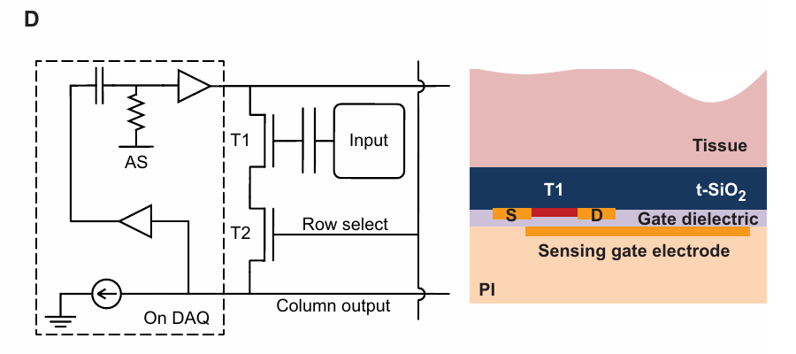
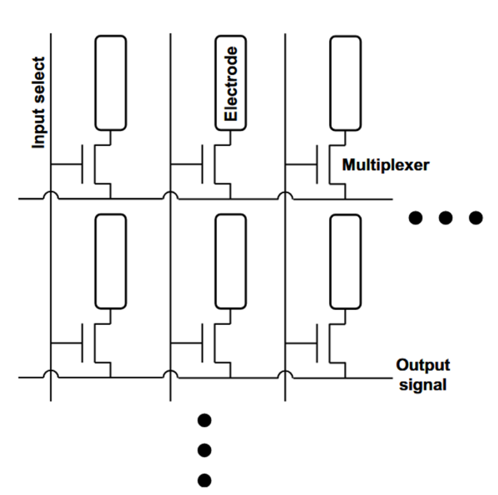
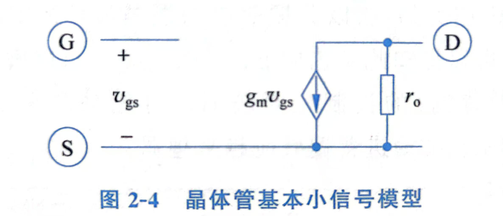
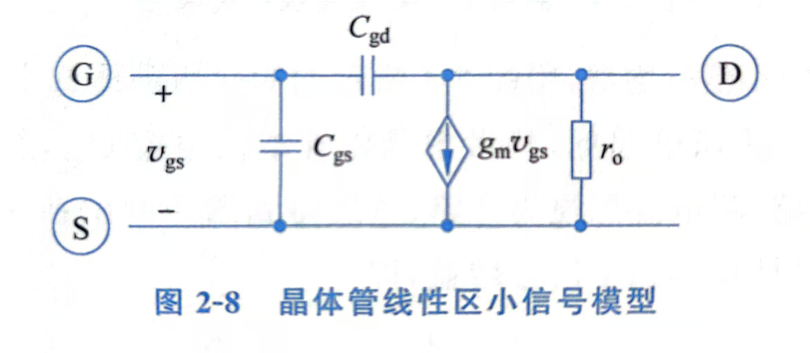

# 1T、2T 与电容耦合读出电路的理论分析

## 10/13芯片设计团队会议纪要

1. **1T：** 氧化物 TFT 的导通电阻约为 $20\,\mathrm{k\Omega}$，高于实测仅几 kΩ 的金电极阻抗；这是串联噪声的主要关注项，继续优化电极—组织界面阻抗的收益有限。
2. **电压采集的 2T：** 传感晶体管在前，采用源极跟随器；没有大于 1 的电压增益，选通 TFT 仍位于源极读出通路，其噪声未被消除。
3. **电流采集的 2T：** 选通晶体管在传感管漏极侧，传感管以共源跨导方式把栅压转成电流；有限的 TFT 导通能力会限制有效跨导。
4. **电容耦合：** 2017、2020年的论文用了 SiO₂ 封装电容耦合方案，会议担心增加隔直电容后栅极 DC 工作点不受控，甚至可能使电路不成立；提出“依靠寄生电容稳定 DC”的猜测，以及在传感管栅极上下各加一只 TFT、以大电阻提供偏置的改进设想。
5. **NeuroCam：** 针对 DC 漂移，可进一步设计直流失调消除（DCOC）电路。

后续工作：按小信号理论模型计算电流读出 2T 的增益与各项输入参考噪声；依据实际电极面积和 SiO₂ 厚度计算耦合电容及低频传输条件。

约定：$v_E$ 为电极电压，$Z_E$ 为电极等效阻抗，$T_S$ 为传感晶体管，$T_R$ 为选通晶体管。以下均在行选稳定的直流工作点附近建立小信号模型；$S_x(f)$ 表示单边噪声功率谱密度，各噪声源暂按互不相关处理。输出噪声折回电极端时，除以电极到输出传递函数的模平方；目标频带 $[f_L,f_H]$ 内的 RMS 噪声为

$$S_{v,\mathrm{in}}(f)=\frac{S_{v_o}(f)}{|H(f)|^2},\qquad v_{n,\mathrm{in}}=\sqrt{\int_{f_L}^{f_H}S_{v,\mathrm{in}}(f)\,df}.$$

## 1. 会议中的 1T 问题

现有 1T 结构中，电极、选通 TFT 和列端串联。已知 TFT 导通电阻约 $20\,\mathrm{k\Omega}$，金电极阻抗为几 kΩ，故 TFT 是这条串联通路中较大的阻抗。仅从串联阻抗和理想电阻热噪声考虑，继续减小已较低的电极阻抗，收益小于降低 TFT 导通电阻。

```text
v_E ── Z_E ──[e_E]── R_on ──[e_R]──● v_o
                                     │
                                    Z_L
                                     │
                                    地
```

$e_E$、$e_R$ 分别是电极与导通电阻的等效串联噪声。设后端直接叠加的电压噪声为 $e_A$，则

$$H_{1T}=\frac{Z_L}{Z_E+R_{on}+Z_L},\qquad
S_{v,\mathrm{in},1T}=S_{e_E}+4kTR_{on}+\frac{S_{e_A}}{|H_{1T}|^2}.$$

这里把 TFT **作为理想电阻**，其热噪声为 $\sqrt{4kTR_{on}}$；该近似与直流、小信号电阻的区别见文末“补充说明”。代入 $R_{on}=20\,\mathrm{k\Omega}$、$T=300\,\mathrm K$，得 $18.2\,\mathrm{nV}/\sqrt{\mathrm{Hz}}$；若带宽为 $B$，该项 RMS 为 $18.2\sqrt{B/\mathrm{Hz}}\,\mathrm{nV}$。若把电极在某一频带近似为电阻 $R_E$，两项热噪声功率之比为 $R_{on}:R_E$。电极是复阻抗时，热平衡模型应使用 $4kT\operatorname{Re}Z_E(f)$，不能把 $|Z_E|$ 直接代入。

若单通道采样率为 $f_s=100\,\mathrm{kS/s}$，并假设采样前的理想抗混叠低通截止于 $f_s/2=50\,\mathrm{kHz}$，则 $B_{\mathrm{ENBW}}=50\,\mathrm{kHz}$，输入参考电阻热噪声为

$$v_{n,R}=\sqrt{4kTR_{on}B_{\mathrm{ENBW}}}
=\sqrt{4(1.380649\times10^{-23})(300)(20\times10^3)(50\times10^3)}
\approx4.07\,\mu\mathrm{V}_{\mathrm{RMS}}.$$

采样率本身不决定噪声带宽。若抗混叠滤波器不是理想砖墙，应代入实际的 $B_{\mathrm{ENBW}}=\int_0^\infty |H_{AA}(f)|^2\,df$；高于奈奎斯特频率且未被滤除的噪声会混叠。若 $100\,\mathrm{kS/s}$ 是多路复用总速率，还须先确定每通道有效采样率。

## 2. 会议中的两种 2T 方案

### 2.1 电压读出：源极跟随器

传感管栅极接电极，漏极接电源，源极经选通管到列端。令选通管的理想电阻近似为 $R_R$，列端对地导纳为 $Y_L$；传感管、偏置电流汇、列端输入电流和读出电压的噪声谱分别为 $S_{i_S}$、$S_{i_B}$、$S_{i_A}$、$S_{e_A}$：

```text
              电源（交流地）
                    │
v_E ── 栅极 → T_S 源极 ● s ──[e_R]── R_R ──● v_o → [e_A] → 读出
                    │                       │
                 偏置电流汇 i_B           Y_L ∥ i_A
                    │                       │
                   地                      地
```

令 $g_{mS}$、$g_{dsS}$ 分别为 $T_S$ 的跨导和输出电导，$H_E=v_g/v_E$，$G_R=1/R_R$，并定义 $a_S=g_{mS}+g_{dsS}$、$D_{SF}=a_S(G_R+Y_L)+G_RY_L$。对源极和列端列小信号节点方程，可得

$$H_{SF}\equiv\frac{v_o}{v_E}=H_E\frac{g_{mS}G_R}{D_{SF}},\qquad
A_{SF}\big|_{Y_L=0}=\frac{g_{mS}}{g_{mS}+g_{dsS}}<1.$$

将各独立噪声源的输出谱除以 $|H_{SF}|^2$，得到输入参考电压噪声：

$$\begin{aligned}
S_{v,\mathrm{in},SF}=S_{e_E}+\frac{1}{|H_Eg_{mS}|^2}\Bigg[
&S_{i_S}+S_{i_B}+|a_S|^2S_{e_R}\\
&+\left|\frac{a_S+G_R}{G_R}\right|^2S_{i_A}
+\left|\frac{D_{SF}}{G_R}\right|^2S_{e_A}
\Bigg],\qquad S_{e_R}=4kTR_R.
\end{aligned}$$

各项依次对应电极、传感管、偏置电流汇、选通电阻、列端输入电流和后端电压噪声。若 $Y_L\to0$ 且忽略 $S_{i_B},S_{i_A}$，上式化为 $S_{e_E}+S_{i_S}/|H_Eg_{mS}|^2+(4kTR_R+S_{e_A})/|H_EA_{SF}|^2$。源极跟随器没有大于 1 的电压增益，选通管噪声仍需计入。

### 2.2 电流读出：漏极侧选通与 TIA

传感管栅极接电极，源极接 TIA 求和点，选通管位于漏极供电侧。TIA 将源极近似保持在交流地；$T_S$ 将栅电压转换为电流，TIA 再通过反馈阻抗 $Z_F$ 将电流转换为电压。像素本身的输出首先是 **电流**。

```text
          电源（交流地）
                 │
             G_R ∥ i_R       选通管等效
                 │
                 ● x          T_S 漏极
                 │
       ┌─────────┼─────────┐
       │         │         │
     g_dsS    g_mS·v_g    i_S       传感管等效
       │         │         │
       └─────────┼─────────┘
                 │
                 ● s ≈ 0 ─── TIA ─── v_o
                       └── Z_F ──────┘

v_E ── Z_E ──● v_g；H_E=v_g/v_E
```

$G_R$ 是从内部节点 $x$ 看向选通管的线性化导纳；当选通管栅极交流接地且 $x$ 为其源极时，$G_R=g_{mR}+g_{dsR}$；若将其简化成理想电阻，则 $G_R=1/R_R$。令 $D=G_R+g_{dsS}$、$\eta=G_R/D$、$\beta=g_{dsS}/D$。在 $x$ 节点列 KCL，并将所得 $v_x$ 代入传感管输出电流：

$$
Dv_x+g_{mS}v_g+i_S+i_R=0,
$$

$$
i_{col}=g_{mS}v_g+g_{dsS}v_x+i_S
=\eta g_{mS}v_g+\eta i_S-\beta i_R.
$$

因此电极到输出的理论传递函数为

$$g_{m,\mathrm{eff}}=\eta g_{mS}
=\frac{G_R}{G_R+g_{dsS}}g_{mS}
=\frac{g_{mS}}{1+g_{dsS}R_R}\quad(G_R=1/R_R),\qquad
H_{2T}=-H_Eg_{m,\mathrm{eff}}Z_F,\qquad
Z_F=R_F\parallel\frac{1}{j2\pi f C_F}.$$

这里 $g_{m,\mathrm{eff}}$ 是从传感管栅压到列电流的等效跨导；最后一种写法仅在选通管可近似为两端电阻时使用。

令 $S_{i_A}$ 为 TIA 输入电流噪声谱，$S_{e_A}$ 为 TIA 输入电压噪声谱。反馈电阻可等效为输入电流噪声 $S_{i_F}=4kT/R_F$。再令 $Y_F=1/Z_F$、$Y_P$ 为求和点其它并联导纳、$Y_{pix}\simeq\eta(g_{mS}+g_{dsS})$ 为像素从源极看入的导纳。各独立噪声源传至输出后相加：

$$\begin{aligned}
S_{v_o}={}&|H_{2T}|^2S_{e_E}
+|Z_F|^2\left(\eta^2S_{i_S}+\beta^2S_{i_R}+S_{i_A}+\frac{4kT}{R_F}\right)\\
&+\left|1+Z_F(Y_P+Y_{pix})\right|^2S_{e_A}.
\end{aligned}$$

除以 $|H_{2T}|^2=|H_Eg_{m,\mathrm{eff}}Z_F|^2$，得到逐项输入参考表达式：

$$\begin{aligned}
S_{v,\mathrm{in},2T}={}&S_{e_E}
+\frac{S_{i_S}}{|H_E|^2g_{mS}^2}
+\frac{g_{dsS}^2S_{i_R}}{|H_E|^2g_{mS}^2G_R^2}\\
&+\frac{S_{i_A}+4kT/R_F}{|H_Eg_{m,\mathrm{eff}}|^2}
+\left|\frac{Y_F+Y_P+Y_{pix}}{H_Eg_{m,\mathrm{eff}}}\right|^2S_{e_A}.
\end{aligned}$$

右侧五项依次为电极、传感管、选通管、TIA 输入电流与反馈电阻、TIA 输入电压噪声。传感管噪声以 $\eta$ 传至列端，折回输入后 $\eta$ 相消；选通管噪声以 $\beta$ 传至列端，因而其输入参考项还取决于 $g_{dsS}/G_R$。若选通管可视作热平衡的理想电阻，则 $S_{i_R}=4kTG_R$；若用简单传感管白噪声模型，可取 $S_{i_S}=4kT\gamma_Sg_{mS}$。实际 TFT 的 $1/f$ 噪声应加进对应的 $S_i(f)$，不可用理想电阻白噪声替代整个器件。代入上述简化白噪声模型，传感管与选通管两项分别为

$$S_{v,S}=\frac{4kT\gamma_S}{|H_E|^2g_{mS}},\qquad
S_{v,R}=\frac{4kTg_{dsS}^2}{|H_E|^2g_{mS}^2G_R}.$$

**不需要从“有跨导增益”直接推断 2T 总噪声更低**；比较 1T 与两种 2T 时，应将各自的 $S_{v,\mathrm{in}}(f)$ 在同一频带积分。

## 3. Chiang 等（2020）的 SiO₂ 封装电容耦合

论文 [Chiang 等，*Science Translational Medicine* 12, eaay4682 (2020)](https://doi.org/10.1126/scitranslmed.aay4682) 图 1D 的结构是：组织与感测栅电极之间隔着热生长 SiO₂；组织电位经这层封装介质电容耦合至 T1 栅极。T1 是源极跟随器，T2 用于行选；板卡提供可调电流汇和有源屏蔽，后者把输出的交流分量反馈至 T1 漏极，并叠加可调 DC 偏置。**这不是在原有 1T 漏源串联通路中额外插入一只电容。**



图源：Chiang 等（2020），图 1D；左为单元电路与板卡有源屏蔽，右为组织、热氧化 SiO₂、T1 与感测栅电极的剖面。

### 3.1 根据论文尺寸估算耦合电容

补充信息“Device fabrication”（第 3 页）给出封装介质来自 SOI 的 **1000 nm SiO₂**；正文“Capacitive sensing”（第 9 页）给出灵长类电极 $100\times180\,\mathrm{\mu m^2}$、大鼠电极 $195\times270\,\mathrm{\mu m^2}$。取 SiO₂ 相对介电常数 $\epsilon_r\approx3.9$（计算假设），忽略边缘场：

$$C_{\mathrm{sense}}\simeq\frac{\epsilon_0\epsilon_r A}{t},\qquad t=1.0\,\mathrm{\mu m}.$$

- 灵长类：$A=1.80\times10^{-8}\,\mathrm{m^2}$，$C_{\mathrm{sense}}\approx0.62\,\mathrm{pF}$，在 $1\,\mathrm{kHz}$ 的容抗约 $256\,\mathrm{M\Omega}$。
- 大鼠：$A=5.265\times10^{-8}\,\mathrm{m^2}$，$C_{\mathrm{sense}}\approx1.82\,\mathrm{pF}$，在 $1\,\mathrm{kHz}$ 的容抗约 $87.5\,\mathrm{M\Omega}$。

正文报告同一结构的电容估计约为 **0.7 pF（灵长类）**、**2 pF（大鼠）**，分别对应约 $230\,\mathrm{M\Omega}$、$80\,\mathrm{M\Omega}$（1 kHz）；平行板估算与之接近。这些数值属于论文的电极尺寸，不能直接当作我们器件的电容。

### 3.2 交流传递与 DC 工作点

令 $C_g$ 为 T1 有效栅电容，$C_p$ 为其他对交流固定节点的寄生电容；在这些节点近似交流固定时，理想电容分压为

$$\frac{v_g}{v_E}\simeq\frac{C_{\mathrm{sense}}}{C_{\mathrm{sense}}+C_g+C_p}.$$

正文给出 $C_{\mathrm{sense}}/C_g=3.3$（灵长类）和 $4.9$（大鼠）。暂忽略 $C_p$，上述因子分别为 $0.77$ 和 $0.83$；实际增益还取决于源极跟随器、寄生电容及有源屏蔽，不能只用几何电容决定。T1 的本地缓冲使这类高容抗电极仍可读出交流信号。

**电容本身不设定唯一的栅极 DC 电位。** 若栅极理想绝缘、漏电忽略，$Q_0=C_{\mathrm{sense}}(V_g-V_E)+C_g(V_g-V_{ch})+C_p(V_g-V_p)$ 是由初始状态决定的栅极电荷。寄生电容只能改变电荷分配，不能把栅极钳到某个 DC 电压。论文已展示这种结构能够记录信号，因此不能由“图中没有栅极偏置电阻”直接判定电路不成立；但仅凭图 1D 也不能推断其栅极 DC 点由封装电容自动稳定。板卡的电流汇和有源屏蔽调节 T1 的工作条件，补充信息第 4 页所述 **0.0016 Hz 输出高通** 去除的是缓冲后的平均电极 DC 偏移，不等于直接固定栅极 DC 点。

若我们的设计要求 **明确、可重复的栅极偏置**，会议提出的上下两只 TFT 可等效为 $R_H,R_L$，分别接 $V_H,V_L$：$R_B=R_H\parallel R_L$、$V_B=(V_H/R_H+V_L/R_L)/(1/R_H+1/R_L)$。在简化的单节点模型中，$f_{HP}\simeq[2\pi R_B(C_{\mathrm{sense}}+C_g+C_p)]^{-1}$。这属于拟议改进，不是论文图 1D 原有器件；还应计入偏置 TFT 的噪声。

## 4. NeuroCam 的 DCOC

将 DC 偏移消除电路抽象为低频反馈环路时，信号通道可写成一阶高通形式

$$H_{DCOC}(s)=\frac{s}{s+\omega_D},\qquad f_D=\frac{\omega_D}{2\pi}.$$

它抑制 DC 与低于 $f_D$ 的漂移，也同时衰减该频段内的信号。若 DCOC 设在列端，必须在模型中区分逐像素偏移与公共列偏移；二者是否能由同一状态变量抵消，取决于行扫描和环路结构。

## 5. 后续理论计算顺序

1. 固定相同的 $H_E(f)$、$Z_L(f)$、TIA 噪声模型和积分频带，分别计算第 1、2 节三种拓扑的输入参考 PSD 与积分 RMS；逐项列出电极、选通管、传感管和后端贡献。
2. 对第二种 2T 扫描理论参数 $g_{mS}$、$g_{dsS}$、$G_R$、$R_F$、$C_F$，由 $g_{m,\mathrm{eff}}$ 与 $S_{v,\mathrm{in},2T}$ 同时判断增益和噪声的变化。
3. 用我们器件的实际感测面积与 SiO₂ 厚度计算 $C_{\mathrm{sense}}$；与 $C_g,C_p$ 一起求交流分压。若采用两只偏置 TFT，再由目标低频截止频率求 $R_B$ 并计入其噪声。

## 补充说明：原1T 开关的工作区&小信号模型等效

### 1. 电路性质与工作区

<p align="center"></p>

在生物实验中，电极接 TFT 漏极 $D$，PXIe-4309 （差分输入）的 AI+ 接源极 $S$，AI− 与颅钉参考接同一地，行选通信号将栅极置于 $V_G=6\,\mathrm V$。它的主要功能是 **传输开关**。

行选稳定时栅极为交流地，按公共端可说“接近共栅”，但通常意义上的共栅放大器是源极输入、漏极输出的电流跟随器，与该电路并不相同。

若 $V_D\ge V_S$，增强型 n 沟道晶体管处于线性区的判据为

$$V_{GS}=6-V_S>V_{TH}$$

$$0\le V_{DS}<V_{GS}-V_{TH}$$

已知 $V_{TH}\approx4$–$5\,\mathrm V$，以上条件可简化为 $V_D<6-V_{TH}=1$–$2\,\mathrm V$，且 $V_S<1$–$2\,\mathrm V$。

在实际情况下，$V_D$为神经信号，约为几百微伏的交流信号，由于存在颅钉作为电位参考，其直流电位近似为零, $V_S$ 存在 DC offset，有一定的直流偏移（约在 $\pm 1\,V$量程范围内），TFT 工作在 **深线性区**。（由于直流偏移，可能出现 $V_D<V_S$，对近似对称的 TFT，可以实际较低电位端作为有效源极重新判断。）

### 2. 饱和区与线性区的小信号模型对比

用长沟道模型进行分析，令 $\beta=\mu C_{ox}W/L$、$V_{OV}=V_{GS}-V_{TH}$

#### 2.1 饱和区小信号模型

当 $V_{GS}-V_{TH}>0$， $V_{DS}>V_{GS}-V_{TH}$ 时，晶体管工作在饱和区，电压电流关系为：

$$
I_D=\beta(V_{GS}-V_{TH})^2
$$

可以看出漏极电流 $I_D$ 由栅源电压 $V_{GS}$ 决定，可通过求偏导数得到跨导

$$
g_m=\frac{\partial I_D}{\partial V_{GS}}=2 \beta(V_{GS}-V_{TH})=\frac{2I_D}{V_{OV}}
$$

如考虑沟道长度调制效应，引入与 $V_{DS}$ 调控电流相关的系数 $\lambda$，即

$$
I_D=\beta(V_{GS}-V_{TH})^2(1+\lambda V_{DS})
$$

因此引入电导

$$
g_{ds}=\frac{\partial I_D}{\partial V_{DS}}= \beta(V_{GS}-V_{TH})^2 \lambda=\frac{\lambda I_D}{1+\lambda V_{DS}}\approx\lambda I_D
$$

通常在小信号模型中将该电导表示成输出电阻的形式，即

$$
r_o=\frac{1}{g_{ds}}=\frac{1}{\lambda I_D}
$$

饱和区最基本的小信号模型如下图所示（未考虑电容的影响）
<div align="center">

</div>
<br>

#### 2.2 线性区小信号模型

当 $V_{GS}-V_{TH}>0$， $V_{DS}<V_{GS}-V_{TH}$ 时，晶体管工作在线性区，电压电流关系为：

$$
I_D=\beta[(V_{GS}-V_{TH})V_{DS}-\frac{1}{2}V_{DS}^2]
$$

线性区跨导为

$$
g_m=\frac{\partial I_D}{\partial V_{GS}}=\beta V_{DS}
$$

晶体管工作在线性区时漏源电压 $V_{DS}$ 较小，相较于饱和区，线性区跨导更小

输出电阻为

$$
r_o=\frac{1}{\partial I_D/\partial V_{DS}}=\frac{1}{\beta(V_{GS}-V_{TH}-V_{DS})}
$$

这里的 $r_o$ 是线性区的 **微分导通电阻**，不依赖饱和区的沟道长度调制（厄利效应）。线性区小信号模型如下图所示

<div align="center">

</div>
<br>

#### 2.3 线性区小信号模型计算出的传递函数

对源极列KCL方程

$$
\frac{v_d-v_s}{r_o}-g_mv_s=\frac{v_s}{Z_L}
$$

对漏极列KCL方程

$$
\frac{v_E-v_d}{Z_E}=\frac{v_d-v_s}{r_o}-g_mv_s
$$
其中电极输入等效为戴维南源，电极电压为 $v_E$，电极阻抗为 $Z_E$、板卡等效交流负载阻抗为 $Z_L$，漏极输入到源极输出的传递函数为

$$
\frac{v_s}{v_E}=\frac{Z_L}{Z_E+(1+g_mr_o)Z_L+r_o}
$$

### 3. PXIe-4309 会把 $V_S$ 稳定在 0 V 吗？

**不会主动钳位到 0 V。** [PXIe-4309 用户手册](https://download.ni.com/support/manuals/377024a.pdf)把 AI+、AI− 描述为差分电压输入，前端具有浮置输入电路、信号调理、缓冲和 SAR ADC。其[规格](https://www.ni.com/docs/en-US/bundle/pxie-4309-specs/page/specs.html)写明输入为 **DC 耦合**；[NI 的输入阻抗说明](https://www.ni.com/en/support/documentation/supplemental/19/specifications-explained--ni-dsa---sc-express-daq.html)给出 PXIe-4309 输入阻抗 **大于 10 GΩ**。AI− 外接地使板卡读数为 $V_{AI+}-V_{AI-}=V_S$，但不等于把 AI+ 接地。手册没有给出一个可用来设定 $V_S=0$ 的内部低阻偏置电路。

有限输入阻抗和输入电流确实会给 $V_S$ 带来 **弱负载或偏移**，因此在直流节点方程中不能完全删去板卡。把电极表示为开路电位 $V_E$ 与直流源阻抗 $R_{E,DC}$，把板卡输入暂近似为对参考端的 $R_{IN,DC}$ 和吸入板卡的偏置电流 $I_B$，导通 TFT 暂近似为 $R_{on}$，则

$$\frac{V_E-V_S}{R_{E,DC}+R_{on}}
=\frac{V_S}{R_{IN,DC}}+I_B,$$

$$\boxed{V_S=
\frac{V_E-(R_{E,DC}+R_{on})I_B}
{1+(R_{E,DC}+R_{on})/R_{IN,DC}}}.$$

这个 $R_{IN,DC}$ 是 **分析用的等效量**：NI 的“$>10\,\mathrm{G\Omega}$”不能据此解释成一只已知数值、直接把 AI+ 接到外部地的实物电阻。公式说明 $V_S$ 由电极 DC 电位、导通通路和板卡负载共同决定；当输入负载很弱且偏置电流可忽略时，$V_S\approx V_E$，而不是板卡强行使 $V_S=0$。关断行失去 TFT 导通路径后，板卡的弱输入负载也不能保证列节点迅速或精确回零。

手册还要求低源阻抗以获得最佳测量性能，[规格](https://www.ni.com/docs/en-US/bundle/pxie-4309-specs/page/specs.html)给出的建议是从 DC 到 2 MHz 保持源阻抗不高于 $50\,\Omega$。这与“输入阻抗很高、直流加载较弱”并不矛盾：$20\,\mathrm{k\Omega}$ 的开关通路对静态分压可能很小，却仍会增加输入切换和采样时的建立误差。自动归零校正的是测量链失调，也不会把外部 $V_S$ 固定到 0 V。

### 4. 什么条件下有 $V_{S,DC}=0$、$v_{S,AC}=v_{neural}$？

这可以作为 **理想化目标**，但须同时满足：电极相对颅钉参考的 DC 电位 $V_{E,DC}=0$；行选 TFT 深三极管区导通；板卡输入电流与加载可忽略；交流通路已建立且在目标频带内 $|v_s/v_E|\approx1$。在这些条件下，$V_{S,DC}=0$，$v_{S,AC}\approx v_{neural}$。

更一般的理想“无损开关”关系是 **$V_S(t)=V_E(t)$**。若电极相对参考存在 DC 偏移 $V_{E,DC}$，理想开关同样会把它传到 $S$ 极，即 $V_{S,DC}=V_{E,DC}$；颅钉接地和 AI− 接地本身不会消除这个偏移。要得到零 DC 基线，需输入电极本来为零，或另有明确的偏置/去直流机制。
