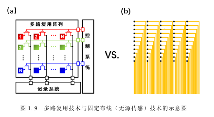
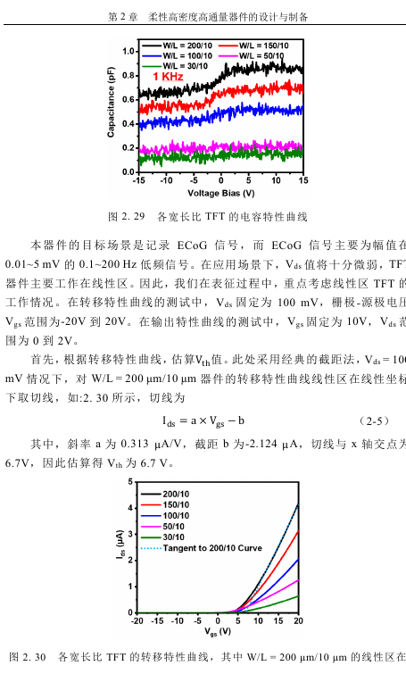
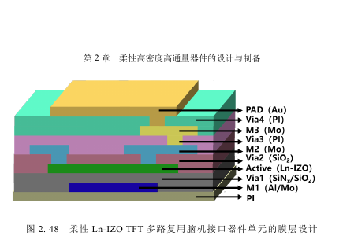
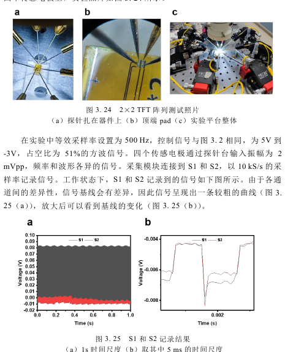
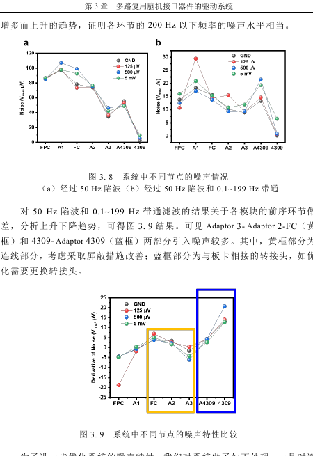
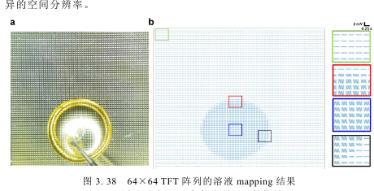
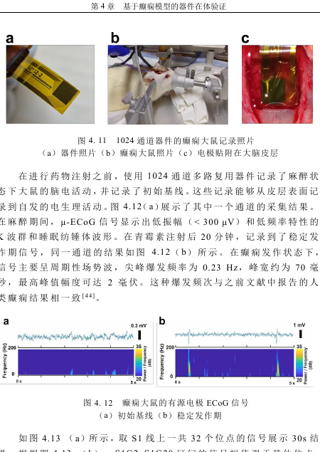
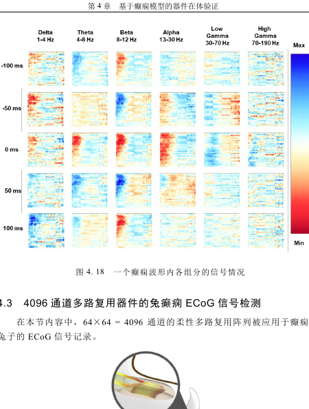

# TFT 柔性高密度 ECoG：项目背景、前沿进展、创新与后续工作

> 资料范围：谢杨博士论文《柔性高密度高通量多路复用脑机接口器件及应用研究》（167 页），本工作区 [TFT1.md](TFT1.md)、[TFT2.md](TFT2.md) 与“分析该电路”会话，以及文末列出的原始研究论文。文中“论文成果”指谢杨论文中已经完成的器件与实验；“我们方案”指目前的双 IGZO TFT + TIA 设计和初步仿真。后者的性能优势尚待实测。论文插图裁自用户提供的 PDF，图号与 PDF 物理页码均在图注中注明。

## 1 项目背景

ECoG 在皮层表面记录神经群体活动。大面积、高空间分辨率的记录需要大量电极；若每个电极都单独引出导线，互连数量、柔性封装和后端采集通道会迅速成为瓶颈。利用薄膜晶体管（TFT）在阵列内逐行选通、逐列读出，可把大量记录点复用到较少的引线上。与此同时，皮层贴合、长期防水、低电极阻抗、低噪声和足够的单点采样率必须一同满足。

谢杨论文以金属氧化物 TFT（器件截面图标注为 Ln-IZO）及柔性工艺为基础，研究器件、电路、驱动系统和应用的完整链路。其目标是用约百根驱动引线支持千至数千个 ECoG 记录点，同时保持柔性贴合和可用信号质量。我们目前的研究以这一系统问题为起点，进一步关注像素端有源传感和列端跨阻放大能否改善高阻电极的读出质量。

### 1.1 为什么要同时追求覆盖范围与空间分辨率

皮层活动既有跨脑区传播的大尺度结构，也有局部神经群体的细小差异。癫痫放电的起始、传播方向和局部波形可能因记录点位置而不同；只提高单点信噪比而不增加空间采样，会丢失传播信息。反过来，只把电极数堆高而没有足够的采样率和低噪声链路，空间上“有点位”也不等于获得可解释的数据。因此阵列设计应同时规定覆盖面积、点位间距、每通道有效采样率和目标频带，而不能仅以总通道数排名。

电极缩小通常有利于空间分辨率，却也可能提高电极阻抗，使接触噪声、输入电流噪声和输入电容分压更显著。柔性薄膜可以改善与曲面皮层的贴合，但超薄基底、金属互连和封装又增加制造、植入和长期浸液可靠性的难度。项目的核心工程问题因而是 **在可植入柔性形态中，建立从电极到数字数据都可量化的高密度读出链路**。

### 1.2 引线瓶颈与阵列内复用

传统无源阵列为每个点位提供独立引线，通道数接近引线数。随着电极数升至千级，扇出区、连接器、线缆和后端放大器的规模随之增长。主动矩阵把像素编成行和列，通过行扫描与列共享读出减少扇出数量。代价是每个像素只在其选通窗口内被观测，必须在有限时间内完成开关闭合、列节点建立、采样和复位；前一行残留电荷、ROW 馈通、列间不一致和外部时钟噪声都可能进入信号。

*图 1：论文图 1.9，PDF 第 45 页。左图示意共享行列的复用网络，右图示意每电极独立布线。图示的是互连拓扑，不代表主动矩阵能自动提高单点信噪比。*

对于 $N_r\times N_c$ 阵列，理想情况下行列地址与列读出规模大致随 $N_r+N_c$ 增长，而独立布线随 $N_rN_c$ 增长。实际引线还包括偏置、电源、地和辅助控制，因此“约百根”应理解为具体系统设计的报告值。若逐行采样，每点有效采样率还受到总行数、行切换开销及列端并行度限制；这是 1024 通道与 4096 通道系统性能不能仅按电极数比较的原因。

### 1.3 从电极到数字码的完整链路

ECoG 信号先经过电极—组织界面，再到 TFT 像素、共享列线、放大及滤波电路、ADC，最后进入数字处理。任一环节可能设定系统上限：电极阻抗过高会增加加载及噪声；TFT 的 $1/f$ 噪声会落在低频 ECoG 频带；列电容和 ROW 切换决定建立时间；运放输出摆幅限制可用增益；ADC 的输入量程与采样方式决定最后的数据质量。项目必须对这条完整链路同时给出增益、噪声、带宽、功耗和串扰预算。

过去“分析该电路”会话提出了重要区分：1T 漏极侧被动传感时，电极可能承受沟道/负载电流，电极阻抗 $Z_E$ 直接参与传输函数；栅极传感时，低频理想绝缘栅几乎不取电流，电极阻抗对信号加载较弱。然而栅漏电、$C_{gs}$、$C_{gd}$、焊盘及连线寄生使实际输入导纳不为零，所以需要验证 $|Z_E(f)Y_{\mathrm{in,g}}(f)|\ll1$ 在目标频带内是否成立。即使成立，电极阻抗的热噪声和电化学噪声仍不可删去。

### 1.4 本项目的具体研究问题

本工作要回答的不是“能否做更多通道”这一个问题，而是：借鉴论文已证明的柔性金属氧化物 TFT 复用平台，将像素从单管开关发展为双 IGZO 管有源传感时，能否在相同电极、行列规模、采样率和采集链路条件下，取得可重复的输入参考噪声或信号质量改善？若有改善，需要付出的面积、静态电流、偏置电压和驱动复杂度是否可接受？如果没有改善，是器件 $1/f$ 噪声、输入电容、TIA 噪声，还是阵列动态限制了收益？这些可测问题决定了后续实验和对照设计。

### 1.5 需要同时成立的四个尺度

本课题跨越四个尺度。第一是微米尺度的电极与 TFT：电极面积、介质厚度、重叠电容及接触电阻决定输入和开关特性。第二是毫米到厘米尺度的阵列：行列金属的长度、片电阻和分布电容决定扫描速度及串扰。第三是系统时间尺度：神经信号在毫秒到秒级变化，而 ROW 边沿和 TIA 建立可能在微秒到毫秒级发生，两个时间尺度重叠时会产生难以靠后处理消除的伪影。第四是使用寿命尺度：短时间测试通过后，浸液、机械弯折与偏压应力仍可能改变阈值、电极阻抗和封装完整性。

这四个尺度要求评价指标具备可追溯性。例如“带宽”要明确是单个晶体管的跨导带宽、闭环 TIA 带宽，还是扫描后的每通道有效带宽；“噪声”要明确是电极端输入参考谱、列输出谱，还是 ADC 的数字码方差；“通道数”要同时报告实际可用通道率。若不声明测量节点和条件，同名指标在不同论文之间可能无法比较。项目介绍应把每个数据都绑定到样品、偏置、频带、采样率和测量节点。

### 1.6 为什么电路创新必须接受系统检验

在理想小信号模型中，增加传感管跨导有望提升信号电流；但真实阵列中，较大的传感管还可能抬高栅极输入电容和列节点寄生，使高阻电极发生频率相关衰减、TIA 增加电压噪声耦合，并延长行切换后的建立时间。像素增加一只管也意味着额外静态功耗和面积，可能迫使点距变大或减少覆盖面积。一个单像素增益更高的电路，若让同等面积内记录点更少，未必改善癫痫波传播的空间映射。因此本项目的成功标准应是同一应用场景下的系统收益，而非某一器件参数刷新。

## 2 前沿进展与论文已完成工作

### 2.1 高密度柔性复用阵列

论文制作并验证了 **1024 通道和 4096 通道** 两类柔性阵列。开发过程先用刚性晶体管阵列验证电学方案，再优化器件电学特性、防水性与电极阻抗，最后转向超薄柔性器件。4096 通道版本达到 **44 sites/mm²**，引线压缩至约百根；这些是该论文的器件指标，而非本项目新方案的指标。

### 2.2 驱动、采样与应用验证

论文分析 TFT 在周期性选通时的电平波动及稳定区间，并建立控制模块与记录模块协同的驱动系统，以抑制高速开关带来的干扰。摘要报告 1024 通道阵列可工作于 **500 S/s/通道**，4096 通道阵列可工作于 **250 S/s/通道**。论文还通过磷酸盐缓冲液环境测试空间分辨率，并在癫痫大鼠、家兔实验中记录 ECoG；与自制无源微电极阵列所得波形作了比较。这些验证说明多路复用系统可以工作，但不能直接证明新增有源像素结构的性能。

### 2.3 相关电路路线及关键权衡

此前电路分析比较了三类读出结构：柔性单晶硅 **2T 源极跟随/电压读出**、MoS₂ **2T 栅极传感/电流加 TIA 读出**，以及 IGZO **1T 被动电压复用**。1T 结构像素简单、面积较省，但电极阻抗直接进入信号通路；源极跟随结构提供缓冲，电压增益通常小于 1；2T 电流/TIA 结构在像素内将栅极电压转为电流，再由列端 TIA 转成电压，必须处理偏置、列电容、稳定性和功耗。材料体系和读出拓扑的比较详见 [TFT1.md](TFT1.md)，不应把不同论文或方案的指标混为同一实测结果。

### 2.4 论文的器件路线：从 TFT 到柔性阵列

论文并非只展示一张高通道数电极片，而是按“器件—封装—系统—应用”的顺序建立证据链。第 2 章先讨论金属氧化物 TFT 的转移特性、导通/关断与寄生参数，再优化电极和封装。论文图 2.29、2.30 展示不同宽长比器件的电容与转移曲线：增大器件宽度可能提高电流能力，但寄生电容也增加。这与我们之后的尺寸优化直接相关——不能把更大的 $g_m$ 视为单调改善。

*图 2：论文图 2.29–2.30，PDF 第 66 页。宽长比改变电容及转移特性；不同工艺和偏置下的实际参数需由测试确认。*

论文图 2.48 给出柔性 Ln-IZO TFT 复用器件单元的层叠设计。它强调器件电学特性之外的工艺约束：有源层、介质层、通孔、金属电极、柔性衬底与封装必须共同工作。对我们的双管像素，增加一个 TFT 也意味着布线、像素面积、重叠电容、漏液路径和良率的变化，不能只改 SmartSpice 网表而忽略版图与工艺。

*图 3：论文图 2.48，PDF 第 78 页。原论文使用 Ln-IZO 有源层；本文拟研究的双 IGZO 管需要对应工艺重新设计和验证，不能直接沿用材料参数。*

论文报告的 1024 与 4096 通道是器件、驱动和外部采集协同后的系统结果。实际阵列点位数量扩大四倍，并不会自动保持每通道采样率；论文摘要所报告的 500 与 250 S/s/通道恰好提醒我们要关注复用比与时序。论文第 3 章先以小规模阵列验证选通和记录，再展开高通量驱动。图 3.24、3.25 的 2×2 测试展示了探针连接和选通前后的波形；它说明“小阵列先把开关、建立和基线做清楚”比直接进入大阵列更可靠。

*图 4：论文图 3.24–3.25，PDF 第 105 页。2×2 阵列的探针实验与记录波形，为我们后续的小规模双管像素验证提供测试顺序参考。*

论文第 3 章还对系统各节点的噪声进行了逐级测量。图 3.8、3.9 说明连接器、转接板、采集卡及滤波配置均可能改变最后的噪声水平。因此我们若观察到 2T 方案的 ADC 噪声变小，必须在相同线缆、连接、滤波和采样条件下进行比较，否则无法把改善归因于像素拓扑。

*图 5：论文图 3.8–3.9，PDF 第 94 页。各测试节点与不同滤波条件下的噪声不同，提示要固定测量链路。*

### 2.5 论文的空间映射与动物记录证据

论文在 PBS 环境中对 4096 通道阵列开展 mapping 验证，图 3.38 展示了激励位置与记录空间图案的对应关系。这个测试主要证明通道寻址及空间分辨能力：既要看热点是否落在正确位置，也要评估远端像素是否出现同步伪影。后者恰好可作为双管方案中开关馈通和列串扰的评估模板。

*图 6：论文图 3.38，PDF 第 113 页。64×64 阵列在体外测试液中的空间映射结果。*

论文第 4 章进一步给出癫痫模型中的 ECoG 记录。图 4.11、4.12 展示了 1024 通道器件在大鼠实验中的形态、植入及示例记录；图 4.18 展示 4096 通道器件记录到的空间频带变化。这类结果的重要性在于把工程指标与实际脑信号连接起来，但动物波形同时受麻醉、模型、植入位置和电极接触条件影响，不能单凭一组波形推断某种读出电路具有更低输入参考噪声。

*图 7：论文图 4.11–4.12，PDF 第 124 页。1024 通道器件与大鼠 ECoG 示例记录。*

*图 8：论文图 4.18，PDF 第 128 页。4096 通道阵列记录的时空频带变化。*

### 2.6 与前沿原始文献的比较

| 路线与代表工作 | 已展示的能力 | 对本项目的启发与边界 |
| --- | --- | --- |
| [Viventi 等，*Nature Neuroscience*, 2011](https://pubmed.ncbi.nlm.nih.gov/22081157/) | 柔性硅纳米膜晶体管集成于电极阵列，主动复用减少高密度记录的引线瓶颈，并用于猫脑活动记录 | 证明阵列内晶体管可兼顾密度与柔性；其硅器件工艺和像素结构不能直接当作 IGZO 参数。 |
| [Khodagholy 等，*Nature Communications*, 2013](https://www.nature.com/articles/ncomms2573) | 超薄有机电化学晶体管在大鼠皮层原位记录，展示局部晶体管增益与较高 SNR | 支持“靠近传感点做有源转换”的方向；OECT 的离子耦合、偏置与速度不同于绝缘栅 IGZO TFT。 |
| [Khodagholy 等，*Nature Neuroscience*, 2015](https://www.nature.com/articles/nn.3905) | 超顺应 NeuroGrid 在皮层表面记录 LFP 与浅层神经元活动，展示高密度贴合的重要性 | 高质量电极—组织接触本身很关键；NeuroGrid 不等同于本文的 TFT 多路复用架构。 |
| [Xie 等，NeuroCam 预印本，2024](https://doi.org/10.1101/2024.08.18.608446)及谢杨博士论文 | 金属氧化物 TFT 柔性复用 ECoG，4096 通道、44 sites/mm²、约百根引线 | 是我们的直接系统基线。引用论文指标时需注明为作者器件结果，并保留预印本的发表状态。 |
| [Woodington 等，*Nature Communications*, 2024](https://www.nature.com/articles/s41467-024-50597-2) | 折叠后经小开口植入、在皮层表面展开的柔性 ECoG 阵列 | 提醒大面积覆盖还受植入方式制约；其优势是机械部署，不是对我们噪声问题的直接验证。 |

这些工作的比较不能简单用“通道越多越先进”概括。Viventi 强调硅有源矩阵，OECT 研究强调原位放大，NeuroGrid 强调电极贴合与浅表信号，谢杨论文强调金属氧化物柔性阵列与完整驱动系统。我们提出的双 IGZO 方案位于这些路线的交叉处：借鉴金属氧化物 TFT 复用的系统基础，同时检验栅极有源传感能否解决被动像素对高阻电极的加载问题。论文的 Ln-IZO 工艺数据不能直接替代 IGZO 器件模型。

### 2.7 前沿工作的未解决问题

首先，电极密度与有效数据质量之间的关系仍依赖具体应用。NeuroGrid 的高贴合度和电极材料可以带来浅表信号优势，但其结果不能说明任一 TFT 复用读出都会达到相同质量。主动矩阵降低引线数，却引入开关噪声、行列时序和周期性观测；这些代价需要以通道级信噪比及空间伪影衡量。我们的论文基线已证明 4096 通道 mapping 和动物 ECoG 可行，但仍需在相同电极条件下比较“1T 复用”和“2T 有源传感”的增量收益。

其次，器件材料之间存在不可忽略的工艺差异。硅纳米膜晶体管、OECT、Ln-IZO 和 IGZO 都能用于柔性神经接口，但其载流机制、工作电压、低频噪声、稳定性、封装要求和可用模型不同。把 OECT 报告的局部增益直接代入 IGZO 设计，或把 Ln-IZO 的阈值和噪声直接放入双 IGZO 仿真，都会产生虚假的确定性。合理的文献使用方式是借鉴其架构问题和实验方法，再用我们工艺的实测数据重建参数。

第三，已有研究常把器件密度、机械贴合、电子增益和动物信号分别突出展示，但新体系必须同时通过这些关口。特别是低频 ECoG 与 $1/f$ 噪声、偏置漂移的频段重叠；为了获得高跨导而提高偏置电流，也可能使列端功耗和 TIA 直流偏移难以承受。我们将这些冲突作为明确的设计变量，而不是在项目完成后才讨论其限制。

## 3 我们的创新定位（拟验证）

1. **从 1T 被动复用转向 2T 有源传感。** 用 IGZO 传感晶体管 $T_S$ 的栅极连接电极，让电极电压控制沟道电流；选通晶体管 $T_R$ 位于漏极供电侧，按行接通。列端 TIA 维持 $T_S$ 源极近似虚地并把电流转为电压。目标是在保留阵列复用能力的同时，减轻高阻电极对信号路径的加载。
2. **把电极、像素与采集端作为同一个设计对象。** 不仅比较 TFT 的跨导或噪声，还统一核算电极阻抗及噪声、输入电容、开关馈通、TIA 稳定性、完整信号增益、采集端输出参考噪声和电极输入参考噪声。前者决定 ADC/NI 实际数据质量，后者适合跨结构公平比较。
3. **以可实现偏置和实测模型约束尺寸。** 选通管满足跨导损失、压降和建立时间后采用最小可靠尺寸；传感管在跨导/低频噪声收益与栅电容/求和节点电容代价之间优化。现有模型的尺寸缩放及低频噪声尚未完成实测校准，因此“创新”目前是设计思路与验证计划，不是已证实的性能提升。

### 3.1 像素内高阻传感与列端电流读出

我们选定的像素包括传感管 $T_S$ 和选通管 $T_R$。电极接 $T_S$ 栅极；$T_R$ 从漏极侧接通偏置；$T_S$ 源极连接共享列线及 TIA 求和节点。在闭环有效频带内，TIA 近似固定源极电位，使电极的小电压变化调制 $T_S$ 的沟道电流，列端把电流变化变成可采样的电压。这与论文中仅靠 1T 开关接入电极电压的复用基线不同，也与源极跟随输出不同。

创新假设 A 是：**在目标电极阻抗和频带下，栅极传感可以降低电极阻抗造成的信号加载，并使阵列对电极阻抗离散性的敏感度减小。** 验证时应使用一组已测阻抗的实际电极或等效网络，扫描 $Z_E(f)$，观察 1T 与 2T 的完整增益、相位和噪声。仅在理想电压源输入下比较增益，无法证明这一假设。若输入电容变大，使 $2\pi f|Z_E|C_{\mathrm{in}}$ 接近 1，则 2T 栅极方案也会出现明显衰减。

### 3.2 选通管位置与有效跨导

由于 $T_R$ 位于 $T_S$ 漏极供电侧，它导通时既要给 $T_S$ 提供偏置，又不能过度削弱从电极电压到源端电流的有效跨导。现有小信号模型给出近似关系：

$$
g_{m,\mathrm{eff}}
=\frac{g_{mS}(g_{mR}+g_{dsR})}
{g_{mR}+g_{dsR}+g_{dsS}}.
$$

若要求选通造成的跨导损失不超过 5%，对应 $g_{mR}+g_{dsR}\ge 19g_{dsS}$。这只是低频小信号条件，还要检查 $T_S$ 饱和裕量、$T_R$ 导通压降、ROW 瞬态和列线建立时间。创新假设 B 是：**漏极侧选通能够在可接受的面积和寄生代价下维持足够高的有效跨导，同时让 TIA 列节点保持较低阻抗。** 可用实测工作点和行选通波形逐项验证，而不是以一个 DC $g_m$ 数值代替系统结论。

### 3.3 噪声比较口径的统一

已有讨论明确区分两个噪声口径。要评价 ADC/NI 最终记录的数据，应报告 ADC 输入端或数字输出端的带内输出参考噪声；要比较 1T、2T、不同尺寸和不同增益方案，则应把完整链路输出噪声除以完整电极到采集端的增益，换算为电极输入参考噪声。若只看输出噪声，增益较低的结构可能显得“安静”，但信号同样被压低。

创新假设 C 是：**采用“电极—像素—列前端—采集端”的统一输入参考模型，可以识别有源像素的真实收益与代价。** 模型至少纳入电极噪声，$T_S/T_R$ 低频与热噪声，TIA 的电压/电流噪声，反馈电阻热噪声，列线及其他像素耦合，后级滤波与 ADC 噪声。谱密度需按同一 $f_L$ 到 $f_H$ 积分，并保留测试时的滤波及采样设置。论文图 3.8、3.9 说明系统连接环节本身就可改变测得噪声，因此测量口径必须写进实验记录。

### 3.4 可制造的尺寸优化而非单点仿真最优

增加 $T_S$ 的宽度通常能提高跨导、降低某些输入参考噪声，但也增加栅电容、求和节点电容、面积和 ROW/列耦合。增加 $T_R$ 宽度可以降低选通损失，却同时增加重叠电容与开关注入。IGZO 的接触电阻、陷阱噪声、阈值漂移又使简单硅 MOS 平方律不可靠。因此我们把尺寸问题写成约束优化：在输出摆幅、功耗、相位裕量、建立时间、串扰及良率达标的候选中，比较带内输入参考噪声与面积的 Pareto 前沿，而非声明“$W/L$ 越大越好”。

创新假设 D 是：**用几何尺寸专属模型和实测寄生量校准后，可以找到不同于单纯最大 $g_m$ 的有限最优像素尺寸。** 目前 $800/10$ 与 $100/10\,\mathrm{\mu m}$ 只是当前模型网格的候选，不能替代掩膜版最终尺寸。其是否值得制作，取决于实际电源是否容纳当前直流输出，以及低频噪声测量能否支持模型。

### 3.5 创新点的可证伪条件

为避免把设计方向写成已实现成果，建议在报告中把四项假设逐一设立反例条件：若高阻电极下 2T 的完整增益及 SNR 与 1T 相同或更差，则假设 A 不成立；若选通瞬态或功耗迫使 TIA 失稳，则假设 B 不成立；若统一输入参考后没有噪声收益，则不能仅用较大的输出振幅声称改进；若实测模型改变最优尺寸排序，则必须更新候选。这样的定义让“创新”对应具体可重复的实验结论。

## 4 现阶段具体工作内容

### 4.1 电路分析与架构确定

已完成三类结构的功能、信号路径、输出阻抗、增益、噪声及尺寸权衡分析。现阶段选定 **双 IGZO TFT 漏极侧选通 + 列端 TIA** 作为深入研究对象：电极接 $T_S$ 栅极，$T_R$ 串在 $T_S$ 漏极供电侧，$T_S$ 源极接 TIA 求和节点。理想化低频信号链为 $v_E\rightarrow g_{m,\mathrm{eff}}v_E\rightarrow -R_Fg_{m,\mathrm{eff}}v_E$。栅极高输入阻抗的近似需要满足 $|Z_EY_{\mathrm{in,g}}|\ll1$；即使加载很小，电极自身噪声仍须计入。

### 4.2 SmartSpice 初步仿真

已进行偏置扫描、尺寸网格、AC/噪声和选通瞬态仿真，详细条件及结果见 [TFT2.md](TFT2.md) 第 12 节。早期 $V_{\mathrm{REF}}=-12\,\mathrm V$、$R_F=330\,\mathrm{k\Omega}$ 的设定使理想 TIA 静态输出达到约 $-509\,\mathrm V$，暴露出输出饱和问题。调整到 $V_{\mathrm{REF}}=-5.2\,\mathrm V$ 后，现有模型与测试条件下暂取 $T_S: W/L=800/10\,\mathrm{\mu m}$、$T_R: W/L=100/10\,\mathrm{\mu m}$ 为候选。在这一候选工作点，仿真显示 $T_S$ 位于饱和区、$T_R$ 位于线性区；$I_D\approx10.692\,\mathrm{\mu A}$，$g_{mS}\approx31.08\,\mathrm{\mu S}$，理想静态 TIA 输出约 $-8.73\,\mathrm V$。是否可用还取决于实际运放的供电、输入共模范围和输出摆幅。

### 4.3 目前结论的边界

现有 LEVEL 36 模型卡主要针对特定几何器件；跨沟道长度扫描出现不连续异常，不能据此外推最优长度。模型的 IGZO $1/f$ 噪声、寄生电容、接触电阻、阈值漂移与尺寸缩放也尚未由实测充分校准。当前所谓“最优尺寸”仅是**在特定模型、偏置、候选网格和约束下的仿真候选**。现有记录还没有证明有源 2T 阵列在真实 ECoG、功耗或长期稳定性方面优于论文中的 1T 基线。

### 4.4 电极及等效输入网络

现有电路分析把电极表示为信号源与复阻抗 $Z_E(f)$ 的组合。下一步模型中不能只放固定电阻：电极—电解质界面的双电层、电荷转移及几何面积变化会使阻抗随频率改变，浸液、组织接触和封装状态还会改变其分布。应在 PBS 和实际使用条件下对样品测量阻抗谱，并保留不同位置、不同批次的离散性。电极信号源的幅度与噪声谱也应单独定义。只有这样，才能预测大尺寸 $T_S$ 的输入电容是否会造成高频衰减，以及 1T 被动开关下的电极加载有多大。

这一部分的结果应形成两套可复用输入：一套供 SPICE 使用的代表性电极 RC/恒相元件近似模型，另一套供系统分析使用的实测 $Z_E(f)$ 数据及区间。两者不能相互替代：简单模型便于扫参数，实测曲线用来检验模型误差。在高阻与低阻两端都应比较 1T/2T，而不只选择最有利于 2T 的典型电极。

### 4.5 器件工作点与直流裕量

此前仿真最有价值的发现是偏置敏感性。在 $V_G=0$、TIA 虚地参考约 $-5.2\,\mathrm V$ 时，$T_S$ 的 $V_{GS}$ 约为 $5.2\,\mathrm V$；模型输出的有效阈值约 $4.392\,\mathrm V$，过驱动约 $0.808\,\mathrm V$。候选尺寸下 $T_S$ 为饱和区，$T_R$ 为线性区，符合前者跨导转换、后者低压降选通的意图。但当前 $I_D\approx10.692\,\mathrm{\mu A}$，$R_F=330\,\mathrm{k\Omega}$ 时理想直流输出约 $-8.73\,\mathrm V$。这对单电源低压系统尤其苛刻；真实运放的电源、输入共模和输出摆幅必须先允许此工作点，才有资格继续讨论动态噪声和尺寸最优。

应把直流预算写成表格：$V_D$、$V_{ROW,H/L}$、$V_{REF}$、电极 DC 偏置、$I_D$、$V_{DS,S}$、$V_{DS,R}$、TIA 输出基线、正负信号摆幅、关断漏电及每像素功耗。随后对 $V_T$、迁移率、接触电阻、温度和电极 DC 偏移做角落扫描。只有在所有预期角落都有输出余量，标称工作点才算可用。

### 4.6 小信号、闭环与噪声分析

现有文档已经推导了有效跨导，并给出 TIA 反馈电阻、反馈电容和求和节点寄生电容的影响。工程实现还需要真实运放宏模型：有限开环增益和增益带宽积会使“虚地”在高频失效；输入电压噪声通过总输入导纳转成电流噪声；求和节点电容增加会降低相位裕量。建议同时计算 $v_E\rightarrow v_{out}$ 的幅相曲线、TIA 环路增益/相位裕量，以及选通后的瞬态建立曲线。如果 AC 增益很高却在行选通窗口内未建立，实际记录依然无效。

噪声仿真要避免把软件默认噪声当作 IGZO 真值。当前模型卡未显式包含经实测标定的低频陷阱噪声参数，因而 `.NOISE` 的积分值仅用于当前模型中的相对趋势。应分别测 $T_S$ 与 $T_R$ 在目标偏置下的 $S_I(f)$，区分 $1/f$、热噪声、随机电报噪声和器件间离散性；再将它们与实测电极噪声、运放 $e_n/i_n$、反馈电阻噪声及 ADC 噪声合成。最终同时报告输入参考谱、带内均方根值和采集端实际谱，而不仅是一个无频带说明的“噪声值”。

### 4.7 行列扫描和串扰

1T 与 2T 的系统比较必须覆盖动态复用。选通瞬间的 ROW 边沿会经 $C_{gdR}$、布线电容及基板耦合进入列端；关断像素漏电会叠加到列线上；前一行留下的电荷会使后一行出现记忆效应。此前“TFT 阵列串扰”工作还提示，空置行采到信号可能源于列线残留、采集仪器高精度模式的建立时间或接地/屏蔽，而不必然是像素漏电。测试应分别改变 ROW 频率、边沿速度、列负载、采集卡档位及输入信号所在像素，以区分这些机制。

对一行的时间预算建议拆分为 $t_{ROW}$ 边沿、像素导通、列端/TIA 建立、有效采样窗口、关断和复位。定义在给定误差带（例如稳态幅度的 0.1% 或根据实际分辨率选择）内的建立时间，并测量相邻行和相邻列的串扰比。对于目标每通道采样率，必须检验所有行所需时间总和；不能拿单像素连续工作的带宽直接推断整阵列吞吐量。

### 4.8 版图、封装与可制造性

将 1T 像素扩为 2T，必须重新检查像素面积是否仍能达到目标密度，电极与栅极的走线是否引入新的寄生，ROW 和供电线是否需要更宽金属，跨层连接与防水封装是否降低良率。论文图 2.48 及图 2.40（本文件未裁出）展示了层叠结构和细微划痕导致阵列损坏的经验：柔性器件的失效往往不是电路方程能预见的。建议先制作含器件测试结构、1T 对照像素、2T 候选像素和小阵列的同片试验版，确保工艺差异不会淹没拓扑差异。

## 5 后续工作方向与优先顺序

| 阶段 | 具体任务 | 应形成的结果 |
| --- | --- | --- |
| 1. 需求与基线 | 明确目标通道数、每通道采样率、ECoG 频带、电极阻抗范围、供电、允许功耗和输入参考噪声；用论文 1T 复用结构及现有硬件建立相同条件下的基线 | 一页系统指标表、统一的测试条件和对照指标 |
| 2. 器件表征 | 对多组 IGZO $W/L$ 测量 $I$–$V$、$g_m$、$g_{ds}$、$R_C$、栅漏电、$C_{gs}/C_{gd}$、噪声谱、偏压应力漂移和器件离散性；单独测量电极阻抗谱 | 可按几何尺寸和偏置调用的模型及误差范围 |
| 3. 前端闭环验证 | 用真实 TIA 运放模型及器件样品核算静态输出裕量、输入共模、反馈稳定性、带宽、动态范围和反馈电阻噪声；测量完整链路的带内噪声 | 可工作的偏置/TIA 参数与测得的增益、噪声和相位裕量 |
| 4. 复用动态 | 加入真实 ROW 驱动、列线/互连寄生、相邻像素、实际负载；量化建立时间、馈通、电荷注入、空置行串扰、关断漏电和逐通道校准量 | 最大可用扫描速率及串扰预算 |
| 5. 阵列与系统对照 | 先制作小规模测试阵列，再扩展到目标密度；对比 1T 基线与 2T 方案的输入参考噪声、实际 ADC 输出噪声、采样率、面积、功耗、防水与长期漂移 | 是否值得采用 2T 的定量判断及可复现实验报告 |

**最先要解决的两个关口**是器件模型可信度和真实 TIA 输出裕量。只有两者通过后，尺寸优化和大阵列扩展的结论才有工程意义。若 $-5.2\,\mathrm V$ 参考电压或约 $-8.73\,\mathrm V$ 静态输出与目标电源不兼容，应先重新设计偏置、反馈电阻或电流抵消方案，再比较噪声和尺寸。最终用统一的电极模型、频带和采集链路，把 1T 与 2T 在同一条件下实测对照。

### 5.1 第一阶段：把系统指标变成可计算预算

先锁定应用场景：主要观察慢波、常规 ECoG 还是更高频活动？不同频带对应不同采样率、噪声积分范围和电极尺寸。建议从论文 1024/4096 通道结果出发，分别建立“近期验证阵列”和“远期扩展阵列”的指标表，至少包括点位数、间距、覆盖面积、有效每通道采样率、目标频带、最大输入参考噪声、动态范围、串扰上限、功耗与供电，以及可接受的柔性尺寸和封装寿命。表格中的阈值应由具体记录任务或 1T 实测基线确定，不能为了方便仿真任意设定。

再把指标向下分配到电极、TFT、TIA、扫描驱动和 ADC。例如给定整机输入参考噪声目标后，单独规定电极噪声、传感管噪声、选通管噪声、TIA 和采集端的预算；给定每行有效时间后，为 ROW 边沿、模拟建立和 ADC 采样分配时长。若预算在纸面上已不闭合，应先修改体系结构，而不是继续扫描尺寸。

### 5.2 第二阶段：建立可信的 IGZO 与电极模型

优先制作或取得与目标工艺一致的多尺寸器件，而不是用一个 $W600/L10$ 模型缩放到所有尺寸。对每组尺寸、多个样品和多个晶圆/位置采集转移/输出曲线，提取 $V_T$、$g_m$、$g_{ds}$、亚阈值摆幅、接触电阻及关断漏电。以阻抗或专用测试结构测 $C_{gs}$、$C_{gd}$ 和 ROW/列线重叠电容。分别在短时、持续偏压和浸液前后测试漂移，建立其分布和可逆性。噪声需在目标偏置与目标频带实测，不能仅从 DC 参数推断。

电极侧测量不同面积、材料、表面处理和浸液状态的阻抗谱与背景噪声。若同时打算研究动物在体记录，还需用无源电极或论文原架构作同场景基线。模型校准后，应留出独立尺寸和器件样品作交叉验证；仅对训练样品拟合得好不足以证明模型可用于尺寸优化。

### 5.3 第三阶段：关闭偏置与前端设计风险

用真实供电和运放模型重新计算已发现的 $-8.73\,\mathrm V$ 输出基线问题。可比较较小 $R_F$、不同 $V_{REF}$、直流电流抵消、交流耦合或改变传感管偏置等方案，但每种方案都须重算输入参考噪声、动态范围和低频响应。对 ECoG 的低频内容，不能为了移除 DC 而选择过高的高通截止频率。确认运放输入共模、输出摆幅及稳定性后，再用原型板/裸片实验核对仿真。

建议定义硬性准入条件：所有目标器件角落下 $T_S$ 保持所需工作区，$T_R$ 导通压降与关断漏电可接受；TIA 在最大/最小列电容下无不稳定或过度峰化；电极最大输入信号与 DC 偏移叠加后输出仍不削顶。若这些条件无法满足，应在此阶段修改架构，避免把后续阵列问题误判为工艺问题。

### 5.4 第四阶段：先单像素，再小阵列

单像素样品首先测 DC 工作点、输入到输出增益、幅相、噪声谱、ROW 导通/关断响应和电极阻抗变化时的加载。之后制作 2×2 或 4×4 阵列，沿用论文图 3.24–3.25 的小规模验证思路，加入“只驱动一个像素、观察所有其它像素”的串扰矩阵测试。对每一个位置记录信号增益、零输入残留、行切换后建立时间和与相邻行列的耦合。输入源从低阻电压源逐步换成电极等效网络与 PBS 中实物电极，以辨认输入阻抗导致的差异。

1T 与 2T 对照应尽量在同一版、同一电极设计及相同列前端测量。如果无法完全共用前端，应至少校准各自的完整增益与噪声后折算至电极输入，并同时给出其实际 ADC 输出数据。每个结论应报告器件数、通道数、重复次数和不确定度，避免用单个“最好像素”代表整阵列。

### 5.5 第五阶段：扩展到高通量系统及应用

小阵列稳定后，逐级增加行列数，观察随列电容、共享供电阻抗与互连长度增长出现的增益下降和串扰。结合目标采样率重新制定扫描时序，包括空白等待、有效采样窗与数字去伪影策略。用 PBS mapping 复现论文图 3.38 一类空间刺激实验，比较激励坐标与记录热点、空间扩散宽度及背景伪影。只有大阵列系统仍满足噪声和时序预算，才进入动物实验。

动物验证应先使用已稳定的无源或 1T 阵列同步记录，控制电极位置、植入时长、麻醉或行为状态及参考电极配置。除了展示代表性波形，还应评价相邻通道一致性、有效通道率、空间传播图、长期漂移与失效率。论文第 4 章已说明空间映射和癫痫放电是可行的应用验证路线；我们的验证重点应进一步回答双管像素带来的增益或噪声收益是否超过额外功耗、面积和复杂度。

### 5.6 里程碑与退出条件

| 里程碑 | 进入下一阶段的证据 | 若未通过的处理 |
| --- | --- | --- |
| 需求冻结 | 指标表、1T 基线及噪声/时序预算一致 | 调整目标频带、扫描比或前端方案 |
| 模型可信 | 多尺寸实测模型可预测留出样品的 DC、AC、寄生和噪声趋势 | 缩小可用尺寸范围，补测或改用查表模型 |
| 单像素可用 | 真实 TIA 不饱和，增益、噪声及动态与模型一致 | 先改偏置与反馈，暂不扩阵列 |
| 小阵列可用 | 串扰矩阵与建立时间满足有效采样窗口 | 优化 ROW 边沿、列复位、版图与采样相位 |
| 系统收益明确 | 2T 相比 1T 在同一电极和采集条件下有统计可信的信号质量收益，且功耗/面积可接受 | 保留 1T 为主方案，或聚焦高阻电极的特定使用场景 |

以上阶段构成一个顺序依赖：先证明器件模型与直流可实现，再证明单像素和小阵列动态，最后比较系统收益。并行可以开展论文/文献整理和电极测试，但不能让尚未校准的 SmartSpice 噪声值承担最终选型依据。

## 资料索引

- 谢杨，《柔性高密度高通量多路复用脑机接口器件及应用研究》，博士论文：摘要第 II–III 页为通道数、密度、引线数、采样率及应用验证的主要出处。
- [TFT1.md](TFT1.md)：三种阵列拓扑、小信号与噪声分析、尺寸优化。
- [TFT2.md](TFT2.md)：双 IGZO TFT + TIA 的模型、仿真网表、实跑结果及限制。
- “分析该电路”会话：关于栅极/漏极传感中电极阻抗的作用、TIA 偏置与传感管工作区的补充解释。
