# 柔性高密度皮层电图阵列的研究背景、技术路线与后续工作

## 1 研究背景：从神经活动到皮层电信号

### 1.1 神经系统的信息传递与脑机交互

人脑由数百亿个神经元及数量庞大的胶质细胞组成。神经元通过突触连接形成网络，以膜电位变化和跨膜离子电流传递、整合信息。神经元群体活动涉及感觉、运动、认知及疾病过程；对这些活动进行可靠测量，是理解脑功能和建立脑机接口的基础。对人体或动物脑组织进行交互时，电极可以记录神经活动，也可在受控条件下施加刺激。其中，记录链路首先需要把微弱的生物电变化转化为可重复测量、可定位、可分析的电信号。[Herculano-Houzel（2009）](https://pmc.ncbi.nlm.nih.gov/articles/PMC2776484/)给出人脑神经元数量约为 860 亿的估计；这一数量说明神经系统的复杂性，但电极记录到的信号并不等同于逐个神经元的独立读数。

神经元放电及突触活动产生跨膜电流，在细胞外形成电场。皮层表面电极测得的是多个电流源经脑组织、脑脊液与电极界面共同作用后的电位变化，通常表现为神经元群体活动及其时空相关性。突触电流是细胞外场电位的重要来源，动作电位、其他离子流和组织几何同样影响波形。因此，阵列电极记录的皮层电图应解释为一定空间范围内的网络活动，而不能简单对应到单个细胞。[Buzsáki、Anastassiou 与 Koch（2012）](https://pmc.ncbi.nlm.nih.gov/articles/PMC4907333/)系统讨论了 EEG、ECoG、局部场电位及尖峰活动的物理来源。

神经信号的采集是研究脑网络因果关系的前提。仅凭行为结果或影像变化，难以确定某一脑区的电活动在何时首先发生，以及活动如何传递至其他区域；连续电生理记录则提供了与神经活动时间尺度直接对应的观测。对于病理状态，异常节律、局部尖峰和不同脑区之间的同步变化，可分别反映网络兴奋性、异常放电起点与传播路径。对于正常功能，刺激后的诱发电位、运动相关节律和状态依赖的频带变化，则为理解神经编码和闭环脑机交互提供依据。这些现象都具有明显的空间分布，因而需要在同一时间基准下观察多个位置的活动。

神经活动具有显著的空间与时间结构。一次局部异常放电可能首先出现在有限皮层区域，随后沿不同方向扩展；不同部位的起始时刻、幅值与频谱也可能不同。癫痫定位和传播分析因而需要同时记录多个相邻位置，并保持通道间时间基准一致。运动意图、感觉诱发反应和功能区识别同样依赖空间分布信息。单点记录只能得到局部时间序列，难以重建活动的起源和传播路径；大范围但稀疏的记录则可能遗漏局部细节。

### 1.2 脑电记录层级与 ECoG 的研究价值

头皮脑电（EEG）通过体表电极记录广泛脑区活动，无需植入，但电位经过脑组织、颅骨及头皮传播后，空间信息会被混合和衰减。立体定向脑电（sEEG）将电极置于脑内，可以接近深部结构，但记录位置取决于穿刺路径。皮层电图（ECoG）将电极布置在皮层表面，可沿皮层连续铺展，在覆盖范围与局部空间信息之间提供适合本课题的记录层级。微电极化的 ECoG 阵列进一步缩小点距，使异常活动的局部起始和传播边界有机会被更细致地表征。

ECoG 位于头皮记录与脑内微电极记录之间。电极不穿入皮层组织，却能避开颅骨对电位的强烈空间平滑；其记录对象以局部神经元群的协同活动为主，适合分析跨毫米尺度的皮层网络过程。电极与脑表面的接触状态会改变所测电位，因此可弯曲的薄膜阵列能够贴合脑回表面并减小局部悬空带来的空间不连续。另一方面，脑脊液和组织具有体积传导作用，相邻电极信号存在生理相关和空间扩散；阵列图像中的热点须结合参考电极、组织几何及实验范式解释，而不能直接等同于单个神经元或唯一病灶点。

本研究关注皮层表面神经网络活动的空间分布及其随时间变化的过程。癫痫异常放电具有局部起始、跨区域传播和不同脑区响应不一致等特征，因而为观察 ECoG 的时空演化提供了明确的生物学场景。皮层表面阵列能够同时覆盖连续脑区：同一时刻各记录点的电位分布描述活动的空间形态，连续采样则揭示异常活动的起始、扩散与终止。理解这种群体活动，是进一步研究功能区定位、感觉和运动相关过程以及脑机交互的基础。

## 2 无源 ECoG 及其材料基础

### 2.1 无源记录方式

无源阵列在每个记录点设置暴露的电极接触区，通过独立金属走线接至阵列外的高输入阻抗前端。像素内部不包含有源放大或开关器件，因而无需在脑表面为晶体管提供偏置与供电。其性能主要取决于电极材料、表面形貌、柔性基底、绝缘封装与外部放大器之间的匹配。无源阵列适合研究神经信号本身、比较不同电极界面，也适合作为有源阵列的同场景参考。

[NeuroGrid（Khodagholy 等，2015）](https://www.nature.com/articles/nn.3905)利用超顺应有机材料阵列实现皮层表面局部场电位和浅层神经元活动记录，说明良好的组织贴合和界面工程对信号质量具有直接作用。前期课题制作的 70 通道无源电极阵列用于大鼠和家兔癫痫模型，建立异常放电形态与空间传播的对照。无源电极能够提供可靠的生物实验基线，但每个记录点对应的独立走线仍占用柔性片材和外部连接器资源。

### 2.2 电极、基底与封装材料

电极材料需同时满足电化学稳定性、可加工性、柔性结构兼容性和低界面阻抗。金和铂等贵金属易于形成微细图形，且适合作为稳定的导电接触；然而，平面微电极在尺寸缩小时有效界面面积降低，阻抗可能升高。粗糙化、纳米多孔结构或三维表面可以在保持平面投影尺寸的同时增大有效接触面积。导电聚合物 PEDOT:PSS 通过离子—电子耦合改善界面电荷交换，也已用于柔性神经电极，但其长期附着、浸液稳定性与批次一致性需要与具体基底及工艺一同验证。[多孔铂柔性微电极研究](https://pmc.ncbi.nlm.nih.gov/articles/PMC7880536/)与[高通道神经界面材料比较研究](https://pmc.ncbi.nlm.nih.gov/articles/PMC10357958/)均表明，电极阻抗必须在相同面积、频率和测试介质下比较。

柔性基底决定阵列对脑表面曲率的顺应性及多层薄膜的工艺兼容性。聚酰亚胺（PI）具有较成熟的薄膜微加工与金属布线条件，可承载晶体管、互连和通孔；Parylene C 等聚合物可提供较薄的柔性支撑或绝缘层。材料模量、膜厚、残余应力及层叠结构共同决定实际弯曲刚度，因此单独比较材料弹性模量不足以判断植入后的贴合程度。对于多层阵列，还需控制暴露电极与受保护金属线之间的边界，避免液体沿针孔、通孔侧壁或机械划伤进入有源层。

电极阻抗是频率相关的复数，单一频点数值不能完整预测 ECoG 频带内的加载和噪声。界面电容、极化阻抗、溶液电阻与寄生电容共同影响输入信号。材料选择因此应与电化学阻抗谱、循环伏安、浸液漂移及在体接触试验相结合。前期三维纳米结构电极在相应测试条件下将同尺寸电极的阻抗由约 $837.97\,\mathrm{k\Omega}$ 降至约 $61.74\,\mathrm{k\Omega}$；这一结果说明界面结构优化对小电极具有明显作用，其数值不能直接移植到不同材料、频率或几何尺寸的器件。

## 3 高密度 ECoG 的微纳布线瓶颈与主动矩阵寻址

### 3.1 独立引线在微纳制造中的约束

设阵列包含 $N\times N$ 个记录点。无源结构若为每个电极保留独立读出通路，则须从阵列中心向周边扇出 $N^2$ 条信号线。实际光刻具有最小线宽和线间距，金属层还须满足连续性、附着、弯折可靠性以及绝缘层对相邻导线的隔离要求。当电极节距缩小而边界长度仅随 $N$ 增长时，周边可容纳的并行导线数无法与 $N^2$ 同步增加。增加金属层可通过跨层通孔分担布线，但每新增一层都带来光刻对准、介质平坦化、通孔开口和金属覆盖的工艺难题；通孔边缘及绝缘针孔还可能成为生物液体侵入的失效起点。

若强行减小线宽、线距，导线断裂、金属桥连和层间短路的风险升高，线电阻与相邻线寄生电容也随之增加。柔性基底在曝光、沉积和湿法处理中的形变，会进一步压缩多层图形的对准裕量。密集扇出占据电极之间本应用于像素电路、开窗和封装的面积，阵列边缘则需要更宽的连接焊盘与过渡区。因此，布线问题首先是阵列内部及边界处的可制造性问题，然后才表现为外部线缆和采集通道数增加。

### 3.2 显示屏主动矩阵与 ECoG 行列复用

主动矩阵显示屏为理解复用提供了直观参照。显示面板的每个像素含薄膜晶体管（TFT）开关：一条栅扫描线控制同一行 TFT，一条数据线连接同一列。选中一行时，该行 TFT 同时导通，列数据线将对应亮度信息写入像素电容；该行关闭后转入下一行，像素电容在两次刷新之间保持电压。因此，$N\times N$ 个显示像素并不需要 $N^2$ 根独立数据线，而使用 $N$ 根行选择线和 $N$ 根列数据线完成寻址。[有源矩阵显示像素电路原始专利](https://patents.google.com/patent/US6952244B2/en)给出了扫描线、数据线、TFT 与存储电容的连接关系。

ECoG 的 1T 行列阵列沿用同一开关矩阵，但信息流方向相反：电极本身产生待测电位，选通行的 $N$ 个 TFT 把各电极依次接到对应的 $N$ 根列读出线上。行控制器按 $1,2,\ldots,N$ 逐行选通，列端同时采样一整行，再组合为 $N\times N$ 的电位帧。理想情况下，外部信号引线由 $N^2$ 条降低为 $N$ 根行线与 $N$ 根列线；电源、参考、屏蔽和其他辅助端须另外计入。若帧率为 $f_{\mathrm{frame}}$，每行可用时间为 $t_{\mathrm{row}}=1/(Nf_{\mathrm{frame}})$，有效采样窗口还需扣除行边沿和列端建立时间。显示像素可以依赖存储电容维持上一帧亮度，而神经信号在未选通期间仍持续变化，因此 ECoG 的逐点采样率和抗混叠要求不能直接照搬显示屏刷新指标。

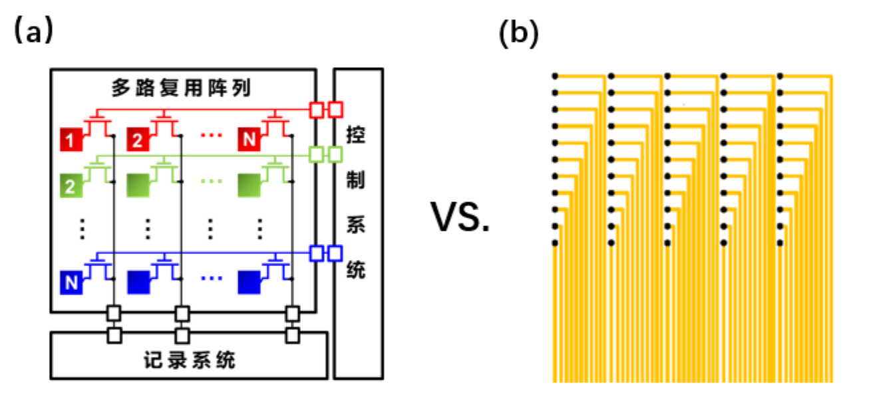

*图 1：独立引线与行列复用的互连方式示意，图像源自谢杨博士论文。*

复用改变了像素到读出端的电学路径。导通 TFT 表现为有限电阻，列线有分布电容，关断像素仍存在漏电和寄生耦合。行切换后的电荷注入、前一行残留及列端采样建立均可能使实测电位偏离真实电极电位。主动矩阵因此解决了布线的几何增长，同时要求对开关、电极和采集前端开展完整分析。

## 4 有源 ECoG 的研究进展

有源阵列将晶体管布置在电极附近。按照像素功能，可以区分以 TFT 作为行列选通开关的电压复用结构，以及在像素内完成电压缓冲、电位—电流转换或局部增益的结构。前者优先降低引线数与像素面积；后者有机会减轻高阻电极和长列线造成的信号衰减，但会引入偏置电流、器件噪声及更多工艺层和互连。不同材料体系对这两类结构的适配程度亦不同。

| 代表研究 | 有源材料与像素功能 | 已实现能力及设计启示 |
| --- | --- | --- |
| [Viventi 等，*Nature Neuroscience*, 2011](https://www.nature.com/articles/nn.2973) | 柔性硅纳米膜晶体管主动复用 | 360 点阵列记录在体皮层活动，证明主动矩阵可减少高密度记录的互连；硅器件转移与柔性多层集成具有较高工艺要求。 |
| [Chiang 等，*Science Translational Medicine*, 2020](https://pmc.ncbi.nlm.nih.gov/articles/PMC7478122/) | 柔性硅主动矩阵 Neural Matrix | 1008 点、少于百根外引线并开展长期动物记录，表明通道扩展必须同时处理封装与可靠性。 |
| [Khodagholy 等，*Nature Communications*, 2013](https://www.nature.com/articles/ncomms2573) | 有机电化学晶体管局部换能 | 在皮层原位实现电位调制电流的记录，突出邻近电极转换的价值；离子输运、偏置与响应速度需要单独考虑。 |
| [Lee 等，*PNAS*, 2017](https://pmc.ncbi.nlm.nih.gov/articles/PMC5635873/) | 透明 OECT 像素阵列 | 将局部有源记录与光学刺激结合，展示多模态应用；像素密度与系统吞吐仍受结构约束。 |
| [Blaschke 等，*Nature Materials*, 2018/2019](https://www.nature.com/articles/s41563-018-0249-4) | 石墨烯溶液栅晶体管 | 记录皮层超低频活动，提示低频保真及湿界面稳定性的重要性。 |
| [Londoño-Ramírez 等，*Advanced Science*, 2024](https://pmc.ncbi.nlm.nih.gov/articles/PMC10933637/) | 柔性 a-IGZO TFT 单开关像素 | 以 16×16 复用阵列和外部读出电路实现皮层映射；像素结构简洁，但像素内没有局部放大。 |

硅晶体管提供成熟的器件性能；有机电化学器件能够利用电解质耦合获得局部换能；石墨烯体系具有不同的界面敏感机制；金属氧化物 TFT 则与大面积薄膜制程和柔性背板相容。不同工作的噪声、频带及通道数是在各自电极、读出方式和动物条件下获得的，只有在统一输入参考及有效采样率口径后才可定量比较。这些进展共同表明，像素数、柔性贴合、信号质量与阵列级可制造性必须同步实现。

## 5 材料体系与单像素结构的选择

### 5.1 半导体材料的选择依据

神经电极阵列中的有源半导体需要兼顾低温工艺、柔性衬底兼容性、足够的开关速度、低关断漏电、器件均匀性及生物液体环境下的封装稳定性。超薄单晶硅具备较高迁移率和成熟电路设计基础，但其转移、层间对准及大面积柔性集成较复杂。有机半导体与 OECT 更易与柔性/湿界面结合，不过其载流或离子传输机制会改变速度、偏置和漂移特性。二维半导体可构成超薄传感晶体管，但大面积均匀生长、低阻接触和批次一致性仍直接影响阵列良率。

金属氧化物 TFT 能以薄膜方式在较大面积基底上制备，具有与行列寻址背板相适配的器件形式。其高开关比有利于抑制未选通行漏电，较大的可加工面积有利于千级点位布局。然而，氧化物材料的陷阱态、接触电阻、阈值漂移及低频噪声会随成分、工艺和偏置改变，不能只依据迁移率或开关比确定最终架构。前期柔性阵列采用 **Ln-IZO** 有源层；后续双晶体管结构拟采用 **IGZO**。两种氧化物的组成、接触和低频噪声须分别测量，不能仅凭材料类别推断电路表现。

| 材料层级 | 本课题前期采用或拟研究的方案 | 对记录性能的作用 | 必需的评价指标 |
| --- | --- | --- | --- |
| 柔性基底与绝缘层 | PI 基底，叠层介质及 PI/无机绝缘层 | 支撑阵列并隔离液体与金属互连 | 膜厚、弯曲半径、残余应力、浸液漏电与针孔率 |
| 电极与接触金属 | Au 接触区及三维纳米结构界面；多层金属布线 | 将离子电位转为电子电路信号并控制点位阻抗 | 阻抗谱、相位、噪声、附着与机械稳定性 |
| TFT 有源层 | 前期 Ln-IZO；双管候选 IGZO | 确定开关、跨导和噪声特性 | $V_T$、$g_m$、$g_{ds}$、开关比、接触电阻及低频噪声 |
| 封装与通孔 | PI/无机介质的多层开口及钝化结构 | 暴露电极、保护 TFT 与行列线 | PBS 浸泡前后转移曲线、漏电、划伤敏感性与弯折寿命 |

前期像素截面采用 PI 柔性基底、Al/Mo 与 Mo 多层互连、SiN$_x$/SiO$_2$ 介质、Ln-IZO 有源层以及 Au 电极接触区。多层材料选择不仅影响单管性能，还决定通孔数量、行列交叉方式与浸液失效路径。材料与电路选择因此必须在同一像素版图和封装结构中共同评估。

### 5.2 电极界面与像素尺寸的协同选择

电极尺寸决定空间采样能力，也影响电极—电解质阻抗。若直接缩小平面电极，低频界面阻抗可能上升，使前端电流噪声经源阻抗转化为更大的输入电压噪声，同时增加不同通道因组织接触差异造成的增益分散。采用三维纳米结构增大有效界面面积，有助于在较小投影面积中维持较低阻抗。电极制程仍需保证结构附着、浸液稳定、可清洗性和与绝缘开口的一致性。

像素晶体管的沟道宽度增大通常降低导通电阻或提高跨导，却同时增加栅极重叠电容、面积和扫描馈通。沟道长度缩短可能提高速度，但接触电阻、输出电导、漏电及噪声并不必然按理想硅 MOSFET 方程缩放。因此，电极直径、像素节距和晶体管 $W/L$ 应由同一面积与时序预算约束，并在所选材料体系下以多尺寸实测数据校准。

### 5.3 单像素结构的功能比较

**无源独立引线像素。** 电极直接连接外部高输入阻抗前端，像素面积主要由电极、绝缘开口和走线决定。该结构避免片上开关噪声和偏置功耗，适合作为生物记录基线；其外引线数随点位数增长，是千级以上阵列的主要限制。

**1T 电压复用像素。** 单个 TFT 串接在电极与列线之间，行控制栅极决定电极是否接入读出端。它使像素结构紧凑、无需片上静态放大偏置，是前期 1024/4096 点位扩展所采用的核心方案。该 TFT 主要承担模拟开关功能，并不产生局部电压增益。导通电阻、电极阻抗、列线电容和板卡输入共同决定幅值保持与建立时间；未选通漏电和行切换电荷会影响串扰与基线。

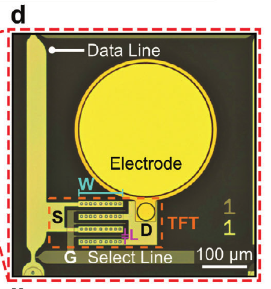

*图 2：[Londoño-Ramírez 等（2024）](https://doi.org/10.1002/advs.202308507)的 1T 氧化物复用像素局部图；每个电极通过行选通 TFT 接入列线，裁取原文图 1d。*

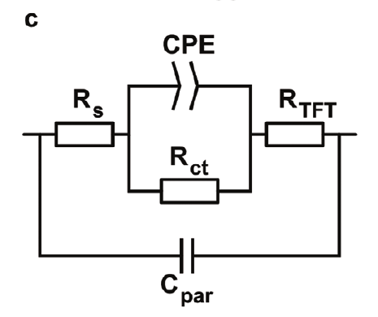

*图 3：同一研究的电极界面、寄生电容与 TFT 导通电阻等效电路，裁取原文图 2c。图中的 $R_{\mathrm{TFT}}$ 为选通时的串联电阻。*

**2T 电压缓冲像素。** 电极连接传感晶体管的高阻栅极，传感管以源极跟随方式驱动列线，另一晶体管提供行选通。电极与长列线的直接阻抗耦合由局部缓冲减弱，输出电压的动态阻抗通常低于 1T 直通结构，但源随器电压增益通常小于 1，直流偏移随阈值与偏置变化。开关若位于源极输出侧，还会使导通压降及开关噪声直接影响输出节点。

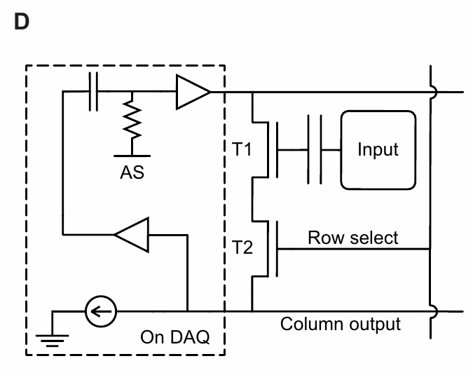

*图 4：[Chiang 等（2020）](https://pmc.ncbi.nlm.nih.gov/articles/PMC7478122/)的 2T 源极跟随像素与列端读出局部电路，裁取原文图 1D。$T_1$ 为传感管，$T_2$ 为行选通管；虚线框内为板端电路。*

**2T 电位—电流转换像素。** 电极连接传感管栅极，另一晶体管置于其漏极供电侧进行行选通；传感管源极接共享列线，由列端跨阻放大器（TIA）维持近似固定电位。电极电压变化转化为沟道电流变化，再由 TIA 转为电压。该方案能够利用高输入阻抗传感降低电极加载，并通过列端跨阻提供完整链路增益；代价是传感管静态电流、额外像素面积、供电线与 TIA 的噪声和输出摆幅。双管像素的潜在收益必须以实测输入参考噪声、功耗及阵列良率验证。

| 像素方案 | 外部互连规模 | 电极与列线的关系 | 主要设计代价 | 本课题作用 |
| --- | --- | --- | --- | --- |
| 无源独立引线 | 随点位数增长 | 电极直达外部前端 | 扇出及线缆规模 | 生物实验和界面材料基线 |
| 1T 行列电压复用 | 近似随行数与列数之和增长 | 电极经开关驱动列线 | 加载、建立、馈通与无像素增益 | 前期高密度阵列基线 |
| 2T 源极跟随 | 近似随行列数增长，另需偏置 | 高阻栅极输入、局部电压缓冲 | 阈值相关偏移、偏置及开关噪声 | 有源缓冲对照架构 |
| 2T 漏极选通＋TIA | 近似随行列数增长，另需供电 | 高阻栅极输入、电流列线 | TIA 裕量、静态功耗及寄生 | 当前待验证方案 |

### 5.4 前期技术路线及后续结构选择

前期研究优先解决高密度、低外引线数和柔性制备的共同约束，因此采用 Ln-IZO 单开关像素与行列复用。三维电极界面用于缓解小点位阻抗上升，采集系统则以并行 ADC 和快速行驱动满足复用时间预算。该设计在 64×64 阵列上实现约 $9.6\times9.6\,\mathrm{mm^2}$ 的有源区域、44.44 sites/mm² 的密度和 134 根外引线，并完成体外及动物 ECoG 验证。

生物实验之后，弱信号噪声和高复用模式下的幅值衰减成为进一步提高数据质量的限制。后续研究因而将高阻栅极传感与列端 TIA 组合为双 IGZO TFT 候选像素，并保留 1T 阵列作为对照。选择漏极供电侧选通，是为了使传感管源极保持在 TIA 求和节点附近，从而将输入电压变化映射为可测电流。该结构是否优于 1T 或源随器，取决于实测材料噪声、偏置余量、列线建立、功耗和封装后的良率。

## 6 前期阵列实现与实验验证

### 6.1 阵列规模与器件表征

前期工作完成 32×32（1024 点）和 64×64（4096 点）柔性 Ln-IZO TFT 阵列，并围绕柔性单管、像素、电极界面和阵列互连建立逐级表征。柔性 TFT 的转移和输出曲线用于提取阈值、跨导、开关比及导通电阻；不同沟道尺寸的电容测试用于衡量导通能力提升所付出的寄生电容代价。测试结果应始终注明栅压、漏压、频率及浸液状态，因为 $R_{\mathrm{on}}$ 与电容不是脱离工作条件的常数。

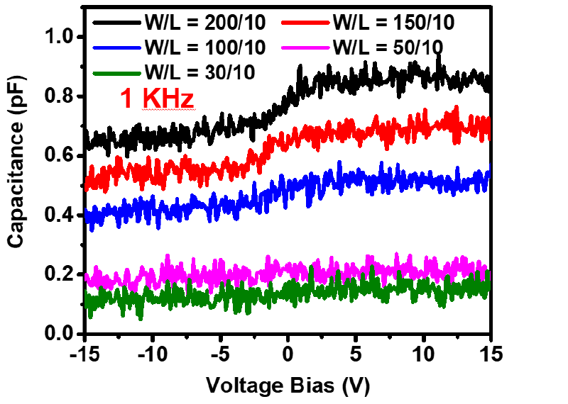

*图 5：不同沟道尺寸的电容—偏置特性局部图，源自谢杨博士论文。*

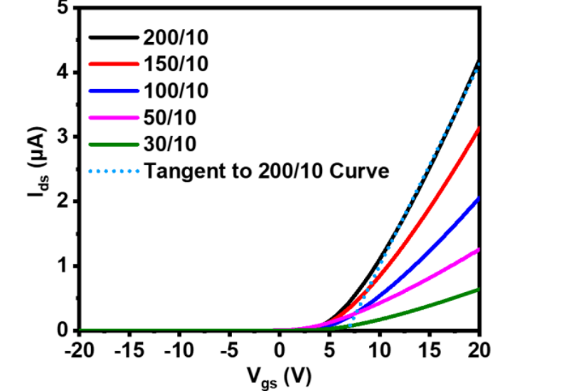

*图 6：柔性 TFT 转移特性局部图，源自谢杨博士论文。*

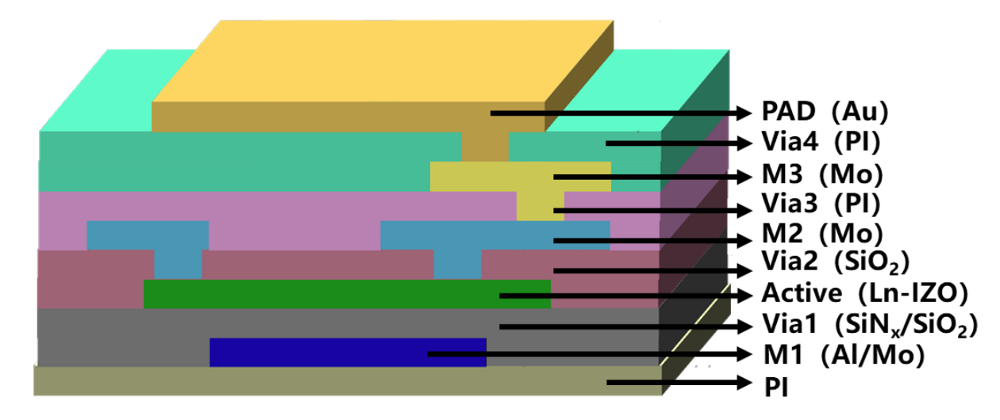

*图 7：柔性 Ln-IZO TFT 像素的材料层叠与多层互连，图像源自谢杨博士论文。*

| 表征对象 | 测量方法 | 回答的设计问题 |
| --- | --- | --- |
| 柔性单管与测试结构 | 转移/输出曲线、迁移率、开关比、导通电阻及接触影响 | TFT 能否在目标偏置下充分选通并抑制未选通漏电 |
| 小规模复用阵列 | 2×2、8×8 寻址；静态噪声与切换波形；逐点注入已知信号 | 寻址正确性、稳定采样窗口、空行残留和初步串扰 |
| 几何尺寸与寄生 | 多组 $W/L$ 的转移、输出及电容测试 | 导通能力的改善是否足以抵偿电容与像素面积增加 |
| 液体封装 | PBS 浸泡前后转移曲线、液中高速切换和局部划伤观察 | 通孔、边缘与绝缘层是否构成漏液失效路径 |
| 电极界面 | SEM/FIB 形貌、阻抗谱与循环伏安 | 三维纳米结构对小电极阻抗及界面稳定性的影响 |
| 柔性可靠性 | 弯折前后电学参数和阵列可用率；包括 10,000 次弯折条件 | 多层器件的机械耐受性及批内一致性 |

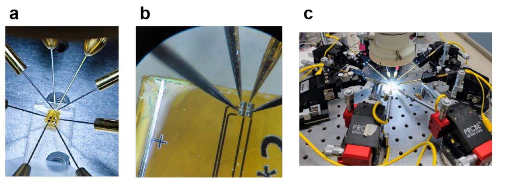

*图 8：小阵列的探针连接与选通波形，图像源自谢杨博士论文。*

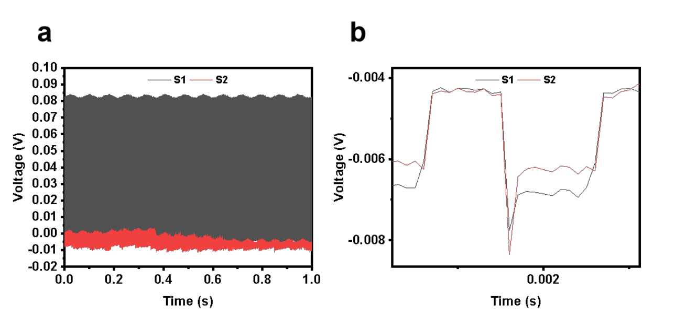

*图 9：小阵列逐点选通后的波形局部图，源自谢杨博士论文。*

### 6.2 板卡选择与采集链设计

采集板卡的配置由每行可用时间、并行列数和噪声目标共同决定。32×32 阵列在 500 S/s/点时，每行周期约为 62.5 μs；行切换后需要避开尖峰和基线波动，在约 35 μs 的稳定窗口内完成多次采样和平均。64×64 阵列若保持约 62.5 μs 的行周期，每点有效速率降为约 250 S/s。物理 ADC 速率、板卡内部输入复用、行驱动建立及数据同步必须与这一预算匹配。

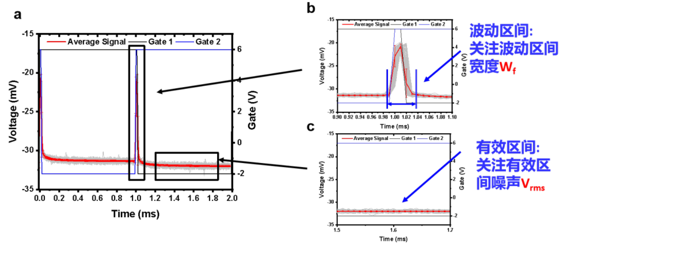

*图 10：行选通瞬态及稳定采样窗口，图像源自谢杨博士论文。*

前期系统使用 PXIe-4309 采集列线电压，使用 PXIe-6738 产生行选通控制。所用配置下，PXIe-4309 每卡具有 8 个 ADC，每个 ADC 可接入最多 4 个物理通道；高精度单通道配置采用 200 kS/s 量级的速率。PXIe-6738 具有 32 路模拟输出，32 路同时更新时约 350 kS/s，满足行控制时序要求。系统配置 3 块 PXIe-4309 分担列线，连接为 16、8、8 个物理输入通道；FPC、ACF、转接 PCB、VHDCI、屏蔽层与参考地共同构成实际测量链。[PXIe-4309 产品资料](https://www.ni.com/docs/en-US/bundle/pxie-4309/page/overview.html)中的最大采样率对应另一配置条件，不能直接替代系统实际工作速率；[PXIe-6738 规格](https://download.ni.com/support/manuals/375391a.pdf)则给出了多路同时更新条件。

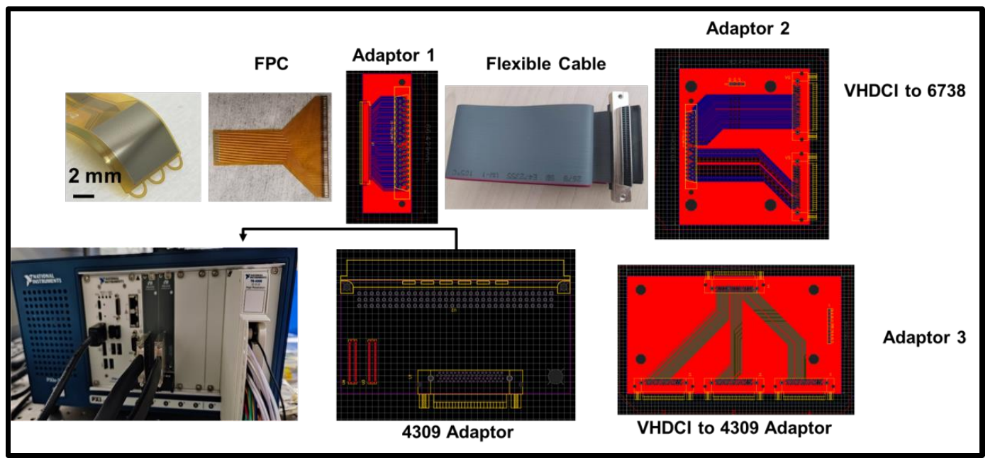

*图 11：阵列、转接结构、行驱动与列采集的系统连接，图像源自谢杨博士论文。*

高分辨率 ADC 的器件指标仍需与信号源阻抗和建立时间匹配。[PXIe-4309 使用手册](https://download.ni.com/support/manuals/377024a.pdf)给出的最佳性能条件建议源阻抗不高于 50 Ω；高阻电极经 TFT 和列线复用后并不自动满足这一条件。前期系统的高精度模式在相应 PBS 正弦输入测试下取得约 0.9 的平均幅值比；扩大可读列数的高通量模式取得约 0.5 的平均幅值比。幅值变化是电极、复用电路、采集端与时序共同作用的系统结果，不能等同于板卡独立增益。

### 6.3 体外空间映射与动物记录

体外验证按干燥电学测试、PBS 浸液测试和空间映射逐步开展。在 2×2、8×8、32×32 及部分 64×64 阵列中注入已知波形，可检查地址是否对应、未选通点是否出现残留及邻近位置的串扰。PBS 环境进一步引入真实电极界面、液体横向传导和封装可靠性。全阵列 PBS 测试的平均噪声约为 53 μV RMS，该数值依赖所用链路与滤波条件。对 4096 点阵列进行局部激励时，所记录的空间热点与激励位置对应，说明阵列具备空间映射能力；远端同步信号仍需结合液体耦合与电路串扰分析。

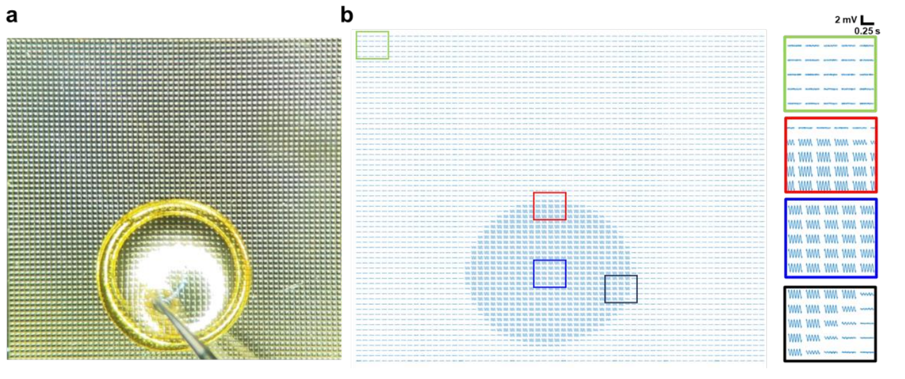

*图 12：64×64 阵列的体外空间映射结果，图像源自谢杨博士论文。*

动物实验先用 70 通道无源阵列记录青霉素诱发的大鼠和家兔癫痫活动，建立基线、潜伏期及发作阶段的波形参照。随后使用 1024 点柔性阵列记录癫痫大鼠 ECoG：物理采样率约 100 kS/s，经 32 行复用后每点获得约 500 S/s；空间分布显示病灶邻近与远端电极的异常尖峰在时间和幅值上存在差异。4096 点阵列用于癫痫家兔记录时，每点有效速率约 250 S/s；全阵列数据显示异常活动在不同区域传播，253 个点位出现功能减弱或失效，报告的有效点位比例约 93.82%。在体结果证明大规模柔性复用记录的可行性，也表明信号质量和可用率需要逐通道统计。

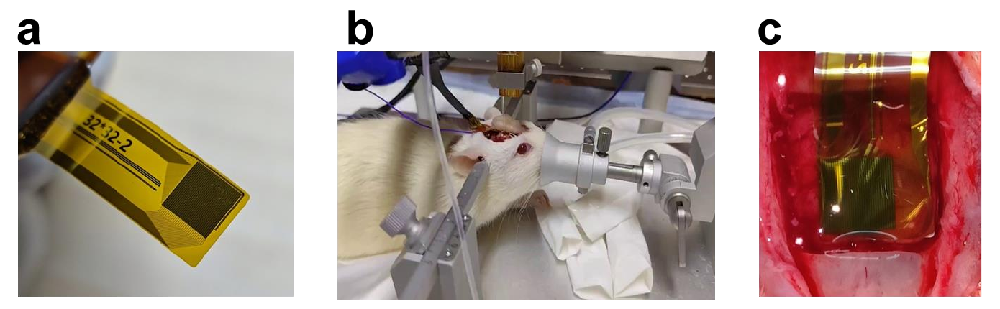

*图 13：1024 点柔性阵列在大鼠模型中的植入与 ECoG 记录，图像源自谢杨博士论文。*

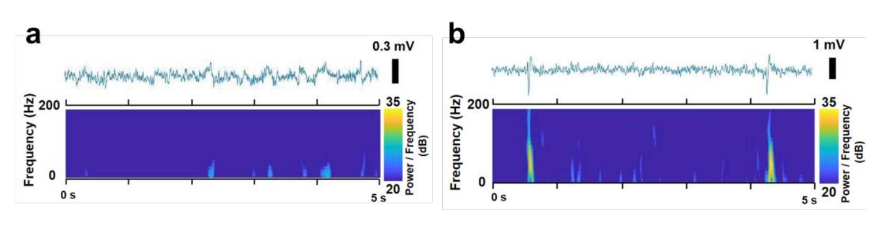

*图 14：大鼠模型记录的 ECoG 波形局部图，源自谢杨博士论文。*

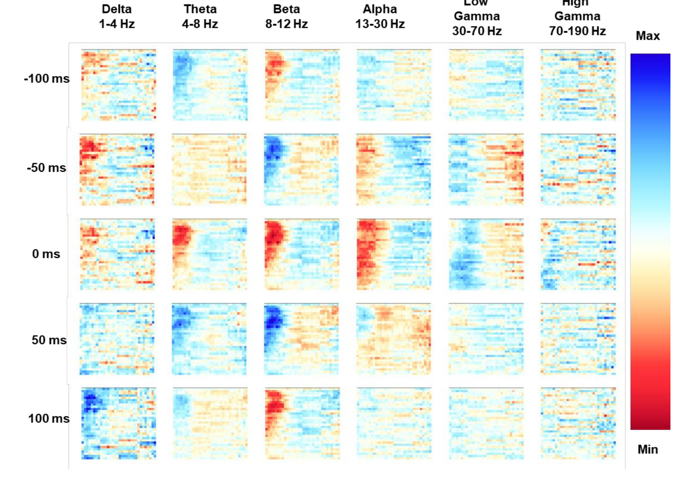

*图 15：1024 点阵列记录的空间频带变化，图像源自谢杨博士论文。*

### 6.4 噪声与幅值保持的后续瓶颈

生物实验的进一步扩展受到较高背景噪声和弱信号幅值衰减限制。逐节点测试表明，柔性线缆、转接板及采集卡适配端均影响测得的噪声。经屏蔽和接地优化，在 50 Hz 陷波、0.1–199.9 Hz 带通及接地输入条件下，FPC 测试点的均方根噪声由约 13.814 μV 降至 1.694 μV，4309 转接点由约 13.356 μV 降至 3.854 μV。不同节点的数据对应不同测量位置，不能相加得到整体噪声。阵列在 PBS 中约 53 μV RMS 的结果还包括电极、液体耦合、像素和采集链的共同影响。

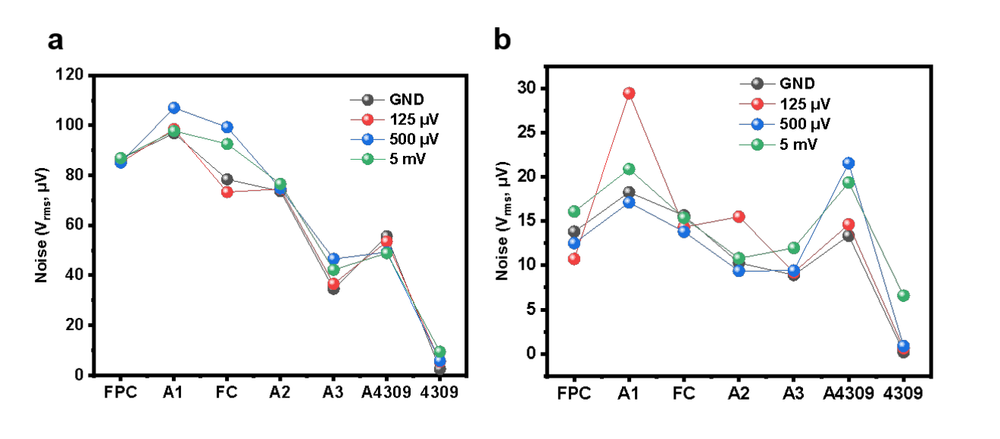

*图 16：系统节点及滤波条件对测得噪声的影响，图像源自谢杨博士论文。*

1T 电压复用结构没有像素内增益，高阻电极、TFT 导通电阻和列端输入共同决定幅值保持。部分台架条件下，32×32 阵列的输入输出幅值比由低物理采样率时约 0.9 降至较高采样率时约 0.7，高通量模式约为 0.5；建立不足、源阻抗匹配与行切换瞬态均可能产生影响。若链路增益下降，后端固定噪声折算至电极端的数值会增大。进一步的噪声归因应在电极等效源、阵列列端、转接板、板卡输入和数字输出分别测量，并在干燥、PBS 与在体条件下统一频带、采样率、屏蔽和参考配置。空行残留还需区分液体导电、浮空电极、寄生电容、关断漏电及共享参考的贡献。

## 7 噪声瓶颈与像素电路的阻抗、噪声分析

### 7.1 在体记录所暴露的噪声瓶颈

前期柔性复用阵列已能记录大幅值的癫痫异常放电，但生物实验中接近百微伏量级的背景波动，使幅度较小的自发活动与诱发反应难以获得充分信噪比。癫痫尖峰可达到毫伏量级，因而仍能从背景中识别；对几十微伏至百微伏量级的正常活动，噪声、幅值衰减和参考漂移则可能与信号同阶。现阶段的可靠应用范式因而主要集中于幅度较大的癫痫放电及其空间传播，若要拓展至弱幅值活动，必须先降低完整链路的输入参考噪声，并保留目标频带内的有效增益。这一判断取决于记录频带、参考方式及动物状态，不能用一次 RMS 数值代替所有范式的检测限。

1T 像素的关键器件限制是 TFT 作为模拟开关时的**有限导通电阻** $R_{\mathrm{on}}$。它一方面产生热噪声，另一方面与电极阻抗、列线电容及读出端输入阻抗构成分压与低通网络。后者使神经信号衰减，并将板端固定噪声折算为更大的电极输入参考噪声。TFT 沟道陷阱还可能产生低频电阻涨落，扫描行边沿经栅漏寄生电容耦合到列线。因而“导通电阻相关噪声”应同时考虑其本征热噪声、偏置下的低频涨落和由传输衰减带来的系统噪声放大，而不能把所有在体背景波动直接归因于理想电阻的约翰逊噪声。

### 7.2 噪声与阻抗的统一测量口径

以电极开路神经电位 $v_E$ 为输入、采集端记录电压 $v_o$ 为输出，定义完整链路复增益 $H(j\omega)=v_o/v_E$。若输出电压噪声单边谱密度为 $S_{v_o}(f)$，对应的电极输入参考噪声谱为

$$S_{v,\mathrm{in}}(f)=\frac{S_{v_o}(f)}{|H(j2\pi f)|^2},\qquad
\sigma_{\mathrm{in}}=\left[\int_{f_L}^{f_H}S_{v,\mathrm{in}}(f)\,df\right]^{1/2}. $$

比较不同像素时，须同时报告 $H(f)$、输出噪声、输入参考噪声、积分频带、有效每点采样率和行切换后的有效采样窗。若增益变小，即使输出端 RMS 也变小，输入参考噪声仍可能变大。参考电极、差分/单端接法、滤波器以及抗混叠设置应保持一致。对周期性工频和行扫描伪影，另报告谱线及去除方法，避免将确定性干扰混入随机噪声积分。

电极—电解质界面可表示为溶液电阻 $R_s$ 串联双电层恒相元件 $Z_{\mathrm{CPE}}=1/[Q(j\omega)^\alpha]$ 与电荷转移电阻 $R_{ct}$ 的并联支路，即 $Z_E=R_s+(Z_{\mathrm{CPE}}\parallel R_{ct})$；根据材料和测试频带，模型还需加入扩散或寄生项。电极自身的噪声和组织背景也要实测，不能把整个复阻抗简单替换为一个固定电阻。以下公式以线性小信号、单行稳定导通及器件间噪声不相关为前提；真实阵列的相关噪声和扫描伪影需另行测量。

### 7.3 1T 电压复用像素：信号传递、输出阻抗与噪声

对单个被选通像素，将电极等效为 $v_E$ 串联 $Z_E$，TFT 导通时等效为 $R_{\mathrm{on}}$，列线及板端等效为 $Z_L=[Z_{\mathrm{AFE}}^{-1}+j\omega C_{\mathrm{col}}]^{-1}$。忽略开关寄生电容时，电极到列端的传递函数及从列端向像素看入的输出阻抗分别为

$$H_{1T}(j\omega)=\frac{Z_L}{Z_E+R_{\mathrm{on}}+Z_L},\qquad
Z_{\mathrm{out},1T}\simeq Z_E+R_{\mathrm{on}}.$$

当 $Z_L$ 以列电容为主时，$R_{\mathrm{on}}+Z_E$ 与 $C_{\mathrm{col}}$ 决定建立速度。若在目标频段可将 $Z_E$ 近似为实部 $R_E$，阶跃误差近似按 $\exp[-t/((R_E+R_{\mathrm{on}})C_{\mathrm{col}})]$ 衰减；达到相对误差 $\epsilon$ 所需时间为 $t_{\mathrm{set}}\gtrsim(R_E+R_{\mathrm{on}})C_{\mathrm{col}}\ln(1/\epsilon)$。实际电极是色散阻抗，需用测得 $Z_E(f)$ 验证该单极点近似。若行周期内未充分建立，高阻像素尤其容易出现幅值下降和上一行记忆。

导通电阻在温度 $T$ 下的单边热噪声电压谱为 $S_{v,R}=4k_BT R_{\mathrm{on}}$，其传至列端的谱为

$$S_{v_o,R}=\left|\frac{Z_L}{Z_E+R_{\mathrm{on}}+Z_L}\right|^2 4k_BT R_{\mathrm{on}}.$$

电极电阻实部的热噪声按相应传递函数计入；板端电压噪声 $S_{e,\mathrm{AFE}}$ 和 ADC 噪声通常直接叠加到输出端，折回电极端时除以 $|H_{1T}|^2$。板端电流噪声与 $Z_{\mathrm{out},1T}$ 相乘形成电压噪声，故源阻抗升高会放大其贡献。沟道陷阱导致的 $1/f$ 噪声、随机电报噪声、$R_{\mathrm{on}}$ 随行电压和电极偏置变化产生的调制噪声，应以实际偏置下的 $S_I(f)$ 测得，不能由直流电阻唯一预测。[Londoño-Ramírez 等（2024）](https://pmc.ncbi.nlm.nih.gov/articles/PMC10933637/)对 1T 氧化物阵列也将开关导通电阻和电极、列线寄生纳入分析。

数量级核对可避免错误归因：即使取 $R_{\mathrm{on}}=32\,\mathrm{k\Omega}$、$T=300\,\mathrm K$、积分带宽 $B=200\,\mathrm{Hz}$，仅由理想导通电阻产生的热噪声也只有 $\sqrt{4k_BTR_{\mathrm{on}}B}\approx0.33\,\mathrm{\mu V_{RMS}}$。因此，接近百微伏的系统背景不能由该项热噪声单独解释。更应检查导通电阻造成的增益损失、未充分建立、陷阱噪声、行扫描馈通、环境拾取和在体生理背景各自的贡献。上述 $32\,\mathrm{k\Omega}$ 仅用于数量级示例，不代表所有像素的工作阻值。

### 7.4 2T 源极跟随像素：电极隔离与输出噪声

源极跟随结构将电极接传感 TFT 栅极，传感管 $T_S$ 以跨导 $g_{mS}$ 调制源端，选通管 $T_R$ 将源端接到列线。电极所见输入阻抗近似为 $Z_{\mathrm{in,g}}=[G_{\mathrm{leak}}+j\omega C_{\mathrm{in}}]^{-1}$，故电极加载系数为 $H_E=Z_{\mathrm{in,g}}/(Z_E+Z_{\mathrm{in,g}})$。在传感管漏端为交流地、体效应可忽略、列端等效导纳为 $g_L$ 的简化条件下，源随器局部电压增益为

$$A_{\mathrm{SF}}\simeq\frac{g_{mS}}{g_{mS}+g_{dsS}+g_L},\qquad H_{2T,\mathrm{SF}}\simeq H_E A_{\mathrm{SF}}H_R.$$

其中 $H_R$ 描述选通管 $R_{\mathrm{on},R}$ 与列负载的分压和动态建立。计算开路输出阻抗时移去外部列负载，在偏置源交流阻抗足够大的条件下近似有 $Z_{\mathrm{out},\mathrm{SF}}\simeq R_{\mathrm{on},R}+[g_{mS}+g_{dsS}]^{-1}$；若电路拓扑改变或偏置电流源不理想，应重新列节点方程，而不能套用该式。相对于 1T，栅极输入隔离了电极与列电容，源端较低阻抗有利于驱动列线；但 $A_{\mathrm{SF}}<1$，阈值变化会带来直流偏移，选通电阻仍在输出端产生热噪声及建立延迟。

噪声分析应先把传感管漏源电流噪声 $S_{i,S}(f)$ 折算到其栅端：$S_{v,g,S}\simeq S_{i,S}/g_{mS}^2$，再乘电极加载和源随器增益传至列端。选通管的沟道噪声按其到列端的传递函数计入；列端负载与板端噪声再折回电极。若提高 $g_{mS}$ 需要增大沟道宽度，随之增大的 $C_{\mathrm{in}}$ 会使高阻电极的 $H_E$ 下降，因此提高跨导不保证输入参考噪声单调改善。图 4 所示 [Neural Matrix](https://pmc.ncbi.nlm.nih.gov/articles/PMC7478122/)使用两管源随器和列端电流偏置，为这一结构提供了实际电路参照。

### 7.5 2T 漏极选通与列端 TIA：电流读出和噪声预算

后续候选结构使电极连接 $T_S$ 栅极，行选通 $T_R$ 置于 $T_S$ 漏极供电侧，$T_S$ 源极接共享列线和 TIA 求和节点。理想闭环下源极电位接近参考电压，输入电极不直接驱动列电容。设传感管输出电导为 $g_{dsS}$、选通管导通工作点的有效漏端导纳为 $g_{mR}+g_{dsR}$，在所用小信号方向约定下，漏极退化后的有效跨导为

$$g_{m,\mathrm{eff}}=g_{mS}\frac{g_{mR}+g_{dsR}}{g_{mR}+g_{dsR}+g_{dsS}}.$$

这说明选通管并非无损开关：其导通不足时，漏端电位随信号变化，传感管有效跨导降低。若要求损失不超过 $\delta$，须有 $g_{mR}+g_{dsR}\ge (1-\delta)g_{dsS}/\delta$，并检查 $T_S$ 的饱和裕量、$T_R$ 压降和功耗。列端反馈阻抗为 $Z_F=R_F\parallel1/(j\omega C_F)$，忽略有限运放增益时，电极到输出的近似增益为

$$H_{2T,\mathrm{TIA}}(j\omega)\simeq-H_E(j\omega)g_{m,\mathrm{eff}}Z_F(j\omega).$$

对非反相端接固定参考、忽略其他求和节点支路的理想反馈结构，TIA 求和节点输入阻抗近似为 $Z_{\mathrm{sum}}\simeq Z_F/[1+A(j\omega)]$。实际列电容、传感管输出导纳和多像素漏电会改变噪声增益及相位裕量，须用运放实测开环特性重新核算。偏置电流 $I_D$ 还产生 $I_D R_F$ 的直流输出偏移，必须在供电和输出摆幅之内，否则理论交流增益没有实际意义。

传感管沟道电流噪声、选通管导通噪声、TIA 电流噪声及反馈电阻电流噪声通过各自的电流传递系数进入求和节点。若以 $a_S$、$a_R$ 表示两管噪声到列节点的转移系数，并以 $Y_\Sigma$ 表示求和节点总导纳，输出噪声的一阶预算可写为

$$S_{v_o}\simeq |Z_F|^2\!\left(|a_S|^2S_{i,S}+|a_R|^2S_{i,R}+S_{i,\mathrm{op}}+\frac{4k_BT}{R_F}+|Y_\Sigma|^2S_{e,\mathrm{op}}\right)+S_{v,\mathrm{ADC}}+|H_{2T,\mathrm{TIA}}|^2S_{v,E}. $$

这里 $S_{e,\mathrm{op}}$ 和 $S_{i,\mathrm{op}}$ 分别为运放输入电压与电流噪声谱，$S_{v,E}$ 为电极及组织端的电压噪声谱；$a_S$、$a_R$ 应从实际偏置电路的节点方程或逐管噪声注入实验取得。反馈电阻的 $4k_BT/R_F$ 是其并联等效电流噪声。晶体管低频陷阱噪声并不服从简单白噪声公式，必须在目标频带和偏置下测量。比较 1T 与 2T 时，最终仍以完整 $H$ 折算输入参考噪声，而非只比较某个晶体管的输出噪声。

### 7.6 结构选择与可检验的判据

1T 适合在小像素面积内实现大规模复用，但电极阻抗直接串入读出通道；2T 源随器将电极与列线隔离，代价是小于一的电压增益与静态偏置；2T 漏极选通加 TIA 能通过 $g_{m,\mathrm{eff}}Z_F$ 建立电压增益，但需要控制静态电流、列端稳定性和两管低频噪声。材料与结构必须共同选择：IGZO 的高关断比利于矩阵寻址，而阈值漂移和陷阱噪声可能限制弱信号记录。应在同一电极面积、参考方式、频带、有效采样率及可接受功耗下比较三种结构，分别报告增益、输入参考噪声、串扰、有效点位率和长期漂移。只有 2T 在这些条件下呈现可重复的信噪比改善，新增器件和偏置的复杂度才有依据。

## 8 后续工作方向

### 8.1 噪声归因与电极界面测量

先用短接板端输入、等效电阻源、无源电极、1T 单像素和完整阵列逐级测量同一频带内的噪声谱及 RMS。分别在干燥、PBS 和在体条件下保留一致的接地、参考、滤波与采样设置。对列线短接与开路、选通行与未选通行、不同 ROW 幅值和扫描频率开展对照，区分板端固定噪声、TFT 导通电阻及陷阱噪声、行边沿馈通、液体横向耦合与生理背景。同步测量不同尺寸电极的 $Z_E(f)$、界面噪声、浸液漂移和接触状态，建立阵列内分布，而非仅报告平均值。以电极输入参考谱和实际信号幅值共同定义弱信号检测边界。

### 8.2 器件与读出电路的解析设计

对多组 IGZO 沟道宽长比及不同偏置测量 $I$–$V$、$g_m$、$g_{ds}$、$R_{\mathrm{on}}$、接触电阻、栅漏电、输入和重叠电容、$1/f$ 与随机电报噪声；同时记录器件间离散性和偏压应力后的漂移。由实测 $Z_E(f)$、$R_{\mathrm{on}}$、$C_{\mathrm{col}}$ 计算 1T 的 $H(f)$ 与建立时间；由实测 $g_m$、$g_{ds}$ 和列负载计算 2T 源随器及 TIA 架构的增益、输入/输出阻抗、直流裕量和噪声预算。使用留出的器件和电极样品检验分析式的预测误差。尺寸选择同时受像素面积、栅电容、导通损耗、供电和功耗约束，不以单项跨导最大化为目标。

### 8.3 小阵列及采集链验证

在同一柔性工艺批次制作 1T 对照像素、2T 候选像素与小阵列。逐点注入已知小信号，测量电极到 ADC 的幅相、输入参考噪声、行切换建立时间、空行残留及邻近行列串扰矩阵。列端分别接高输入阻抗电压前端和 TIA，记录完整实际连接中的列电容、板端输入阻抗及运放稳定性。行周期应满足 $t_{\mathrm{ROW}}+t_{\mathrm{set}}+t_{\mathrm{sample}}+t_{\mathrm{reset}}\le1/(Nf_{\mathrm{frame}})$；据此选择 ADC 数量、并行列数、板卡档位和行驱动更新速率。若输入参考噪声下降但直流输出削顶、列端振荡或功耗超过预算，则该结构仍不满足阵列要求。

### 8.4 阵列扩展与生物验证

小阵列通过后扩大行列数，观察互连长度、列电容及共享供电阻抗增长引起的幅值损失和串扰。PBS 空间刺激映射应同时报告激励位置与记录热点、空间扩散宽度、背景噪声、失效点位及重复测量偏差。动物实验先以稳定的无源或 1T ECoG 同场景记录为基线，在相同参考、麻醉/行为状态和频带下比较 2T 的 SNR、有效通道率和传播图稳定性。癫痫尖峰记录可验证大幅值事件的空间映射；弱幅值自发或诱发活动应在输入参考噪声和重复试验统计结果支持后再作为新的应用验证。长期浸液和弯折后的器件漂移、封装失效及通道可用率须纳入最终结构选择。

## 参考资料

- 谢杨：《柔性高密度高通量多路复用脑机接口器件及应用研究》，博士学位论文；前期柔性阵列、采集系统和生物实验数据及图像来源。
- [Herculano-Houzel（2009）：人脑神经元数量](https://pmc.ncbi.nlm.nih.gov/articles/PMC2776484/)；[Buzsáki 等（2012）：细胞外场电位的物理来源](https://pmc.ncbi.nlm.nih.gov/articles/PMC4907333/)。
- [Viventi 等（2011）：柔性有源矩阵 ECoG](https://pubmed.ncbi.nlm.nih.gov/22081157/)；[Chiang 等（2020）：Neural Matrix 的 2T 源随器阵列](https://pmc.ncbi.nlm.nih.gov/articles/PMC7478122/)；[Londoño-Ramírez 等（2024）：氧化物 TFT 1T 阵列及等效电路](https://doi.org/10.1002/advs.202308507)。
- [Khodagholy 等（2013）：有机电化学晶体管记录](https://www.nature.com/articles/ncomms2573)；[Lee 等（2017）：透明有源阵列](https://pmc.ncbi.nlm.nih.gov/articles/PMC5635873/)；[Blaschke 等（2018）：石墨烯皮层记录](https://www.nature.com/articles/s41563-018-0249-4)。
- [TFT1.md](TFT1.md)：像素结构及解析电路笔记；[NI1.md](NI1.md)：采集链与空行信号排查记录。
