# 高密度 ECoG 有源阵列与读出电路：文献阅读指南

## 研究问题与阅读路径

柔性皮层电图（ECoG）阵列的核心系统问题，是在电极数量和密度提高时维持每点有效采样率、输入参考信噪比与空间定位能力。行列复用减少了引线数量，同时把电极接口、像素偏置、开关瞬态、列线负载、共享模拟前端及数据链路耦合成一个设计问题。现有研究可沿以下四条线索阅读：

1. **像素怎样产生和传递信号**：Bourhis 的氧化物 TFT 像素最贴近柔性 TFT 背板；Xu 的 OECT、Garcia-Cortadella 与 Cisneros-Fernández 的 GFET、Uguz 的 OECT–二极管串联结构提供有源电极与选通的不同实现。
2. **复用后的模拟链怎样保持动态范围和噪声性能**：Cisneros-Fernández 的行端 ROIC、Fathy 2022/2024 的共享 AFE，以及 Jung 的像素积分与共享 ADC，分别处理偏置、电流读出、采样噪声和时隙建立。
3. **“高通量”如何落到可比较的数字上**：同时记录物理电极数、并行读出数、每点采样率、噪声频带、功耗与动物实验规模。Jung 的 65,536 电极/1,024 同时通道是这组文献中最清楚的系统级例子。
4. **空间图像如何确认来自皮层而非读出链**：Xu 的未选线边界条件、Uguz 的关断隔离和 Porto Cruz 的分段串扰模型，共同构成阵列空间保真度的实验路线。

本项目已有 32×32 与 64×64 氧化物 TFT 行列复用阵列。当前 1T 像素以漏源通路传递电极电压，PXIe-6738 驱动行选，PXIe-4309 读取列端差分电压；下一步考察源随器及跨导/TIA 像素。上述文献涉及两类前端：一类是电极电压经开关传到列线，另一类是电极电位先调制像素晶体管电流，再由 TIA 读出。以下按信号路径讨论两类设计，并用相同的电极输入、采样率和噪声频带建立比较基准。项目现有模型与实验问题见 [TFT4](TFT4.md)。

| 阅读顺序 | 论文 | 阵列与读出重点 | 建议重点看 |
|---|---|---|---|
| 1 | Bourhis 2026 | 16×16 a-IGZO 2T 跨导像素、行 TIA、慢性 ECoG | 图 1G–M；像素偏置、突发采样与体内对照 |
| 2 | Xu 2025 | 32×32 vOECT、外置复用板与 PXI、湿态串扰 | 图 1、3；补充图 S4–S8、S12–S13 |
| 3 | Cisneros-Fernández 2021 | 32×32 GFET 与 32 行 CMOS ROIC、CDS/ADC/校准 | 图 3、5–11、15–16、21–23 |
| 4 | Uguz 2024 | OECT–有机二极管像素隔离、外置 TIA、体内 LFP | 图 2–5；补充图 S7–S12 |
| 5 | Garcia-Cortadella 2021 | 64 路 GFET、DC 耦合 TIA、无线宽频带记录 | 图 2–4；漂移、量化噪声和动物数据 |
| 6 | Fathy 2022 → 2024 | 16:1 TDMA 共享 AFE、EOV 抵消、斩波与输入阻抗 | 两篇架构图、时序图和性能表 |
| 7 | Jung 2025 → Jain 2025 | CMOS 像素积分/逐像素数字化、吞吐与伪迹恢复 | Jung 补充讨论 S1/图 S6；Jain 像素 ADC 图 |
| 8 | Porto Cruz 2025 | 皮层、电极、布线、头端串扰的联合模型 | 图 3–5、表 1；空间相关性与校正前后数据 |

## 一、柔性有源阵列：从像素结构到动物记录

### 1. Bourhis 等：a-IGZO TFT 背板的像素跨导读出

**文献**：[A Thin Film Transistor Backplane for Scalable Chronic Neural Interfaces](../literature/2026.06.23.733868v1.full.pdf)，bioRxiv，2026，[DOI](https://doi.org/10.64898/2026.06.23.733868)。

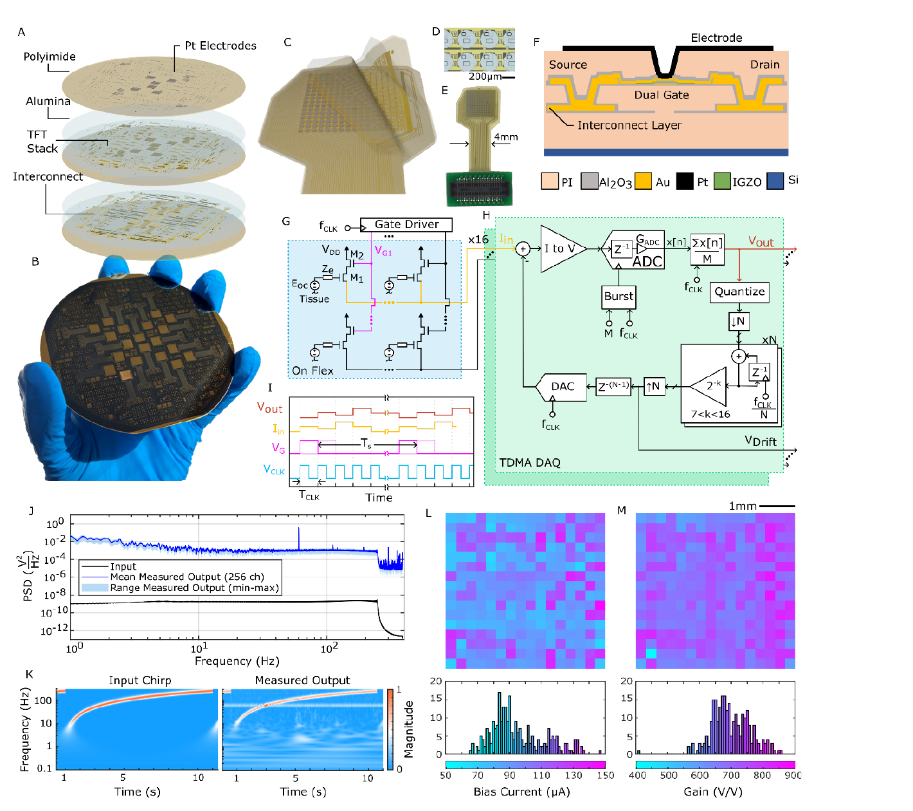

*图 1. 截自原文 PDF 第 4 页图 1。A、F 显示 Pt 电极及双栅 a-IGZO 截面；G 中 M1 将电极电位转为电流，M2 负责选通；H、I 是行端 TIA、数字偏置抵消和列时序；J–M 展示频响与像素分布。*

- **电极材料**：顶部 Pt 电极约 300 × 300 µm，聚酰亚胺柔性基底上叠置 Al₂O₃ 绝缘层与双栅 a-IGZO TFT；阵列为 16 × 16、256 点。
- **前端电路（每个 pixel）**：M1 在饱和区作跨导级，栅端接收皮层电位，漏极电流携带信号；M2 是行列寻址开关。后续像素加入交流耦合电容与伪电阻，建立栅极直流工作点。（第 3–5 页）
- **偏置电路**：选中像素的典型静态电流约 90 µA；逐点电流差异由数字反馈估计，再经 DAC 在 TIA 输入端抵消。读图时沿图 1G 的栅极偏置、M2 选通和图 1H 的反馈路径逐级追踪 DC 电流。（第 4–5 页）
- **读出电路**：16 个行端 TIA 并行工作，16 列轮流选通；每个时隙采用突发采样和数字低通，端到端增益超过 800 V/V。256 点约 1 kS/s/点，PBS 中 DC–250 Hz 响应较平坦，输入参考噪声约 60 µV RMS；论文的噪声数字应连同其测量条件一起引用。（第 4–5 页）

**生物实验与综述位置**：急性胡须刺激和慢性硬膜外大鼠记录连通了器件、阵列与 ECoG；慢性数据见术后第 2、7、10、13、16、23 天。该文是本组中最直接的氧化物 TFT 跨导像素参照，重点分析 M1 偏置散布、M2 时隙建立和 TIA 满量程。（第 6、9、11–14 页）

### 2. Xu 等：高密度 vOECT 阵列与外置 PXI 读出

**文献**：[High-density, ultraflexible organic electrochemical transistor array for brain activity mapping](../literature/d4tc02839b.pdf)，*Journal of Materials Chemistry C*，2025，[DOI](https://doi.org/10.1039/D4TC02839B)；[补充图表](../literature/d4tc02839b1_suppl.pdf)。

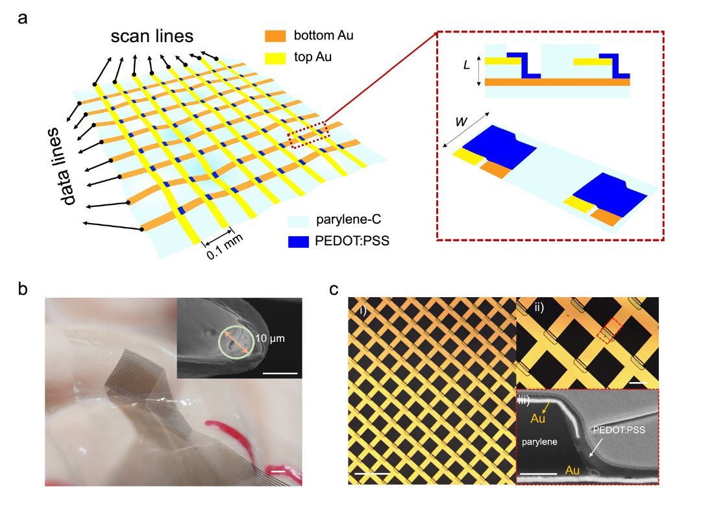

*图 2. 截自主文 PDF 第 4 页图 1a–c。上下金属源漏之间的 PEDOT:PSS 通道构成垂直 OECT，图中的密集阵列为器件层，选通由外置板实现。*

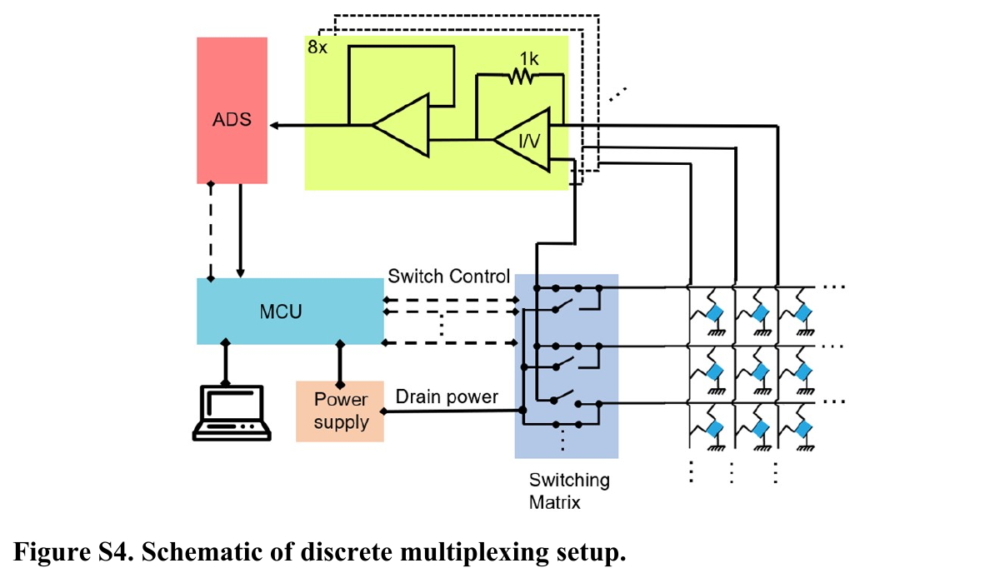

*图 3. 截自补充 PDF 第 5 页图 S4。MCU 控制行列开关，选中器件的电流经 I/V 级和增益级输出；读图时区分阵列内器件与阵列外选通、放大器。*

- **电极材料**：PEDOT:PSS 有源通道直接接触电解质，Au 薄膜构成垂直源漏接点，器件制作在柔性 parylene 基底上；32 × 32 阵列共有 1,024 个 OECT，整体厚度约 4.2 µm。（主文第 3–4 页；补充图 S1）
- **前端电路（每个 pixel）**：单个垂直 OECT 将局部电解质电位调制成源漏电流；每点结构在图 1 中不含独立选通 TFT。1,024 点阵列平均跨导 2.07 ± 0.20 mS、响应时间约 233 µs；慢性实验另用 8 × 8 阵列，其跨导与响应时间分别为 4.19 ± 0.26 mS 和 291.3 ± 16.7 µs。（补充表 S1）
- **偏置电路**：电解质中的 Ag/AgCl 电极建立公共门极参考，PXI 提供源漏偏置；体内采集方法给出漏极电源 −1 V。未选线路的浮空与接地状态在补充图 S12 中分别测试，接地条件下的空间响应更集中。（主文第 8、11 页；补充第 10 页）
- **读出电路**：MCU 驱动外置开关矩阵，电流经过反馈电阻约 1 kΩ 的 I/V 级、后续约 8 倍放大和 PXI 采集。癫痫映射为 250 Hz/点，胡须刺激为 625 Hz/点；作者以事件峰值/静息背景标准差定义 SNR，OECT 与对侧被动 Pt 电极分别为 32.13 ± 2.51 dB 和 25.54 ± 0.55 dB。该 SNR 属于体内事件指标。（主文第 6–8、11 页；补充图 S4、S13）

**生物实验与综述位置**：用 16 × 16 子区域作空间映射，8 × 8 阵列记录延续 92 天。此文最适合讨论共享电解质中的未选线电位和外置复用板实现。（主文第 6–8 页）

### 3. Garcia-Cortadella 等：GFET 有源电极与无线宽频带头端

**文献**：[Graphene active sensor arrays for long-term and wireless mapping of wide frequency band epicortical brain activity](../literature/Garcia_Cortadella_2021_Graphene_Active_Sensor_Arrays.pdf)，*Nature Communications*，2021，[DOI](https://doi.org/10.1038/s41467-020-20546-w)。

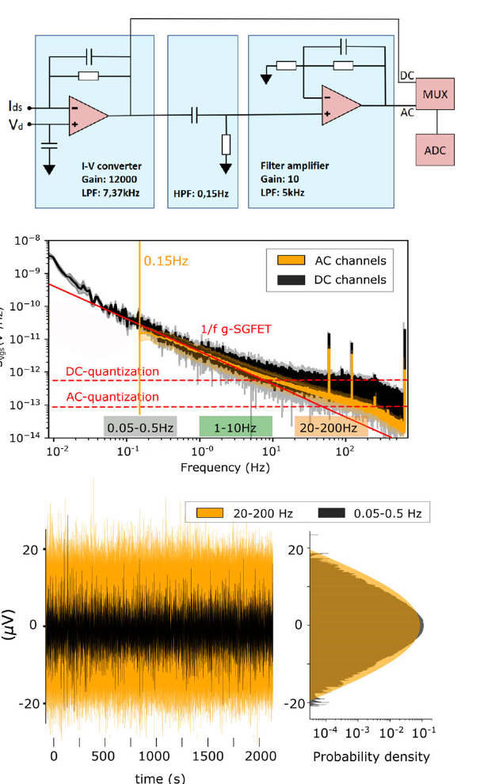

*图 4. 截自原文 PDF 第 4 页图 2e、f、h。上方是 I/V 转换、0.15 Hz 高通及第二级放大；中间按频率区分器件 1/f 噪声与头端量化噪声；下方给出不同频带的时间域背景。*

- **电极材料**：柔性阵列以石墨烯溶液栅 GFET 的沟道作为有源感测界面，共 64 点；小脑表面的参考电极及两枚 Pt–Ir 电极参与体内布置。（第 2–3 页，图 1）
- **前端电路（每个 pixel）**：每点为一个 GFET，皮层电位改变门源电压，进而调制漏源电流；阵列中没有独立行列开关。作者用电流噪声除以局部跨导计算门极输入等效噪声；示例探针在 1–10 Hz 约 4.13 ± 1.14 µV RMS。（第 2–4 页）
- **偏置电路**：参考电极设定溶液栅电位，头端给出漏源偏置；工作点相对电荷中性点的位置决定电流与跨导。文中用 24 h 记录追踪初始偏置及电荷中性点漂移。（第 3、6 页）
- **读出电路**：第一级 DC 耦合 I/V 转换增益约 12,000、低通约 7.37 kHz；第二级 0.15 Hz 高通、10 倍增益、5 kHz 低通，之后复用至 ADC。64 路中 8 路可切换 DC/AC 路径。论文给出 0.05–0.5、1–10、20–200 Hz 分频带噪声图，20–200 Hz 噪声受头端量化贡献影响；正文未给出便于与复用阵列直接并列的统一每点采样率。（第 3–4 页，图 2）

**生物实验与综述位置**：自由活动大鼠连续无线记录约 24 h，功能电学随访约 4 周；该文串起 DC 慢波、GFET 低频噪声和无线 ADC 动态范围。（第 5–7 页）

### 4. Uguz 等：OECT–有机二极管串联像素

**文献**：[Flexible switch matrix addressable electrode arrays with organic electrochemical transistor and pn diode technology](../literature/Uguz_2024_Flexible_Switch_Matrix_OECT_pn_Diode.pdf)，*Nature Communications*，2024，[DOI](https://doi.org/10.1038/s41467-023-44024-1)；[补充图表](../literature/41467_2023_44024_MOESM1_ESM.pdf)。

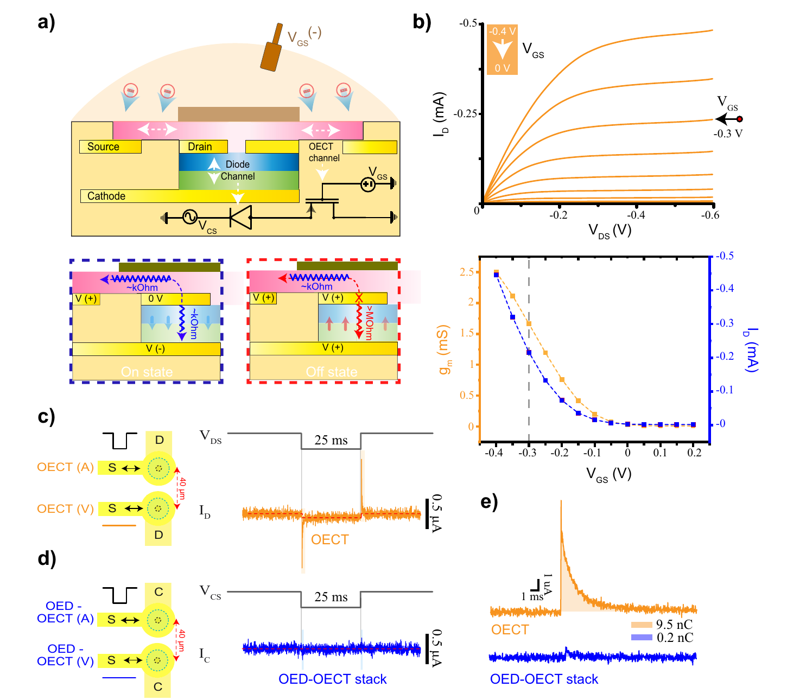

*图 5. 截自主文 PDF 第 6 页图 3a–e。上方画出 OECT 通道与串联二极管；下方对比仅有 OECT 与串联结构在选通脉冲时的邻点响应和注入电荷。*

- **电极材料**：p(g2T-TT) 有机混合导体构成 OECT 通道并延伸至二极管 p 侧，二极管包含 n 型有机半导体层；金属接点和 parylene C 柔性基底承载器件。皮层电位经电解质调制 OECT。（第 2–6 页）
- **前端电路（每个 pixel）**：OECT 跨导器件与有机电化学 p–n 二极管串联；选通列时二极管正向导通，关断列时反偏隔离。二极管整流比超过 10⁵、开关约 230 µs，串联后跨导仍超过 1.5 mS；关断电流降低约三数量级，边沿注入电荷从约 9.5 nC 降至约 0.2 nC。（第 5–6 页，图 2–3）
- **偏置电路**：公共电解质门极由外部电极设定，列端施加选通/关断脉冲，行端收集电流；图 3b 以 VGS ≈ −0.3 V 展示 OECT 工作区。选通脉冲、门极偏置和二极管正反偏共同决定有效采样窗口。（第 6–7 页）
- **读出电路**：8 × 8 台架矩阵用 8 条选线与 8 条输出线；外置 TIA、高通和采集链见补充图 S10、S12。四路示范以 1 ms 脉冲、5 ms 周期顺序读取，约 200 Hz/点；4 × 8 穿刺式阵列在小鼠视觉皮层记录，0.15–100 Hz 输入参考噪声约 5.1 µV RMS。（第 7–9 页；补充第 11、13 页）

**生物实验与综述位置**：此文把像素隔离的稳态漏电、边沿注入和体内 LFP 放入同一论证链，可用于综述中的选通瞬态与空间串扰部分。

## 二、行列复用与共享模拟前端

### 5. Cisneros-Fernández 等：GFET 阵列的行端 CMOS ROIC

**文献**：[A 1024-Channel 10-Bit 36-µW/ch CMOS ROIC for Multiplexed GFET-Only Sensor Arrays in Brain Mapping](../literature/A_1024-Channel_10-Bit_36-muW_ch_CMOS_ROIC_for_Multiplexed_GFET-Only_Sensor_Arrays_in_Brain_Mapping.pdf)，*IEEE TBCAS*，2021，[DOI](https://doi.org/10.1109/TBCAS.2021.3113556)。

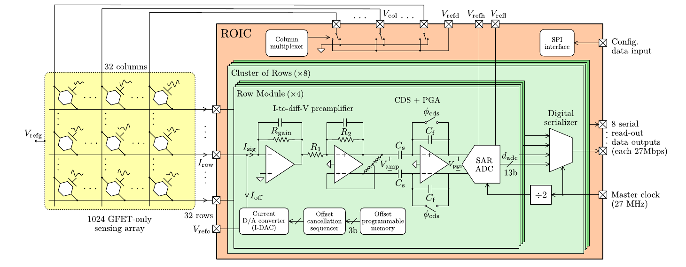

*图 6. 截自原文 PDF 第 5 页图 6。按电流流向阅读：GFET 行线 → 电流 DAC → 25 kΩ TIA → 缓冲与开关电容 PGA/CDS → 10 位 SAR ADC。*

- **电极材料**：石墨烯 GFET 沟道接触电解质并充当有源感测面，阵列为 32 × 32；校准时用电解质中的 Ag/AgCl 电极设公共门极参考。（第 3–5、8 页）
- **前端电路（每个 pixel）**：单个 GFET 以跨导将门极电位转为漏源电流；没有串联像素选通管。列线施加漏源偏置完成寻址，所有行线同时连接 ROIC。其等效行阻抗与走线电阻共同影响关断串扰。（第 3–5 页，图 3、5）
- **偏置电路**：选中列 VDS 约 50–100 mV，未选列为 0 V；公共门极偏置通过逐点转移曲线校准。每行 3 位电流 DAC 预扣典型约 50 µA 的静态电流，给 TIA 留出信号摆幅；逐点 DAC 码与增益在扫描中调用。（第 5–9 页）
- **读出电路**：每行含 25 kΩ TIA、单端转差分、2/4/8/16 倍开关电容 PGA/CDS 与 10 位 SAR ADC。ADC 为 422 kS/s/行，32 列扫描对应约 13.2 kS/s/点；0.18 µm CMOS 功耗 36 µW/点。16 × 32 GFET 盐水系统的 1–100 Hz 输入参考噪声约 32 µV RMS；32 × 32 琼脂阵列展示空间梯度。（第 5–13 页）

**综述位置**：这一篇最适合展开行列寻址、逐点 DC 预扣、复用 CDS 与每点校准的电路章节。验证覆盖盐水和琼脂模型，动物 ECoG 指标可留给同组其他系统论文。

### 6. Fathy 等 2022：共享 AFE 的电极偏移抵消

**文献**：[A Digitally Assisted Multiplexed Neural Recording System With Dynamic Electrode Offset Cancellation via an LMS Interference-Canceling Filter](<../literature/eScholarship UC item 61z008bz.pdf>)，*IEEE JSSC*，2022，[DOI](https://doi.org/10.1109/JSSC.2021.3116021)。

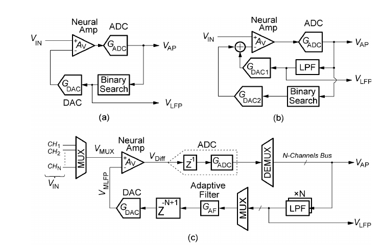

*图 7. 截自原文 PDF 第 6 页图 3a–c。下方 c 图将 N 路输入先复用，再通过共享放大器和 ADC；数字域解复用、低通与自适应滤波后，DAC 反馈在模拟输入端抵消各路偏移。*

- **电极材料**：芯片论文面向外接被动神经电极，台架用电极等效阻抗验证；所测性能未绑定一种像素电极材料。（第 9–11 页）
- **前端电路（每个 pixel）**：电极位于芯片外，每点在探针侧仅是被动端口；16 路进入模拟 MUX 后共用一套前端，逐通道状态由数字存储和 DAC 码保持。（第 3–6 页）
- **偏置电路**：电极偏移在复用输出上形成阶梯，逐通道低通与 LMS 估计其慢变分量，10 位电容 DAC 在放大前作模拟抵消；测得 ±50 mV 偏移处理范围和约 53 dB 抑制。（第 6–10 页）
- **读出电路**：共享 AC 耦合开环放大器和 10 位 SAR ADC，ADC 320 kS/s；16 路时相当于 20 kS/s/路的时隙预算。放大器带宽约 397 kHz，10 kHz 频带输入参考噪声 2.6 µV RMS，100 Hz 输入阻抗约 28 MΩ；面积 0.00248 mm²/通道、功耗 3.38 µW/通道。（第 7–11 页）

**综述位置**：配合有源 TFT 阵列阅读时，重点放在共享 AFE 所承受的逐点 DC 差异、DAC 抵消范围和每时隙建立时间。

### 7. Fathy 等 2024：斩波 TDMA 与预测预充

**文献**：[A 0.00179 mm²/Ch Chopper-Stabilized TDMA Neural Recording System with Dynamic EOV Cancellation and Predictive Mixed-Signal Impedance Boosting](../literature/Fathy_2024_TBCAS_Chopper_TDMA_Neural_Recording.pdf)，*IEEE TBCAS*，2024，[DOI](https://doi.org/10.1109/TBCAS.2024.3366649)。

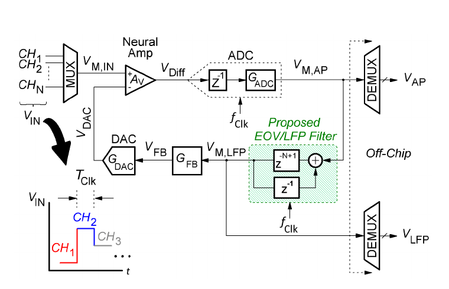

*图 8. 截自原文 PDF 第 2 页图 2。16 路 MUX 后共用放大器与 ADC；绿色数字滤波块从复用输出恢复每路 EOV/LFP，并驱动反馈 DAC。*

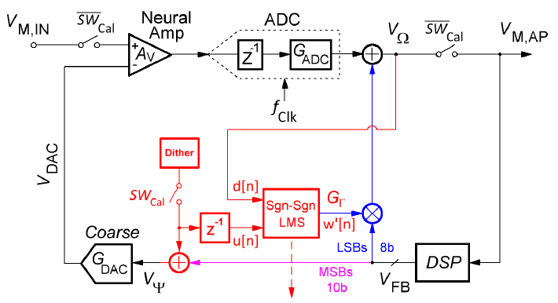

*图 9. 截自原文 PDF 第 3 页图 4c。sign-sign LMS 与 DAC 的粗细码相连；它与输入预充电路共同处理时隙切换时的电极偏移和耦合电容充电。*

- **电极材料**：急性大鼠胡须实验使用 parylene C 上的 Pt 纳米棒薄膜电极；芯片接收外部电极信号。（第 1、13 页）
- **前端电路（每个 pixel）**：阵列侧为被动电极，16 路模拟输入复用后进入共享前端；芯片内部按通道保存反馈状态，像素侧没有集成晶体管。（第 2–3 页）
- **偏置电路**：约 2 pF 输入耦合电容配合伪电阻设定放大器输入；逐通道 EOV/LFP 反馈 DAC 与 sign-sign LMS 预测下一时隙电压并预充输入。9.3 kHz 输入阻抗由约 176 kΩ 提高到 7.25 MΩ，±50 mV 偏移衰减超过 54 dB。（第 3–8、11–12 页）
- **读出电路**：复用后 1.28 MHz 斩波、逐时隙复位的移动平均及 SAR ADC 抑制低频与宽带噪声。16 路、目标 10 kHz/路时，选通时钟为 320 kHz；AP 0.3–10 kHz 噪声 2.19 µV RMS，LFP DC–0.3 kHz 为 2.4 µV RMS。65 nm CMOS 面积 0.00179 mm²/通道，功耗 5.11 µW/通道。（第 7、10–13 页）

**综述位置**：与 2022 篇连读，可分析抵消偏移之后，输入预充、斩波和抗混叠如何影响输入阻抗、功耗与有效采样窗口。

## 三、片上像素电路与极高电极数

### 8. Jung 等：65,536 电极 BISC 的像素积分

**文献**：[A wireless subdural-contained brain–computer interface with 65,536 electrodes and 1,024 channels](../literature/Jung_2025_BISC_65536_Electrodes.pdf)，*Nature Electronics*，2025，[DOI](https://doi.org/10.1038/s41928-025-01509-9)；[补充讨论与电路图](<../literature/41928_2025_1509_MOESM1_ESM (1).pdf>)。

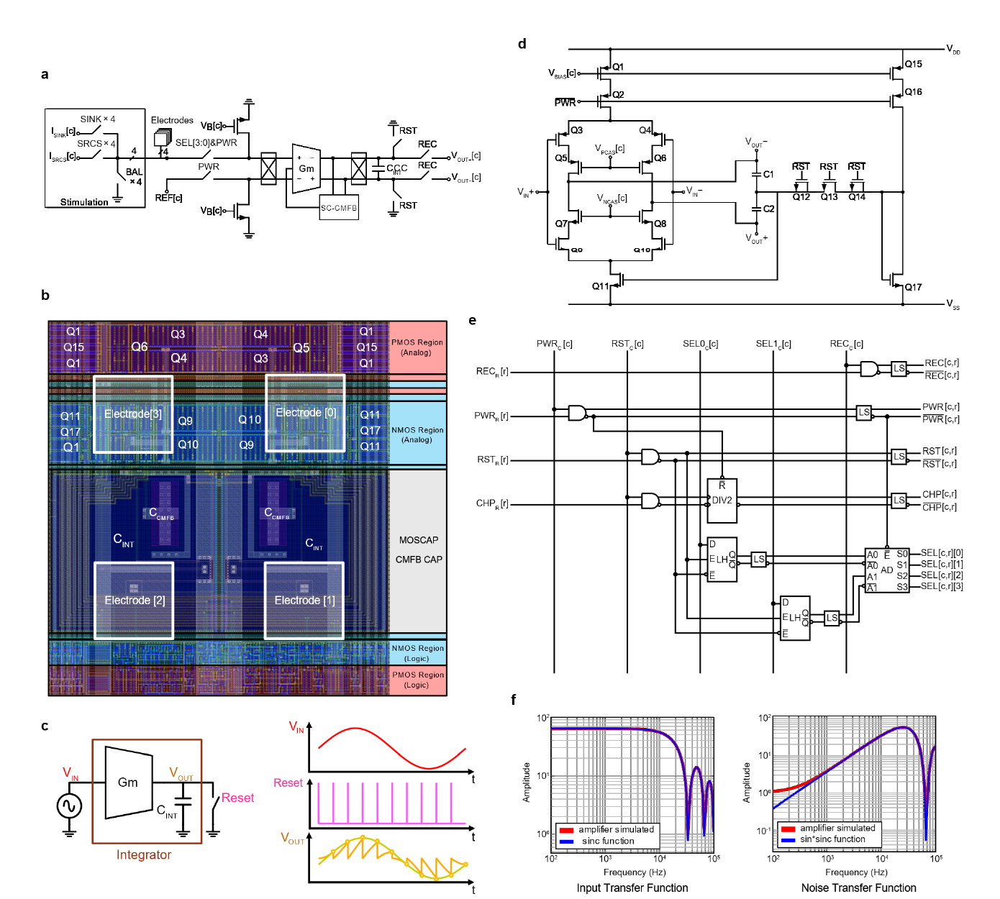

*图 10. 截自补充 PDF 第 34 页图 S6。a 是四电极选一与积分、复位链；b 为版图；c、d 显示 Gm–C 积分器及晶体管级电路；e、f 为逻辑与传递函数。*

- **电极材料**：CMOS 芯片表面 TiN 电极，256 × 256 共 65,536 个物理电极；补充资料给出约 205 kΩ@1 kHz 的电极阻抗与约 0.77 nF 等效界面电容。（主文第 1–4 页；补充讨论 S1）
- **前端电路（每个 pixel）**：每组 2 × 2 电极共用一套约 53 × 58 µm² 的 CMOS 像素电路，合计 16,384 个记录像素。选中的电极经伪电阻输入偏置、斩波和互补 Gm–C 差分积分器；约 29.38 µs 积分、随后读出与复位，积分盒形响应兼具抗混叠作用。（补充第 4–7、34 页）
- **偏置电路**：电极输入以伪电阻固定 DC 工作点，像素电流源与共模反馈设积分器工作区；电极偏移在像素时序中通过斩波和复位处理，补充讨论给出约 25 mV 的偏移容限。（补充讨论 S1、图 S6）
- **读出电路**：最多同时读 1,024 路，像素积分电荷送共享 PGA、双路交错 10 位 8.67 MS/s SAR ADC 与无线链路。256 通道模式为 33.9 kS/s/点、输入参考噪声 7.68 ± 3.11 µV RMS；1,024 通道模式为 8.475 kS/s/点、16.51 ± 6.85 µV RMS，噪声频带均为 10 Hz–4 kHz。无线链路最高约 108 Mb/s，整机约 64 mW。（主文第 1–4、18 页）

**生物实验与综述位置**：猪约 2 周、非人灵长类约 64 天的记录把电极密度、同时通道数和无线吞吐连接到生物验证；综述中宜同时列出“物理电极”和“并行读出数”。

### 9. Jain 等：逐像素 ΔΣ 数字化与刺激恢复

**文献**：[A 2.5–20 kS/s In-Pixel Direct Digitization ECoG Front End With Submillisecond Stimulation Artifact Recovery](../literature/Jain_2025_JSSC_In_Pixel_Digitization_ECoG.pdf)，*IEEE JSSC*，2025，[DOI](https://doi.org/10.1109/JSSC.2024.3508544)。

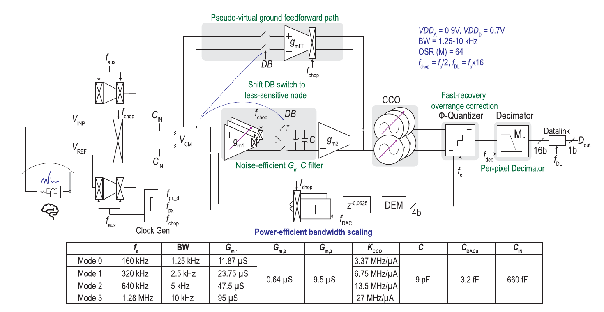

*图 11. 截自原文 PDF 第 3 页图 3。左端 Pt 电极输入经斩波与电容耦合，中间是两级 Gm–C、CCO 量化及反馈 DAC，右端每像素 CIC 抽取；下表是四档带宽、采样率与电路参数。*

- **电极材料**：体内实验采用 Pt 纳米棒电极；8 像素 CMOS 原型为 4 × 2 排列，电极在芯片外接入。论文报告所用电极约 10 kΩ@1 kHz。（第 2、9–11 页）
- **前端电路（每个 pixel）**：每点含二阶连续时间 ΔΣ ADC：斩波互补 Gm–C 积分、第二积分级、CCO/Gray 量化和逐像素 CIC 抽取。输入约 660 fF 电容；额外预充通路提高电极端输入阻抗，过量程检测辅助刺激伪迹恢复。（第 3–7 页，图 3–8）
- **偏置电路**：输入共模由片上偏置设定；不同工作模式按带宽缩放跨导、时钟及 DAC 反馈。辅助放大器预充输入节点后，输入阻抗超过 30 MΩ，约为原值的 34 倍。（第 4–8 页）
- **读出电路**：每像素数字输出经 CIC 后送数据链。四档有效采样率 2.5–20 kS/s/点，对应 1.25–10 kHz 带宽；10 kHz 内输入参考噪声约 6 µV RMS、动态范围 78.6 dB，像素间隔离超过 60 dBc。180 nm CMOS 面积约 0.09 mm²/点、功耗约 14 µW/点；刺激后恢复约 0.05–0.4 ms，随模式变化。（第 7–11 页）

**生物实验与综述位置**：大鼠胡须皮层实验证明像素内 ADC 与刺激期记录的组合；该文适合放入宽带和闭环 ECoG 电路章节。

## 四、阵列空间保真度：从电极到头端的串扰

### 10. Porto Cruz 等：从电极到头端的串扰模型

**文献**：[Bridging circuit modeling and signal analysis to understand the risk of crosstalk contamination in brain recordings](../literature/Porto_Cruz_2025_Crosstalk_Brain_Recordings.pdf)，*Nature Communications*，2025，[DOI](https://doi.org/10.1038/s41467-025-59391-0)。

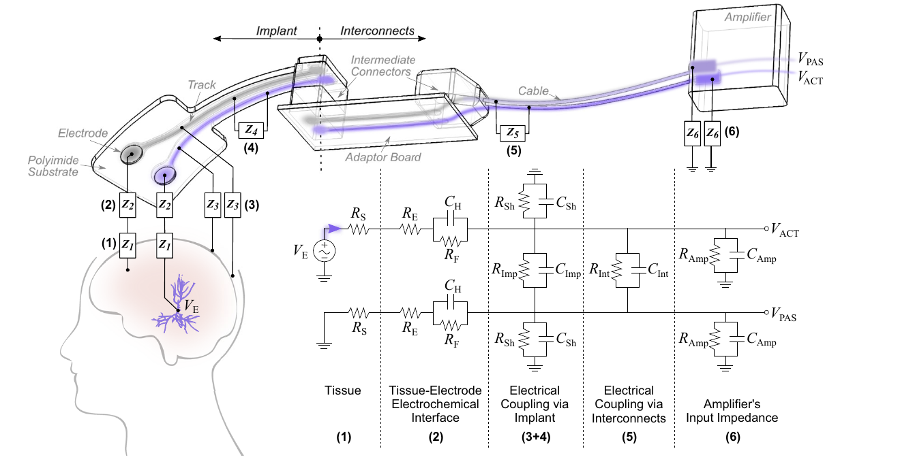

*图 12. 截自原文 PDF 第 5 页图 4。沿左到右依次是脑组织、电极界面、植入体走线、外部互连和放大器输入；下方等效电路给出各段的阻抗及跨通道耦合支路。*

- **电极材料**：8 µm 厚聚酰亚胺薄膜上制作 Pt 电极，4 × 4 阵列使用直径 100 µm 的圆盘电极，间距 750 µm；另有片上参考电极结构。本研究的体内记录使用大电极和颅骨螺钉参考/地。（第 4、11 页，图 9）
- **前端电路（每个 pixel）**：每点为被动 Pt 电极及其电化学界面，模型用组织扩散电阻、界面电阻/电容和走线寄生表示；图 4 中 Z₁–Z₆ 将皮层、电极、植入、外部连接和放大器输入拆开。（第 5–6 页）
- **偏置电路**：采用单极记录，头端参考端与地端相连至同一颅骨螺钉；电极无主动像素偏置。该参考连接与放大器输入阻抗一起进入空间耦合模型。（第 11 页）
- **读出电路**：Tucker Davis ZIF-Clip 单位增益头端、PZ2-256 前放及 RZ2 处理器，以 18 位、12,207 samples/s/点采集。本文性能核心是频率相关串扰：模型给出 LFP 段约 −40 dB、10 kHz 附近约 −16 dB；1 kHz 时外部互连与植入体耦合阻抗分别约 5 MΩ、31 MΩ。论文未以统一频带的输入参考噪声作为主要性能指标。（第 5–6、11 页）

**生物实验与综述位置**：大鼠胡须刺激记录中的高频空间相干经电路模型和混合矩阵分析后重新解释。将该文置于综述末尾，可引出二维传递矩阵、布线邻接和空间定位误差的验证方法。

## 五、综合：将器件、电路与 ECoG 实验连成同一评价体系

### 1. 像素与行列复用

当前文献形成三条清晰的像素路线。**电压传输开关**把电极电位送到列端，关键参数是开关导通/关断特性、列线负载和选通后的建立时间；本项目 1T 阵列处于这一路线。**像素跨导加行端 TIA**将电极输入转换成电流，Bourhis、Xu、Cisneros-Fernández 和 Uguz 分别展示氧化物、OECT、GFET 与有机二极管的实现；关键参数扩展到 `g_m`、偏置电流、器件电流噪声和 TIA 动态范围。**像素局部积分或数字化**由 Jung 和 Jain 展示，侧重局部抗干扰、共享后端吞吐或刺激恢复。

### 2. 统一的读出链指标

后续实验与综述表建议按同一顺序填写：电极与参考条件 → 输入耦合/偏置 → 像素传递函数 → 行列时序及有效占空比 → 列端负载与前放 → 抗混叠/ADC → 数字校准 → 动物实验。每项指标记录频带、输入信号幅度、每点采样率、噪声积分区间和校准方式。这样可以区分器件输入等效噪声、整机 IRN、事件 SNR 与诱发反应 `z` 分数。

| 评价项 | 建议记录的量 | 相关论文 |
|---|---|---|
| 增益与保真度 | 电极到数字输出的复数 `H(f)`、每点散布、偏置漂移 | Bourhis、Xu、Cisneros-Fernández |
| 噪声与采样 | 输入参考 PSD、积分频带、每点速率、混叠与消隐窗口 | Bourhis、Cisneros-Fernández、Jung、Fathy |
| 动态范围 | 逐点 DC 偏移/电流、TIA 或 AFE 满量程、抵消残差 | Cisneros-Fernández、Fathy 2022/2024 |
| 空间隔离 | `20 log10|V_off/V_on|`、二维 `H_{mn}(f)`、边沿注入与残余 | Xu、Uguz、Porto Cruz |
| 系统吞吐 | 物理点位、同时读取通道、每点采样率、链路速率、功耗 | Jung、Cisneros-Fernández、Bourhis |
| 生物证据 | 诱发实验、连续记录时长、随访时点、组织学条件 | Bourhis、Xu、Garcia-Cortadella、Uguz、Jung |

### 3. 面向本项目的阅读产出

第一步，依据现有 1T 的实际接线与电极阻抗，建立电极到 PXIe-4309 的幅相、噪声与切换瞬态基线；扫描行周期和采样延迟，提取每点稳定窗口。第二步，用 Xu、Uguz 和 Porto Cruz 的实验逻辑测未选线边界条件与二维空间串扰。第三步，以 Bourhis 和 Cisneros-Fernández 的电流型像素为参照，搭建 2T 源随器与 2T 跨导/TIA 的同条件台架，比较输入参考噪声、增益、偏置、建立时间和功耗。最后，把 Fathy 的逐点偏移抵消与 Jung 的抗混叠/吞吐预算纳入共享后端设计。

按这一顺序，文献综述可以自然形成“柔性有源阵列的发展 → 像素和复用架构 → 噪声与动态范围 → 空间串扰 → 体内验证 → 本项目电路选择”的叙事链。
