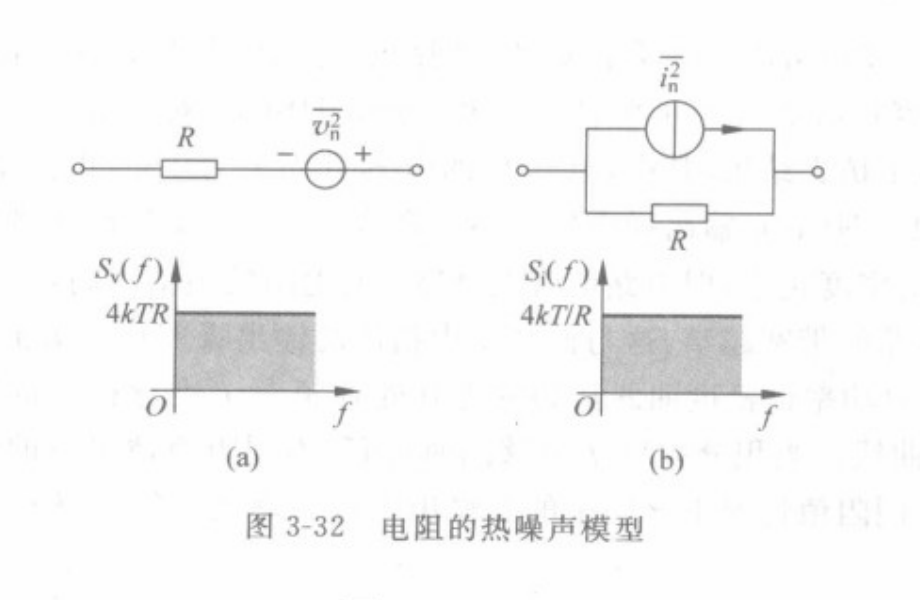
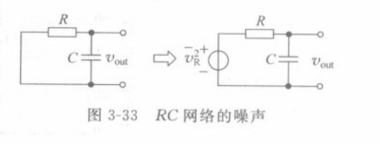
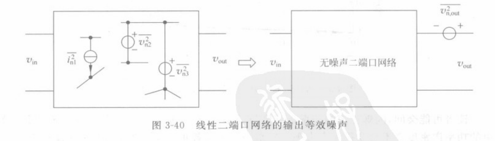
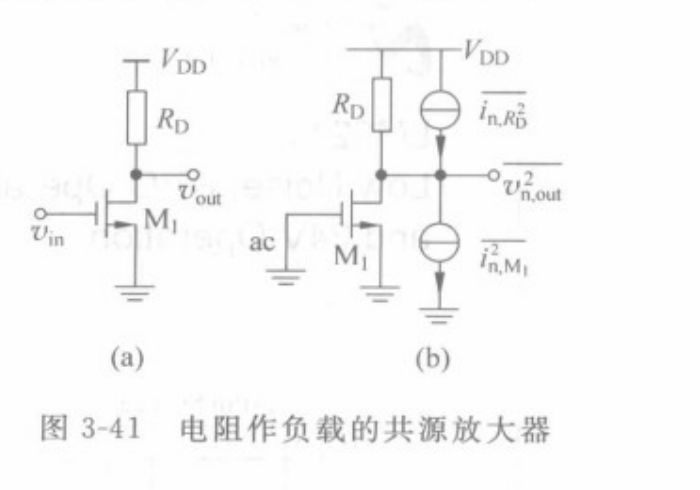
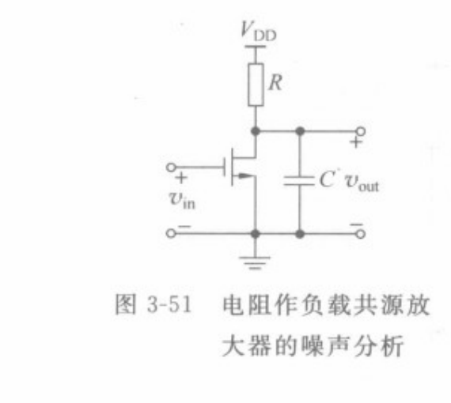
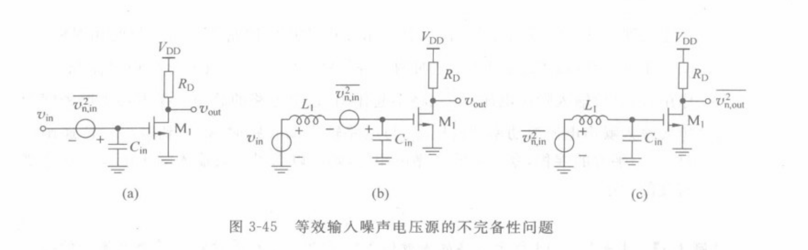
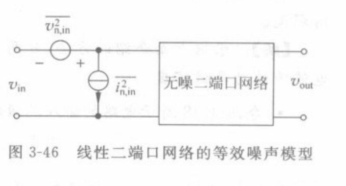
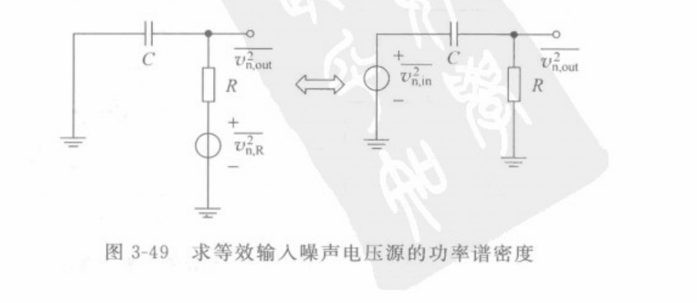

# 输入等效噪声、输出等效噪声与电路噪声模型

本文以池保勇《模拟集成电路与系统》第 3 章 3.3.3～3.3.6 节（印刷页 97～109）的噪声建模顺序为主线，重新推导等效输入、输出噪声及其适用边界，并补充原书例子对电极、TFT 和 TIA 读出的启示。文中裁图均取自该书，保留原图号与图题。以下统一使用**单边**功率谱密度 $S_v(f)$、$S_i(f)$，在频点 $s=j2\pi f$ 计算传递函数；不沿用书中的公式编号。

## 1. 从物理噪声源建立小信号模型

### 1.1 无源电阻：同一噪声的两种端口表示

温度为 $T$ 的无源电阻 $R$，可画成无噪声电阻与串联噪声电压源，也可画成无噪声电阻与并联噪声电流源。按本文的单边谱约定，二者满足

$$
S_{e_R}=4kTR,\qquad
S_{i_R}=\frac{4kT}{R},\qquad
S_{e_R}=R^2S_{i_R}.
$$

这两个源代表**同一份**热噪声，只能择一放入电路。选串联表示还是并联表示，应看哪一种更容易列节点方程。电阻的噪声极性或电流箭头可自行规定，但计算各传递函数时须保持规定不变。理想电容和理想电感没有自身的电阻热噪声，却能改变其他噪声的频率响应；真实损耗要由其等效电阻及相应噪声表示。

原书的 RC 低通例子很能说明“噪声源变大”与“输出总噪声变大”不是一回事。将电阻 $R$ 的串联热噪声送入由 $R$、$C$ 构成的低通，输出在电容两端。电路及噪声模型如下图。

无噪声的输入信号源置零后，该噪声到输出的传递函数为 $H_R(s)=1/(1+sRC)$，于是

$$
S_{v_o}(f)=\frac{4kTR}{1+(2\pi fRC)^2}.
$$

从 $0$ 积分到无穷大，得到

$$
v_{n,o,\mathrm{rms}}^2
=\int_0^\infty S_{v_o}(f)\,df
=\frac{kT}{C}.
$$

在这个理想模型中，增加 $R$ 会提高低频噪声谱的高度，同时缩窄低通带宽，二者对**全频带总均方噪声**的影响相消。这是原书强调的 $kT/C$ 结果；若只积分有限频带、加入其他极点或引入电容损耗，结论就要按实际传递函数重算。

### 1.2 MOS 沟道与闪烁噪声：谱形决定分析频带

原书以饱和区 MOS 管为例，把沟道热噪声和闪烁噪声分别画成漏源之间的噪声电流源。其常用起始模型为

$$
S_{i,\mathrm{ch}}=4kT\gamma g_m,\qquad
S_{i,1/f}(f)=\frac{K g_m^2}{C_{\mathrm{ox}}WLf}.
$$

$\gamma$ 是沟道热噪声系数；长沟道饱和区常用 $2/3$ 近似。$K$ 取决于器件和工艺，$C_{\mathrm{ox}}$ 是单位面积栅氧化层电容，$W,L$ 是沟道尺寸。第二式是书中例子的经验模型，不应未经测量直接用于 IGZO、MoS₂ 或其他 TFT。对这些器件，还应考察接触、电荷俘获、漏电及偏置相关噪声，并尽量使用目标偏置下的实测谱或经验证的紧凑模型。

两项相等的频率称为该模型下的转角频率。直接令上面两式相等，可得

$$
f_c=\frac{K g_m}{4kT\gamma C_{\mathrm{ox}}WL}.
$$

$f\ll f_c$ 时，上述闪烁噪声项可能占主导；$f\gg f_c$ 时，白色沟道热噪声项可能占主导。这只是对**该器件这两项之间**的比较，不能据此忽略负载电阻、偏置源或后级的噪声。闪烁噪声在 $[f_L,f_H]$ 内的电流均方值为

$$
\int_{f_L}^{f_H}S_{i,1/f}(f)\,df
=\frac{K g_m^2}{C_{\mathrm{ox}}WL}\ln\frac{f_H}{f_L}.
$$

所以讨论低频噪声时必须说明最低观测频率、记录时间或高通机制；把理想 $1/f$ 式无限延伸到 $f=0$ 再积分没有实际意义。以下各节先保留噪声谱的频率依赖，**最后**才在目标频带积分。

## 2. 输出等效噪声：先固定一个真正要观察的输出

书中图 3-40 的想法是：一个有噪声的线性网络，在**指定的输出端口与负载条件下**，可用“无噪声网络 + 输出端的一个等效噪声源”描述内部所有噪声对该输出的总作用。这里的“等效”只保证选定输出量的噪声谱相同，并不意味着网络里真的只剩一个物理噪声源。

分析前先说明输出究竟是列端电压、TIA 输出电压、ADC 输入电压，还是某个输出电流。同一电路换一个观察端口，输出等效噪声就会变化；换负载或后级输入阻抗，也须重新计算。

令有用输入信号为 $v_s$，其到观察端的传递函数为 $H_s(s)$。设网络中有 $m$ 个噪声源 $n_k$，第 $k$ 个到同一输出的传递函数为 $H_k(s)$。在线性小信号条件下，输出可以写成

$$
v_o=H_s v_s+\sum_{k=1}^{m}H_k n_k.
$$

**求输出噪声时**，把独立的确定性输入信号置零：理想电压信号源短路，理想电流信号源开路；它们原有的内阻或输出阻抗仍保留。直流电源在理想小信号模型中是交流地，晶体管的受控源、$g_m$、$r_o$ 和各个噪声源也必须保留。一次只开启一个噪声源，求其到输出的 $H_k$，再合并结果。

若各噪声源互不相关，输出噪声 PSD 为

$$
S_{v_o}(f)=\sum_{k=1}^{m}|H_k(j2\pi f)|^2S_{n_k}(f).
$$

若源 $n_k,n_l$ 相关，还须加入互谱项。约定 $S_{kl}(f)=\mathbb E\{N_k(f)N_l^*(f)\}$，则

$$
S_{v_o}(f)=\sum_k|H_k|^2S_{n_k}
+2\sum_{k<l}\operatorname{Re}\!\left\{H_kH_l^*S_{kl}\right\}.
$$

上式表明“单独计算后把 PSD 相加”有一个前提：**所选噪声源彼此不相关**。同一器件的不同等效噪声源可能相关，尤其不能把同一个电阻的戴维南和诺顿表示同时计入。

求得 $S_{v_o}$ 后，可用一个虚构的输出串联电压噪声源 $e_{n,o}$ 表示：$S_{e_{n,o}}=S_{v_o}$。若观察的是输出电流，则定义输出等效电流噪声。这个源的位置在**无噪声网络之后、选定的观察面之前**；不要把它误当成一个可在任意负载下替代全部端口行为的真实电压源。

## 3. 输入等效噪声：把输出噪声除以同一条件下的信号增益

只看输出噪声，可能把“放大器更安静”与“放大器增益更小”混在一起。书中图 3-42、图 3-43 说明：在共源级后再接一级**理想无噪**增益 $A$，原级输出噪声电压会乘以 $|A|$，但原级本身并没有变得更嘈杂。因此需要把噪声折回到明确定义的输入信号端。

对电压输入 $v_s$，若信号传递函数 $H_s=v_o/v_s$，定义该输入端的等效电压噪声 PSD 为

$$
S_{e,\mathrm{in}}(f)=\frac{S_{v_o}(f)}{|H_s(j2\pi f)|^2},\qquad H_s\ne0.
$$

它的含义是：假想一个放在指定输入参考平面的噪声电压源，经过原电路的**信号传递函数**后，产生与真实内部噪声相同的输出 PSD。它是折算值，不一定是该输入端实际测到的物理电压。若有用输入是电流 $i_s$，则应以跨阻 $Z_t=v_o/i_s$ 折算为输入等效电流噪声：

$$
S_{i,\mathrm{in}}(f)=\frac{S_{v_o}(f)}{|Z_t(j2\pi f)|^2}.
$$

**参考平面必须写清楚。**“晶体管栅端输入等效噪声”与“电极开路电压端输入等效噪声”不是同一个量；两者之间还隔着电极阻抗、耦合电容或偏置网络。折算时应使用从所选输入平面到同一输出平面的完整信号增益，而不是随手取一个局部 $g_m$ 或后级增益。若某频率 $H_s$ 很小，输入等效噪声会很大，说明该频率的有用信号也几乎传不过去。

理想无噪后级的例子可直接检验定义。若前级输出噪声为 $S_{v,1}$、信号增益为 $H_1$，后级增益为 $A$，则

$$
S_{v,2}=|A|^2S_{v,1},\qquad H_2=AH_1,\qquad
\frac{S_{v,2}}{|H_2|^2}=\frac{S_{v,1}}{|H_1|^2}.
$$

如果后级自己另产生输出噪声 $S_{v,A}$，且与前级不相关，则新的输入等效 PSD 还要增加 $S_{v,A}/|AH_1|^2$。输入等效噪声因此可比较不同增益的前端；最终数据的抖动和 ADC 动态范围仍要看实际**输出**噪声。两者都正确，只是回答的问题不同。

## 4. 共源放大器：从三个物理噪声源推到输入、输出等效量

考虑书中例子：NMOS $M_1$ 源极交流接地，漏极经电阻 $R_D$ 接交流地等效的电源，从栅极输入 $v_g$，在漏极观察 $v_o$。先忽略沟道长度调制、负载和寄生电容，并假定 $R_D$ 与晶体管噪声互不相关。可把三个噪声源都放在漏极节点附近的诺顿支路上：

| 物理来源 | 漏极等效电流噪声 PSD | 适用说明 |
| --- | --- | --- |
| $M_1$ 沟道热噪声 | $S_{i,\mathrm{ch}}=4kT\gamma g_m$ | 长沟道饱和区常取 $\gamma\approx2/3$ 作起点；TFT 或短沟道器件须实测/选用有效模型 |
| $M_1$ 低频闪烁噪声 | $S_{i,1/f}=K g_m^2/(C_{\mathrm{ox}}WLf)$ | 按书中例题形式写出；$K$ 为该模型的经验参数，不是通用常数 |
| 漏极电阻 $R_D$ 的热噪声 | $S_{i,R_D}=4kT/R_D$ | 这是 $R_D$ 的诺顿表示；不再另加它的串联噪声源 |

这里 $k$ 是玻尔兹曼常数，$T$ 是绝对温度，$C_{\mathrm{ox}}$ 是单位面积栅氧化层电容，$W,L$ 是沟道宽、长。$4kT\gamma g_m$ 不是所有偏置区、所有 TFT 材料的普适定律；器件的接触噪声、陷阱噪声和漏电噪声应按实际模型增列。

取噪声电流都以使漏极电压下降的方向为正，小信号节点方程为

$$
\frac{v_o}{R_D}+g_m v_g+i_{\mathrm{ch}}+i_{1/f}+i_{R_D}=0.
$$

因此有用信号增益与各电流噪声到输出的传递分别为

$$
A_v=\frac{v_o}{v_g}\bigg|_{\text{仅信号}}=-g_mR_D,\qquad
H_{i_k\to o}=-R_D.
$$

输入信号置零后，三个不相关噪声源的输出 PSD 直接相加：

$$
\begin{aligned}
S_{v_o}(f)
&=R_D^2\left(S_{i,\mathrm{ch}}+S_{i,1/f}+S_{i,R_D}\right)\\
&=R_D^2\left(4kT\gamma g_m+\frac{K g_m^2}{C_{\mathrm{ox}}WLf}+\frac{4kT}{R_D}\right).
\end{aligned}
$$

把它除以 $|A_v|^2=g_m^2R_D^2$，得到书中相应的输入等效电压噪声：

$$
S_{e,\mathrm{in}}(f)
=\frac{4kT\gamma}{g_m}
+\frac{K}{C_{\mathrm{ox}}WLf}
+\frac{4kT}{g_m^2R_D}.
$$

第一项来自沟道热噪声，第二项来自低频闪烁噪声，第三项来自负载电阻。取书中长沟道近似 $\gamma=2/3$，第一项为 $4kT(2/3)/g_m$。低频项随 $1/f$ 增大；在 $[f_L,f_H]$ 积分时，其均方贡献为 $K\ln(f_H/f_L)/(C_{\mathrm{ox}}WL)$，因此必须说明 $f_L>0$ 与实际观测时间/高通机制。

作一个只含白噪声的数量级检查：令 $T=300\,\mathrm K$、$g_m=1\,\mathrm{mS}$、$R_D=10\,\mathrm{k\Omega}$、$\gamma=2/3$，暂不计闪烁噪声。沟道热噪声折回栅端约为 $3.32\,\mathrm{nV}/\sqrt{\mathrm{Hz}}$，负载电阻项折回栅端约为 $1.29\,\mathrm{nV}/\sqrt{\mathrm{Hz}}$。应将两者的 **PSD** 相加再开方，得到约 $3.56\,\mathrm{nV}/\sqrt{\mathrm{Hz}}$；由于 $|A_v|=10$，漏极输出约为 $35.6\,\mathrm{nV}/\sqrt{\mathrm{Hz}}$。在理想 $1\,\mathrm{kHz}$ 等效白噪声带宽内，输入等效 RMS 约为 $0.113\,\mu\mathrm V$。这些数字只是上述简化参数下的演算，不包含闪烁噪声和实际滤波器形状。

如果保留晶体管输出电阻 $r_o$ 和无噪负载 $Z_L$，将相应漏极总阻抗记为 $Z_D=R_D\parallel r_o\parallel Z_L$。在这些噪声仍可看作向同一漏极节点注入电流时，$A_v=-g_mZ_D$，各支路电流噪声到输出为 $-Z_D$；只要没有新增噪声源，折回栅端时共同的 $|Z_D|^2$ 会消去。若 $Z_L$ 是真实电阻，需另加该电阻的热噪声；晶体管的 $r_o$ 是有源器件的小信号参数，不能仅因画成电阻就机械地再加 $4kT/r_o$。

### 4.1 接上电容负载后：共源级的总输出噪声

原书随后让同一个共源级驱动漏极到地的电容 $C$，电路如下图。

先忽略闪烁噪声、$r_o$ 和其他寄生电容，漏极的噪声电流都流经

$$
Z_o(s)=R_D\parallel\frac{1}{sC}
=\frac{R_D}{1+sR_DC}.
$$

于是输出电压噪声 PSD 与全频带均方值依次为

$$
S_{v_o}(f)
=4kT\left(\gamma g_m+\frac{1}{R_D}\right)
\frac{R_D^2}{1+(2\pi fR_DC)^2},
$$

$$
\begin{aligned}
v_{n,o,\mathrm{rms}}^2
&=\int_0^\infty S_{v_o}(f)\,df\\
&=\frac{kT}{C}\left(1+\gamma g_mR_D\right).
\end{aligned}
$$

第一项 $kT/C$ 来自负载电阻，第二项来自有源晶体管的沟道噪声。若低频增益 $A_v=-g_mR_D$，也可写成 $v_{n,o,\mathrm{rms}}^2=(kT/C)(1+\gamma|A_v|)$。这里不是说增加电容会免费改善系统：$C$ 同时缩小带宽并延长建立时间；若在**相同带宽和增益**条件下增加 $C$，还需调整 $R_D$、$g_m$ 或偏置电流。闪烁噪声、有限 $r_o$、多极点和有限积分频带也会使这个闭式结果改变。

## 5. 为什么“一个输入等效电压噪声源”仍可能不够

上节的 $S_{e,\mathrm{in}}=S_{v_o}/|A_v|^2$，默认参考的是**已经到达晶体管栅节点的电压**。若信号实际来自一个带阻抗的电极、传感器或前级网络，源端电压与栅节点电压并不总相同；改变源阻抗还会改变输入端电流噪声产生的电压。书中图 3-45 用输入电感 $L_1$ 和输入电容 $C_{\mathrm{in}}$ 专门说明这种问题。

可以先看一个直观例子。某前端的输入等效电压噪声幅度谱密度为 $10\,\mathrm{nV}/\sqrt{\mathrm{Hz}}$，输入等效电流噪声为 $1\,\mathrm{pA}/\sqrt{\mathrm{Hz}}$。若源阻抗近似纯电阻 $100\,\mathrm{k\Omega}$，后者产生的输入等效电压噪声幅度就是 $100\,\mathrm{nV}/\sqrt{\mathrm{Hz}}$。若二者不相关，合成约为 $\sqrt{10^2+100^2}=100.5\,\mathrm{nV}/\sqrt{\mathrm{Hz}}$。只报第一个“输入电压噪声”会严重低估这个源条件下的总噪声。

一个更普遍的**线性二端口输入噪声模型**，是在无噪声网络的输入前放串联电压噪声源 $e_n$，并在输入端放并联电流噪声源 $i_n$。这两个源是等效量，可以相关；它们不一定分别对应芯片里某个真实物理电压源和真实物理电流源。

图中的“输入端”是网络的信号端口，不是任意选取的栅极内部节点。$Z_s$ 是电极或信号源的戴维南阻抗；无噪声网络的输入阻抗为 $Z_{\mathrm{in}}$，由该端口电压 $v_p$ 到输出的增益为 $A(s)=v_o/v_p$。规定 $e_n$ 的极性使它与 $v_s$ 相加，$i_n$ 的正方向为**向输入节点注入电流**。改变任一极性，只会改变相关项的符号约定，不会改变可观测结果。

### 5.1 从节点方程得到完整输入等效式

在频域对输入节点列 KCL：

$$
\frac{v_p-v_s-e_n}{Z_s}+\frac{v_p}{Z_{\mathrm{in}}}=i_n.
$$

定义加载系数 $L_s=Z_{\mathrm{in}}/(Z_s+Z_{\mathrm{in}})$ 和并联阻抗 $Z_p=Z_s\parallel Z_{\mathrm{in}}$，则

$$
v_p=L_s(v_s+e_n)+Z_p i_n,\qquad
v_o=A\left[L_s(v_s+e_n)+Z_p i_n\right].
$$

所以开路信号源电压到输出的增益为 $H_s=AL_s$，两个等效噪声源到输出的传递分别为 $H_e=AL_s$ 与 $H_i=AZ_p$。由于 $Z_p/L_s=Z_s$，把输出噪声折回**开路信号电压 $v_s$ 所在的平面**，得到简洁的关系

$$
e_{\mathrm{eq}}=e_n+Z_s i_n.
$$

若两源不相关：

$$
S_{e,\mathrm{eq}}(f;Z_s)=S_e(f)+|Z_s(f)|^2S_i(f).
$$

若两源相关，约定互谱 $S_{ei}(f)=\mathbb E\{E_n(f)I_n^*(f)\}$，则完整表达式为

$$
S_{e,\mathrm{eq}}(f;Z_s)
=S_e+|Z_s|^2S_i+2\operatorname{Re}\!\left\{Z_s^*S_{ei}\right\}.
$$

互谱一般为复数。物理上它不能任意取值，必须满足 $|S_{ei}|^2\leq S_eS_i$，以保证任何 $Z_s$ 下的噪声 PSD 非负。若改以已加载的端口电压 $v_p$ 为参考，信号增益是 $A$，折算式会写成 $S_{v_p,\mathrm{eq}}=|L_s|^2S_{e,\mathrm{eq}}$；**两种输入参考平面不能混用**。

若源阻抗 $Z_s$ 是温度 $T_s$ 下、处于热平衡的无源阻抗，它自身的开路热噪声还须另计：

$$
S_{e_s}(f)=4kT_s\operatorname{Re}Z_s(f).
$$

在源噪声与放大器噪声独立时，输入端总噪声为 $S_{e_s}+S_{e,\mathrm{eq}}$，输出端总噪声为 $|H_s|^2(S_{e_s}+S_{e,\mathrm{eq}})$。对电化学电极，热噪声可能不是全部；电极的低频漂移、界面噪声和生理背景须单独建模或实测。公式中的 $4kT\operatorname{Re}Z_s$ 也不能随意改成 $4kT|Z_s|$。

### 5.2 输入短路与开路分别告诉我们什么

书中图 3-46 后的步骤是利用不同输入端接条件分离两个等效源。理想输入短路对应 $Z_s=0$。此时并联电流 $i_n$ 被短路分流，不在输入节点产生电压；$e_n$ 仍以串联形式驱动网络。因此只要保持原工作点与输出端接条件，

$$
S_{v_o,\mathrm{short}}=|H_{e,\mathrm{short}}|^2S_e,
\qquad
S_e=\frac{S_{v_o,\mathrm{short}}}{|H_{e,\mathrm{short}}|^2}.
$$

在上面的简单模型中，$H_{e,\mathrm{short}}=A$。若输入外部开路，串联源没有闭合信号路径，输入电流噪声流过有限的 $Z_{\mathrm{in}}$，得到

$$
S_{v_o,\mathrm{open}}=|H_{i,\mathrm{open}}|^2S_i,
\qquad H_{i,\mathrm{open}}=A Z_{\mathrm{in}}.
$$

实际芯片的“开路”会留下焊盘、探头、漏电和寄生电容；理想 $Z_{\mathrm{in}}\to\infty$ 时上式也不再给出有限的工作条件。因此实验或仿真应记录**有限且已知的端接阻抗**，用相应的 $H_e,H_i$ 反推。短路和开路测到的两个 PSD 只能分别确定 $S_e$、$S_i$；它们**不能单独确定互谱 $S_{ei}$**。若相关性不可忽略，还须在多个已知的复源阻抗下测量，或测量适当的交叉谱。一个给定 $Z_s$ 下的单一输入等效 PSD，只能预测该源条件下的噪声，不能自动外推到所有源阻抗。

### 5.3 书中电感、电容例子：相关项为何不可随手丢掉

令共源放大器的输入仅有无噪电容 $C_{\mathrm{in}}$，源阻抗为无噪电感 $Z_s=sL_1$。若电路内的沟道和负载噪声只在漏极产生，且忽略栅漏反向耦合，那么真实的输出噪声 $S_{v_o}$ 与输入电感 $L_1$ 无关。可是信号从电感左侧的开路电压 $v_s$ 到栅端会被 $L_1$ 和 $C_{\mathrm{in}}$ 分压：

$$
Y_{\mathrm{in}}=sC_{\mathrm{in}},\qquad
\frac{v_p}{v_s}=\frac{1}{1+Z_sY_{\mathrm{in}}},\qquad
H_s=\frac{-g_m Z_D}{1+Z_sY_{\mathrm{in}}}.
$$

如果只把栅节点处的内部噪声折成一个固定的、放在**电感左侧**的串联 $e_n$，它也会受到相同分压，于是会错误预测输出噪声随 $L_1$ 改变。问题并非“输入等效噪声”失效，而是**把只在某一个输入条件下成立的单源等效电路，用到了另一个源阻抗条件下**。

在这个简化例子里，可令内部漏极噪声 $i_d$ 对应的等效输入电压为 $e_n=i_d/g_m$，并同时令 $i_n=Y_{\mathrm{in}}e_n$。两者源自同一个 $i_d$，所以完全相关。由上一节的节点式，等效噪声作用于栅节点的量为

$$
L_s(e_n+Z_s i_n)
=\frac{e_n+Z_sY_{\mathrm{in}}e_n}{1+Z_sY_{\mathrm{in}}}
=e_n.
$$

这样栅节点的噪声作用以及漏极输出噪声就不随 $L_1$ 改变，与原电路一致。若实际输入端另有独立的漏电或偏置电流噪声，应把它加入 $i_n$；若器件存在栅漏相关噪声，还要保留相应互谱。这个构造说明了书中双源模型的必要性，也说明**双源不等于互不相关**。在 $L_1C_{\mathrm{in}}$ 的理想无损谐振点，简单分压式可能奇异；真实电路的串联损耗和寄生电阻必须纳入。

### 5.4 原书的 RC 高通例子：两个输入等效源从哪里来

原书例 3-3 的电路是“输入端—串联电容 $C$—输出节点”，输出节点再通过电阻 $R$ 接地。理想电容不产生噪声，唯一物理噪声源是 $R$。用并联诺顿电流 $i_R$ 表示它，$S_{i_R}=4kT/R$。

先求有用信号的电压传递。理想信号源直接驱动输入时，

$$
H_s(s)=\frac{v_o}{v_s}=\frac{sCR}{1+sCR}.
$$

求物理输出噪声时将理想输入电压源短路：电容的一端成为交流地，$i_R$ 在 $R$ 与 $C$ 的并联阻抗上建立电压。因此

$$
S_{v_o}(f)
=S_{i_R}\left|R\parallel\frac{1}{sC}\right|^2
=\frac{4kTR}{|1+sCR|^2}.
$$

按输入短路条件将它折回为串联输入电压噪声，有

$$
S_{e,\mathrm{in}}(f)
=\frac{S_{v_o}}{|H_s|^2}
=\frac{4kTR}{|sCR|^2}
=\frac{4kT}{(2\pi f)^2C^2R}.
$$

再把输入端开路。此时电容另一端悬空，电阻热噪声在输出节点产生 $S_{v_o,\mathrm{open}}=4kTR$；对 $f>0$ 的交流小信号，从输入端注入电流到输出电压的跨阻为 $H_{i,\mathrm{open}}=R$，所以并联输入等效电流噪声为

$$
S_{i,\mathrm{in}}(f)
=\frac{S_{v_o,\mathrm{open}}}{|H_{i,\mathrm{open}}|^2}
=\frac{4kT}{R}.
$$

这两个输入等效 PSD 的频率依赖完全不同，但**它们都来自同一个电阻**。因此仅知道 $S_{e,\mathrm{in}}$ 与 $S_{i,\mathrm{in}}$，仍不能把它们当作两个互不相关源。依照第 5.1 节的极性约定，可令 $i_n=i_R$、$e_n=i_R/(sC)$，于是二者完全相关。若输入源具有串联阻抗 $Z_s$，在这个理想例子中，电路自身折回该开路源端的噪声为

$$
S_{e,\mathrm{eq}}(f;Z_s)
=\frac{4kT}{R}\left|Z_s+\frac{1}{j2\pi fC}\right|^2.
$$

该式还不包含源阻抗自身的热噪声。它是由书中短路、开路计算继续推出的**任意源阻抗结果**；如果误把两个等效源当作不相关，遗漏互谱项，就得不到这个表达式。它也说明输入等效噪声必须附带参考平面和源阻抗条件。

## 6. 建立实际噪声模型时，究竟往电路里放什么

**先画无噪声的小信号电路，再给每个真实的噪声机制选择一个等效源。**“噪声源”不是见到电阻符号就加，也不是把器件手册上的所有谱直接放到输入端。源的放置位置、方向和 PSD，必须与所采用的器件模型一致。

| 元件或机制 | 常用的初始模型 | 建模时必须核查 |
| --- | --- | --- |
| 处于热平衡的无源电阻 $R$ | 串联 $S_e=4kTR$ **或**并联 $S_i=4kT/R$ | 二者等效但只选一个；温度、实际阻值和频带须明确 |
| 理想电容、理想电感 | 本身没有电阻热噪声 | 等效串联电阻、介质损耗、电感绕线电阻有噪声，并会改变传递函数 |
| MOS/TFT 沟道 | 偏置下的漏源等效电流噪声 $S_{i,\mathrm{ch}}$ | $4kT\gamma g_m$ 仅是特定模型的起点；线性区、接触限制及 TFT 材料需验证 |
| TFT 低频陷阱和接触 | 实测 $S_{i,1/f}(f)$、$S_{i,\mathrm c}(f)$ 或经验证的紧凑模型 | 可能不是简单的 $1/f$，也可能与其他器件噪声相关 |
| 偏置电流源、行选驱动 | 电流/电压噪声谱与输出阻抗或驱动阻抗 | 理想直流源的小信号值为零，不代表真实电流镜或 ROW 驱动没有噪声 |
| 运放和 TIA | 输入电压噪声 $e_A$、输入电流噪声 $i_A$、反馈元件噪声 | 电压噪声走噪声增益，电流噪声走跨阻；必要时考虑相关性 |
| 电极与采集接口 | 电极 $Z_E(f)$、界面噪声、前端输入噪声和 ADC 噪声 | 电极阻抗影响信号传输与电流噪声转换；环境干扰、运动伪迹不能全当白噪声 |

电阻的串联模型与并联模型可用 $e_R=Ri_R$ 的端口关系互相转换，PSD 满足 $S_{e_R}=R^2S_{i_R}$。这只是**同一个电阻噪声的两种画法**。晶体管的 $r_o=1/g_{ds}$ 是有源器件在某偏置点的微分电阻；其沟道噪声已经由器件模型规定，不能只凭 $r_o$ 数值额外添加一份无源电阻热噪声。仿真软件若已经开启器件内建噪声模型，也不能再手工叠加完全相同的沟道噪声源。

对每个候选噪声源都应记录四件事：**物理来源、模型位置与方向、PSD 或互谱、到观察端的传递函数**。若仅有器件的噪声幅度谱密度数据，先平方得到 PSD 再按传递函数的模平方计算；若噪声是宽带脉冲、周期调制或具有明显非平稳性，普通静态 PSD 模型可能不足。

## 7. 从电极、TFT 到 TIA：如何选输入参考平面

假设电极可在目标频带内用开路信号电压 $v_E$ 和串联阻抗 $Z_E(f)$ 表示，前端输入导纳为 $Y_{\mathrm{in}}(f)$。电极到前端输入节点的电压传递为

$$
H_E(f)=\frac{1}{1+Z_E(f)Y_{\mathrm{in}}(f)}.
$$

如果前端输入端使用第 5 节的等效电压、电流噪声模型，**以电极开路电压 $v_E$ 为参考**时，前端附加噪声为

$$
S_{e,\mathrm{amp}|E}
=S_{e_A}+|Z_E|^2S_{i_A}
+2\operatorname{Re}\!\left\{Z_E^*S_{e_Ai_A}\right\}.
$$

电极自身的串联噪声谱 $S_{e_E}$ 另加，不能和前端电流噪声混为一项。若还有选通 TFT、偏置汇、列负载等后续噪声，应先求它们到**同一输出端口**的 $S_{v_o,\mathrm{down}}$，再除以完整的电极到输出增益 $|H_{Eo}|^2$：

$$
S_{v,\mathrm{in}|E}
=S_{e_E}+S_{e,\mathrm{amp}|E}
+\frac{S_{v_o,\mathrm{down}}}{|H_{Eo}|^2}.
$$

此写法假定上述几组来源彼此不相关，且 $S_{v_o,\mathrm{down}}$ 不含已经计入的电极与前端输入噪声。对 TFT 阵列，$H_{Eo}$ 还应包含电极加载、行选管的传输、列线负载和实际读出级；不同电路的输入等效值只有在**同一电极模型、参考电位、频带、时序与输出观测面**下才适合比较。

若信号本来是向 TIA 求和节点注入的电流 $i_s$，自然的参考量是**输入等效电流噪声**。以理想闭环 TIA、反馈阻抗 $Z_F$、输入节点除反馈外的总导纳 $Y_\Sigma$ 为例，若各源独立，输出噪声的常用起始式是

$$
S_{v_o,\mathrm{TIA}}
\approx |Z_F|^2\left(S_{i,\mathrm{sensor}}+S_{i_A}+\frac{4kT}{R_F}\right)
+|1+Z_FY_\Sigma|^2S_{e_A}.
$$

其中 $S_{i,\mathrm{sensor}}$ 表示传感器/像素已经到达求和节点的噪声电流谱；反馈电阻 $R_F$ 的并联热噪声 PSD 为 $4kT/R_F$，其反馈电容若视作理想则自身不另产热噪声。TIA 输入电流噪声经 $Z_F$ 到输出；TIA 输入电压噪声经噪声增益 $1+Z_FY_\Sigma$ 到输出。这说明**信号跨阻**与**电压噪声增益**一般不是同一个传递函数。

若信号传递 $v_o/i_s\approx-Z_F$，则将总输出噪声除以 $|Z_F|^2$ 得到对该电流源的输入等效电流 PSD。若最终仍要与电极开路电压比较，且像素将电极电压转换为列电流 $i_s=H_Eg_{m,\mathrm{eff}}v_E$，则完整信号增益近似为 $H_{Eo}=-Z_FH_Eg_{m,\mathrm{eff}}$，应改除以 $|Z_FH_Eg_{m,\mathrm{eff}}|^2$。实际有有限运放开环增益、列寄生和行选调制时，应重新求这些传递函数，不能机械使用理想 TIA 式。

## 8. 一套可重复的分析与验证步骤

1. **定问题与端口。**写清输入是开路电压、已加载节点电压还是电流；输出是像素列端、TIA 输出、ADC 输入还是数字码。固定输出负载和目标频带。
2. **定直流工作点。**先确认所有 TFT、MOS、偏置源和运放处于预期工作区，并记录温度、器件尺寸和行选状态。噪声模型中的 $g_m$、$g_{ds}$ 依赖这个工作点。
3. **画无噪声小信号电路。**保留真实的源阻抗、输入导纳、反馈、寄生电容和负载；独立的确定性输入置零时，保留其阻抗和所有受控源。
4. **筛选并加入物理噪声源。**从电极/源阻抗、晶体管、偏置、选通、负载、运放、反馈元件到 ADC，列明 PSD。先用小扰动判断某源到目标输出是否有显著传递；能证明传递为零或可忽略时才删去。一个元件的等效表示只选一种，并检查相关噪声。对称电路可先算一侧，再核对两侧噪声是否独立、传递是否等幅，满足后才乘以 2。
5. **先算信号传递函数。**从确定的输入参考平面到确定的输出平面求 $H_s(f)$；有反馈时先确认闭环稳定和噪声增益。
6. **逐源算输出噪声。**只开启一个噪声源，求 $H_k(f)$；以 $|H_k|^2S_k$ 计算该项，最后加上相关源的互谱项。这与书中图 3-40 和共源例题的做法相同。
7. **折回输入并积分。**逐频点求 $S_{\mathrm{in}}(f)=S_{\mathrm{out}}(f)/|H_s(f)|^2$，再对同一目标频带积分。不可先积完输出 PSD，再用一个中频增益平方去除，除非增益在整个频带内确实近似恒定。
8. **改变端接作检查。**分别检查输入短路、已知阻抗和高阻输入条件，验证串联与并联噪声的权重；若模拟软件提供噪声贡献分解，核对各项是否与手算方向一致。
9. **测系统级结果。**实测/仿真输出 PSD、带内 RMS 与信号增益，比较折回的输入等效谱；同时记录 ADC 码值噪声、输出摆幅、建立时间和实际 SNR。

若系统按行周期性选通，噪声可能随时序变化并在采样后混叠。此时应将抗混叠滤波、采样保持、相关双采样、基线扣除及数字滤波的传递纳入模型；单个静态工作点的连续时间 PSD 只能描述其适用的稳定选通阶段。确定性的 ROW 馈通、上一行残留、环境工频耦合和运动伪迹也不能靠一个白噪声 PSD 代替。

## 9. 怎样使用这几种结果

| 想回答的问题 | 首先查看的量 | 还要同时报告 |
| --- | --- | --- |
| 电路指定输出端有多大波动？ | 该端口的 $S_{v_o}(f)$ 与带内 RMS | 端口、负载、频带、滤波和选通状态 |
| 不同增益的前端哪个对同一传感器更安静？ | 折回**同一信号源平面**的输入等效 PSD 与带内 RMS | 信号增益、源阻抗及其自身噪声、输出动态范围 |
| 换电极阻抗或输入滤波网络后会怎样？ | $S_e$、$S_i$、$S_{ei}$ 以及 $Z_s(f)$ | 输入导纳、频率响应和源端接条件 |
| 最终采集数据的噪声与 SNR 如何？ | ADC 端或数字端的总输出噪声与有效信号 | 量化、参考源、采样、抗混叠及可能的饱和 |

如果有用信号覆盖一段频带，且其输入 PSD 为 $S_{\mathrm{sig,in}}(f)$，则应按实际信号传递函数计算输出信号均方值，再与同一输出端的噪声均方值比较：

$$
\mathrm{SNR}_{\mathrm{out}}
=\frac{\displaystyle\int_{f_L}^{f_H}|H_s(j2\pi f)|^2S_{\mathrm{sig,in}}(f)\,df}
{\displaystyle\int_{f_L}^{f_H}S_{v_o}(f)\,df}.
$$

若信号是单频正弦，应改用该频点的输出信号 RMS 平方作分子。传递函数随频率显著变化时，不能把一个中频增益、一个输出 RMS 和一个输入 RMS 随意组合成系统 SNR。

因此，不存在脱离参考端口和源条件的“最准确的一种噪声”。**输出等效噪声**是指定端口的直接可观察量；**输入等效噪声**把它与信号增益一起折回，便于在同一输入条件下比较；**串联电压加并联电流的输入模型**进一步描述源阻抗变化时的噪声，必要时还要保留二者互谱。建立模型时先求真实电路的输出噪声，再选择合适的输入参考平面折算，是最稳妥的顺序。
