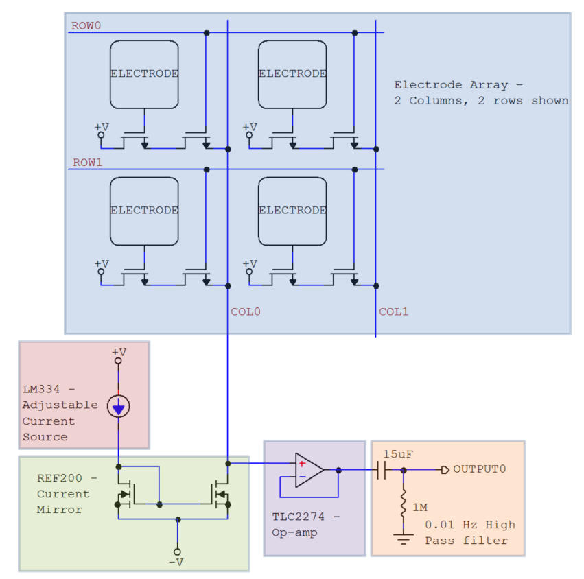
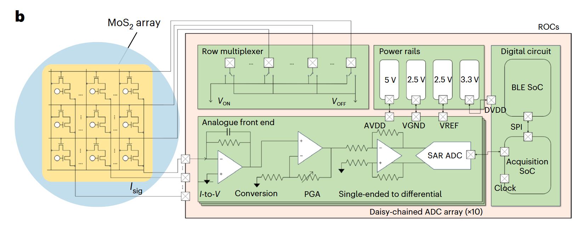
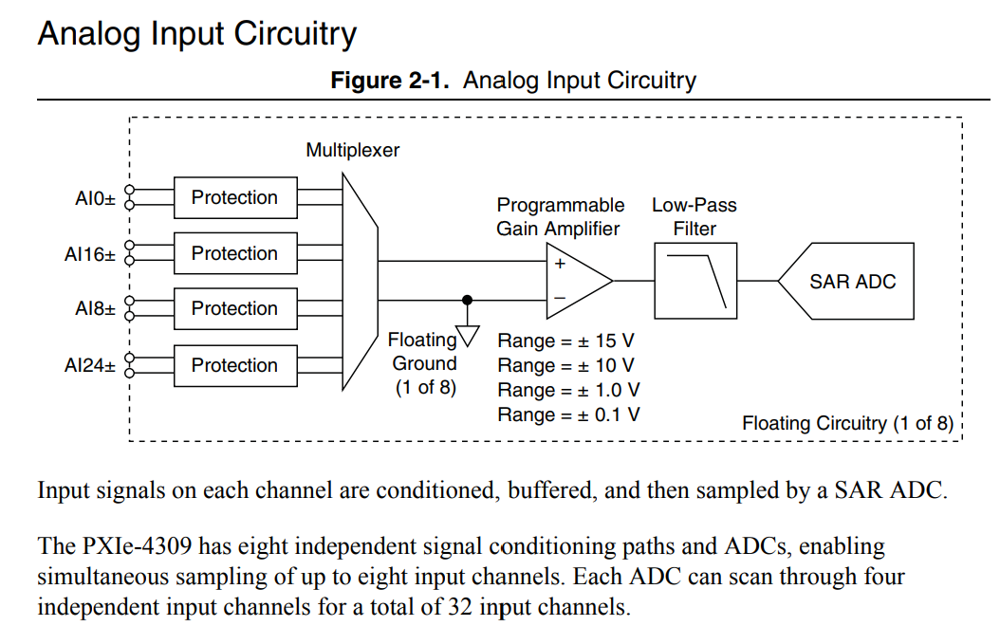
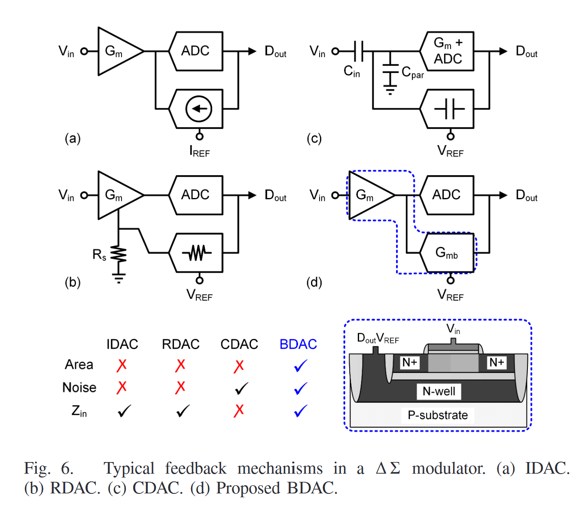
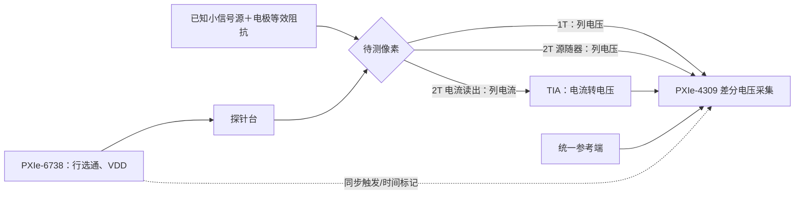

# task1017

## 1. 项目背景及当前进展

项目目标是构建高密度 TFT 电极阵列读出链路，在保留空间分辨率与有效采样率的同时，降低弱信号记录的输入等效噪声。前期已完成 1T 复用阵列及 NI PXIe-4309 采集链的搭建和体内外验证；当前待解决的主要问题是高阻列线的幅值衰减、噪声归因和空行残留，并判断两种 2T 方案能否带来系统级改善。项目脉络、现有数据和参考文献见 [TFT_introduction.md](TFT_introduction.md)。

目前有三种待统一比较的电路：1T 电压复用、2T 源极跟随电压读出、2T 漏极侧选通加跨阻放大器（TIA）的电流读出。现有 1T、2T 器件可用于台架连接测试；理论分析和仿真结果需要用实际器件参数与统一的测试条件核对。

### 三种电路示意

1T 电压复用：

<p align="center"></p>

2T 源极跟随电压读出：

<p align="center"></p>

2T 漏极侧选通加 TIA 电流读出：

<p align="center"></p>

## 2. 1013 讨论结果

- **当前 1T 方案：** 氧化物薄膜晶体管导通电阻为 20k，远高于一般金电极，会产生较大的热噪声。
- **两种 2T 方案：**
  - 电压采集＋传感晶体管在前：属于经典的 Source Follower（源极跟随器）电路，没有放大功能；TFT 电阻仍在串联回路中，没有解决噪声问题。
  - 电流采集＋传感晶体管在后：属于 Common Source（共源）接法，对电压进行跨导放大，放大倍数受到 TFT 电阻的限制。
- **电容耦合方案：** 加入电容后，DC 电压无法控制，这个电路本身可能是不成立的。讨论了依靠寄生电容稳定 DC 电压，以及在传感晶体管栅极上下各加一个晶体管、导通时作为大电阻的改进方案。
- **NeuroCam 的 DC 漂移：** 可协助设计 DCOC 电路解决。
- **后续计划：** 对电流采集的 2T 方案进行详细的噪声计算和仿真；根据实际尺寸评估电容耦合的可行性。

## 3. 1016 讨论结果

- **NI 板卡：** NI板卡内部为SAR ADC，信号在进入该ADC之前需要放大器。

  <p align="center"></p>

- **Huang（2022）方案：** Huang(2022)这篇文章中用的是 $\Delta \Sigma$ ADC，最终方案是不增加额外的放大器。

  <p align="center"></p>

- **增加低噪声放大器：** 在不改变后端板卡的前提下，可以考虑增加一个低噪声放大器。找到同时满足动态范围、噪声、采样率的采集板卡较为困难，找一个低噪声放大器相对简单。放大器的添加实际上不可能增加信噪比，只是在NI板卡噪声影响更为显著时，我们选择先放大进入板卡前的信号和噪声。
- **ADC 改进：** ADC能效比？ 增加功耗，可提高ADC精度，降低噪声。
- **2T 相比 1T 的优势：**
  - 阻抗问题：1T和2T电路，后端都连接到运放，电压跟随器和跨阻放大器的输入端均属于高阻节点（输入阻抗极大），对输出阻抗没有很高的要求。
  - 噪声问题：在计算噪声时，需要算输入等效噪声，2T（电流采集）尽管可以进行跨导放大，但等效噪声不会减小。

## 4. 接下来的任务

### 4.1 理论分析：三种电路的输入等效噪声与输出阻抗

统一定义电极小信号电压 $v_E$ 、电极界面阻抗 $Z_E(f)$ 、从电极到最终采集输出的传递函数 $H(f)$ ，以及目标频带 $[f_L,f_H]$ 。输入等效噪声谱与积分 RMS 分别为：

$$
S_{v,\mathrm{in}}(f)=\frac{S_{v,\mathrm{out}}(f)}{|H(f)|^2}
$$

$$
\sigma_{v,\mathrm{in}}=\sqrt{\int_{f_L}^{f_H}S_{v,\mathrm{in}}(f)\,df}
$$

计算输出阻抗时，明确测试端口，令独立输入小信号为零、移除外部负载，在端口注入测试源并求：

$$
Z_{\mathrm{out}}(f)=\frac{v_t}{i_t}
$$

| 电路 | 输入等效噪声计算项 | 输出阻抗与传输计算项 |
| --- | --- | --- |
| 1T 电压复用 | 电极界面、选通 TFT 热噪声与低频噪声、后端电压/电流噪声、ADC 噪声；按完整 $H_{1T}(f)$ 折回电极端 | $Z_E(f)$ 、$R_{\mathrm{on}}$ 、TFT 小信号参数、列线电容及后端负载；核算行切换后建立 |
| 2T 源极跟随 | 电极、传感管、选通管、偏置电流源、后端和 ADC 噪声；分别求各噪声源到输出的传递函数 | 栅极加载、源随器增益、选通管压降、列线电容、偏置源交流阻抗及输出摆幅 |
| 2T 电流读出＋TIA | 电极、两只 TFT、TIA 输入电压/电流噪声、反馈电阻、供电/偏置及 ADC 噪声；除以完整 $|H_{2T,\mathrm{TIA}}(f)|^2$ | 传感管有效跨导、漏极侧选通损失、像素自身输出阻抗、TIA 求和节点等效输入阻抗、反馈网络和稳定性 |

### 4.2 仿真分析：SmartSpice 验证与修正

使用 SmartSpice 分别仿真三种电路的工作点、传递函数、输出阻抗、输入等效噪声和行切换瞬态。将仿真结果与理论计算对照，对存在偏差的模型或公式进行修正。

### 4.3 实验：现有 1T、2T 器件接板卡测试

现有 1T 和 2T 器件连接板卡进行测试。行选通与 $V_{DD}$ 电压均由 PXIe-6738 输出，经探针台连接至器件；1T 测试只使用其中的行选通输出。PXIe-4309 采集电压；电流读出 2T 经 TIA 转换为电压后接入板卡。



**A. 1T 电压复用**

```text
信号源小信号 ── 电极/等效 Z_E ── 1T 漏极 D
                                     1T 栅极 G ← 探针台 ← PXIe-6738 行选通输出
                                     1T 源极 S ── COL ── PXIe-4309 AI+
信号源参考 / 电极参考 ─────────────────────────────────────────────────────── PXIe-4309 AI−
                               行选通时钟 ── 同步触发/时间标记 ── 采集记录
```

**B. 2T 源极跟随电压读出**

```text
信号源小信号 ── 电极/等效 Z_E ── 传感管 T_S 栅极 G
                                    T_S 漏极 D ← 探针台 ← PXIe-6738 VDD 输出
                                    T_S 源极 S ── 选通管 T_R ── COL ── PXIe-4309 AI+
                                                       T_R 栅极 ← 探针台 ← PXIe-6738 行选通输出
                                                COL ── 偏置电流汇 → 电源参考
信号源参考 / 电源参考 ───────────────────────────────────────────── PXIe-4309 AI−
```

**C. 2T 漏极侧选通＋TIA 电流读出**

```text
信号源小信号 ── 电极/等效 Z_E ── 传感管 T_S 栅极 G
                                    T_S 漏极 D ── 选通管 T_R ── 探针台 ── PXIe-6738 VDD 输出
                                                       T_R 栅极 ← 探针台 ← PXIe-6738 行选通输出
                                    T_S 源极 S ── COL ── TIA 反相求和节点（−）
                                                               ↑ 反馈 R_F∥C_F ← TIA 输出
参考 V_REF ─────────────────────────────────────── TIA 同相端（＋）
TIA 输出 ───────────────────────────────────────── PXIe-4309 AI+
V_REF ──────────────────────────────────────────── PXIe-4309 AI−
```

## 5. 其他实验（论文需要补充数据）

1. 多晶硅晶体管转移特性曲线
2. 多晶硅与 IGZO 晶体管阻抗特性曲线：

   （1）多晶硅器件为玻璃衬底，使用金刚石笔切割；IGZO 器件为柔性 PI 衬底，使用激光切割。

   （2）阻抗测量采用电化学工作站，三电极法。
