# 如何阅读文献

阅读顺序取决于对领域的熟悉程度。刚进入领域时，重点是建立背景；熟悉领域后，重点转向论文的创新和数据。以下两种读法都以理解 **results** 和图为核心。

## 刚进入领域时

1. **abstract**：先看研究问题、采用的方法和主要发现，了解论文的整体内容。
2. **introduction**：详细阅读研究背景、已有方法和本文要解决的问题。对不熟悉的概念，可选取其中引用的综述或代表性论文继续读。读完后，记下“已有方法是什么、还有什么问题、本文做了什么”。
3. **results**：按论文顺序阅读各幅图。先看图注、坐标和颜色，再结合正文理解每幅图的实验内容与结论。
4. **methods、discussion、supplementary information**：遇到实验条件、器件结构或分析方法的细节，回查相应部分。**discussion** 可用于了解作者如何总结结果；**supplementary information** 常包含正文未展开的测试和图表。

## 对领域较熟悉时

1. **abstract、introduction**：快速浏览背景，重点看作者提出的研究缺口、与已有论文的区别，以及本文的创新点。
2. **results**：重点阅读每一幅图。弄清实验输入、测量量、坐标、单位、颜色、数据处理和图对应的结论。正文的主要论点通常都能对应到一幅或几幅图。
3. **supplementary information**：结合正文引用的 Supplementary Figure 查器件性能、原始或单次记录、分析细节等。很多论文需要连同补充材料一起读。
4. **methods、discussion**：需要使用论文中的方法时，细读实验步骤和参数；需要梳理整篇论文的结论时，再看 **discussion**。

## 看图时记录什么

每幅图可以简要记四项：**图要回答的问题、各子图展示的内容、关键数值、对应结论**。对于热图，记录颜色代表什么；对于波形，记录时间和幅值单位；对于示意图，记录结构与信号流向。下面用一篇论文示范。

## 示例：Viventi 等（2011）的柔性高密度脑电极

Viventi et al., *Flexible, foldable, actively multiplexed, high-density electrode array for mapping brain activity in vivo*, **Nature Neuroscience** 14, 1599–1605 (2011)，DOI：[10.1038/nn.2973](https://doi.org/10.1038/nn.2973)。本文正文开头的背景部分没有单独标出 **introduction** 标题。

**abstract 与 introduction 的主线：**临床电极需要覆盖较大的脑表面，而精细的脑活动需要密集采样。传统被动电极为每个记录点单独布线，限制了阵列密度。作者把晶体管集成在柔性电极阵列中，通过主动多路复用减少输出线路，并在猫脑上测试其记录能力。

**results 的顺序：**Figure 1 介绍器件，Figure 2 交代实验放置方式，Figure 3–5 分别展示睡眠纺锤波、视觉诱发反应和癫痫样活动。

### Figure 1：器件结构与性能

<p align="center">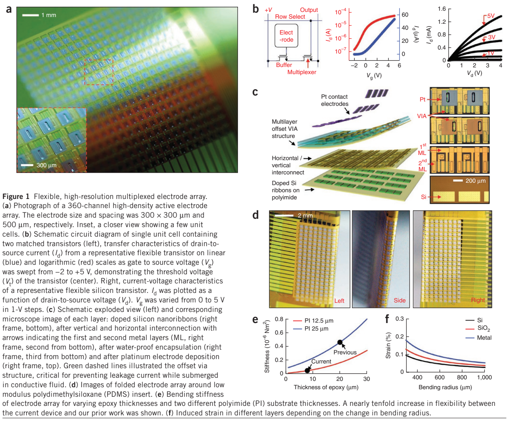</p>

*正文 PDF 第 2 页，Figure 1。*

- **a**：阵列照片及局部放大图。阵列有 360 个记录通道，电极尺寸为 300 × 300 µm，间距为 500 µm。
- **b**：一个单元使用两个晶体管。缓冲晶体管连接电极，多路复用晶体管使同一列电极共用输出线；旁边的曲线展示晶体管的电学特性。因此，正文所说的 720 个晶体管对应 360 个记录通道。
- **c**：硅纳米带、金属互连、封装层和铂电极的分层结构。错位的垂直连接结构用于阻隔导电液体造成的漏电。
- **d**：阵列折叠后的正面、侧面和背面照片。
- **e**：基底和封装层厚度与器件弯曲刚度的关系。减薄后，阵列的弯曲刚度降低。
- **f**：不同弯曲半径下，硅、二氧化硅和金属层的应变变化。

**结论：**主动多路复用实现了 360 通道的密集记录；薄层结构使阵列可以折叠。

### Figure 2：电极的放置方式

<p align="center">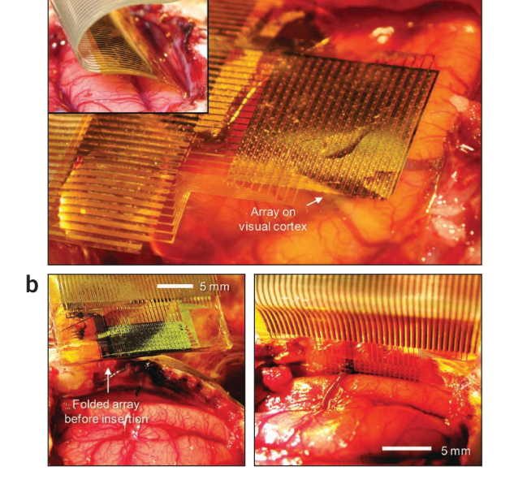</p>

*正文 PDF 第 3 页，Figure 2。*

- **a**：阵列放在猫视觉皮层表面的照片。
- **b**：左图是插入前的折叠阵列，右图是放入半球间裂的平铺阵列。

**结论：**柔性阵列既可放在皮层表面，也可进入半球间裂进行记录。

### Figure 3：睡眠纺锤波

<p align="center">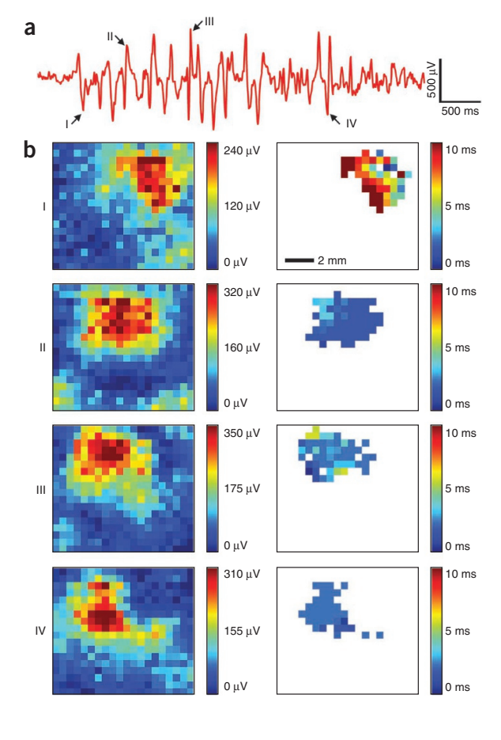</p>

*正文 PDF 第 3 页，Figure 3。*

- **a**：一个通道记录到的典型睡眠纺锤波，I–IV 标出其中四个波峰。
- **b**：每个波峰对应两类空间图。左列显示阵列上不同位置的信号强度，右列显示各通道到达峰值的相对时间。四个波峰的强响应集中在局部区域，峰值时间相近。

**结论：**该实验中的睡眠纺锤波分布在小于约 5 × 5 mm 的区域内，且参与区域的活动较为同步。

### Figure 4：视觉诱发反应

<p align="center">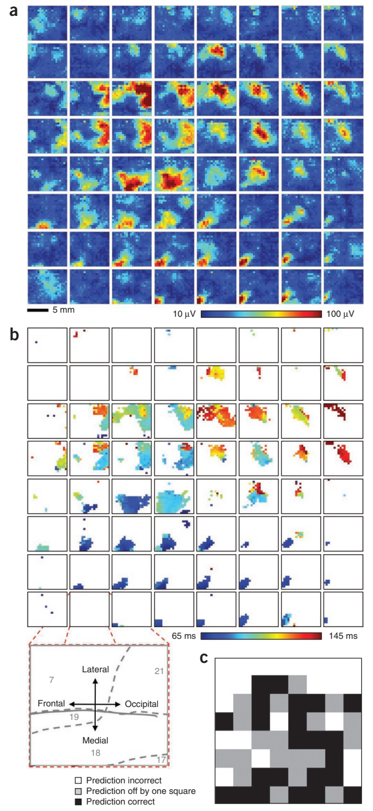</p>

*正文 PDF 第 4 页，Figure 4。*

- **a**：8 × 8 的大矩阵对应屏幕上 64 个闪光位置。每个小图都是整个 360 通道阵列的响应强度图：小图在大矩阵中的位置是刺激位置，小图内部的颜色是皮层响应的位置与强度。每个刺激位置重复 15 次，图中展示平均响应。
- **b**：同一批数据的响应延迟图，显示强响应通道的峰值时间；下方示意图标出阵列相对于脑区的方向。
- **c**：用电极记录预测闪光位置。64 个位置中，23 个被准确预测，42 个被预测在正确位置或相邻位置。

**结论：**不同视觉刺激位置对应不同的皮层响应分布，阵列记录可用于区分刺激位置。

### Figure 5：癫痫样活动的空间传播

<p align="center">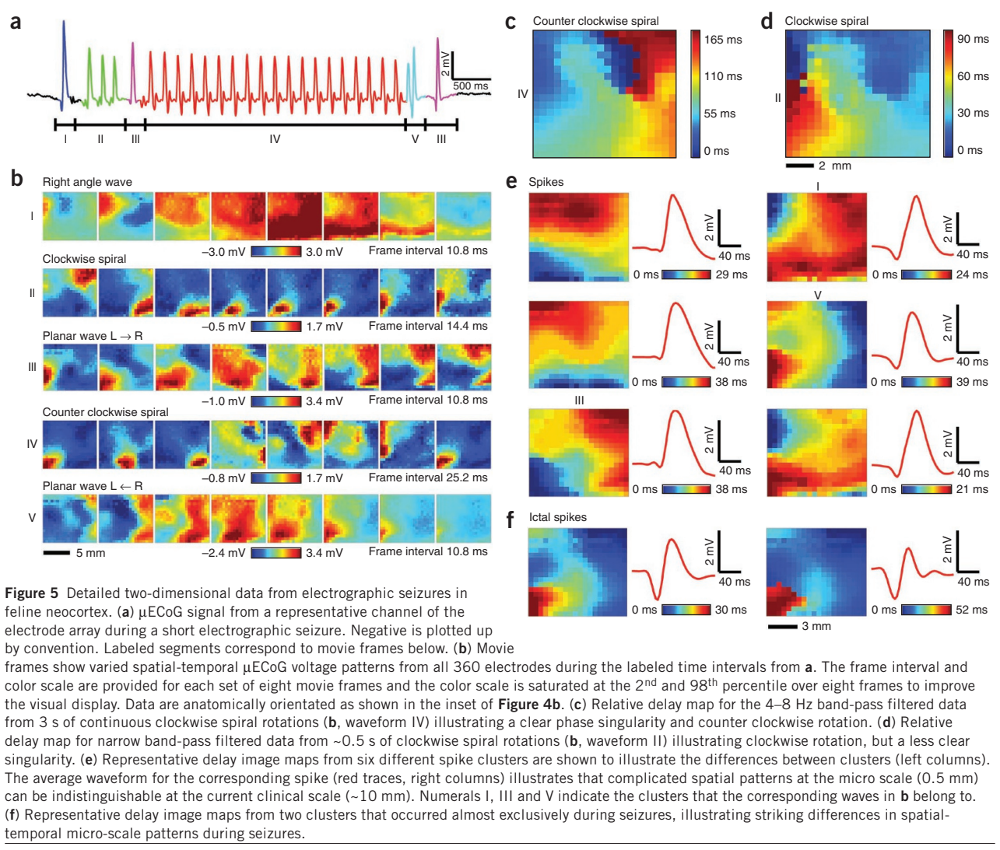</p>

*正文 PDF 第 5 页，Figure 5。*

- **a**：药物诱发的电图癫痫发作在一个通道上的波形；标记 I–V 对应下方的空间图序列。
- **b**：连续时间帧显示不同传播模式，包括平面波、顺时针旋转和逆时针旋转。每一行有自己的颜色范围和帧间隔，读图时分别对照行内标注。
- **c**：相关频段信号的通道间相对延迟图，呈现逆时针旋转的空间模式。
- **d**：另一段旋转活动的相对延迟图，呈现顺时针旋转的空间模式。
- **e**：六类放电事件的相对延迟图及平均波形。波形相近的事件可具有不同的空间传播模式。
- **f**：主要出现在发作期的两类放电模式。

**结论：**高密度阵列记录到该猫脑模型中的平面波和旋转传播，并区分出不同的空间放电模式。

## 这篇论文的 supplementary information

补充材料共包含 27 幅 Supplementary Figure。下面选出与正文器件性能、视觉反应和空间传播直接相关的几幅。

### Supplementary Figure 1：制作过程与剖面

<p align="center">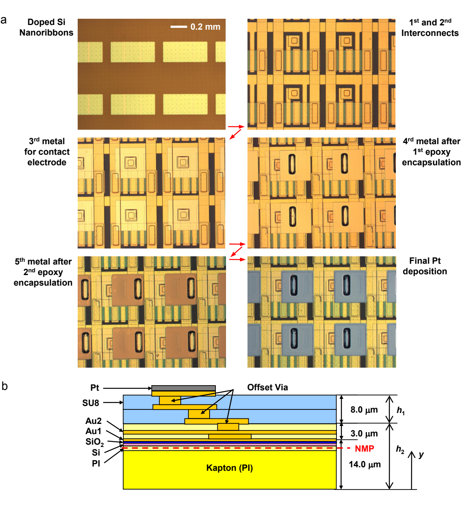</p>

*补充 PDF 第 4 页，Supplementary Figure 1。*

- **a**：依次展示硅纳米带、金属互连、封装和铂电极形成后的显微照片。
- **b**：标出器件各层及中性机械面的位置。

**对应结论：**Figure 1 中的柔性、互连与防漏电设计有具体的层次结构。

### Supplementary Figure 27：通道响应分布

<p align="center">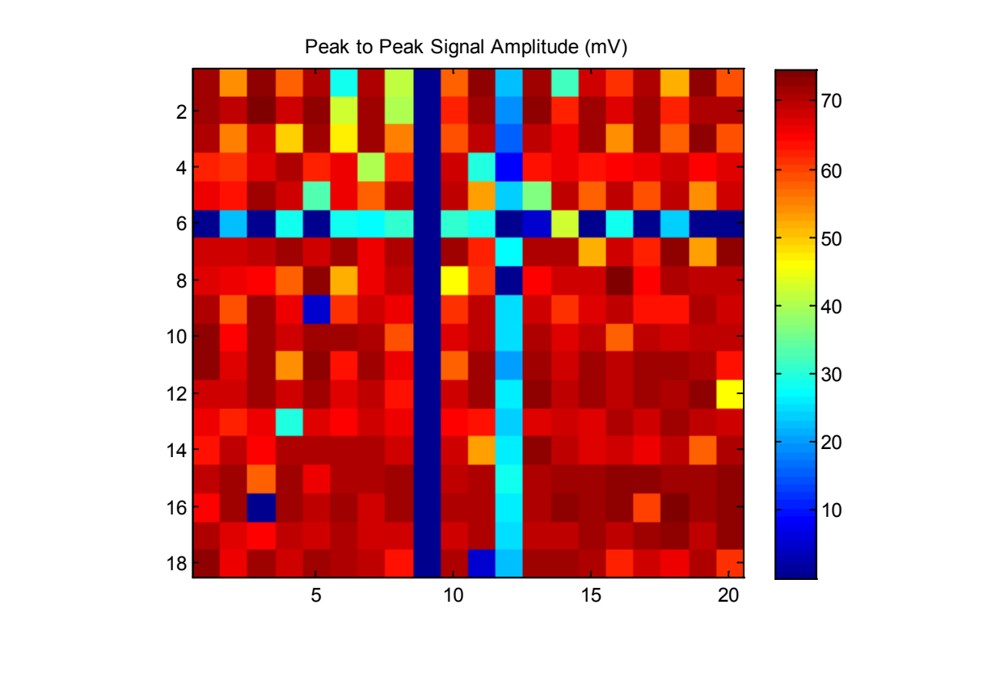</p>

*补充 PDF 第 30 页，Supplementary Figure 27。*

作者把阵列放在盐水中，用 100 mV 峰峰值、3.14 Hz 的正弦信号测试通道响应。热图显示多数通道的响应幅值接近，也有低响应的行列。**online methods** 报告该阵列约 83% 的通道可工作；对不可用通道，作者在后续分析中使用邻域插值。**对应结论：**阵列大部分通道具有相近的响应，后续空间图包含对不可用通道的插值处理。

### Supplementary Figure 26：折叠插入的力学模型

<p align="center">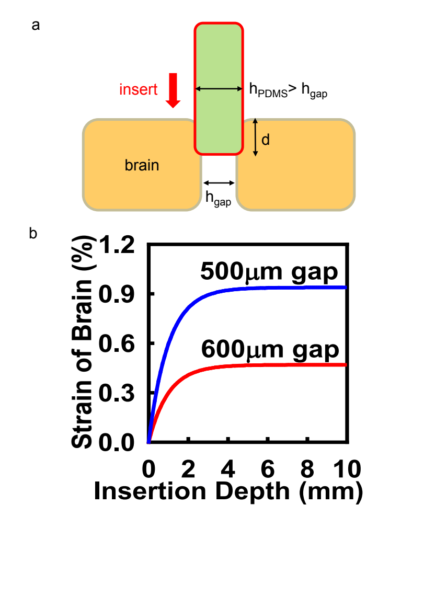</p>

*补充 PDF 第 29 页，Supplementary Figure 26。*

- **a**：定义插入深度和两侧间隙。
- **b**：给出 500 µm 与 600 µm 间隙下，模型计算的脑组织应变随插入深度的变化。

**对应结论：**在该模型中，间隙较窄时插入造成的应变较高。

### Supplementary Figure 2：单次视觉反应

<p align="center">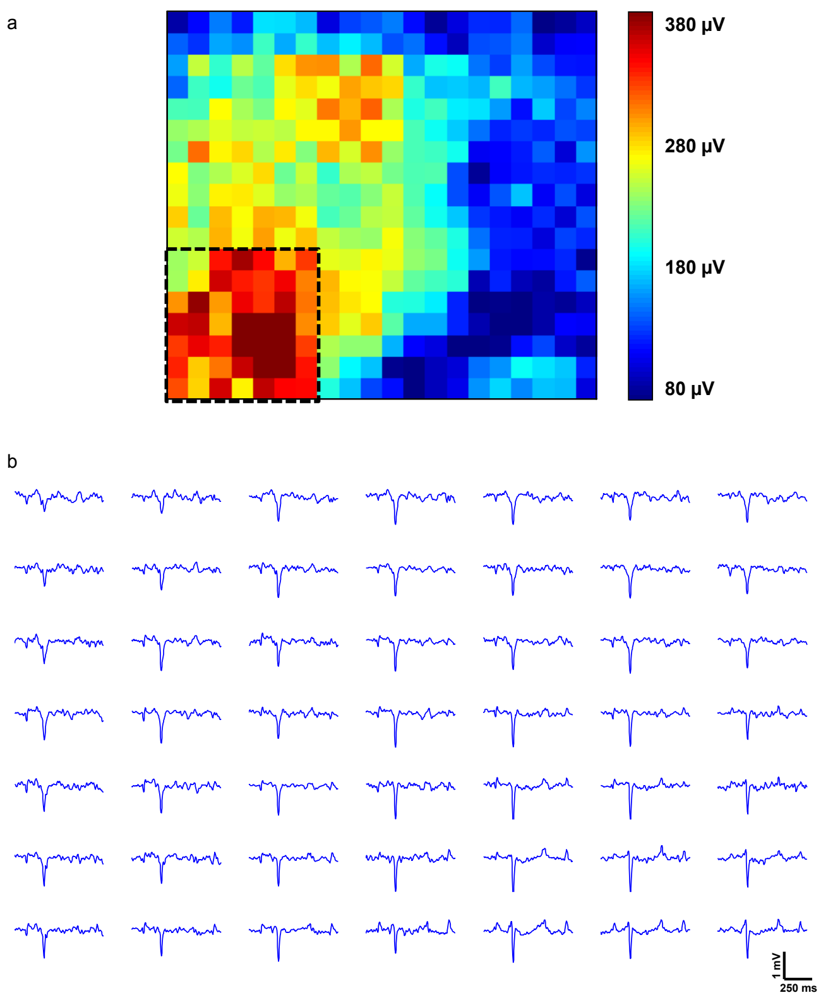</p>

*补充 PDF 第 5 页，Supplementary Figure 2。*

- **a**：一次漂移光栅刺激后的阵列响应分布。
- **b**：虚线框内 49 个电极的单次波形。

**对应结论：**一次刺激即可在多个相邻电极上记录到有空间分布的视觉诱发反应。Figure 4 使用的是另一组闪光位置刺激及多次试验平均。

### Supplementary Figure 3：旋转传播片段的频谱

<p align="center">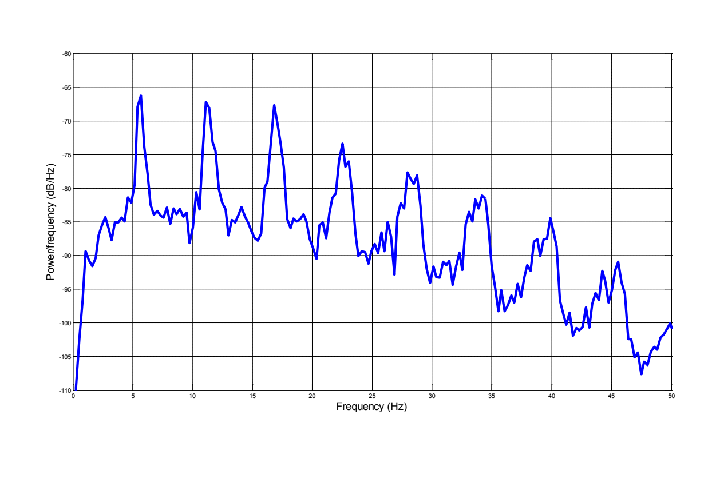</p>

*补充 PDF 第 6 页，Supplementary Figure 3。*

频谱的主要峰值在约 6 Hz，正文 Figure 5 对旋转传播片段的分析使用了邻近的频段。**对应结论：**该片段以约 6 Hz 的节律为主。

### Supplementary Figure 13：放电簇中的空间模式

<p align="center">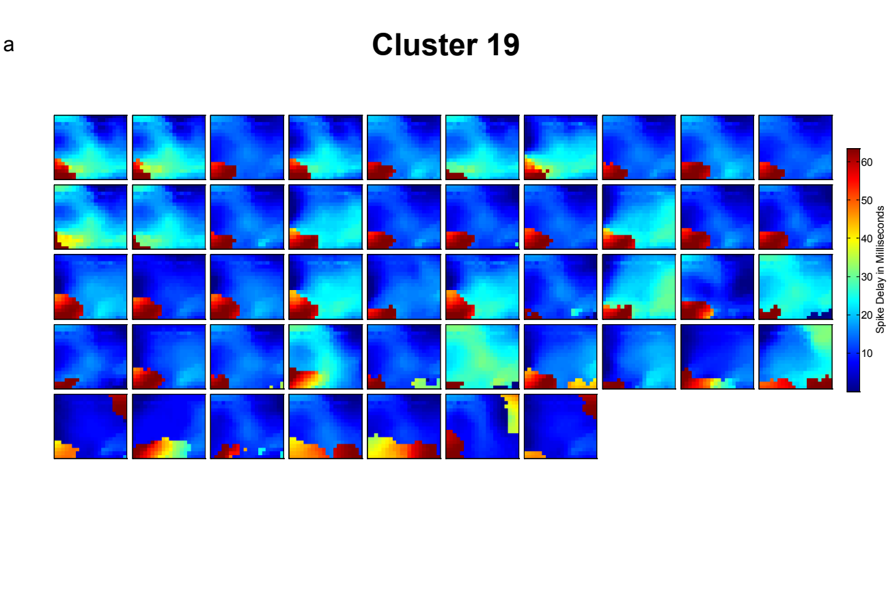</p>

<p align="center">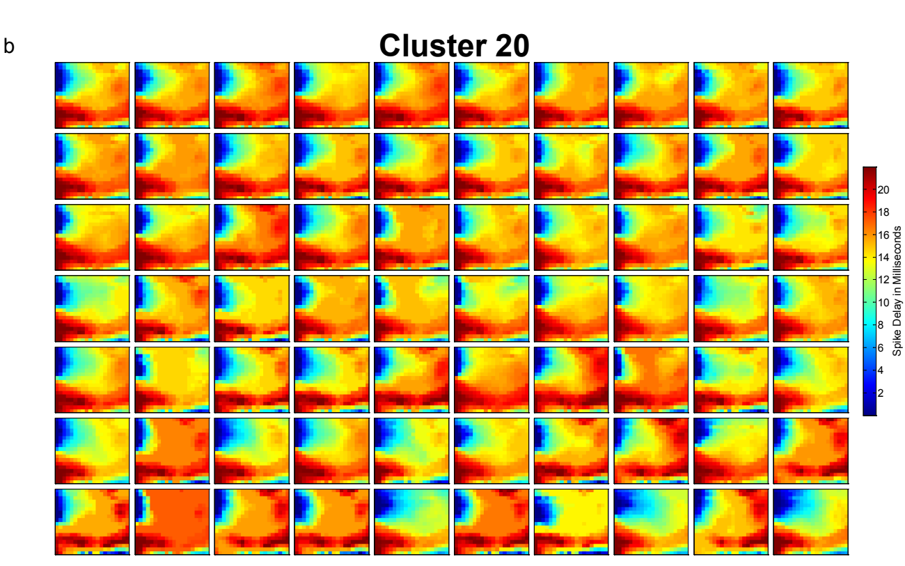</p>

*补充 PDF 第 16 页，Supplementary Figure 13。*

- **a（Cluster 19）**：每个小方块代表一次放电事件的空间延迟图；这一簇的事件主要出现在发作期。
- **b（Cluster 20）**：同一簇内的延迟图呈现相近形态；这一簇的事件分布在整段记录中。

**对应结论：**两簇呈现不同且可重复观察到的空间传播模式，对应 Figure 5 的放电聚类结果。

## 阅读记录

读完一篇论文，可以留下几项信息，方便以后回查：

```text
研究问题：
introduction 中提出的研究缺口：
本文的主要方法和创新：
results 中最关键的 Figure 及其结论：
需要进一步查看的 methods、supplementary information 或 references：
```
